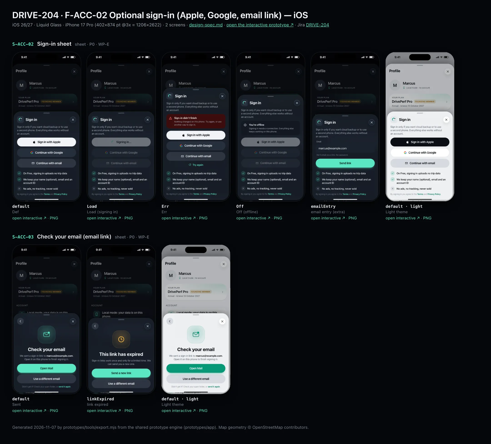
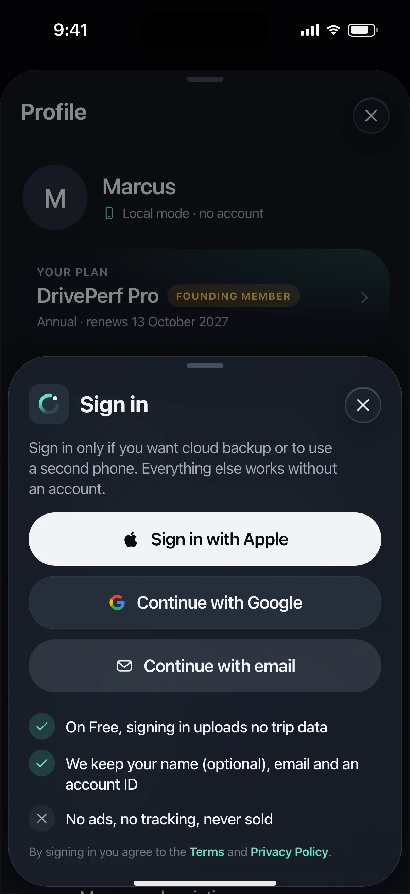
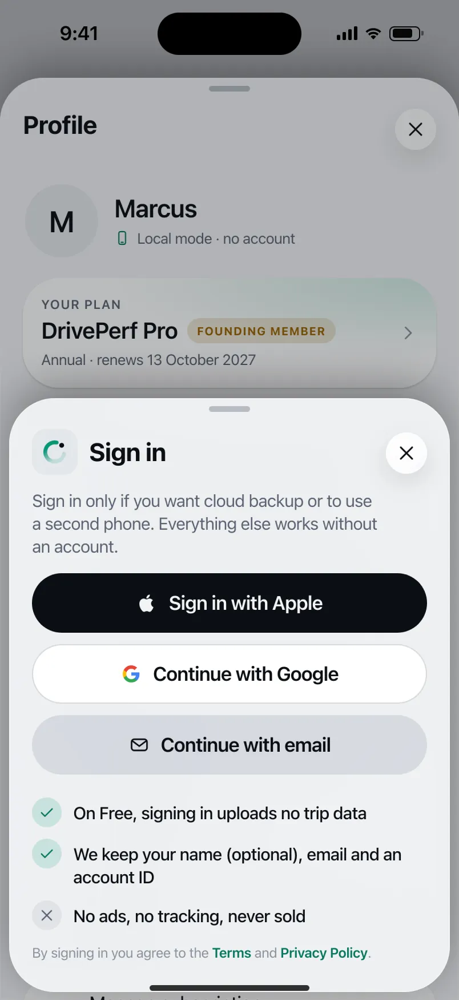
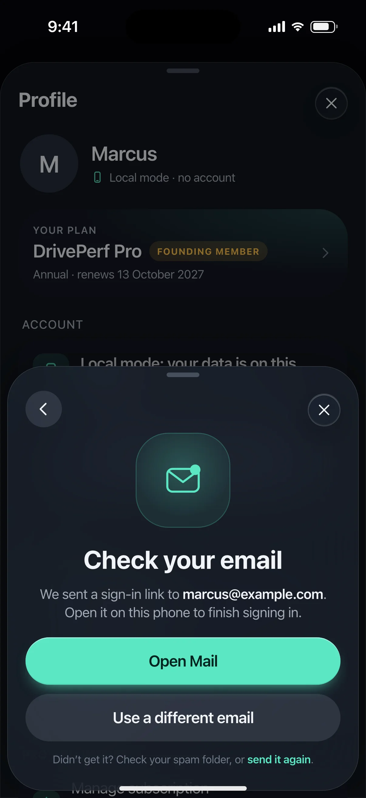
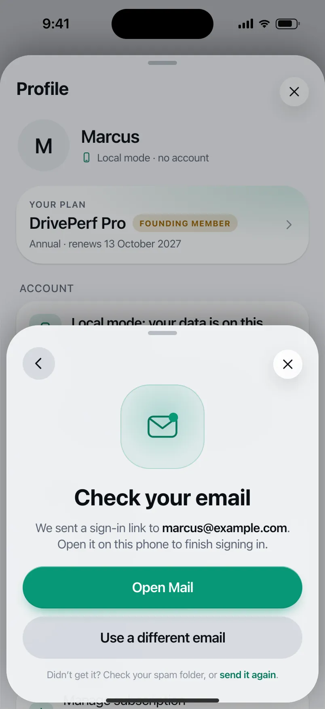

# DRIVE-204 · F-ACC-02 Optional sign-in (Apple, Google, email link) — iOS design spec

> Generated by `prototypes/tools/export.mjs` on 2026-11-06 from the shared prototype engine. **Do not edit by hand:** change the screen's `spec` in `prototypes/app/screens/wp-*.js` (see `prototypes/app/AUTHORING.md`) and re-export.

- **Jira story:** [DRIVE-204](https://thekeval.atlassian.net/browse/DRIVE-204) · F-ACC-02 · P0
- **Platform:** iOS 26/27 · Liquid Glass · iPhone 17 Pro (402×874 pt @3x = 1206×2622)
- **Interactive prototype:** [../../../../prototypes/ios/index.html#S-ACC-02](../../../../prototypes/ios/index.html#S-ACC-02) (catalog panel: every screen and state; deep links `#S-ID/state?trip=…&ent=…&theme=light&text=xl&rm=1`)
- **Contact sheet:** [mockup.html](mockup.html) · 
- **Design system (source of truth for values):** [brand](../../system/brand.md) · [components](../../system/components.md) · [motion](../../system/motion.md) · [accessibility](../../system/accessibility.md) · [screen map](../../system/screen-map.md) · [fixtures](../../system/fixtures.md) · tokens `prototypes/shared/tokens.css`

## Screens in this story

| Screen | Name | Presentation | Priority | States | Status |
|---|---|---|---|---|---|
| `S-ACC-02` | Sign-in sheet | Sheet (medium) | P0 | 5 | Prototyped |
| `S-ACC-03` | Check your email (email link) | Push in sheet | P0 | 2 | Prototyped |

## Tokens used on this platform

Values resolved from `prototypes/shared/tokens.css` inside the iOS device (`[data-platform="ios"]`). Use the token names in code; the hex values are for reference.

| Token | Dark | Light |
|---|---|---|
| `--app-bg` | `#080B10` | `#F2F3F6` |
| `--card-bg` | `#131822` | `#FFFFFF` |
| `--dp-bg-grouped` | `#080B10` | `#F2F3F6` |
| `--dp-surface` | `#131822` | `#FFFFFF` |
| `--dp-surface-2` | `#1B222D` | `#F2F3F6` |
| `--dp-surface-3` | `#262E3B` | `#E4E7EC` |
| `--dp-fill` | `#7880961F` | `#7880961F` |
| `--dp-fill-strong` | `#7880963D` | `#78809633` |
| `--dp-text` | `#F2F4F7` | `#0B0E13` |
| `--dp-text-2` | `#A3AAB6` | `#5A6271` |
| `--dp-text-3` | `#6E7787` | `#8A919D` |
| `--dp-separator` | `#96A0B429` | `#3C435024` |
| `--dp-accent` | `#5BE7C4` | `#079777` |
| `--dp-accent-text` | `#5BE7C4` | `#06775E` |
| `--dp-on-accent` | `#04241D` | `#FFFFFF` |
| `--dp-accent-container` | `#0A4439` | `#C6F8EA` |
| `--dp-record` | `#FFC24B` | `#9A6300` |
| `--dp-positive` | `#5BE7C4` | `#06775E` |
| `--dp-change-down` | `#A3AAB6` | `#5A6271` |
| `--dp-warning` | `#F5B648` | `#9A5F00` |
| `--dp-critical` | `#FF6B6B` | `#C62828` |
| `--dp-glass-fill` | `#1C222C6B` | `#FFFFFF8C` |
| `--dp-glass-fill-strong` | `#1C222CB8` | `#FFFFFFD1` |
| `--dp-glass-stroke` | `#FFFFFF24` | `#FFFFFF99` |
| `--dp-data-route` | `#5BE7C4` | `#079777` |
| `--dp-data-event-brake` | `#FF7A66` | `#A21F16` |
| `--dp-data-event-accel` | `#E58BD0` | `#A33A8C` |
| `--dp-data-event-corner` | `#EAD54E` | `#9A8A00` |
| `--dp-data-quality-good` | `#5FDB9C` | `#1E9E62` |
| `--dp-data-speed` | `#D6DCE4` | `#404A58` |
| `--dp-data-long-g` | `#5AB8F5` | `#0A6AB8` |
| `--dp-data-lat-g` | `#F5A142` | `#B25A00` |

| Type / layout token | Value |
|---|---|
| `--dp-font-screen-title` | `700 34px / 41px -apple-system, BlinkMacSystemFont, "SF Pro Display", system-ui, sans-serif` |
| `--dp-font-sheet-title` | `700 22px / 28px -apple-system, BlinkMacSystemFont, "SF Pro Display", system-ui, sans-serif` |
| `--dp-font-section-title` | `600 20px / 25px -apple-system, BlinkMacSystemFont, "SF Pro Display", system-ui, sans-serif` |
| `--dp-font-card-title` | `600 17px / 22px -apple-system, BlinkMacSystemFont, "SF Pro Text", system-ui, sans-serif` |
| `--dp-font-body` | `400 17px / 22px -apple-system, BlinkMacSystemFont, "SF Pro Text", system-ui, sans-serif` |
| `--dp-font-body-secondary` | `400 15px / 20px -apple-system, BlinkMacSystemFont, "SF Pro Text", system-ui, sans-serif` |
| `--dp-font-meta` | `400 13px / 18px -apple-system, BlinkMacSystemFont, "SF Pro Text", system-ui, sans-serif` |
| `--dp-font-caption` | `400 12px / 16px -apple-system, BlinkMacSystemFont, "SF Pro Text", system-ui, sans-serif` |
| `--dp-font-button` | `600 17px / 22px -apple-system, BlinkMacSystemFont, "SF Pro Text", system-ui, sans-serif` |
| `--dp-num-hero` | `600 72px / 72px -apple-system, BlinkMacSystemFont, "SF Pro Display", system-ui, sans-serif` |
| `--dp-num-xl` | `600 48px / 52px -apple-system, BlinkMacSystemFont, "SF Pro Display", system-ui, sans-serif` |
| `--dp-num-l` | `600 34px / 38px -apple-system, BlinkMacSystemFont, "SF Pro Display", system-ui, sans-serif` |
| `--dp-num-m` | `600 24px / 28px -apple-system, BlinkMacSystemFont, "SF Pro Display", system-ui, sans-serif` |
| `--dp-num-s` | `600 17px / 22px -apple-system, BlinkMacSystemFont, "SF Pro Display", system-ui, sans-serif` |
| `--dp-num-xs` | `600 13px / 16px -apple-system, BlinkMacSystemFont, "SF Pro Display", system-ui, sans-serif` |
| `--dp-screen-margin` | `16px` |
| `--dp-radius-card` | `24px` |
| `--dp-radius-card-hero` | `32px` |
| `--dp-radius-sheet` | `38px` |
| `--dp-radius-chip` | `999px` |
| `--dp-radius-button` | `999px` |
| `--dp-layout-list-row-min` | `52px` |
| `--dp-layout-touch-min` | `44px` |
| `--safe-top` | `62px` |
| `--safe-bottom` | `34px` |

Text sizes scale with `--dp-text-scale` (XL = 2.0×) and numerals with `--dp-num-scale` (XL = 1.3×). DP Numerals: SF Pro Expanded Semibold, tabular.

---

## S-ACC-02 · Sign-in sheet

 

- **Presentation:** sheet · tab: profile · detent: auto — screen map: “Sheet (medium)”
- **Entry points:** S-ACC-01 · S-ACC-04 (backup needs sign-in) · S-PRV-06 re-auth
- **Leads to:** S-ACC-03 (email) · S-ACC-05 (first backup) · back
- **PRD features:** F-ACC-02 · **Priority:** P0 · **WP:** E
- **Interactive:** [S-ACC-02](../../../../prototypes/ios/index.html#S-ACC-02)

**Purpose.** Optional sign-in with Apple, Google or an email link (F-ACC-02), only for cloud backup and a second phone. It says plainly that a Free sign-in uploads no trip data. Also used for re-authentication before account deletion (S-PRV-06).

### States

| State | PRD label | Fixture params | Screenshot |
|---|---|---|---|
| `default` | Def | — | [S-ACC-02.png](../../screens/ios/S-ACC-02.webp) · [open](../../../../prototypes/ios/index.html#S-ACC-02) |
| `Load` | Load (signing in) | — | [S-ACC-02--Load.png](../../screens/ios/S-ACC-02--Load.webp) · [open](../../../../prototypes/ios/index.html#S-ACC-02/Load) |
| `Err` | Err | — | [S-ACC-02--Err.png](../../screens/ios/S-ACC-02--Err.webp) · [open](../../../../prototypes/ios/index.html#S-ACC-02/Err) |
| `Off` | Off (offline) | — | [S-ACC-02--Off.png](../../screens/ios/S-ACC-02--Off.webp) · [open](../../../../prototypes/ios/index.html#S-ACC-02/Off) |
| `emailEntry` | email entry (extra) | — | [S-ACC-02--emailEntry.png](../../screens/ios/S-ACC-02--emailEntry.webp) · [open](../../../../prototypes/ios/index.html#S-ACC-02/emailEntry) |
| default · light | Light theme | `theme=light` | [S-ACC-02--light.png](../../screens/ios/S-ACC-02--light.webp) |

Every state also renders in light/dark (`theme=light`), XL text (`text=xl`) and reduced motion (`rm=1`).

### Layout

- Sheet fitted to content (iOS partial detent, glass · Android ModalBottomSheet). Header: Loop mark in a 40 tile + title “Sign in” (“Sign in to back up” from S-ACC-04 · “Confirm it’s you” for re-auth) + close (iOS).
- Lead (body-secondary, text-2). Optional banner (Err critical / Off info).
- Provider buttons, 52 pt / 56 dp tall, radius capsule (iOS) / full (Android), full width, 10 apart: iOS order Apple (white on dark, black on light, per HIG) · Google (surface with the four-colour G) · email (tonal, envelope). Android order Google · Apple (web flow) · email.
- Email entry (after “Continue with email”): text field “Email” (iOS rounded field · Android OutlinedTextField) with helper “We’ll email you a link. No password.” + filled “Send link”.
- Checklist: ✓ On Free, signing in uploads no trip data · ✓ We keep your name (optional), email and an account ID · ✕ No ads, no tracking, never sold. Footnote with Terms and Privacy Policy links.
- Load: the tapped provider button shows the loader + “Signing in…”, the rest are disabled (38%).

### Components & tokens

| Component | Tokens / spec |
|---|---|
| `sheetHeader` | see components.md |
| `banner` | radius 12 (--dp-radius-sm+) · info --dp-fill · attention --dp-warning-container · critical --dp-critical-container · components.md §22 |
| `textField` | see components.md |
| `button` | --dp-accent / --dp-on-accent (filled) · --dp-fill-strong · --md-sys-color-secondary-container (tonal) · --dp-radius-button · height iOS 50/44/34 · Android 56/40/32 · --dp-font-button · components.md §0 |
| `loader` | see components.md |
| `sheet` | iOS glass --dp-glass-fill-strong + --dp-glass-prominent-blur, radius --dp-radius-sheet 38 · Android ModalBottomSheet --md-sys-color-surface-container-low, top radius 28, drag handle 32×4 · motion spring.sheet |

### Interactions & navigation

- Sign in with Apple → native ASAuthorization sheet (iOS) / web flow (Android) → signed in: back to the caller + toast “Signed in with Apple. No trip data is uploaded unless you turn on backup.” From S-ACC-04 (next = backup) → S-ACC-05 consent. Re-auth → back to S-PRV-06 summary.
- Continue with Google → Credential Manager / Google Sign-In → same as above.
- Continue with email → email field → Send link → S-ACC-03 (pushed inside the sheet).
- Err: “Try again” → default. Off: buttons disabled; the sheet stays open.
- On success the purchase identity is linked (RevenueCat app user ID = Firebase UID) so Pro follows the account.

### Motion

- Provider buttons rise 8 px, 40 ms stagger, spring.default. Loader: iOS Loop / Android M3E shape morph. RM: fades; static loader.

### Accessibility

- Buttons are labelled exactly as shown (“Sign in with Apple”). Loading announces “Signing in”. The banner is a status region.
- XL: the sheet opens at the large detent; button labels wrap to two lines rather than truncating.

### Platform notes

- **iOS (this spec):** SignInWithAppleButton (style white on dark / black on light) first, then Google; glass sheet at a partial detent.
- *Android (for reference):* Credential Manager “Sign in with Google” first; Apple through the web flow (Custom Tab); ModalBottomSheet.

### Analytics

- `sign_in_started {method}`
- `sign_in_completed {method}`
- `sign_in_failed {method, reason}`

### Copy

| Key | Text |
|---|---|
| Title | Sign in · Sign in to back up · Confirm it’s you |
| Lead | Sign in only if you want cloud backup or to use a second phone. Everything else works without an account. |
| Re-auth lead | Sign in again to delete your account. This keeps anyone else from deleting it. |
| Err | Sign-in didn’t finish. Nothing changed on this phone. Try again, or use another way to sign in. |
| Off | You’re offline. Signing in needs a connection. Everything else keeps working on this phone. |
| Promise | On Free, signing in uploads no trip data · We keep your name (optional), email and an account ID · No ads, no tracking, never sold |

### Free / Pro

Free for everyone. Pro users can then turn on backup (S-ACC-05). Free users who sign in upload nothing.

### Data & fixtures

No account fixture exists; the email field uses the test value marcus@example.com.

### Assets

[icon-bell.svg](assets/icon-bell.svg) · [icon-refresh.svg](assets/icon-refresh.svg) · [icon-check.svg](assets/icon-check.svg) · [icon-close.svg](assets/icon-close.svg) · [icon-gps.svg](assets/icon-gps.svg) · [logo-a-loop.svg](assets/logo-a-loop.svg)

UI glyphs may be swapped for SF Symbols / Material Symbols Rounded equivalents; event-pin, quality and provenance glyphs must not be (components.md global rules).

### Checklist (accessibility.md §9)

- [ ] Light and dark both render, and contrast passes.
- [ ] The XL text state reflows with no truncation.
- [ ] The RM state is defined.
- [ ] Every control has a label; every chart and map has a summary sentence.
- [ ] Every target ≥ 44 pt / 48 dp (≥ 64 in-drive).
- [ ] No meaning by colour alone.
- [ ] Speed is neutral wherever it appears and absent from social or live surfaces.
- [ ] No streak, leaderboard, speed or “beat your time” language.
- [ ] Behaviour is defined while a trip is active (D1 gate).
- [ ] Haptics come from motion.md §6 only.

---

## S-ACC-03 · Check your email (email link)

 

- **Presentation:** sheet · tab: profile · detent: auto — screen map: “Push in sheet”
- **Entry points:** S-ACC-02 email
- **Leads to:** Universal/App link → signed in
- **PRD features:** F-ACC-02 · **Priority:** P0 · **WP:** E
- **Interactive:** [S-ACC-03](../../../../prototypes/ios/index.html#S-ACC-03)

**Purpose.** Confirms that an email sign-in link was sent and that it signs the user in on this same phone (F-ACC-02.2), with recovery when the link has expired.

### States

| State | PRD label | Fixture params | Screenshot |
|---|---|---|---|
| `default` | Sent | — | [S-ACC-03.png](../../screens/ios/S-ACC-03.webp) · [open](../../../../prototypes/ios/index.html#S-ACC-03) |
| `linkExpired` | link expired | — | [S-ACC-03--linkExpired.png](../../screens/ios/S-ACC-03--linkExpired.webp) · [open](../../../../prototypes/ios/index.html#S-ACC-03/linkExpired) |
| default · light | Light theme | `theme=light` | [S-ACC-03--light.png](../../screens/ios/S-ACC-03--light.webp) |

Every state also renders in light/dark (`theme=light`), XL text (`text=xl`) and reduced motion (`rm=1`).

### Layout

- Pushed inside the sign-in sheet (NavigationStack in the sheet on iOS; in-sheet navigation on Android). The prototype renders it as the sheet’s next page: leading back chevron (iOS) / arrow (Android), no title in the bar.
- Illustration 104 (envelope with a Glide dot; expired = clock on a warning halo). Title (28/34 display) + lead with the address in bold.
- Buttons stacked, full width, 52 pt / 56 dp: “Open Mail” / “Open email app” (filled) · “Use a different email” (tonal). Expired: “Send a new link” (filled) · “Use a different email”.
- Footnote: “Didn’t get it? Check your spam folder, or send it again.”

### Components & tokens

| Component | Tokens / spec |
|---|---|
| `sheetHeader` | see components.md |
| `button` | --dp-accent / --dp-on-accent (filled) · --dp-fill-strong · --md-sys-color-secondary-container (tonal) · --dp-radius-button · height iOS 50/44/34 · Android 56/40/32 · --dp-font-button · components.md §0 |
| `sheet` | iOS glass --dp-glass-fill-strong + --dp-glass-prominent-blur, radius --dp-radius-sheet 38 · Android ModalBottomSheet --md-sys-color-surface-container-low, top radius 28, drag handle 32×4 · motion spring.sheet |

### Interactions & navigation

- Back / “Use a different email” → S-ACC-02 with the email field open.
- Open Mail → the mail app (mailto: / ACTION_MAIN CATEGORY_APP_EMAIL).
- Send it again / Send a new link → toast “New link sent to …”.
- Opening the link (Universal Link / App Link on the Firebase Hosting domain) signs in and returns to the caller.

### Motion

- Envelope pops (scale .86 → 1); text and buttons rise 8 px, 40 ms stagger. RM: fade.

### Accessibility

- Focus lands on the title. The address is read in full. XL: the sheet opens large; buttons wrap.

### Platform notes

- **iOS (this spec):** Pushed in the sheet’s NavigationStack with a back chevron; “Open Mail”.
- *Android (for reference):* In-sheet destination with the back arrow and predictive back; “Open email app”.

### Analytics

- `sign_in_link_sent`
- `sign_in_link_resent`
- `sign_in_link_expired`

### Copy

| Key | Text |
|---|---|
| Sent | Check your email. We sent a sign-in link to {email}. Open it on this phone to finish signing in. |
| Expired | This link has expired. Sign-in links work once and only for a limited time. We can send you a new one. |
| Footnote | Didn’t get it? Check your spam folder, or send it again. |

### Free / Pro

Free.

### Data & fixtures

Test email marcus@example.com (no account fixture). Link lifetime is set by A17 (Firebase email-link settings); the copy avoids a number until it is confirmed.

### Assets

[icon-chevronLeft.svg](assets/icon-chevronLeft.svg) · [icon-arrowBack.svg](assets/icon-arrowBack.svg) · [icon-bell.svg](assets/icon-bell.svg) · [icon-clock.svg](assets/icon-clock.svg)

UI glyphs may be swapped for SF Symbols / Material Symbols Rounded equivalents; event-pin, quality and provenance glyphs must not be (components.md global rules).

### Checklist (accessibility.md §9)

- [ ] Light and dark both render, and contrast passes.
- [ ] The XL text state reflows with no truncation.
- [ ] The RM state is defined.
- [ ] Every control has a label; every chart and map has a summary sentence.
- [ ] Every target ≥ 44 pt / 48 dp (≥ 64 in-drive).
- [ ] No meaning by colour alone.
- [ ] Speed is neutral wherever it appears and absent from social or live surfaces.
- [ ] No streak, leaderboard, speed or “beat your time” language.
- [ ] Behaviour is defined while a trip is active (D1 gate).
- [ ] Haptics come from motion.md §6 only.

---

Map geometry in the prototype: © OpenStreetMap contributors (ODbL). Speed and G are simulated fixtures (fixtures.md).
