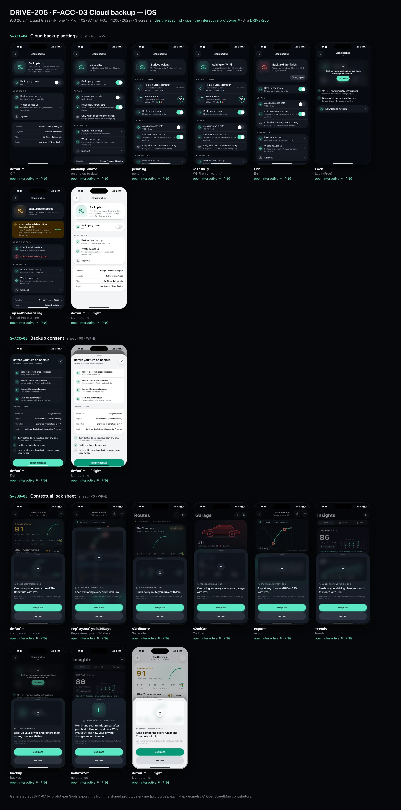
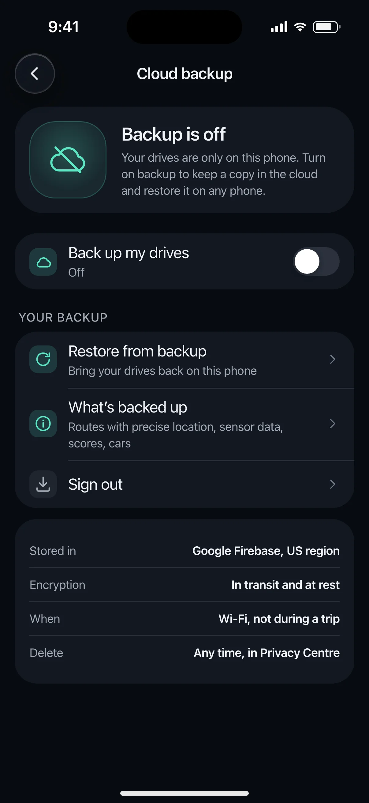
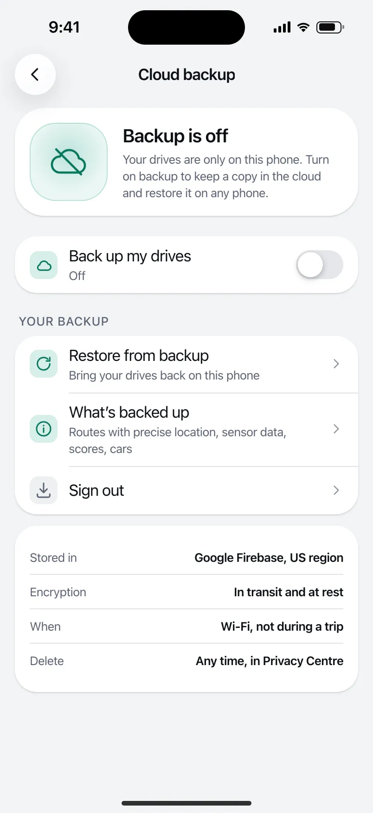
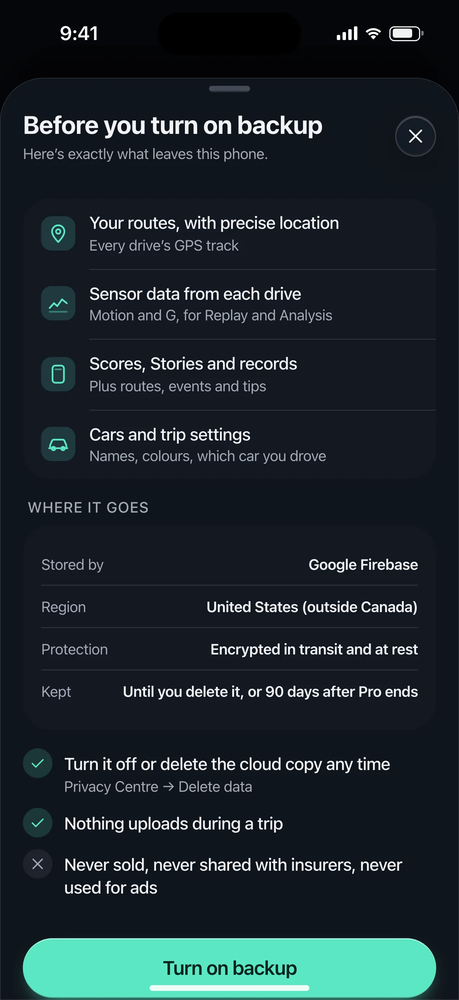
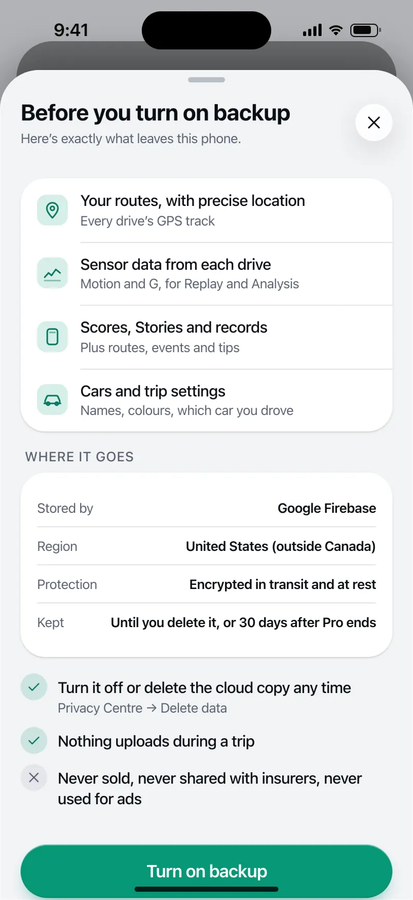
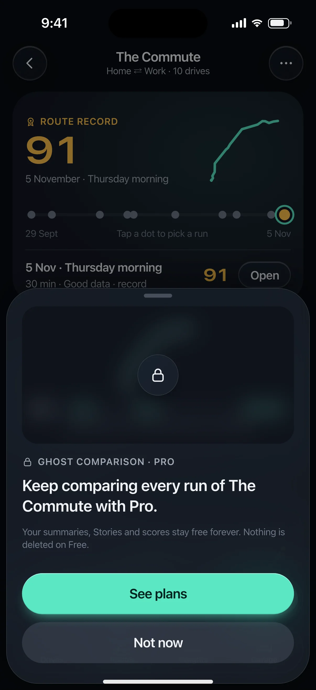
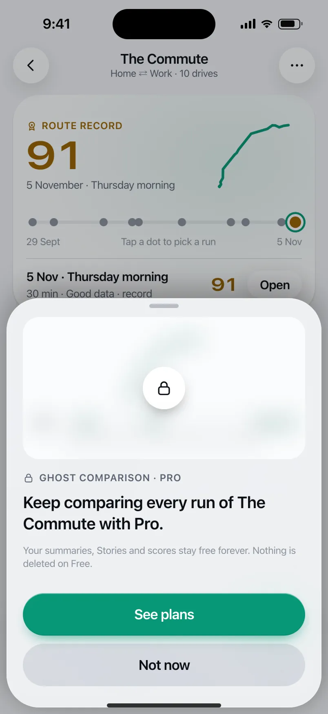

# DRIVE-205 · F-ACC-03 Cloud backup — iOS design spec

> Generated by `prototypes/tools/export.mjs` on 2026-11-07 from the shared prototype engine. **Do not edit by hand:** change the screen's `spec` in `prototypes/app/screens/wp-*.js` (see `prototypes/app/AUTHORING.md`) and re-export.

- **Jira story:** [DRIVE-205](https://thekeval.atlassian.net/browse/DRIVE-205) · F-ACC-03 · P0
- **Platform:** iOS 26/27 · Liquid Glass · iPhone 17 Pro (402×874 pt @3x = 1206×2622)
- **Interactive prototype:** [../../../../prototypes/ios/index.html#S-ACC-04](../../../../prototypes/ios/index.html#S-ACC-04) (catalog panel: every screen and state; deep links `#S-ID/state?trip=…&ent=…&theme=light&text=xl&rm=1`)
- **Contact sheet:** [mockup.html](mockup.html) · 
- **Design system (source of truth for values):** [brand](../../system/brand.md) · [components](../../system/components.md) · [motion](../../system/motion.md) · [accessibility](../../system/accessibility.md) · [screen map](../../system/screen-map.md) · [fixtures](../../system/fixtures.md) · tokens `prototypes/shared/tokens.css`

## Screens in this story

| Screen | Name | Presentation | Priority | States | Status |
|---|---|---|---|---|---|
| `S-ACC-04` | Cloud backup settings | Push | P0 | 7 | Prototyped |
| `S-ACC-05` | Backup consent | Sheet (large) | P0 | 1 | Prototyped |
| `S-SUB-03` | Contextual lock sheet | Sheet (medium) | P0 | 8 | Prototyped |

## Tokens used on this platform

Values resolved from `prototypes/shared/tokens.css` inside the iOS device (`[data-platform="ios"]`). Use the token names in code; the hex values are for reference.

| Token | Dark | Light |
|---|---|---|
| `--app-bg` | `#080B10` | `#F2F3F6` |
| `--card-bg` | `#131822` | `#FFFFFF` |
| `--dp-bg-grouped` | `#080B10` | `#F2F3F6` |
| `--dp-surface` | `#131822` | `#FFFFFF` |
| `--dp-surface-2` | `#1B222D` | `#F2F3F6` |
| `--dp-surface-3` | `#262E3B` | `#E4E7EC` |
| `--dp-fill` | `#7880961F` | `#7880961F` |
| `--dp-fill-strong` | `#7880963D` | `#78809633` |
| `--dp-text` | `#F2F4F7` | `#0B0E13` |
| `--dp-text-2` | `#A3AAB6` | `#5A6271` |
| `--dp-text-3` | `#6E7787` | `#8A919D` |
| `--dp-separator` | `#96A0B429` | `#3C435024` |
| `--dp-accent` | `#5BE7C4` | `#079777` |
| `--dp-accent-text` | `#5BE7C4` | `#06775E` |
| `--dp-on-accent` | `#04241D` | `#FFFFFF` |
| `--dp-accent-container` | `#0A4439` | `#C6F8EA` |
| `--dp-record` | `#FFC24B` | `#9A6300` |
| `--dp-positive` | `#5BE7C4` | `#06775E` |
| `--dp-change-down` | `#A3AAB6` | `#5A6271` |
| `--dp-warning` | `#F5B648` | `#9A5F00` |
| `--dp-critical` | `#FF6B6B` | `#C62828` |
| `--dp-glass-fill` | `#1C222C6B` | `#FFFFFF8C` |
| `--dp-glass-fill-strong` | `#1C222CB8` | `#FFFFFFD1` |
| `--dp-glass-stroke` | `#FFFFFF24` | `#FFFFFF99` |
| `--dp-data-route` | `#5BE7C4` | `#079777` |
| `--dp-data-event-brake` | `#FF7A66` | `#A21F16` |
| `--dp-data-event-accel` | `#E58BD0` | `#A33A8C` |
| `--dp-data-event-corner` | `#EAD54E` | `#9A8A00` |
| `--dp-data-quality-good` | `#5FDB9C` | `#1E9E62` |
| `--dp-data-speed` | `#D6DCE4` | `#404A58` |
| `--dp-data-long-g` | `#5AB8F5` | `#0A6AB8` |
| `--dp-data-lat-g` | `#F5A142` | `#B25A00` |

| Type / layout token | Value |
|---|---|
| `--dp-font-screen-title` | `700 34px / 41px -apple-system, BlinkMacSystemFont, "SF Pro Display", system-ui, sans-serif` |
| `--dp-font-sheet-title` | `700 22px / 28px -apple-system, BlinkMacSystemFont, "SF Pro Display", system-ui, sans-serif` |
| `--dp-font-section-title` | `600 20px / 25px -apple-system, BlinkMacSystemFont, "SF Pro Display", system-ui, sans-serif` |
| `--dp-font-card-title` | `600 17px / 22px -apple-system, BlinkMacSystemFont, "SF Pro Text", system-ui, sans-serif` |
| `--dp-font-body` | `400 17px / 22px -apple-system, BlinkMacSystemFont, "SF Pro Text", system-ui, sans-serif` |
| `--dp-font-body-secondary` | `400 15px / 20px -apple-system, BlinkMacSystemFont, "SF Pro Text", system-ui, sans-serif` |
| `--dp-font-meta` | `400 13px / 18px -apple-system, BlinkMacSystemFont, "SF Pro Text", system-ui, sans-serif` |
| `--dp-font-caption` | `400 12px / 16px -apple-system, BlinkMacSystemFont, "SF Pro Text", system-ui, sans-serif` |
| `--dp-font-button` | `600 17px / 22px -apple-system, BlinkMacSystemFont, "SF Pro Text", system-ui, sans-serif` |
| `--dp-num-hero` | `600 72px / 72px -apple-system, BlinkMacSystemFont, "SF Pro Display", system-ui, sans-serif` |
| `--dp-num-xl` | `600 48px / 52px -apple-system, BlinkMacSystemFont, "SF Pro Display", system-ui, sans-serif` |
| `--dp-num-l` | `600 34px / 38px -apple-system, BlinkMacSystemFont, "SF Pro Display", system-ui, sans-serif` |
| `--dp-num-m` | `600 24px / 28px -apple-system, BlinkMacSystemFont, "SF Pro Display", system-ui, sans-serif` |
| `--dp-num-s` | `600 17px / 22px -apple-system, BlinkMacSystemFont, "SF Pro Display", system-ui, sans-serif` |
| `--dp-num-xs` | `600 13px / 16px -apple-system, BlinkMacSystemFont, "SF Pro Display", system-ui, sans-serif` |
| `--dp-screen-margin` | `16px` |
| `--dp-radius-card` | `24px` |
| `--dp-radius-card-hero` | `32px` |
| `--dp-radius-sheet` | `38px` |
| `--dp-radius-chip` | `999px` |
| `--dp-radius-button` | `999px` |
| `--dp-layout-list-row-min` | `52px` |
| `--dp-layout-touch-min` | `44px` |
| `--safe-top` | `62px` |
| `--safe-bottom` | `34px` |

Text sizes scale with `--dp-text-scale` (XL = 2.0×) and numerals with `--dp-num-scale` (XL = 1.3×). DP Numerals: SF Pro Expanded Semibold, tabular.

---

## S-ACC-04 · Cloud backup settings

 

- **Presentation:** push · tab: profile — screen map: “Push”
- **Entry points:** S-ACC-01
- **Leads to:** S-ACC-05 · S-ACC-06 · S-SUB-03 (Free) · S-ACC-07
- **PRD features:** F-ACC-03 · **Priority:** P0 · **WP:** E
- **Interactive:** [S-ACC-04](../../../../prototypes/ios/index.html#S-ACC-04)

**Purpose.** Turn Pro cloud backup on or off and see its honest status: last backup, what is waiting, storage used, errors, and what happens if Pro lapses (F-ACC-03). Nothing ever uploads during a trip.

### States

| State | PRD label | Fixture params | Screenshot |
|---|---|---|---|
| `default` | Off | — | [S-ACC-04.png](../../screens/ios/S-ACC-04.webp) · [open](../../../../prototypes/ios/index.html#S-ACC-04) |
| `onAndUpToDate` | on and up to date | — | [S-ACC-04--onAndUpToDate.png](../../screens/ios/S-ACC-04--onAndUpToDate.webp) · [open](../../../../prototypes/ios/index.html#S-ACC-04/onAndUpToDate) |
| `pending` | pending | — | [S-ACC-04--pending.png](../../screens/ios/S-ACC-04--pending.webp) · [open](../../../../prototypes/ios/index.html#S-ACC-04/pending) |
| `wiFiOnly` | Wi-Fi only (waiting) | — | [S-ACC-04--wiFiOnly.png](../../screens/ios/S-ACC-04--wiFiOnly.webp) · [open](../../../../prototypes/ios/index.html#S-ACC-04/wiFiOnly) |
| `Err` | Err | — | [S-ACC-04--Err.png](../../screens/ios/S-ACC-04--Err.webp) · [open](../../../../prototypes/ios/index.html#S-ACC-04/Err) |
| `Lock` | Lock (Free) | `ent=free` | [S-ACC-04--Lock.png](../../screens/ios/S-ACC-04--Lock.webp) · [open](../../../../prototypes/ios/index.html#S-ACC-04/Lock) |
| `lapsedProWarning` | lapsed Pro warning | `ent=free` | [S-ACC-04--lapsedProWarning.png](../../screens/ios/S-ACC-04--lapsedProWarning.webp) · [open](../../../../prototypes/ios/index.html#S-ACC-04/lapsedProWarning) |
| default · light | Light theme | `theme=light` | [S-ACC-04--light.png](../../screens/ios/S-ACC-04--light.webp) |

Every state also renders in light/dark (`theme=light`), XL text (`text=xl`) and reduced motion (`rm=1`).

### Layout

- Push with title “Cloud backup” (iOS inline + glass back · Android MediumFlexibleTopAppBar).
- Status hero card (radius 32/28): cloud illustration 104 (off = slashed, up to date = check on a positive halo, waiting = up arrow, error = “!” on a critical halo) + title (cardTitle) + one line. Err adds a tonal “Try again”.
- lapsed Pro warning: attention banner “Your cloud copy is kept until 6 December 2026 …” + “Keep it” → S-SUB-04.
- pending / Wi-Fi only: “Waiting to upload” trip cards (the two newest drives).
- Toggle row “Back up my drives”. When on: Options (Also use mobile data · Include raw sensor data 151 MB of 186 MB · battery rule, informational) and Your backup (Restore · What’s backed up · Sign out), then a facts card (Stored in Google Firebase, US region · Encryption · When · Delete).
- Lock (Free): the user’s own backup status blurred (14 px, 35% dim) in a lock panel: “Back up your drives and restore them on any phone with Pro.” + See plans; then reassurance checklist and “Download all my data”.

### Components & tokens

| Component | Tokens / spec |
|---|---|
| `navBar` | --dp-font-card-title · --dp-font-meta · glass: --dp-glass-fill + --dp-glass-blur · components.md §2 |
| `card` | --dp-surface / --md-sys-color-surface-container · --dp-radius-card (24 iOS · 16 Android) · hero: --dp-radius-card-hero (32 · 28) · light iOS: --dp-elev-1 |
| `banner` | radius 12 (--dp-radius-sm+) · info --dp-fill · attention --dp-warning-container · critical --dp-critical-container · components.md §22 |
| `tripRow` | glyph 40 on --dp-surface-2 · --dp-font-card-title · --dp-font-meta · components.md §12 |
| `list` | iOS inset grouped radius --dp-radius-card, rows 52 pt, separators --dp-separator inset 16 · Android ListItem 56/72 dp in --md-sys-color-surface-container |
| `row` | --dp-font-body · --dp-font-meta (supporting) · --dp-layout-list-row-min |
| `toggle` | iOS 51×31 tint --dp-accent · Android M3 Switch 52×32 --md-sys-color-primary |
| `stats` | --dp-surface-2 / --md-sys-color-surface-container-high · radius 14 iOS / 12 Android · value --dp-num-m (DP Numerals) · components.md §5 |
| `lockPanel` | blur --dp-opacity-locked-blur 14px · dim --dp-opacity-locked-dim 35% · components.md §15.2 |
| `button` | --dp-accent / --dp-on-accent (filled) · --dp-fill-strong · --md-sys-color-secondary-container (tonal) · --dp-radius-button · height iOS 50/44/34 · Android 56/40/32 · --dp-font-button · components.md §0 |
| `section` | --dp-font-section-title · --dp-layout-section-gap 28 |

### Interactions & navigation

- Toggle on (first time) → S-ACC-05 consent; if not signed in → S-ACC-02 (next = backup) first. Toggle off → toast “Backup off. Your cloud copy stays until you delete it.”
- Restore from backup → S-ACC-06 · What’s backed up → S-ACC-05 · Sign out → S-ACC-07 · Keep it → S-SUB-04 · Lock panel / See plans → S-SUB-03 backup.
- Try again → retries (toast). Mobile data / raw data toggles update in place (haptic toggleOn/Off).

### Motion

- Blocks rise 8 px, 30 ms stagger. Waiting states: the cloud glyph bobs 3 px once (2400 ms ease-in-out). RM: static.

### Accessibility

- Status card is read as title + line (“Up to date. Last backup today, 2:05 pm, 30 drives, 186 megabytes.”).
- Toggle rows are switches with their titles as labels. The lock panel reads “Back up your drives and restore them on any phone with Pro. See plans.”
- XL: facts card stacks label over value; rows wrap.

### Platform notes

- **iOS (this spec):** BGProcessingTask (requires external power optional; Wi-Fi by default); inset-grouped lists; Toggle with Glide tint.
- *Android (for reference):* WorkManager (unmetered network constraint by default, battery not low); M3 Switch with thumb icon; segmented ListItems.

### Analytics

- `backup_enabled`
- `backup_disabled`
- `backup_run {result, items_bucket}`
- `lock_viewed {feature: backup}`

### Copy

| Key | Text |
|---|---|
| Off | Backup is off. Your drives are only on this phone. Turn on backup to keep a copy in the cloud and restore it on any phone. |
| Up to date | Up to date · Last backup today, 2:05 pm · 30 drives · 186 MB |
| Pending | 2 drives waiting. They’ll upload on Wi-Fi when you’re not driving. |
| Wi-Fi only | Waiting for Wi-Fi. 2 drives will upload when this phone is on Wi-Fi. Backup doesn’t use mobile data. |
| Err | Backup didn’t finish. Your drives are safe on this phone. We’ll try again on Wi-Fi. |
| Lapsed | Backup has stopped. Your Pro plan ended, so nothing new is backed up. Your cloud copy is kept until 6 December 2026. Then it’s deleted. Drives on this phone aren’t affected. We’ll remind you 30, 7 and 1 day before. |
| Lock | Back up your drives and restore them on any phone with Pro. (entitlement.lockSheets.backup) |

### Free / Pro

Pro (and Preview / Ride-along). Free: Lock state with the user’s own backup preview blurred. Lapsed: backup stops, cloud copy kept 30 days (OQ-09, decided 6 Nov), warnings at 30/7/1 days).

### Data & fixtures

Sizes from privacy.dataSize (30 drives, 186 MB, raw 151 MB). Pending = the two newest drives (t20261106-1210, t20261105-1745). “Last backup today, 2:05 pm” and the 6 Dec 2026 retention date (today + 30 days, OQ-09 decision) are prototype values.

### Assets

[icon-cloud.svg](assets/icon-cloud.svg) · [icon-refresh.svg](assets/icon-refresh.svg) · [icon-gps.svg](assets/icon-gps.svg) · [icon-analysis.svg](assets/icon-analysis.svg) · [icon-battery.svg](assets/icon-battery.svg) · [icon-info.svg](assets/icon-info.svg) · [icon-export.svg](assets/icon-export.svg) · [icon-clock.svg](assets/icon-clock.svg) · [icon-lock.svg](assets/icon-lock.svg)

UI glyphs may be swapped for SF Symbols / Material Symbols Rounded equivalents; event-pin, quality and provenance glyphs must not be (components.md global rules).

### Checklist (accessibility.md §9)

- [ ] Light and dark both render, and contrast passes.
- [ ] The XL text state reflows with no truncation.
- [ ] The RM state is defined.
- [ ] Every control has a label; every chart and map has a summary sentence.
- [ ] Every target ≥ 44 pt / 48 dp (≥ 64 in-drive).
- [ ] No meaning by colour alone.
- [ ] Speed is neutral wherever it appears and absent from social or live surfaces.
- [ ] No streak, leaderboard, speed or “beat your time” language.
- [ ] Behaviour is defined while a trip is active (D1 gate).
- [ ] Haptics come from motion.md §6 only.

---

## S-ACC-05 · Backup consent

 

- **Presentation:** sheet · tab: profile · detent: large — screen map: “Sheet (large)”
- **Entry points:** S-ACC-04 first enable
- **Leads to:** Back (backup on)
- **PRD features:** F-ACC-03 · **Priority:** P0 · **WP:** E
- **Interactive:** [S-ACC-05](../../../../prototypes/ios/index.html#S-ACC-05)

**Purpose.** Explicit, informed consent before any trip data leaves the phone (F-ACC-03.1; Apple 5.1.5, PIPEDA meaningful consent, Law 25 transfer outside Quebec): what is uploaded, where it is stored, how it is protected, and that it can be deleted any time.

### States

| State | PRD label | Fixture params | Screenshot |
|---|---|---|---|
| `default` | Def | — | [S-ACC-05.png](../../screens/ios/S-ACC-05.webp) · [open](../../../../prototypes/ios/index.html#S-ACC-05) |
| default · light | Light theme | `theme=light` | [S-ACC-05--light.png](../../screens/ios/S-ACC-05--light.webp) |

Every state also renders in light/dark (`theme=light`), XL text (`text=xl`) and reduced motion (`rm=1`).

### Layout

- Large-detent sheet. Header “Before you turn on backup” + sub “Here’s exactly what leaves this phone.”
- What: 4 rows on a card (icon tile 30 · title · sub): routes with precise location · sensor data · scores, Stories and records · cars and trip settings.
- Where it goes (caption section): facts card — Stored by Google Firebase · Region United States (outside Canada) · Encrypted in transit and at rest · Kept until you delete it, or 30 days after Pro ends.
- Checklist: ✓ turn it off or delete any time · ✓ nothing uploads during a trip · ✕ never sold, never shared with insurers, never used for ads.
- Stacked large buttons: “Turn on backup” (filled) · “Not now” (tonal). No pre-ticked boxes.

### Components & tokens

| Component | Tokens / spec |
|---|---|
| `sheetHeader` | see components.md |
| `card` | --dp-surface / --md-sys-color-surface-container · --dp-radius-card (24 iOS · 16 Android) · hero: --dp-radius-card-hero (32 · 28) · light iOS: --dp-elev-1 |
| `section` | --dp-font-section-title · --dp-layout-section-gap 28 |
| `button` | --dp-accent / --dp-on-accent (filled) · --dp-fill-strong · --md-sys-color-secondary-container (tonal) · --dp-radius-button · height iOS 50/44/34 · Android 56/40/32 · --dp-font-button · components.md §0 |
| `sheet` | iOS glass --dp-glass-fill-strong + --dp-glass-prominent-blur, radius --dp-radius-sheet 38 · Android ModalBottomSheet --md-sys-color-surface-container-low, top radius 28, drag handle 32×4 · motion spring.sheet |

### Interactions & navigation

- Turn on backup → consent recorded (timestamp + version) → back to S-ACC-04 in the pending state + toast “Backup on. Your first backup starts on Wi-Fi.” (haptic confirm).
- Not now / drag down / close → back, backup stays off.

### Motion

- Rows rise 8 px, 35 ms stagger; spring.sheet presentation. RM: fades.

### Accessibility

- Focus on the title. Each “what” row is one element (“Your routes, with precise location. Every drive’s GPS track.”).
- XL: facts stack; buttons wrap.

### Platform notes

- **iOS (this spec):** Sheet .large with glass close; buttons glassProminent / glass.
- *Android (for reference):* Expanded ModalBottomSheet; filled + tonal buttons.

### Analytics

- `backup_consent_viewed`
- `backup_enabled`

### Copy

| Key | Text |
|---|---|
| Title | Before you turn on backup |
| Sub | Here’s exactly what leaves this phone. |
| What | Your routes, with precise location · Sensor data from each drive · Scores, Stories and records · Cars and trip settings |
| Where | Google Firebase · United States (outside Canada) · Encrypted in transit and at rest · Until you delete it, or 30 days after Pro ends |
| Never | Never sold, never shared with insurers, never used for ads |

### Free / Pro

Pro only (reached from S-ACC-04).

### Data & fixtures

Retention “30 days after Pro ends” is the OQ-09 decision (6 Nov 2026); region per F-ACC-03.1.

### Assets

[icon-pin.svg](assets/icon-pin.svg) · [icon-analysis.svg](assets/icon-analysis.svg) · [icon-story.svg](assets/icon-story.svg) · [icon-car.svg](assets/icon-car.svg) · [icon-check.svg](assets/icon-check.svg) · [icon-close.svg](assets/icon-close.svg)

UI glyphs may be swapped for SF Symbols / Material Symbols Rounded equivalents; event-pin, quality and provenance glyphs must not be (components.md global rules).

### Checklist (accessibility.md §9)

- [ ] Light and dark both render, and contrast passes.
- [ ] The XL text state reflows with no truncation.
- [ ] The RM state is defined.
- [ ] Every control has a label; every chart and map has a summary sentence.
- [ ] Every target ≥ 44 pt / 48 dp (≥ 64 in-drive).
- [ ] No meaning by colour alone.
- [ ] Speed is neutral wherever it appears and absent from social or live surfaces.
- [ ] No streak, leaderboard, speed or “beat your time” language.
- [ ] Behaviour is defined while a trip is active (D1 gate).
- [ ] Haptics come from motion.md §6 only.

---

## S-SUB-03 · Contextual lock sheet

 

- **Presentation:** sheet · tab: profile · detent: auto — screen map: “Sheet (medium)”
- **Entry points:** Any Pro gate (compare, > 30-day Replay/Analysis, 3rd route, 2nd car, export, trends, backup)
- **Leads to:** S-SUB-04 · "Not now" → exactly where the user was
- **PRD features:** F-SUB-04, F-HIS-03, F-RTE-04, F-RTE-05, F-ACC-03, F-RPL-01, F-SUB-08 · **Priority:** P0 · **WP:** E
- **Interactive:** [S-SUB-03](../../../../prototypes/ios/index.html#S-SUB-03)

**Purpose.** When a Free user taps a Pro feature, show what Pro would show on their own data — blurred, never a stock screenshot — with one sentence of value, “See plans” and “Not now” (F-SUB-04, F-HIS-03 “locked, not lost”). Not now returns exactly where they were.

### States

| State | PRD label | Fixture params | Screenshot |
|---|---|---|---|
| `default` | compare with record | `ent=free` | [S-SUB-03.png](../../screens/ios/S-SUB-03.webp) · [open](../../../../prototypes/ios/index.html#S-SUB-03) |
| `replayAnalysis30Days` | Replay/Analysis > 30 days | `ent=free` | [S-SUB-03--replayAnalysis30Days.png](../../screens/ios/S-SUB-03--replayAnalysis30Days.webp) · [open](../../../../prototypes/ios/index.html#S-SUB-03/replayAnalysis30Days) |
| `s3rdRoute` | 3rd route | `ent=free` | [S-SUB-03--s3rdRoute.png](../../screens/ios/S-SUB-03--s3rdRoute.webp) · [open](../../../../prototypes/ios/index.html#S-SUB-03/s3rdRoute) |
| `s2ndCar` | 2nd car | `ent=free` | [S-SUB-03--s2ndCar.png](../../screens/ios/S-SUB-03--s2ndCar.webp) · [open](../../../../prototypes/ios/index.html#S-SUB-03/s2ndCar) |
| `export` | export | `ent=free` | [S-SUB-03--export.png](../../screens/ios/S-SUB-03--export.webp) · [open](../../../../prototypes/ios/index.html#S-SUB-03/export) |
| `trends` | trends | `ent=free` | [S-SUB-03--trends.png](../../screens/ios/S-SUB-03--trends.webp) · [open](../../../../prototypes/ios/index.html#S-SUB-03/trends) |
| `backup` | backup | `ent=free` | [S-SUB-03--backup.png](../../screens/ios/S-SUB-03--backup.webp) · [open](../../../../prototypes/ios/index.html#S-SUB-03/backup) |
| `noDataYet` | no data yet | `ent=free` | [S-SUB-03--noDataYet.png](../../screens/ios/S-SUB-03--noDataYet.webp) · [open](../../../../prototypes/ios/index.html#S-SUB-03/noDataYet) |
| default · light | Light theme | `theme=light` | [S-SUB-03--light.png](../../screens/ios/S-SUB-03--light.webp) |

Every state also renders in light/dark (`theme=light`), XL text (`text=xl`) and reduced motion (`rm=1`).

### Layout

- Sheet fitted to content (spec: medium). Top: the user’s own content for that feature, blurred 14 px + 35% dim, radius 20, with a 52 lock disc centred (iOS glass, Android tonal).
- Variants (own data): compare = The Commute ghost vs record + 12 gained/lost segments · Replay/Analysis > 30 days = that trip’s map + synced timeline · 3rd route = Gym card (glyph, 2 drives, record 84, run dots) · 2nd car = Ioniq silhouette + drives/average/km tiles · export = that drive’s CSV rows · trends = October trend sparkline + Month/Year/Per car/Per route tabs · backup = backup status · no data yet = illustration instead of a blur.
- Kicker “🔒 Ghost comparison · Pro”, then the value sentence (sheetTitle-size, 20/26 semibold): entitlement.lockSheets.*, footnote “Your summaries, Stories and scores stay free forever. Nothing is deleted on Free.”
- Stacked large buttons: “See plans” (filled) · “Not now” (tonal).

### Components & tokens

| Component | Tokens / spec |
|---|---|
| `sheet` | iOS glass --dp-glass-fill-strong + --dp-glass-prominent-blur, radius --dp-radius-sheet 38 · Android ModalBottomSheet --md-sys-color-surface-container-low, top radius 28, drag handle 32×4 · motion spring.sheet |
| `lockPanel` | blur --dp-opacity-locked-blur 14px · dim --dp-opacity-locked-dim 35% · components.md §15.2 |
| `map` | --dp-data-map-land/road/grid · route --dp-data-route 3.8 + casing --dp-data-route-casing 7.5 · estimated dashed 4/4 at 60% · gap --dp-data-gap-stroke dotted 1/6 · pins DP_ICONS.pin 26 · attribution “© OpenStreetMap contributors” |
| `timeline` | --dp-data-speed · --dp-data-long-g · --dp-data-lat-g (dashed 6/3) · cursor --dp-data-cursor · components.md §7 |
| `glyph` | see components.md |
| `stats` | --dp-surface-2 / --md-sys-color-surface-container-high · radius 14 iOS / 12 Android · value --dp-num-m (DP Numerals) · components.md §5 |
| `sparkline` | see components.md |
| `scoreBadge` | iOS mini ring 46 · Android Cookie9Sided 46 · --dp-num-s |
| `button` | --dp-accent / --dp-on-accent (filled) · --dp-fill-strong · --md-sys-color-secondary-container (tonal) · --dp-radius-button · height iOS 50/44/34 · Android 56/40/32 · --dp-font-button · components.md §0 |

### Interactions & navigation

- See plans → S-SUB-04 (from = feature). Not now / drag / scrim → back to exactly where the user was (scroll position kept).
- Gate: never during a trip or on a worse-than-usual Story’s end card (F-SUB-08.3); the D1 gate holds it while moving.

### Motion

- The user’s content blurs from 0 → 14 px over 320 ms (spring.effects) while the sheet rises at the medium detent; the lock disc pops at 360 ms. RM: shown already blurred, fade.

### Accessibility

- The blurred preview is hidden from screen readers; the sheet reads “Ghost comparison, Pro. Keep comparing every run of The Commute with Pro.” then the buttons. XL: opens large; the preview keeps its height.

### Platform notes

- **iOS (this spec):** Glass sheet at a partial detent; lock disc in glass.
- *Android (for reference):* ModalBottomSheet; lock disc on surfaceContainerHigh; RenderEffect blur (API 31+) or a pre-blurred bitmap.

### Analytics

- `lock_viewed {feature}`
- `lock_cta {see_plans|not_now}`

### Copy

| Key | Text |
|---|---|
| compare | Keep comparing every run of The Commute with Pro. |
| oldAnalysis | Keep exploring every drive with Pro. |
| thirdRoute | Track every route you drive with Pro. |
| secondCar | Keep a log for every car in your garage with Pro. |
| export | Export any drive as GPX or CSV with Pro. |
| trends | See how your driving changes month to month with Pro. |
| backup | Back up your drives and restore them on any phone with Pro. |
| noDataYet | Month and year trends appear after your first full month of drives. With Pro, you’ll see how your driving changes month to month. |
| Footnote | Your summaries, Stories and scores stay free forever. Nothing is deleted on Free. |

### Free / Pro

Free users only (ent = free). Preview/Ride-along/Pro never see it.

### Data & fixtures

compare: route r_commute + ghost (91 vs 89) · replay: t20261002-0745 · 3rd route: r_gym · 2nd car: Ioniq (derived: its scored trips, average and km) · export: t20261105-1745 · trends: wrapped.monthly trend weeks [81, 85, 85, 87] · backup: privacy.dataSize. Parent screens rendered underneath on a deep link follow the variant (S-RTE-02, S-TRP-01 Lock, S-RTE-01, S-GAR-01, S-STA-01, S-ACC-04 Lock).

### Assets

[icon-lock.svg](assets/icon-lock.svg) · [icon-insights.svg](assets/icon-insights.svg) · [icon-cloud.svg](assets/icon-cloud.svg)

UI glyphs may be swapped for SF Symbols / Material Symbols Rounded equivalents; event-pin, quality and provenance glyphs must not be (components.md global rules).

### Checklist (accessibility.md §9)

- [ ] Light and dark both render, and contrast passes.
- [ ] The XL text state reflows with no truncation.
- [ ] The RM state is defined.
- [ ] Every control has a label; every chart and map has a summary sentence.
- [ ] Every target ≥ 44 pt / 48 dp (≥ 64 in-drive).
- [ ] No meaning by colour alone.
- [ ] Speed is neutral wherever it appears and absent from social or live surfaces.
- [ ] No streak, leaderboard, speed or “beat your time” language.
- [ ] Behaviour is defined while a trip is active (D1 gate).
- [ ] Haptics come from motion.md §6 only.

---

Map geometry in the prototype: © OpenStreetMap contributors (ODbL). Speed and G are simulated fixtures (fixtures.md).
