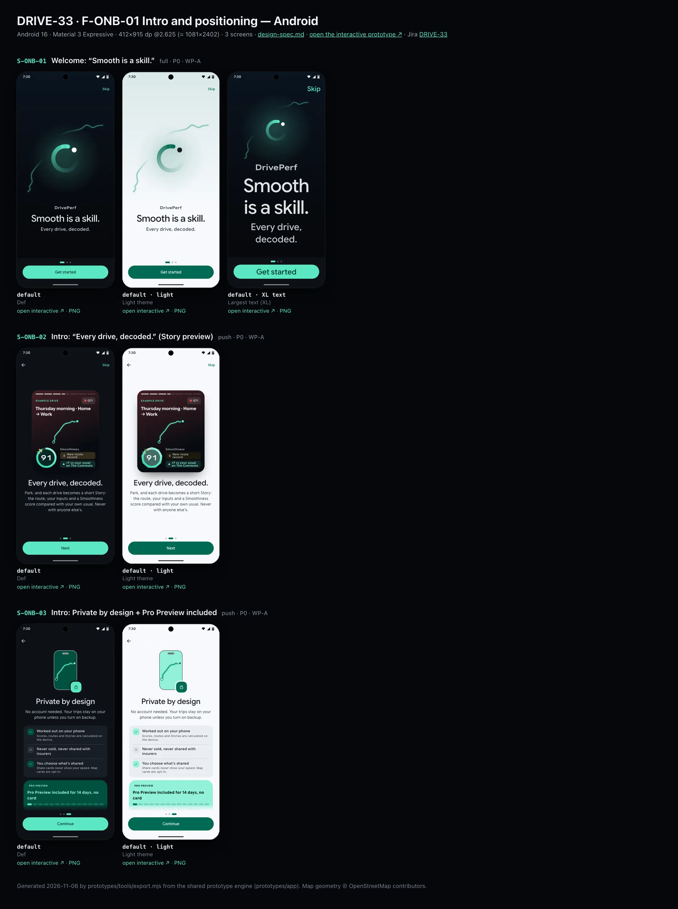
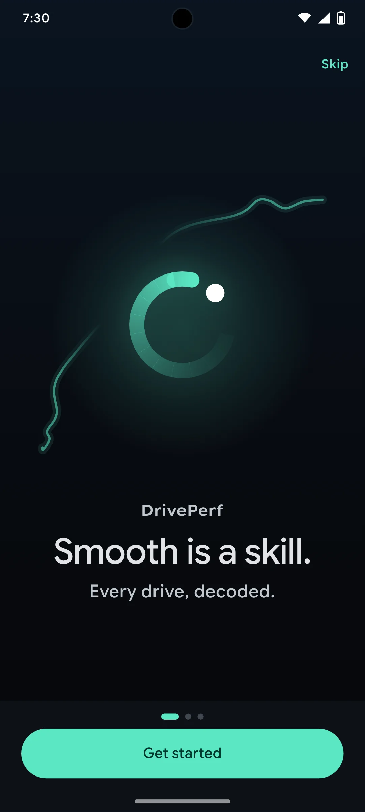
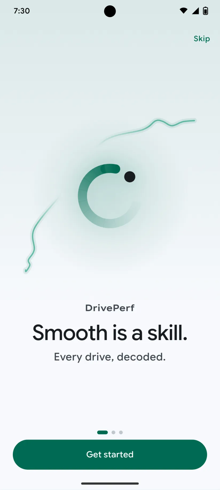
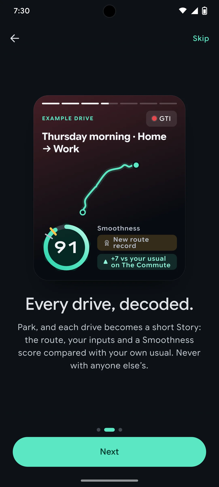
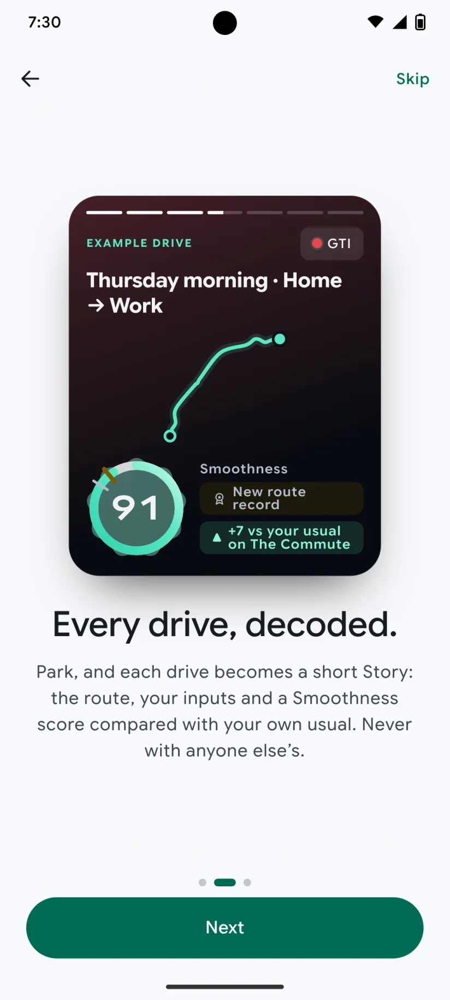
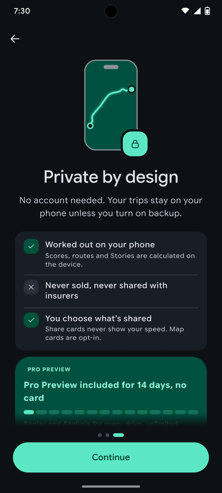
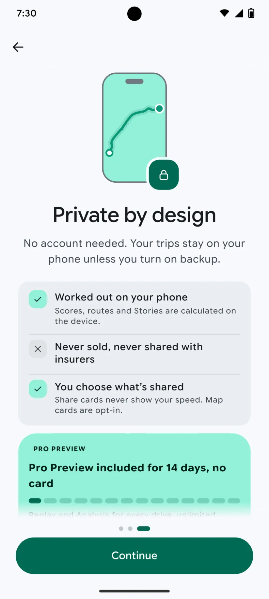

# DRIVE-33 · F-ONB-01 Intro and positioning — Android design spec

> Generated by `prototypes/tools/export.mjs` on 2026-11-06 from the shared prototype engine. **Do not edit by hand:** change the screen's `spec` in `prototypes/app/screens/wp-*.js` (see `prototypes/app/AUTHORING.md`) and re-export.

- **Jira story:** [DRIVE-33](https://thekeval.atlassian.net/browse/DRIVE-33) · F-ONB-01 · P0
- **Platform:** Android 16 · Material 3 Expressive · 412×915 dp @2.625 (≈ 1081×2402)
- **Interactive prototype:** [../../../../prototypes/android/index.html#S-ONB-01](../../../../prototypes/android/index.html#S-ONB-01) (catalog panel: every screen and state; deep links `#S-ID/state?trip=…&ent=…&theme=light&text=xl&rm=1`)
- **Contact sheet:** [mockup.html](mockup.html) · 
- **Design system (source of truth for values):** [brand](../../system/brand.md) · [components](../../system/components.md) · [motion](../../system/motion.md) · [accessibility](../../system/accessibility.md) · [screen map](../../system/screen-map.md) · [fixtures](../../system/fixtures.md) · tokens `prototypes/shared/tokens.css`

## Screens in this story

| Screen | Name | Presentation | Priority | States | Status |
|---|---|---|---|---|---|
| `S-ONB-01` | Welcome: “Smooth is a skill.” | Full | P0 | 1 | Prototyped |
| `S-ONB-02` | Intro: “Every drive, decoded.” (Story preview) | Full (paged) | P0 | 1 | Prototyped |
| `S-ONB-03` | Intro: Private by design + Pro Preview included | Full (paged) | P0 | 1 | Prototyped |

## Tokens used on this platform

Values resolved from `prototypes/shared/tokens.css` inside the Android device (`[data-platform="android"]`). Use the token names in code; the hex values are for reference.

| Token | Dark | Light |
|---|---|---|
| `--app-bg` | `#0D1117` | `#F7F9FC` |
| `--card-bg` | `#191E25` | `#EBEEF2` |
| `--dp-bg-grouped` | `#0D1117` | `#F7F9FC` |
| `--dp-surface` | `#191E25` | `#EBEEF2` |
| `--dp-surface-2` | `#1F252D` | `#E5E8EC` |
| `--dp-surface-3` | `#2A3038` | `#DFE2E6` |
| `--dp-fill` | `#2A3038` | `#DFE2E6` |
| `--dp-fill-strong` | `#353B44` | `#D3D7DC` |
| `--dp-text` | `#E1E3E8` | `#181C20` |
| `--dp-text-2` | `#C0C7CF` | `#40474F` |
| `--dp-text-3` | `#8A929B` | `#707881` |
| `--dp-separator` | `#40474F` | `#C0C7CF` |
| `--dp-accent` | `#5BE7C4` | `#006B53` |
| `--dp-accent-text` | `#5BE7C4` | `#006B53` |
| `--dp-on-accent` | `#00382B` | `#FFFFFF` |
| `--dp-accent-container` | `#00513F` | `#91F1D8` |
| `--dp-record` | `#FFC24B` | `#7A5900` |
| `--dp-positive` | `#5BE7C4` | `#006B53` |
| `--dp-change-down` | `#C0C7CF` | `#40474F` |
| `--dp-warning` | `#F5B648` | `#7A5900` |
| `--dp-critical` | `#FFB4AB` | `#BA1A1A` |
| `--dp-glass-fill` | `#1F252DF2` | `#E5E8ECF2` |
| `--dp-glass-fill-strong` | `#2A3038` | `#DFE2E6` |
| `--dp-glass-stroke` | `#FFFFFF0F` | `#0000000A` |
| `--md-sys-color-primary` | `#5BE7C4` | `#006B53` |
| `--md-sys-color-on-primary` | `#00382B` | `#FFFFFF` |
| `--md-sys-color-primary-container` | `#00513F` | `#91F1D8` |
| `--md-sys-color-on-primary-container` | `#91F1D8` | `#002118` |
| `--md-sys-color-secondary-container` | `#344C44` | `#CEE9DF` |
| `--md-sys-color-surface` | `#0D1117` | `#F7F9FC` |
| `--md-sys-color-surface-container` | `#191E25` | `#EBEEF2` |
| `--md-sys-color-surface-container-high` | `#1F252D` | `#E5E8EC` |
| `--md-sys-color-on-surface-variant` | `#C0C7CF` | `#40474F` |
| `--dp-data-route` | `#5BE7C4` | `#079777` |
| `--dp-data-event-brake` | `#FF7A66` | `#A21F16` |
| `--dp-data-event-accel` | `#E58BD0` | `#A33A8C` |
| `--dp-data-event-corner` | `#EAD54E` | `#9A8A00` |
| `--dp-data-quality-good` | `#5FDB9C` | `#1E9E62` |
| `--dp-data-speed` | `#D6DCE4` | `#404A58` |
| `--dp-data-long-g` | `#5AB8F5` | `#0A6AB8` |
| `--dp-data-lat-g` | `#F5A142` | `#B25A00` |

| Type / layout token | Value |
|---|---|
| `--dp-font-screen-title` | `600 32px / 40px "Google Sans Flex", "Google Sans Display", "Roboto Flex", Roboto, system-ui, sans-serif` |
| `--dp-font-sheet-title` | `400 24px / 32px "Google Sans Flex", "Google Sans Display", "Roboto Flex", Roboto, system-ui, sans-serif` |
| `--dp-font-section-title` | `600 22px / 28px "Google Sans Flex", "Google Sans Display", "Roboto Flex", Roboto, system-ui, sans-serif` |
| `--dp-font-card-title` | `700 16px / 24px "Google Sans Flex", "Google Sans Text", "Roboto Flex", Roboto, system-ui, sans-serif` |
| `--dp-font-body` | `400 16px / 24px "Google Sans Flex", "Google Sans Text", "Roboto Flex", Roboto, system-ui, sans-serif` |
| `--dp-font-body-secondary` | `400 14px / 20px "Google Sans Flex", "Google Sans Text", "Roboto Flex", Roboto, system-ui, sans-serif` |
| `--dp-font-meta` | `400 12px / 16px "Google Sans Flex", "Google Sans Text", "Roboto Flex", Roboto, system-ui, sans-serif` |
| `--dp-font-caption` | `500 12px / 16px "Google Sans Flex", "Google Sans Text", "Roboto Flex", Roboto, system-ui, sans-serif` |
| `--dp-font-button` | `700 14px / 20px "Google Sans Flex", "Google Sans Text", "Roboto Flex", Roboto, system-ui, sans-serif` |
| `--dp-num-hero` | `600 72px / 72px "Google Sans Flex", "Roboto Flex", Roboto, system-ui, sans-serif` |
| `--dp-num-xl` | `600 48px / 52px "Google Sans Flex", "Roboto Flex", Roboto, system-ui, sans-serif` |
| `--dp-num-l` | `600 34px / 38px "Google Sans Flex", "Roboto Flex", Roboto, system-ui, sans-serif` |
| `--dp-num-m` | `600 24px / 28px "Google Sans Flex", "Roboto Flex", Roboto, system-ui, sans-serif` |
| `--dp-num-s` | `600 17px / 22px "Google Sans Flex", "Roboto Flex", Roboto, system-ui, sans-serif` |
| `--dp-num-xs` | `600 13px / 16px "Google Sans Flex", "Roboto Flex", Roboto, system-ui, sans-serif` |
| `--dp-screen-margin` | `16px` |
| `--dp-radius-card` | `16px` |
| `--dp-radius-card-hero` | `28px` |
| `--dp-radius-sheet` | `28px` |
| `--dp-radius-chip` | `8px` |
| `--dp-radius-button` | `999px` |
| `--dp-layout-list-row-min` | `56px` |
| `--dp-layout-touch-min` | `48px` |
| `--safe-top` | `40px` |
| `--safe-bottom` | `24px` |

Text sizes scale with `--dp-text-scale` (XL = 2.0×) and numerals with `--dp-num-scale` (XL = 1.3×). DP Numerals: Google Sans Flex wdth 120 wght 600, tabular.

---

## S-ONB-01 · Welcome: “Smooth is a skill.”

 

- **Presentation:** full — screen map: “Full”
- **Entry points:** First launch
- **Leads to:** S-ONB-02
- **PRD features:** F-ONB-01 · **Priority:** P0 · **WP:** A
- **Interactive:** [S-ONB-01](../../../../prototypes/android/index.html#S-ONB-01)

**Purpose.** First launch (F-ONB-01): say what DrivePerf is in one breath — “Smooth is a skill.” / “Every drive, decoded.” — with the brand’s hero motion, and never ask for a permission before S-ONB-05.

### States

| State | PRD label | Fixture params | Screenshot |
|---|---|---|---|
| `default` | Def | — | [S-ONB-01.png](../../screens/android/S-ONB-01.webp) · [open](../../../../prototypes/android/index.html#S-ONB-01) |
| default · light | Light theme | `theme=light` | [S-ONB-01--light.png](../../screens/android/S-ONB-01--light.webp) |
| default · XL | Largest text | `text=xl` | [S-ONB-01--xl.png](../../screens/android/S-ONB-01--xl.webp) |

Every state also renders in light/dark (`theme=light`), XL text (`text=xl`) and reduced motion (`rm=1`).

### Layout

- Full-screen cover, no navigation bar. Background: night sky (dark: --dp-gradient-night-sky + a Glide glow at 16% behind the mark · light “Day Drive”: Glide 10% wash fading into --app-bg).
- Top trailing: “Skip” text button (44 pt / 48 dp target) → S-ONB-04 (the age and terms step can’t be skipped).
- Hero (≈ 46% of the height): the example commute (fixture t20261105-0742, Home → Work) as a smoothed route line, Glide 2.4 pt at 55% with a 9 pt casing glow at 10%, full width; The Loop mark 172 pt (XL 128) centred over it, trail fading 0.03 → 1 clockwise, G-dot 34° ahead (brand.md §3.1).
- Wordmark “DrivePerf” (wide semibold, +1% tracking, --dp-text-2) → lead “Smooth is a skill.” (iOS 40/44 bold display · Android displaySmall 40/48 emphasized) → support “Every drive, decoded.” (title3 / titleLarge, --dp-text-2). Centred, 32 side margins.
- Bottom: page dots (1 of 3; current = 18×6 capsule in Glide, others 6×6 --dp-fill-strong) above “Get started” (iOS glass-prominent capsule 52 pt in a floating glass dock · Android filled 56 dp full width).

### Components & tokens

| Component | Tokens / spec |
|---|---|
| `page` | --dp-bg-grouped (iOS) / --md-sys-color-surface (Android) · --dp-screen-margin 16 |
| `button` | --dp-accent / --dp-on-accent (filled) · --dp-fill-strong · --md-sys-color-secondary-container (tonal) · --dp-radius-button · height iOS 50/44/34 · Android 56/40/32 · --dp-font-button · components.md §0 |
| `icon` | see components.md |

### Interactions & navigation

- “Get started” → S-ONB-02 (push inside the onboarding stack).
- “Skip” → S-ONB-04/checkboxUnticked; logs onboarding_skipped {from_step: welcome}.
- No permission prompt can appear on this screen (F-ONB-01.1).

### Motion

- Hero motion (route draw-on + Loop): 0–1800 ms the route draws on (stroke-dashoffset, ease.drawOn) with a 5 pt glow head riding the tip, which dissolves at the end (motion.md §3.3).
- 450–1750 ms The Loop’s trail draws on clockwise through a mask (ease.drawOn 1300 ms) while the G-dot glides 270° around just ahead of the head, overshoots 8° and settles back to its 34° lead (spring-like keyframe, total 1560 ms).
- 1350 ms+: wordmark, lead, support and the dock rise 8 px and fade in, 70 ms stagger (spring.default).
- Reduced motion / Remove animations: everything is drawn final and the page cross-fades in over 220 ms (F-ONB-01.4). Export shot mode renders the final frame.

### Accessibility

- VoiceOver/TalkBack reads: “DrivePerf. Smooth is a skill. Every drive, decoded.” (one heading), then “Page 1 of 3”, then “Get started, button”. The hero art is decorative (hidden).
- “Skip” label: “Skip the intro”. XL: the mark shrinks to 128, the lead wraps to two lines, the dock stays pinned; nothing truncates.
- Contrast: lead text on the night sky ≥ 12:1; support line --dp-text-2 ≥ 7:1 (dark) / ≥ 5:1 (light).

### Platform notes

- **Android (this spec):** Activity-level destination, edge to edge; filled Button 56 dp (ButtonDefaults.shapes(), round → square morph on press) with no container behind it; Google Sans Flex displaySmall emphasized; Skip is a TextButton.
- *iOS (for reference):* Inside a .fullScreenCover; buttons in a floating Liquid Glass dock (inset 8, radius 46) with .buttonStyle(.glassProminent); Skip is a plain toolbar text button; SF Pro Display for the lead.

### Analytics

- `onboarding_started`
- `onboarding_step_viewed {step: welcome}`
- `onboarding_skipped {from_step: welcome}`

### Copy

| Key | Text |
|---|---|
| Wordmark | DrivePerf |
| Lead | Smooth is a skill. |
| Support | Every drive, decoded. |
| Primary | Get started |
| Skip | Skip |

### Free / Pro

Same for everyone. No plan is mentioned until S-ONB-03.

### Data & fixtures

Hero route = DP_DATA trips t20261105-0742 glyph (16 normalised points), smoothed with Catmull-Rom into a cubic path (derived, illustration only, no map or coordinates).

### Assets

[logo-a-loop.svg](assets/logo-a-loop.svg) · [logo-a-loop-on-light.svg](assets/logo-a-loop-on-light.svg) · [wordmark.svg](assets/wordmark.svg) · [lockup-stacked.svg](assets/lockup-stacked.svg)

UI glyphs may be swapped for SF Symbols / Material Symbols Rounded equivalents; event-pin, quality and provenance glyphs must not be (components.md global rules).

### Checklist (accessibility.md §9)

- [ ] Light and dark both render, and contrast passes.
- [ ] The XL text state reflows with no truncation.
- [ ] The RM state is defined.
- [ ] Every control has a label; every chart and map has a summary sentence.
- [ ] Every target ≥ 44 pt / 48 dp (≥ 64 in-drive).
- [ ] No meaning by colour alone.
- [ ] Speed is neutral wherever it appears and absent from social or live surfaces.
- [ ] No streak, leaderboard, speed or “beat your time” language.
- [ ] Behaviour is defined while a trip is active (D1 gate).
- [ ] Haptics come from motion.md §6 only.

---

## S-ONB-02 · Intro: “Every drive, decoded.” (Story preview)

 

- **Presentation:** push — screen map: “Full (paged)”
- **Entry points:** S-ONB-01
- **Leads to:** S-ONB-03
- **PRD features:** F-ONB-01 · **Priority:** P0 · **WP:** A
- **Interactive:** [S-ONB-02](../../../../prototypes/android/index.html#S-ONB-02)

**Purpose.** Show, not tell, what a decoded drive looks like (F-ONB-01): a Story preview built from an example drive, with the baseline-relative promise “compared with your own usual”.

### States

| State | PRD label | Fixture params | Screenshot |
|---|---|---|---|
| `default` | Def | — | [S-ONB-02.png](../../screens/android/S-ONB-02.webp) · [open](../../../../prototypes/android/index.html#S-ONB-02) |
| default · light | Light theme | `theme=light` | [S-ONB-02--light.png](../../screens/android/S-ONB-02--light.webp) |

Every state also renders in light/dark (`theme=light`), XL text (`text=xl`) and reduced motion (`rm=1`).

### Layout

- Top bar: Back (iOS glass 44 · Android arrow 48) · Skip (trailing). No step progress on intro pages; page dots sit in the dock (2 of 3).
- Story preview card, 280 × ~370, radius 32 (iOS) / 28 (Android), night background with a 16% wash of the car colour (GTI carmine), 7 progress segments at the top (3 played, 4th active), “EXAMPLE DRIVE” kicker + car chip, title “Thursday morning · Home → Work”, the route line on a faint grid, then the Smoothness ring 92 (baseline notch 84, gold record notch 89 → new) with “New route record” and “▲ +7 vs your usual on The Commute” chips.
- Title “Every drive, decoded.” (iOS 30/36 bold · Android headlineLarge 32/40) and one lead paragraph (body, --dp-text-2), centred.
- Dock: page dots (2 of 3) + “Next”.

### Components & tokens

| Component | Tokens / spec |
|---|---|
| `page` | --dp-bg-grouped (iOS) / --md-sys-color-surface (Android) · --dp-screen-margin 16 |
| `ring` | track --dp-fill-strong · arc --dp-gradient-ring (glide-400 → accent → glide-100) · baseline notch --dp-text-2 · record notch --dp-record · Android container Cookie9Sided --md-sys-color-primary-container 42% · components.md §3 |
| `chip` | --dp-radius-chip (iOS capsule · Android 8) · height 28 · --dp-font-caption |
| `carChip` | see components.md |
| `button` | --dp-accent / --dp-on-accent (filled) · --dp-fill-strong · --md-sys-color-secondary-container (tonal) · --dp-radius-button · height iOS 50/44/34 · Android 56/40/32 · --dp-font-button · components.md §0 |

### Interactions & navigation

- “Next” → S-ONB-03.
- Back → S-ONB-01.
- “Skip” → S-ONB-04/checkboxUnticked (onboarding_skipped {from_step: story_preview}).
- The preview card is not interactive (it is an illustration with a full text label).

### Motion

- Hero motion: the Story “plays” once — the route draws on (1400 ms, ease.drawOn, glow head) from 200 ms, then at 1200 ms the score block rises and the ring reveal runs (motion.md §3.4: arc + count-up 1400 ms, record notch flips gold as the arc passes 89, doubleSuccess haptic).
- Text and dock rise 8 px, 40 ms stagger (spring.default).
- RM: the card is drawn final (full route, full ring, static 91); the page cross-fades 220 ms. Haptics stay (one tap).

### Accessibility

- The card is one image element: “Example Story: Thursday morning · Home to Work. 37.9 kilometres · 30 minutes. Smoothness 91, 7 above the usual on The Commute. New route record.”
- Record and delta chips carry glyphs (rosette, ▲) and text; gold is never the only signal.
- Focus order: Back → step progress (“Setup, step n of N”) → title → body → primary → secondary. XL: art shrinks to 60%, title and copy wrap, the dock stays pinned and scrolls content under it; nothing truncates. Every glyph in a checklist is paired with its text (colour is never the only signal).

### Platform notes

- **Android (this spec):** Ring on a Cookie9Sided primaryContainer shape; AssistChips; filled Next 56 dp.
- *iOS (for reference):* Page inside the onboarding NavigationStack; ring on content; glass chips; glass-prominent Next in a glass dock.

### Analytics

- `onboarding_step_viewed {step: story_preview}`
- `onboarding_skipped {from_step: story_preview}`

### Copy

| Key | Text |
|---|---|
| Title | Every drive, decoded. |
| Lead | Park, and each drive becomes a short Story: the route, your inputs and a Smoothness score compared with your own usual. Never with anyone else’s. |
| Kicker | Example drive |
| Primary | Next |

### Free / Pro

Free: Stories and Smoothness are free forever, so the preview promises nothing paid.

### Data & fixtures

Example = trips t20261105-0742: story.frames.f1.title, f2.line, smoothness.score 91 / baseline 84 / record.previous 89 / compareText “+7 vs your usual on The Commute”; vehicle gti (carmine). Route = smoothed glyph (derived).

### Assets

[icon-rosette.svg](assets/icon-rosette.svg) · [icon-chevronLeft.svg](assets/icon-chevronLeft.svg) · [icon-arrowBack.svg](assets/icon-arrowBack.svg)

UI glyphs may be swapped for SF Symbols / Material Symbols Rounded equivalents; event-pin, quality and provenance glyphs must not be (components.md global rules).

### Checklist (accessibility.md §9)

- [ ] Light and dark both render, and contrast passes.
- [ ] The XL text state reflows with no truncation.
- [ ] The RM state is defined.
- [ ] Every control has a label; every chart and map has a summary sentence.
- [ ] Every target ≥ 44 pt / 48 dp (≥ 64 in-drive).
- [ ] No meaning by colour alone.
- [ ] Speed is neutral wherever it appears and absent from social or live surfaces.
- [ ] No streak, leaderboard, speed or “beat your time” language.
- [ ] Behaviour is defined while a trip is active (D1 gate).
- [ ] Haptics come from motion.md §6 only.

---

## S-ONB-03 · Intro: Private by design + Pro Preview included

 

- **Presentation:** push — screen map: “Full (paged)”
- **Entry points:** S-ONB-02
- **Leads to:** S-ONB-04
- **PRD features:** F-ONB-01 · **Priority:** P0 · **WP:** A
- **Interactive:** [S-ONB-03](../../../../prototypes/android/index.html#S-ONB-03)

**Purpose.** Earn trust before any permission (F-ONB-01.2): state “No account needed. Your trips stay on your phone unless you turn on backup.” and “Pro Preview included for 14 days, no card”.

### States

| State | PRD label | Fixture params | Screenshot |
|---|---|---|---|
| `default` | Def | — | [S-ONB-03.png](../../screens/android/S-ONB-03.webp) · [open](../../../../prototypes/android/index.html#S-ONB-03) |
| default · light | Light theme | `theme=light` | [S-ONB-03--light.png](../../screens/android/S-ONB-03--light.webp) |

Every state also renders in light/dark (`theme=light`), XL text (`text=xl`) and reduced motion (`rm=1`).

### Layout

- Top bar: Back only (no Skip on the last intro page: Continue goes to the same place).
- Art: phone outline 104 × 174 (stroke --dp-text-3) holding the example route in Glide, with a lock badge (40, accent container) on its bottom-trailing corner.
- Title “Private by design”, lead = the privacy line (centred).
- Checklist card (--card-bg, radius card): ✓ Worked out on your phone · ✕ Never sold, never shared with insurers · ✓ You choose what’s shared. Glyph discs 28: check = Glide container, ✕ = neutral fill.
- Pro Preview card: “PRO PREVIEW” badge + “Pro Preview included for 14 days, no card”, a 14-pip day strip (day 1 lit), one line on what Preview unlocks and what stays Free.
- Dock: page dots (3 of 3) + “Continue”.

### Components & tokens

| Component | Tokens / spec |
|---|---|
| `page` | --dp-bg-grouped (iOS) / --md-sys-color-surface (Android) · --dp-screen-margin 16 |
| `proBadge` | see components.md |
| `button` | --dp-accent / --dp-on-accent (filled) · --dp-fill-strong · --md-sys-color-secondary-container (tonal) · --dp-radius-button · height iOS 50/44/34 · Android 56/40/32 · --dp-font-button · components.md §0 |
| `icon` | see components.md |

### Interactions & navigation

- “Continue” → S-ONB-04/checkboxUnticked.
- Back → S-ONB-02.

### Motion

- Hero motion: the art pops in (spring.bouncy, scale .86 → 1) and the route draws on inside the phone (1200 ms, ease.drawOn) from 250 ms.
- Text rises 8 px, 40 ms stagger.
- RM: final art, 220 ms cross-fade.

### Accessibility

- Checklist is a list: “Worked out on your phone. Scores, routes and Stories are calculated on the device.” etc.
- Preview card label: “Pro Preview included for 14 days, no card. Then choose Pro, or keep Free.”
- Focus order: Back → step progress (“Setup, step n of N”) → title → body → primary → secondary. XL: art shrinks to 60%, title and copy wrap, the dock stays pinned and scrolls content under it; nothing truncates. Every glyph in a checklist is paired with its text (colour is never the only signal).

### Platform notes

- **Android (this spec):** surfaceContainer cards (radius 16 · Preview card 28); M3E filled Continue.
- *iOS (for reference):* Grouped content cards (radius 24) on --dp-bg-grouped; Preview badge Glide on accent container.

### Analytics

- `onboarding_step_viewed {step: privacy}`

### Copy

| Key | Text |
|---|---|
| Title | Private by design |
| Lead | No account needed. Your trips stay on your phone unless you turn on backup. |
| Checks | Worked out on your phone · Never sold, never shared with insurers · You choose what’s shared |
| Preview | Pro Preview included for 14 days, no card |
| Preview line | Replay and Analysis for every drive, unlimited routes and trends. Then choose Pro, or keep Free: recording, Stories and scores stay free. |

### Free / Pro

States the 14-day no-card Pro Preview (Gate 2 OQ-08). No price, no paywall, no countdown here.

### Data & fixtures

Preview length from DP_DATA.entitlement.states.preview.of (14). Free/Pro wording from entitlement.proFeatures (summarised).

### Assets

[icon-lock.svg](assets/icon-lock.svg) · [icon-check.svg](assets/icon-check.svg) · [icon-close.svg](assets/icon-close.svg)

UI glyphs may be swapped for SF Symbols / Material Symbols Rounded equivalents; event-pin, quality and provenance glyphs must not be (components.md global rules).

### Checklist (accessibility.md §9)

- [ ] Light and dark both render, and contrast passes.
- [ ] The XL text state reflows with no truncation.
- [ ] The RM state is defined.
- [ ] Every control has a label; every chart and map has a summary sentence.
- [ ] Every target ≥ 44 pt / 48 dp (≥ 64 in-drive).
- [ ] No meaning by colour alone.
- [ ] Speed is neutral wherever it appears and absent from social or live surfaces.
- [ ] No streak, leaderboard, speed or “beat your time” language.
- [ ] Behaviour is defined while a trip is active (D1 gate).
- [ ] Haptics come from motion.md §6 only.

---

Map geometry in the prototype: © OpenStreetMap contributors (ODbL). Speed and G are simulated fixtures (fixtures.md).
