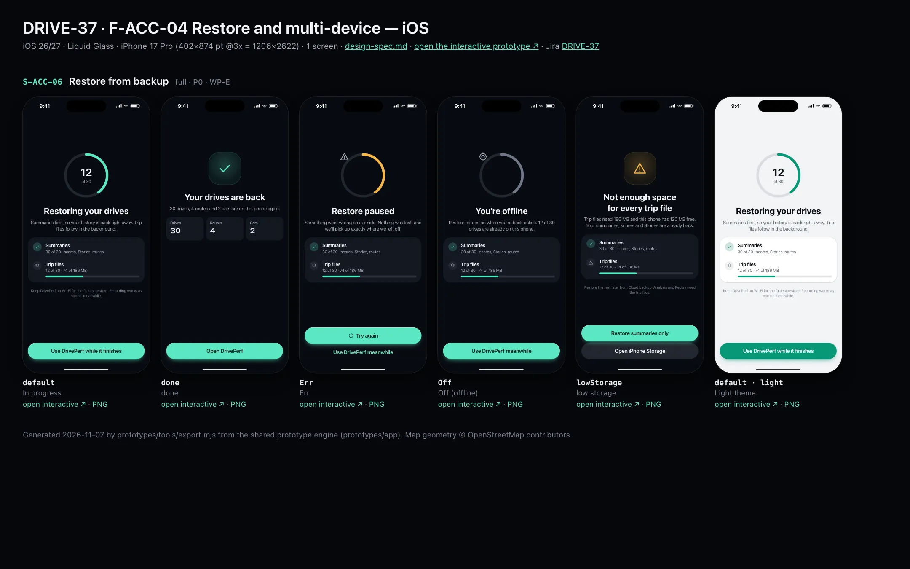
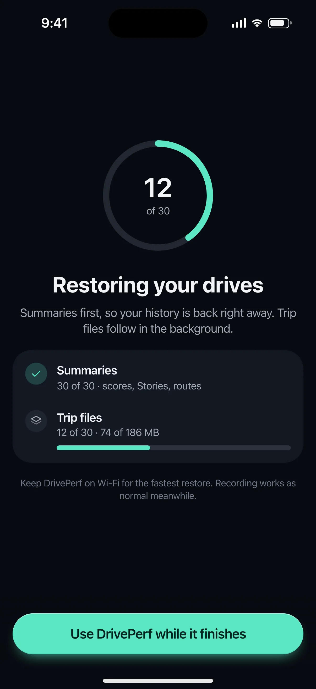
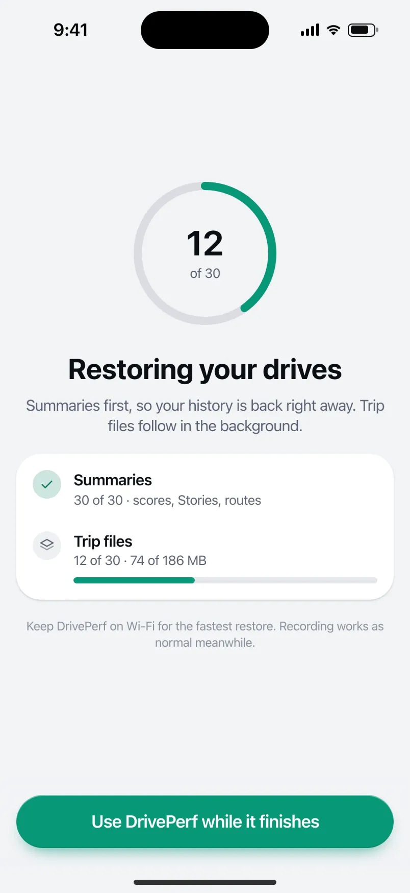

# DRIVE-37 · F-ACC-04 Restore and multi-device — iOS design spec

> Generated by `prototypes/tools/export.mjs` on 2026-11-07 from the shared prototype engine. **Do not edit by hand:** change the screen's `spec` in `prototypes/app/screens/wp-*.js` (see `prototypes/app/AUTHORING.md`) and re-export.

- **Jira story:** [DRIVE-37](https://thekeval.atlassian.net/browse/DRIVE-37) · F-ACC-04 · P0
- **Platform:** iOS 26/27 · Liquid Glass · iPhone 17 Pro (402×874 pt @3x = 1206×2622)
- **Interactive prototype:** [../../../../prototypes/ios/index.html#S-ACC-06](../../../../prototypes/ios/index.html#S-ACC-06) (catalog panel: every screen and state; deep links `#S-ID/state?trip=…&ent=…&theme=light&text=xl&rm=1`)
- **Contact sheet:** [mockup.html](mockup.html) · 
- **Design system (source of truth for values):** [brand](../../system/brand.md) · [components](../../system/components.md) · [motion](../../system/motion.md) · [accessibility](../../system/accessibility.md) · [screen map](../../system/screen-map.md) · [fixtures](../../system/fixtures.md) · tokens `prototypes/shared/tokens.css`

## Screens in this story

| Screen | Name | Presentation | Priority | States | Status |
|---|---|---|---|---|---|
| `S-ACC-06` | Restore from backup | Full | P0 | 5 | Prototyped |

## Tokens used on this platform

Values resolved from `prototypes/shared/tokens.css` inside the iOS device (`[data-platform="ios"]`). Use the token names in code; the hex values are for reference.

| Token | Dark | Light |
|---|---|---|
| `--app-bg` | `#080B10` | `#F2F3F6` |
| `--card-bg` | `#131822` | `#FFFFFF` |
| `--dp-bg-grouped` | `#080B10` | `#F2F3F6` |
| `--dp-surface` | `#131822` | `#FFFFFF` |
| `--dp-surface-2` | `#1B222D` | `#F2F3F6` |
| `--dp-surface-3` | `#262E3B` | `#E4E7EC` |
| `--dp-fill` | `#7880961F` | `#7880961F` |
| `--dp-fill-strong` | `#7880963D` | `#78809633` |
| `--dp-text` | `#F2F4F7` | `#0B0E13` |
| `--dp-text-2` | `#A3AAB6` | `#5A6271` |
| `--dp-text-3` | `#6E7787` | `#8A919D` |
| `--dp-separator` | `#96A0B429` | `#3C435024` |
| `--dp-accent` | `#5BE7C4` | `#079777` |
| `--dp-accent-text` | `#5BE7C4` | `#06775E` |
| `--dp-on-accent` | `#04241D` | `#FFFFFF` |
| `--dp-accent-container` | `#0A4439` | `#C6F8EA` |
| `--dp-record` | `#FFC24B` | `#9A6300` |
| `--dp-positive` | `#5BE7C4` | `#06775E` |
| `--dp-change-down` | `#A3AAB6` | `#5A6271` |
| `--dp-warning` | `#F5B648` | `#9A5F00` |
| `--dp-critical` | `#FF6B6B` | `#C62828` |
| `--dp-glass-fill` | `#1C222C6B` | `#FFFFFF8C` |
| `--dp-glass-fill-strong` | `#1C222CB8` | `#FFFFFFD1` |
| `--dp-glass-stroke` | `#FFFFFF24` | `#FFFFFF99` |
| `--dp-data-route` | `#5BE7C4` | `#079777` |
| `--dp-data-event-brake` | `#FF7A66` | `#A21F16` |
| `--dp-data-event-accel` | `#E58BD0` | `#A33A8C` |
| `--dp-data-event-corner` | `#EAD54E` | `#9A8A00` |
| `--dp-data-quality-good` | `#5FDB9C` | `#1E9E62` |
| `--dp-data-speed` | `#D6DCE4` | `#404A58` |
| `--dp-data-long-g` | `#5AB8F5` | `#0A6AB8` |
| `--dp-data-lat-g` | `#F5A142` | `#B25A00` |

| Type / layout token | Value |
|---|---|
| `--dp-font-screen-title` | `700 34px / 41px -apple-system, BlinkMacSystemFont, "SF Pro Display", system-ui, sans-serif` |
| `--dp-font-sheet-title` | `700 22px / 28px -apple-system, BlinkMacSystemFont, "SF Pro Display", system-ui, sans-serif` |
| `--dp-font-section-title` | `600 20px / 25px -apple-system, BlinkMacSystemFont, "SF Pro Display", system-ui, sans-serif` |
| `--dp-font-card-title` | `600 17px / 22px -apple-system, BlinkMacSystemFont, "SF Pro Text", system-ui, sans-serif` |
| `--dp-font-body` | `400 17px / 22px -apple-system, BlinkMacSystemFont, "SF Pro Text", system-ui, sans-serif` |
| `--dp-font-body-secondary` | `400 15px / 20px -apple-system, BlinkMacSystemFont, "SF Pro Text", system-ui, sans-serif` |
| `--dp-font-meta` | `400 13px / 18px -apple-system, BlinkMacSystemFont, "SF Pro Text", system-ui, sans-serif` |
| `--dp-font-caption` | `400 12px / 16px -apple-system, BlinkMacSystemFont, "SF Pro Text", system-ui, sans-serif` |
| `--dp-font-button` | `600 17px / 22px -apple-system, BlinkMacSystemFont, "SF Pro Text", system-ui, sans-serif` |
| `--dp-num-hero` | `600 72px / 72px -apple-system, BlinkMacSystemFont, "SF Pro Display", system-ui, sans-serif` |
| `--dp-num-xl` | `600 48px / 52px -apple-system, BlinkMacSystemFont, "SF Pro Display", system-ui, sans-serif` |
| `--dp-num-l` | `600 34px / 38px -apple-system, BlinkMacSystemFont, "SF Pro Display", system-ui, sans-serif` |
| `--dp-num-m` | `600 24px / 28px -apple-system, BlinkMacSystemFont, "SF Pro Display", system-ui, sans-serif` |
| `--dp-num-s` | `600 17px / 22px -apple-system, BlinkMacSystemFont, "SF Pro Display", system-ui, sans-serif` |
| `--dp-num-xs` | `600 13px / 16px -apple-system, BlinkMacSystemFont, "SF Pro Display", system-ui, sans-serif` |
| `--dp-screen-margin` | `16px` |
| `--dp-radius-card` | `24px` |
| `--dp-radius-card-hero` | `32px` |
| `--dp-radius-sheet` | `38px` |
| `--dp-radius-chip` | `999px` |
| `--dp-radius-button` | `999px` |
| `--dp-layout-list-row-min` | `52px` |
| `--dp-layout-touch-min` | `44px` |
| `--safe-top` | `62px` |
| `--safe-bottom` | `34px` |

Text sizes scale with `--dp-text-scale` (XL = 2.0×) and numerals with `--dp-num-scale` (XL = 1.3×). DP Numerals: SF Pro Expanded Semibold, tabular.

---

## S-ACC-06 · Restore from backup

 

- **Presentation:** full · tab: profile — screen map: “Full”
- **Entry points:** Sign-in on a new device with a backup · S-ACC-04 restore
- **Leads to:** S-HOME-01
- **PRD features:** F-ACC-04 · **Priority:** P0 · **WP:** E
- **Interactive:** [S-ACC-06](../../../../prototypes/ios/index.html#S-ACC-06)

**Purpose.** Bring a backed-up history onto this phone (F-ACC-04): summaries within 60 s, trip files in the background with progress, resumable without duplicates, and honest about offline, errors and low storage.

### States

| State | PRD label | Fixture params | Screenshot |
|---|---|---|---|
| `default` | In progress | — | [S-ACC-06.png](../../screens/ios/S-ACC-06.webp) · [open](../../../../prototypes/ios/index.html#S-ACC-06) |
| `done` | done | — | [S-ACC-06--done.png](../../screens/ios/S-ACC-06--done.webp) · [open](../../../../prototypes/ios/index.html#S-ACC-06/done) |
| `Err` | Err | — | [S-ACC-06--Err.png](../../screens/ios/S-ACC-06--Err.webp) · [open](../../../../prototypes/ios/index.html#S-ACC-06/Err) |
| `Off` | Off (offline) | — | [S-ACC-06--Off.png](../../screens/ios/S-ACC-06--Off.webp) · [open](../../../../prototypes/ios/index.html#S-ACC-06/Off) |
| `lowStorage` | low storage | — | [S-ACC-06--lowStorage.png](../../screens/ios/S-ACC-06--lowStorage.webp) · [open](../../../../prototypes/ios/index.html#S-ACC-06/lowStorage) |
| default · light | Light theme | `theme=light` | [S-ACC-06--light.png](../../screens/ios/S-ACC-06--light.webp) |

Every state also renders in light/dark (`theme=light`), XL text (`text=xl`) and reduced motion (`rm=1`).

### Layout

- Full-screen cover (no tab bar). Centre: 148 progress ring (8 stroke, Glide; paused = warning, offline = text-3) with “12 of 30” in DP Numerals, or a 104 illustration (done = check on positive halo, low storage = warning).
- Title (28/34) + lead. Progress card: Summaries (✓ 30 of 30 · scores, Stories, routes) and Trip files (12 of 30 · 74 of 186 MB + 6/8 px bar). Done: 3 stat tiles (Drives 30 · Routes 4 · Cars 2).
- Caption note. Bottom dock: in progress “Use DrivePerf while it finishes” · done “Open DrivePerf” · Err “Try again” + “Use DrivePerf meanwhile” · Off “Use DrivePerf meanwhile” · low storage “Restore summaries only” + “Open iPhone Storage / storage settings”.

### Components & tokens

| Component | Tokens / spec |
|---|---|
| `page` | --dp-bg-grouped (iOS) / --md-sys-color-surface (Android) · --dp-screen-margin 16 |
| `card` | --dp-surface / --md-sys-color-surface-container · --dp-radius-card (24 iOS · 16 Android) · hero: --dp-radius-card-hero (32 · 28) · light iOS: --dp-elev-1 |
| `stats` | --dp-surface-2 / --md-sys-color-surface-container-high · radius 14 iOS / 12 Android · value --dp-num-m (DP Numerals) · components.md §5 |
| `button` | --dp-accent / --dp-on-accent (filled) · --dp-fill-strong · --md-sys-color-secondary-container (tonal) · --dp-radius-button · height iOS 50/44/34 · Android 56/40/32 · --dp-font-button · components.md §0 |

### Interactions & navigation

- Use DrivePerf… / Open DrivePerf → S-HOME-01 (the restore keeps running in the background; Home shows the drives as they arrive).
- Try again → resumes (idempotent trip IDs, no duplicates).
- Restore summaries only → done state with summaries; trip files can be fetched later from S-ACC-04. Open storage → OS settings.
- Warn before download when storage is low (EC-STO).

### Motion

- Progress ring sweeps to its value (900 ms ease.countUp); done: the check pops (spring.default) + haptic success on “Open DrivePerf”. Blocks rise 8 px, 40 ms stagger. RM: final values, fades.

### Accessibility

- Ring is a progressbar: “12 of 30 trip files restored”. Progress updates are announced at most every 10% (polite).
- XL: the ring shrinks to 120; rows wrap; the dock grows.

### Platform notes

- **iOS (this spec):** fullScreenCover; downloads in a background URLSession; “Open iPhone Storage”.
- *Android (for reference):* Full-screen destination; WorkManager with a progress notification; “Open storage settings”.

### Analytics

- `restore_started`
- `restore_completed {trips_bucket, ms_bucket}`
- `restore_failed {reason}`

### Copy

| Key | Text |
|---|---|
| In progress | Restoring your drives. Summaries first, so your history is back right away. Trip files follow in the background. |
| Done | Your drives are back. 30 drives, 4 routes and 2 cars are on this phone again. |
| Err | Restore paused. Something went wrong on our side. Nothing was lost, and we’ll pick up exactly where we left off. |
| Off | You’re offline. Restore carries on when you’re back online. 12 of 30 drives are already on this phone. |
| Low storage | Not enough space for every trip file. Trip files need 186 MB and this phone has 120 MB free. Your summaries, scores and Stories are already back. |

### Free / Pro

Pro (a signed-in account with a backup).

### Data & fixtures

Totals from privacy.dataSize (30 drives, 186 MB), routes (4) and vehicles (2). Progress (12 of 30, 74 MB) and free space (120 MB) are prototype values.

### Assets

[icon-check.svg](assets/icon-check.svg) · [icon-warn.svg](assets/icon-warn.svg) · [icon-gps.svg](assets/icon-gps.svg) · [icon-layers.svg](assets/icon-layers.svg) · [icon-refresh.svg](assets/icon-refresh.svg)

UI glyphs may be swapped for SF Symbols / Material Symbols Rounded equivalents; event-pin, quality and provenance glyphs must not be (components.md global rules).

### Checklist (accessibility.md §9)

- [ ] Light and dark both render, and contrast passes.
- [ ] The XL text state reflows with no truncation.
- [ ] The RM state is defined.
- [ ] Every control has a label; every chart and map has a summary sentence.
- [ ] Every target ≥ 44 pt / 48 dp (≥ 64 in-drive).
- [ ] No meaning by colour alone.
- [ ] Speed is neutral wherever it appears and absent from social or live surfaces.
- [ ] No streak, leaderboard, speed or “beat your time” language.
- [ ] Behaviour is defined while a trip is active (D1 gate).
- [ ] Haptics come from motion.md §6 only.

---

Map geometry in the prototype: © OpenStreetMap contributors (ODbL). Speed and G are simulated fixtures (fixtures.md).
