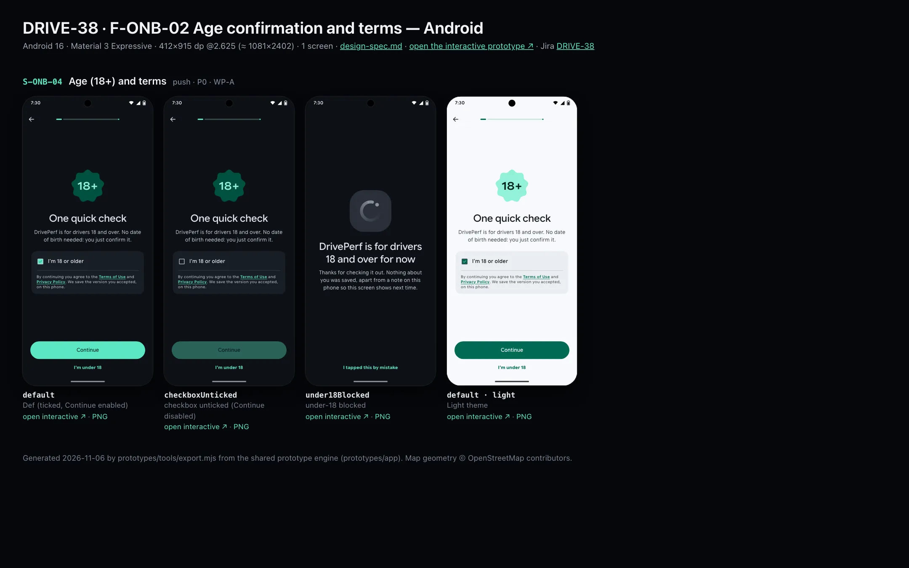
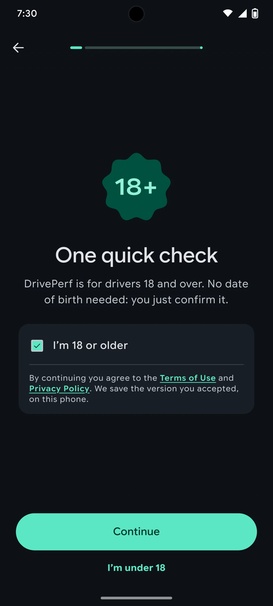
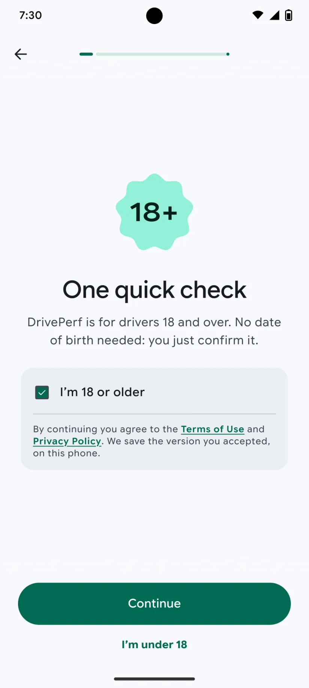

# DRIVE-38 · F-ONB-02 Age confirmation and terms — Android design spec

> Generated by `prototypes/tools/export.mjs` on 2026-11-06 from the shared prototype engine. **Do not edit by hand:** change the screen's `spec` in `prototypes/app/screens/wp-*.js` (see `prototypes/app/AUTHORING.md`) and re-export.

- **Jira story:** [DRIVE-38](https://thekeval.atlassian.net/browse/DRIVE-38) · F-ONB-02 · P0
- **Platform:** Android 16 · Material 3 Expressive · 412×915 dp @2.625 (≈ 1081×2402)
- **Interactive prototype:** [../../../../prototypes/android/index.html#S-ONB-04](../../../../prototypes/android/index.html#S-ONB-04) (catalog panel: every screen and state; deep links `#S-ID/state?trip=…&ent=…&theme=light&text=xl&rm=1`)
- **Contact sheet:** [mockup.html](mockup.html) · 
- **Design system (source of truth for values):** [brand](../../system/brand.md) · [components](../../system/components.md) · [motion](../../system/motion.md) · [accessibility](../../system/accessibility.md) · [screen map](../../system/screen-map.md) · [fixtures](../../system/fixtures.md) · tokens `prototypes/shared/tokens.css`

## Screens in this story

| Screen | Name | Presentation | Priority | States | Status |
|---|---|---|---|---|---|
| `S-ONB-04` | Age (18+) and terms | Full | P0 | 3 | Prototyped |

## Tokens used on this platform

Values resolved from `prototypes/shared/tokens.css` inside the Android device (`[data-platform="android"]`). Use the token names in code; the hex values are for reference.

| Token | Dark | Light |
|---|---|---|
| `--app-bg` | `#0D1117` | `#F7F9FC` |
| `--card-bg` | `#191E25` | `#EBEEF2` |
| `--dp-bg-grouped` | `#0D1117` | `#F7F9FC` |
| `--dp-surface` | `#191E25` | `#EBEEF2` |
| `--dp-surface-2` | `#1F252D` | `#E5E8EC` |
| `--dp-surface-3` | `#2A3038` | `#DFE2E6` |
| `--dp-fill` | `#2A3038` | `#DFE2E6` |
| `--dp-fill-strong` | `#353B44` | `#D3D7DC` |
| `--dp-text` | `#E1E3E8` | `#181C20` |
| `--dp-text-2` | `#C0C7CF` | `#40474F` |
| `--dp-text-3` | `#8A929B` | `#707881` |
| `--dp-separator` | `#40474F` | `#C0C7CF` |
| `--dp-accent` | `#5BE7C4` | `#006B53` |
| `--dp-accent-text` | `#5BE7C4` | `#006B53` |
| `--dp-on-accent` | `#00382B` | `#FFFFFF` |
| `--dp-accent-container` | `#00513F` | `#91F1D8` |
| `--dp-record` | `#FFC24B` | `#7A5900` |
| `--dp-positive` | `#5BE7C4` | `#006B53` |
| `--dp-change-down` | `#C0C7CF` | `#40474F` |
| `--dp-warning` | `#F5B648` | `#7A5900` |
| `--dp-critical` | `#FFB4AB` | `#BA1A1A` |
| `--dp-glass-fill` | `#1F252DF2` | `#E5E8ECF2` |
| `--dp-glass-fill-strong` | `#2A3038` | `#DFE2E6` |
| `--dp-glass-stroke` | `#FFFFFF0F` | `#0000000A` |
| `--md-sys-color-primary` | `#5BE7C4` | `#006B53` |
| `--md-sys-color-on-primary` | `#00382B` | `#FFFFFF` |
| `--md-sys-color-primary-container` | `#00513F` | `#91F1D8` |
| `--md-sys-color-on-primary-container` | `#91F1D8` | `#002118` |
| `--md-sys-color-secondary-container` | `#344C44` | `#CEE9DF` |
| `--md-sys-color-surface` | `#0D1117` | `#F7F9FC` |
| `--md-sys-color-surface-container` | `#191E25` | `#EBEEF2` |
| `--md-sys-color-surface-container-high` | `#1F252D` | `#E5E8EC` |
| `--md-sys-color-on-surface-variant` | `#C0C7CF` | `#40474F` |
| `--dp-data-route` | `#5BE7C4` | `#079777` |
| `--dp-data-event-brake` | `#FF7A66` | `#A21F16` |
| `--dp-data-event-accel` | `#E58BD0` | `#A33A8C` |
| `--dp-data-event-corner` | `#EAD54E` | `#9A8A00` |
| `--dp-data-quality-good` | `#5FDB9C` | `#1E9E62` |
| `--dp-data-speed` | `#D6DCE4` | `#404A58` |
| `--dp-data-long-g` | `#5AB8F5` | `#0A6AB8` |
| `--dp-data-lat-g` | `#F5A142` | `#B25A00` |

| Type / layout token | Value |
|---|---|
| `--dp-font-screen-title` | `600 32px / 40px "Google Sans Flex", "Google Sans Display", "Roboto Flex", Roboto, system-ui, sans-serif` |
| `--dp-font-sheet-title` | `400 24px / 32px "Google Sans Flex", "Google Sans Display", "Roboto Flex", Roboto, system-ui, sans-serif` |
| `--dp-font-section-title` | `600 22px / 28px "Google Sans Flex", "Google Sans Display", "Roboto Flex", Roboto, system-ui, sans-serif` |
| `--dp-font-card-title` | `700 16px / 24px "Google Sans Flex", "Google Sans Text", "Roboto Flex", Roboto, system-ui, sans-serif` |
| `--dp-font-body` | `400 16px / 24px "Google Sans Flex", "Google Sans Text", "Roboto Flex", Roboto, system-ui, sans-serif` |
| `--dp-font-body-secondary` | `400 14px / 20px "Google Sans Flex", "Google Sans Text", "Roboto Flex", Roboto, system-ui, sans-serif` |
| `--dp-font-meta` | `400 12px / 16px "Google Sans Flex", "Google Sans Text", "Roboto Flex", Roboto, system-ui, sans-serif` |
| `--dp-font-caption` | `500 12px / 16px "Google Sans Flex", "Google Sans Text", "Roboto Flex", Roboto, system-ui, sans-serif` |
| `--dp-font-button` | `700 14px / 20px "Google Sans Flex", "Google Sans Text", "Roboto Flex", Roboto, system-ui, sans-serif` |
| `--dp-num-hero` | `600 72px / 72px "Google Sans Flex", "Roboto Flex", Roboto, system-ui, sans-serif` |
| `--dp-num-xl` | `600 48px / 52px "Google Sans Flex", "Roboto Flex", Roboto, system-ui, sans-serif` |
| `--dp-num-l` | `600 34px / 38px "Google Sans Flex", "Roboto Flex", Roboto, system-ui, sans-serif` |
| `--dp-num-m` | `600 24px / 28px "Google Sans Flex", "Roboto Flex", Roboto, system-ui, sans-serif` |
| `--dp-num-s` | `600 17px / 22px "Google Sans Flex", "Roboto Flex", Roboto, system-ui, sans-serif` |
| `--dp-num-xs` | `600 13px / 16px "Google Sans Flex", "Roboto Flex", Roboto, system-ui, sans-serif` |
| `--dp-screen-margin` | `16px` |
| `--dp-radius-card` | `16px` |
| `--dp-radius-card-hero` | `28px` |
| `--dp-radius-sheet` | `28px` |
| `--dp-radius-chip` | `8px` |
| `--dp-radius-button` | `999px` |
| `--dp-layout-list-row-min` | `56px` |
| `--dp-layout-touch-min` | `48px` |
| `--safe-top` | `40px` |
| `--safe-bottom` | `24px` |

Text sizes scale with `--dp-text-scale` (XL = 2.0×) and numerals with `--dp-num-scale` (XL = 1.3×). DP Numerals: Google Sans Flex wdth 120 wght 600, tabular.

---

## S-ONB-04 · Age (18+) and terms

 

- **Presentation:** push — screen map: “Full”
- **Entry points:** S-ONB-03
- **Leads to:** S-ONB-05; under-18 → blocked state (end)
- **PRD features:** F-ONB-02 · **Priority:** P0 · **WP:** A
- **Interactive:** [S-ONB-04](../../../../prototypes/android/index.html#S-ONB-04)

**Purpose.** Keep v1 adults-only (F-ONB-02, PRD §6.7): self-attested 18+ with no date of birth, plus terms and privacy acceptance. This step can’t be skipped.

### States

| State | PRD label | Fixture params | Screenshot |
|---|---|---|---|
| `default` | Def (ticked, Continue enabled) | — | [S-ONB-04.png](../../screens/android/S-ONB-04.webp) · [open](../../../../prototypes/android/index.html#S-ONB-04) |
| `checkboxUnticked` | checkbox unticked (Continue disabled) | — | [S-ONB-04--checkboxUnticked.png](../../screens/android/S-ONB-04--checkboxUnticked.webp) · [open](../../../../prototypes/android/index.html#S-ONB-04/checkboxUnticked) |
| `under18Blocked` | under-18 blocked | — | [S-ONB-04--under18Blocked.png](../../screens/android/S-ONB-04--under18Blocked.webp) · [open](../../../../prototypes/android/index.html#S-ONB-04/under18Blocked) |
| default · light | Light theme | `theme=light` | [S-ONB-04--light.png](../../screens/android/S-ONB-04--light.webp) |

Every state also renders in light/dark (`theme=light`), XL text (`text=xl`) and reduced motion (`rm=1`).

### Layout

- Top bar: Back · step progress (step 1 of 9 iOS / 1 of 11 Android).
- Art: “18+” in DP Numerals 34 on a 112 badge (iOS continuous-corner square 34 radius, Glide 14% · Android Cookie9Sided primaryContainer).
- Title “One quick check”, lead (centred).
- Confirmation card: a checkbox row “I’m 18 or older” (iOS: 26 pt circular check, SF “checkmark.circle.fill” style · Android: M3 Checkbox 18 dp in a 48 dp target) and the terms line with two links (Glide text, underlined).
- Dock: “Continue” (disabled until ticked: 38% opacity, not focus-skipped) and a tertiary text button “I’m under 18”.
- under18Blocked: no back or progress; a muted (text-3) Loop 96, title “DrivePerf is for drivers 18 and over for now”, one honest line, and a tertiary “I tapped this by mistake”. Onboarding stops here.

### Components & tokens

| Component | Tokens / spec |
|---|---|
| `page` | --dp-bg-grouped (iOS) / --md-sys-color-surface (Android) · --dp-screen-margin 16 |
| `button` | --dp-accent / --dp-on-accent (filled) · --dp-fill-strong · --md-sys-color-secondary-container (tonal) · --dp-radius-button · height iOS 50/44/34 · Android 56/40/32 · --dp-font-button · components.md §0 |
| `cookie` | see components.md |
| `icon` | see components.md |

### Interactions & navigation

- Checkbox row toggles default ⇄ checkboxUnticked (toggleOn / toggleOff haptic). Arriving from S-ONB-03 lands on checkboxUnticked: it is never pre-ticked.
- “Continue” (enabled only when ticked) → S-ONB-05; stores the accepted terms version and date locally (terms_accepted).
- Terms of Use / Privacy Policy → driveperf.com/terms and /privacy (S-WEB-03 / S-WEB-04) in an in-app browser (SFSafariViewController / Custom Tab). Prototype: a toast.
- “I’m under 18” → under18Blocked (only a local flag is stored, F-ONB-02.2). “I tapped this by mistake” → checkboxUnticked.

### Motion

- The 18+ badge pops (spring.bouncy). The checkbox tick draws in with spring.fast; the Continue button fades from 38% to 100% (spring.effects).
- Blocked state: the muted Loop draws on once (1100 ms).
- RM: no pop, 220 ms cross-fade; the tick appears without the draw.

### Accessibility

- Checkbox: “I’m 18 or older, checkbox, not checked”. Disabled Continue label: “Continue, unavailable until you confirm you’re 18 or older”.
- Links: “Terms of Use, opens in browser”, “Privacy Policy, opens in browser”.
- Focus order: Back → step progress (“Setup, step n of N”) → title → body → primary → secondary. XL: art shrinks to 60%, title and copy wrap, the dock stays pinned and scrolls content under it; nothing truncates. Every glyph in a checklist is paired with its text (colour is never the only signal).

### Platform notes

- **Android (this spec):** M3 Checkbox + clickable row (Modifier.toggleable, Role.Checkbox). Under-18 uses the same full-screen destination with back disabled.
- *iOS (for reference):* iOS has no native checkbox: a full-row Button with a circular check symbol and .accessibilityAddTraits(.isToggle) / accessibilityValue “checked”.

### Analytics

- `onboarding_step_viewed {step: age}`
- `age_gate_passed`
- `age_gate_blocked`
- `terms_accepted {terms_version}`

### Copy

| Key | Text |
|---|---|
| Title | One quick check |
| Lead | DrivePerf is for drivers 18 and over. No date of birth needed: you just confirm it. |
| Checkbox | I’m 18 or older |
| Terms | By continuing you agree to the Terms of Use and Privacy Policy. We save the version you accepted, on this phone. |
| Under18 | I’m under 18 |
| Blocked title | DrivePerf is for drivers 18 and over for now |
| Blocked text | Thanks for checking it out. Nothing about you was saved, apart from a note on this phone so this screen shows next time. |

### Free / Pro

n/a (Free).

### Data & fixtures

No fixture data. user.ageConfirmed (true for Marcus) is the stored flag.

### Assets

[icon-check.svg](assets/icon-check.svg)

UI glyphs may be swapped for SF Symbols / Material Symbols Rounded equivalents; event-pin, quality and provenance glyphs must not be (components.md global rules).

### Checklist (accessibility.md §9)

- [ ] Light and dark both render, and contrast passes.
- [ ] The XL text state reflows with no truncation.
- [ ] The RM state is defined.
- [ ] Every control has a label; every chart and map has a summary sentence.
- [ ] Every target ≥ 44 pt / 48 dp (≥ 64 in-drive).
- [ ] No meaning by colour alone.
- [ ] Speed is neutral wherever it appears and absent from social or live surfaces.
- [ ] No streak, leaderboard, speed or “beat your time” language.
- [ ] Behaviour is defined while a trip is active (D1 gate).
- [ ] Haptics come from motion.md §6 only.

---

Map geometry in the prototype: © OpenStreetMap contributors (ODbL). Speed and G are simulated fixtures (fixtures.md).
