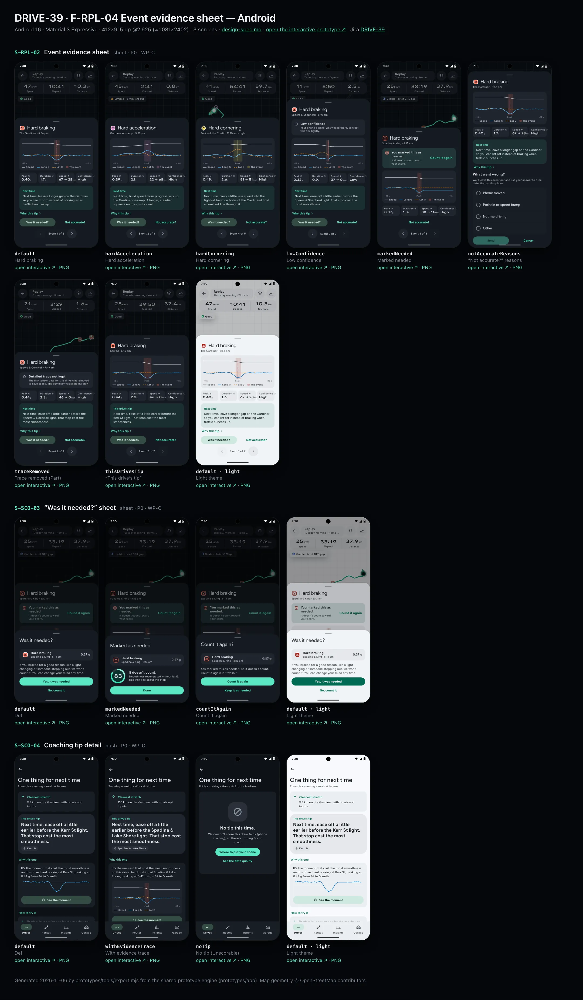
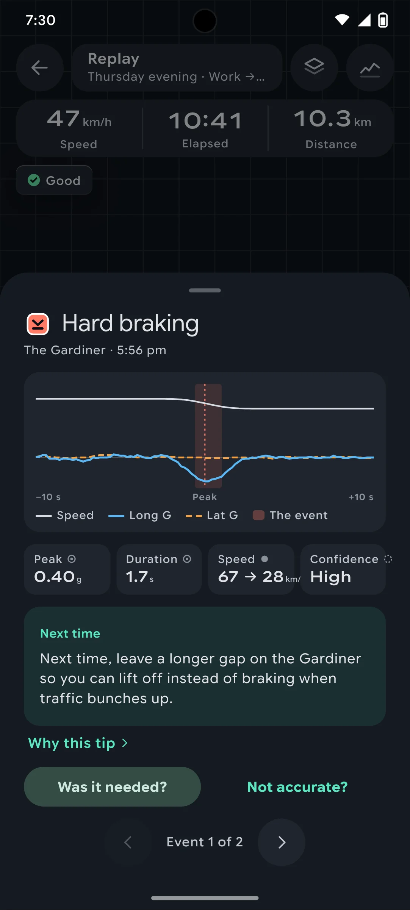
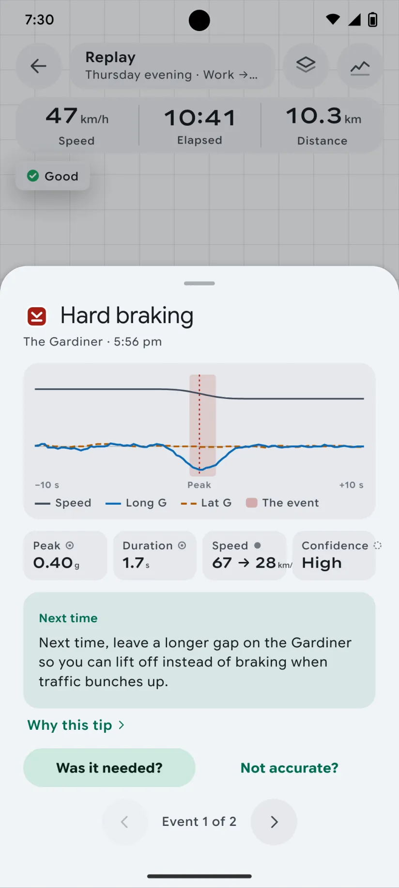
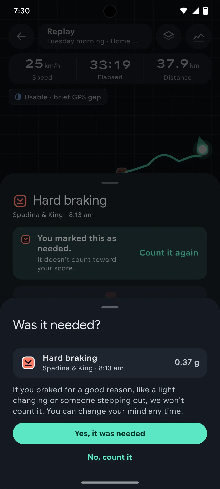
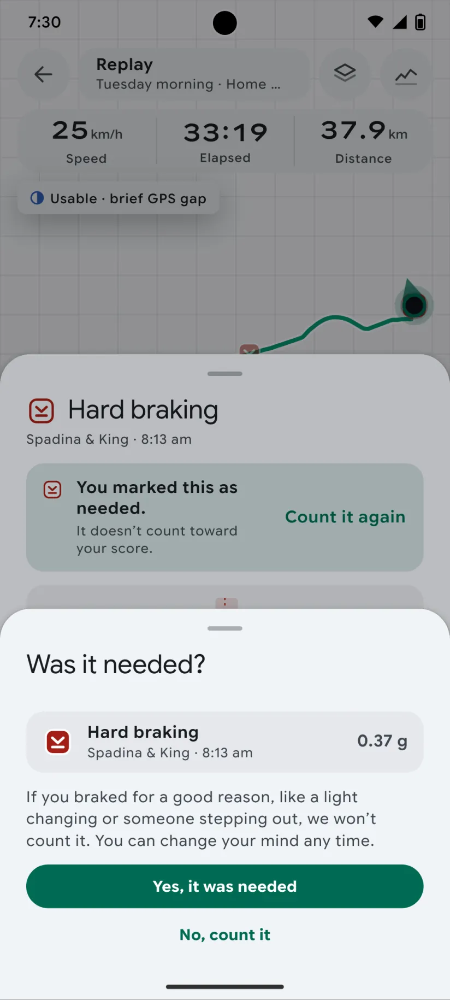
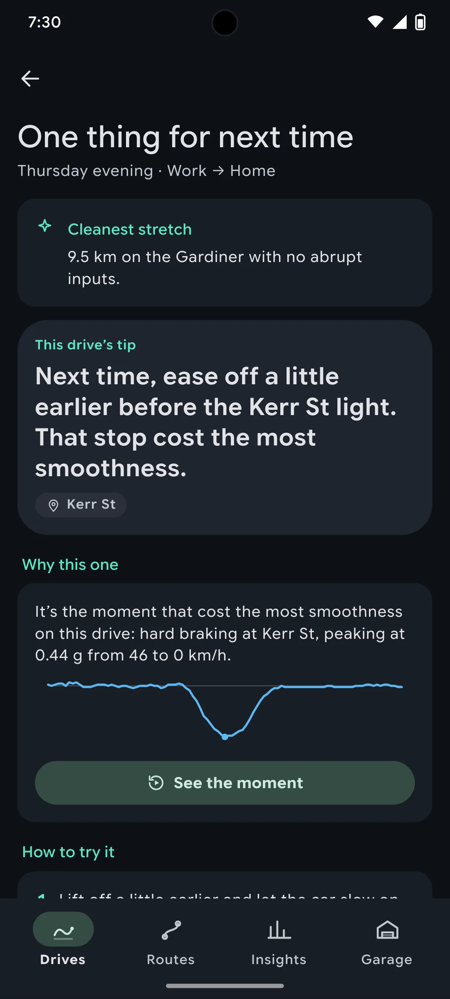
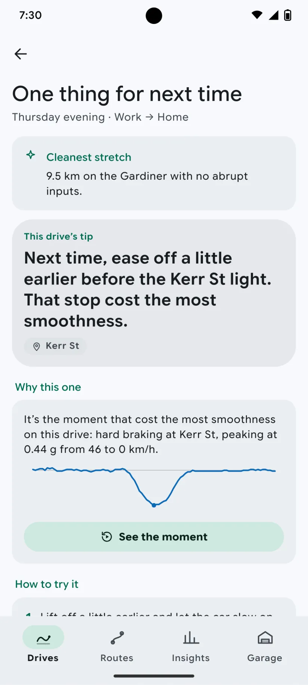

# DRIVE-39 · F-RPL-04 Event evidence sheet — Android design spec

> Generated by `prototypes/tools/export.mjs` on 2026-11-06 from the shared prototype engine. **Do not edit by hand:** change the screen's `spec` in `prototypes/app/screens/wp-*.js` (see `prototypes/app/AUTHORING.md`) and re-export.

- **Jira story:** [DRIVE-39](https://thekeval.atlassian.net/browse/DRIVE-39) · F-RPL-04 · P0
- **Platform:** Android 16 · Material 3 Expressive · 412×915 dp @2.625 (≈ 1081×2402)
- **Interactive prototype:** [../../../../prototypes/android/index.html#S-RPL-02](../../../../prototypes/android/index.html#S-RPL-02) (catalog panel: every screen and state; deep links `#S-ID/state?trip=…&ent=…&theme=light&text=xl&rm=1`)
- **Contact sheet:** [mockup.html](mockup.html) · 
- **Design system (source of truth for values):** [brand](../../system/brand.md) · [components](../../system/components.md) · [motion](../../system/motion.md) · [accessibility](../../system/accessibility.md) · [screen map](../../system/screen-map.md) · [fixtures](../../system/fixtures.md) · tokens `prototypes/shared/tokens.css`

## Screens in this story

| Screen | Name | Presentation | Priority | States | Status |
|---|---|---|---|---|---|
| `S-RPL-02` | Event evidence sheet | Sheet (medium → large) | P0 | 8 | Prototyped |
| `S-SCO-03` | “Was it needed?” sheet | Sheet (small) | P0 | 3 | Prototyped |
| `S-SCO-04` | Coaching tip detail | Push / sheet | P0 | 3 | Prototyped |

## Tokens used on this platform

Values resolved from `prototypes/shared/tokens.css` inside the Android device (`[data-platform="android"]`). Use the token names in code; the hex values are for reference.

| Token | Dark | Light |
|---|---|---|
| `--app-bg` | `#0D1117` | `#F7F9FC` |
| `--card-bg` | `#191E25` | `#EBEEF2` |
| `--dp-bg-grouped` | `#0D1117` | `#F7F9FC` |
| `--dp-surface` | `#191E25` | `#EBEEF2` |
| `--dp-surface-2` | `#1F252D` | `#E5E8EC` |
| `--dp-surface-3` | `#2A3038` | `#DFE2E6` |
| `--dp-fill` | `#2A3038` | `#DFE2E6` |
| `--dp-fill-strong` | `#353B44` | `#D3D7DC` |
| `--dp-text` | `#E1E3E8` | `#181C20` |
| `--dp-text-2` | `#C0C7CF` | `#40474F` |
| `--dp-text-3` | `#8A929B` | `#707881` |
| `--dp-separator` | `#40474F` | `#C0C7CF` |
| `--dp-accent` | `#5BE7C4` | `#006B53` |
| `--dp-accent-text` | `#5BE7C4` | `#006B53` |
| `--dp-on-accent` | `#00382B` | `#FFFFFF` |
| `--dp-accent-container` | `#00513F` | `#91F1D8` |
| `--dp-record` | `#FFC24B` | `#7A5900` |
| `--dp-positive` | `#5BE7C4` | `#006B53` |
| `--dp-change-down` | `#C0C7CF` | `#40474F` |
| `--dp-warning` | `#F5B648` | `#7A5900` |
| `--dp-critical` | `#FFB4AB` | `#BA1A1A` |
| `--dp-glass-fill` | `#1F252DF2` | `#E5E8ECF2` |
| `--dp-glass-fill-strong` | `#2A3038` | `#DFE2E6` |
| `--dp-glass-stroke` | `#FFFFFF0F` | `#0000000A` |
| `--md-sys-color-primary` | `#5BE7C4` | `#006B53` |
| `--md-sys-color-on-primary` | `#00382B` | `#FFFFFF` |
| `--md-sys-color-primary-container` | `#00513F` | `#91F1D8` |
| `--md-sys-color-on-primary-container` | `#91F1D8` | `#002118` |
| `--md-sys-color-secondary-container` | `#344C44` | `#CEE9DF` |
| `--md-sys-color-surface` | `#0D1117` | `#F7F9FC` |
| `--md-sys-color-surface-container` | `#191E25` | `#EBEEF2` |
| `--md-sys-color-surface-container-high` | `#1F252D` | `#E5E8EC` |
| `--md-sys-color-on-surface-variant` | `#C0C7CF` | `#40474F` |
| `--dp-data-route` | `#5BE7C4` | `#079777` |
| `--dp-data-event-brake` | `#FF7A66` | `#A21F16` |
| `--dp-data-event-accel` | `#E58BD0` | `#A33A8C` |
| `--dp-data-event-corner` | `#EAD54E` | `#9A8A00` |
| `--dp-data-quality-good` | `#5FDB9C` | `#1E9E62` |
| `--dp-data-speed` | `#D6DCE4` | `#404A58` |
| `--dp-data-long-g` | `#5AB8F5` | `#0A6AB8` |
| `--dp-data-lat-g` | `#F5A142` | `#B25A00` |

| Type / layout token | Value |
|---|---|
| `--dp-font-screen-title` | `600 32px / 40px "Google Sans Flex", "Google Sans Display", "Roboto Flex", Roboto, system-ui, sans-serif` |
| `--dp-font-sheet-title` | `400 24px / 32px "Google Sans Flex", "Google Sans Display", "Roboto Flex", Roboto, system-ui, sans-serif` |
| `--dp-font-section-title` | `600 22px / 28px "Google Sans Flex", "Google Sans Display", "Roboto Flex", Roboto, system-ui, sans-serif` |
| `--dp-font-card-title` | `700 16px / 24px "Google Sans Flex", "Google Sans Text", "Roboto Flex", Roboto, system-ui, sans-serif` |
| `--dp-font-body` | `400 16px / 24px "Google Sans Flex", "Google Sans Text", "Roboto Flex", Roboto, system-ui, sans-serif` |
| `--dp-font-body-secondary` | `400 14px / 20px "Google Sans Flex", "Google Sans Text", "Roboto Flex", Roboto, system-ui, sans-serif` |
| `--dp-font-meta` | `400 12px / 16px "Google Sans Flex", "Google Sans Text", "Roboto Flex", Roboto, system-ui, sans-serif` |
| `--dp-font-caption` | `500 12px / 16px "Google Sans Flex", "Google Sans Text", "Roboto Flex", Roboto, system-ui, sans-serif` |
| `--dp-font-button` | `700 14px / 20px "Google Sans Flex", "Google Sans Text", "Roboto Flex", Roboto, system-ui, sans-serif` |
| `--dp-num-hero` | `600 72px / 72px "Google Sans Flex", "Roboto Flex", Roboto, system-ui, sans-serif` |
| `--dp-num-xl` | `600 48px / 52px "Google Sans Flex", "Roboto Flex", Roboto, system-ui, sans-serif` |
| `--dp-num-l` | `600 34px / 38px "Google Sans Flex", "Roboto Flex", Roboto, system-ui, sans-serif` |
| `--dp-num-m` | `600 24px / 28px "Google Sans Flex", "Roboto Flex", Roboto, system-ui, sans-serif` |
| `--dp-num-s` | `600 17px / 22px "Google Sans Flex", "Roboto Flex", Roboto, system-ui, sans-serif` |
| `--dp-num-xs` | `600 13px / 16px "Google Sans Flex", "Roboto Flex", Roboto, system-ui, sans-serif` |
| `--dp-screen-margin` | `16px` |
| `--dp-radius-card` | `16px` |
| `--dp-radius-card-hero` | `28px` |
| `--dp-radius-sheet` | `28px` |
| `--dp-radius-chip` | `8px` |
| `--dp-radius-button` | `999px` |
| `--dp-layout-list-row-min` | `56px` |
| `--dp-layout-touch-min` | `48px` |
| `--safe-top` | `40px` |
| `--safe-bottom` | `24px` |

Text sizes scale with `--dp-text-scale` (XL = 2.0×) and numerals with `--dp-num-scale` (XL = 1.3×). DP Numerals: Google Sans Flex wdth 120 wght 600, tabular.

---

## S-RPL-02 · Event evidence sheet

 

- **Presentation:** sheet · tab: drives · detent: auto — screen map: “Sheet (medium → large)”
- **Entry points:** S-RPL-01 pin · S-ANL-01 tick · S-SCO-01 contributor · S-TRP-01 event list
- **Leads to:** S-SCO-03 · S-SCO-04 · "Not accurate?" list
- **PRD features:** F-RPL-04, F-SCO-04, F-SCO-05, F-SCO-06, F-DQ-05 · **Priority:** P0 · **WP:** C
- **Interactive:** [S-RPL-02](../../../../prototypes/android/index.html#S-RPL-02)

**Purpose.** After tapping a pin or tick, show the evidence (speed and G from 10 s before to 10 s after, with start/peak/end) and the related tip, so the user understands the event and what to try next time (F-RPL-04). It is also where “Was it needed?” and “Not accurate?” start (F-SCO-05).

### States

| State | PRD label | Fixture params | Screenshot |
|---|---|---|---|
| `default` | Hard braking | `trip=t20261105-1745` `event=e1` | [S-RPL-02.png](../../screens/android/S-RPL-02.webp) · [open](../../../../prototypes/android/index.html#S-RPL-02) |
| `hardAcceleration` | Hard acceleration | `trip=t20261027-1728` `event=e2` | [S-RPL-02--hardAcceleration.png](../../screens/android/S-RPL-02--hardAcceleration.webp) · [open](../../../../prototypes/android/index.html#S-RPL-02/hardAcceleration) |
| `hardCornering` | Hard cornering | `trip=t20261010-1015` `event=e4` | [S-RPL-02--hardCornering.png](../../screens/android/S-RPL-02--hardCornering.webp) · [open](../../../../prototypes/android/index.html#S-RPL-02/hardCornering) |
| `lowConfidence` | Low confidence | `trip=t20261022-0805` `event=e2` | [S-RPL-02--lowConfidence.png](../../screens/android/S-RPL-02--lowConfidence.webp) · [open](../../../../prototypes/android/index.html#S-RPL-02/lowConfidence) |
| `markedNeeded` | Marked needed | `trip=t20261020-0740` `event=e3` | [S-RPL-02--markedNeeded.png](../../screens/android/S-RPL-02--markedNeeded.webp) · [open](../../../../prototypes/android/index.html#S-RPL-02/markedNeeded) |
| `notAccurateReasons` | “Not accurate?” reasons | `trip=t20261105-1745` `event=e1` | [S-RPL-02--notAccurateReasons.png](../../screens/android/S-RPL-02--notAccurateReasons.webp) · [open](../../../../prototypes/android/index.html#S-RPL-02/notAccurateReasons) |
| `traceRemoved` | Trace removed (Part) | `trip=t20261002-0745` `event=e1` | [S-RPL-02--traceRemoved.png](../../screens/android/S-RPL-02--traceRemoved.webp) · [open](../../../../prototypes/android/index.html#S-RPL-02/traceRemoved) |
| `thisDrivesTip` | “This drive’s tip” | `trip=t20261105-1745` `event=e2` | [S-RPL-02--thisDrivesTip.png](../../screens/android/S-RPL-02--thisDrivesTip.webp) · [open](../../../../prototypes/android/index.html#S-RPL-02/thisDrivesTip) |
| default · light | Light theme | `theme=light` | [S-RPL-02--light.png](../../screens/android/S-RPL-02--light.webp) |

Every state also renders in light/dark (`theme=light`), XL text (`text=xl`) and reduced motion (`rm=1`).

### Layout

- iOS sheet at the medium detent (glass), expandable to large; Android ModalBottomSheet half → full with drag handle. Playback pauses and the map centres on the event underneath.
- Header: event pin 28 (hollow when needed) + “Hard braking” (`sheetTitle`) · “{Place} · {time of day}” (meta) · iOS glass close.
- Banners as needed: low confidence (info, dashed-ring glyph) · marked needed (positive, hollow pin, “Count it again”) · trace removed.
- Trace card (surface-2 / surface-container-high, radius 18, 12 padding): speed (neutral, top) and longitudinal + lateral G (one lane, sky solid and amber dashed), start/peak/end guides, −10 s … +10 s labels, legend row with swatch + pattern.
- Facts grid 4 columns (2 at XL): Peak 0.40 g · Duration 1.7 s · Speed 67 → 28 km/h (neutral) · Confidence High; each label carries its provenance glyph (derived/observed/estimated). Peak is struck through when needed.
- Tip card: “This drive’s tip” when trip.tip.eventId is this event, else “Next time” with the library tip for this event type and place; “Why this tip ›” → S-SCO-04.
- Actions: Was it needed? (tonal, block) → S-SCO-03 · Not accurate? (text) → inline reasons (radios: Phone moved · Pothole or speed bump · Not me driving · Other) + Send / Cancel.
- Event stepper: ‹ Event 1 of 2 › (gesture-free alternative to the scrubber’s next/previous event, accessibility.md §6).

### Components & tokens

| Component | Tokens / spec |
|---|---|
| `sheetHeader` | see components.md |
| `banner` | radius 12 (--dp-radius-sm+) · info --dp-fill · attention --dp-warning-container · critical --dp-critical-container · components.md §22 |
| `evidenceTrace` | see components.md |
| `tipCard` | --dp-accent 10% over --dp-surface · sparkline --dp-data-long-g · components.md §18 |
| `button` | --dp-accent / --dp-on-accent (filled) · --dp-fill-strong · --md-sys-color-secondary-container (tonal) · --dp-radius-button · height iOS 50/44/34 · Android 56/40/32 · --dp-font-button · components.md §0 |
| `radios` | see components.md |
| `iconButton` | see components.md |
| `provenance` | see components.md |

### Interactions & navigation

- Was it needed? → S-SCO-03 (small sheet over this one) · Count it again → S-SCO-03/countItAgain.
- Not accurate? → reasons list; Send → feedback stored locally, the event is excluded, toast, sheet closes. Cancel returns.
- Why this tip → S-SCO-04.
- ‹ / › → previous/next event (replaces this sheet, moves the replay marker and selection underneath).
- Drag down / scrim tap / close → back to Replay, selection clears.

### Motion

- Sheet rises with spring.sheet; the trace lines draw on in 700 ms after the sheet settles; detent snaps use the system spring + haptic selection.
- RM: the trace appears complete; the sheet cross-fades.

### Accessibility

- Sheet label: “Hard braking at Spadina and Front, 8:14 am. Peak 0.42 g over 1.4 seconds, from 48 to 0 kilometres per hour. Confidence high.” Focus moves to the title on open and returns to the pin on close.
- Trace summary: “Speed and G from 10 seconds before to 10 seconds after. Speed went from 67 to 28 kilometres per hour. Peak 0.40 g.”
- Each fact reads label, value, units spelled out and provenance. Needed state is announced in words, not only by the hollow pin.
- XL: facts go to 2 columns; the trace stays 118 tall; the sheet opens large.

### Platform notes

- **Android (this spec):** ModalBottomSheet (surface-container-low, radius 28, 32×4 handle); FilledTonalButton + TextButton; tonal icon buttons; no close button (drag or back).
- *iOS (for reference):* Glass sheet at the medium detent; tonal-glass “Was it needed?” button; glass stepper buttons; close button in the header.

### Analytics

- `evidence_opened {type}`
- `event_reported_inaccurate {type, reason}`
- `tip_viewed {tip_id}`

### Copy

| Key | Text |
|---|---|
| Low confidence | Your phone’s signal was weaker here, so treat this one lightly. |
| Needed | You marked this as needed. It doesn’t count toward your score. · Count it again |
| Trace removed | Detailed trace not kept. The raw sensor data for this drive was removed to save space. The summary values below stay. |
| Tip | This drive’s tip \| Next time |
| Actions | Was it needed? · Not accurate? |
| Reasons | What went wrong? We’ll leave this event out and use your answer to tune detection on this phone. · Phone moved · Pothole or speed bump · Not me driving · Other · Send · Cancel |
| Thanks | Thanks. This event won’t count. Your answer stays on this phone. |

### Free / Pro

Same window as Replay: Free for drives in the last 30 days, Pro for older ones (the sheet is only reachable from an unlocked replay).

### Data & fixtures

States → events: default t20261105-1745/e1 (the Gardiner) · thisDrivesTip t20261105-1745/e2 (Kerr St, trip.tip.eventId) · hardAcceleration t20261027-1728/e2 · hardCornering t20261010-1015/e4 · lowConfidence t20261022-0805/e2 (Low) · markedNeeded t20261020-0740/e3 · notAccurateReasons t20261105-1745/e1 · traceRemoved t20261002-0745/e1 (evidence withheld to simulate storage trimming). “Next time” tips are filled from DP_DATA.tips templates with the event’s place/road (derived); time of day = trip.start + event.t.

### Assets

[icon-info.svg](assets/icon-info.svg) · [icon-layers.svg](assets/icon-layers.svg) · [icon-chevronLeft.svg](assets/icon-chevronLeft.svg) · [icon-chevronRight.svg](assets/icon-chevronRight.svg) · [icon-check.svg](assets/icon-check.svg) · [icon-close.svg](assets/icon-close.svg)

UI glyphs may be swapped for SF Symbols / Material Symbols Rounded equivalents; event-pin, quality and provenance glyphs must not be (components.md global rules).

### Checklist (accessibility.md §9)

- [ ] Light and dark both render, and contrast passes.
- [ ] The XL text state reflows with no truncation.
- [ ] The RM state is defined.
- [ ] Every control has a label; every chart and map has a summary sentence.
- [ ] Every target ≥ 44 pt / 48 dp (≥ 64 in-drive).
- [ ] No meaning by colour alone.
- [ ] Speed is neutral wherever it appears and absent from social or live surfaces.
- [ ] No streak, leaderboard, speed or “beat your time” language.
- [ ] Behaviour is defined while a trip is active (D1 gate).
- [ ] Haptics come from motion.md §6 only.

---

## S-SCO-03 · “Was it needed?” sheet

 

- **Presentation:** sheet · tab: drives · detent: auto — screen map: “Sheet (small)”
- **Entry points:** S-RPL-02 · Story "Was it needed?" chip
- **Leads to:** Back (score recomputes ≤ 1 s)
- **PRD features:** F-SCO-05, F-RPL-04 · **Priority:** P0 · **WP:** C
- **Interactive:** [S-SCO-03](../../../../prototypes/android/index.html#S-SCO-03)

**Purpose.** Let a driver who braked hard for a good reason mark it as needed so they are never penalised for doing the right thing (F-SCO-05); the score recomputes within 1 s and no further questions are asked.

### States

| State | PRD label | Fixture params | Screenshot |
|---|---|---|---|
| `default` | Def | `trip=t20261020-0740` `event=e3` | [S-SCO-03.png](../../screens/android/S-SCO-03.webp) · [open](../../../../prototypes/android/index.html#S-SCO-03) |
| `markedNeeded` | Marked needed | `trip=t20261020-0740` `event=e3` | [S-SCO-03--markedNeeded.png](../../screens/android/S-SCO-03--markedNeeded.webp) · [open](../../../../prototypes/android/index.html#S-SCO-03/markedNeeded) |
| `countItAgain` | Count it again | `trip=t20261020-0740` `event=e3` | [S-SCO-03--countItAgain.png](../../screens/android/S-SCO-03--countItAgain.webp) · [open](../../../../prototypes/android/index.html#S-SCO-03/countItAgain) |
| default · light | Light theme | `theme=light` | [S-SCO-03--light.png](../../screens/android/S-SCO-03--light.webp) |

Every state also renders in light/dark (`theme=light`), XL text (`text=xl`) and reduced motion (`rm=1`).

### Layout

- Small sheet (iOS 0.32 fraction · Android small ModalBottomSheet), auto height, over the evidence sheet or the Story.
- Header “Was it needed?” · event chip (pin 30, type, place · time, peak g) · one explanatory paragraph · Yes, it was needed (filled, block) · No, count it (text).
- markedNeeded: hollow pin, struck-through g, mini ring 78 with the recomputed score + “It doesn’t count. Smoothness recomputed without it: 83. Tips won’t be about this stop.” + Done.
- countItAgain: “Count it again?” + paragraph + Count it again (filled) · Keep it as needed (text).

### Components & tokens

| Component | Tokens / spec |
|---|---|
| `sheetHeader` | see components.md |
| `button` | --dp-accent / --dp-on-accent (filled) · --dp-fill-strong · --md-sys-color-secondary-container (tonal) · --dp-radius-button · height iOS 50/44/34 · Android 56/40/32 · --dp-font-button · components.md §0 |
| `ring` | track --dp-fill-strong · arc --dp-gradient-ring (glide-400 → accent → glide-100) · baseline notch --dp-text-2 · record notch --dp-record · Android container Cookie9Sided --md-sys-color-primary-container 42% · components.md §3 |

### Interactions & navigation

- Yes → markedNeeded (≤ 1 s recompute, haptic tap); Done → back.
- No, count it → back with nothing changed.
- Count it again → restored (toast with Undo), back.

### Motion

- Recompute: the ring arc tweens to the new value with spring.default and the digits roll (contentTransition numericText). RM: value swaps.

### Accessibility

- Focus lands on the title; buttons are full width ≥ 50 pt / 56 dp. The needed state is said in words, not only by the hollow pin.

### Platform notes

- **Android (this spec):** Small ModalBottomSheet; filled + text buttons.
- *iOS (for reference):* Small glass sheet; glassProminent primary.

### Analytics

- `event_marked_needed {type, source}`
- `event_unmarked`

### Copy

| Key | Text |
|---|---|
| Ask | Was it needed? If you braked for a good reason, like a light changing or someone stepping out, we won’t count it. You can change your mind any time. |
| Buttons | Yes, it was needed · No, count it |
| Done | Marked as needed · It doesn’t count. Smoothness recomputed without it: {score}. Tips won’t be about this stop. |
| Again | Count it again? You marked this as needed, so it doesn’t count. Count it again if it wasn’t. · Count it again · Keep it as needed |
| Toast | Counted again · Smoothness recomputed |

### Free / Pro

Free.

### Data & fixtures

t20261020-0740 e3 (hard braking at Spadina & King, needed: true in the fixture; the default state shows it before marking). The recomputed score is the fixture score (83), which already excludes the needed event; the pre-exclusion score isn’t in the fixtures, so it isn’t shown.

### Assets

[icon-check.svg](assets/icon-check.svg) · [icon-close.svg](assets/icon-close.svg)

UI glyphs may be swapped for SF Symbols / Material Symbols Rounded equivalents; event-pin, quality and provenance glyphs must not be (components.md global rules).

### Checklist (accessibility.md §9)

- [ ] Light and dark both render, and contrast passes.
- [ ] The XL text state reflows with no truncation.
- [ ] The RM state is defined.
- [ ] Every control has a label; every chart and map has a summary sentence.
- [ ] Every target ≥ 44 pt / 48 dp (≥ 64 in-drive).
- [ ] No meaning by colour alone.
- [ ] Speed is neutral wherever it appears and absent from social or live surfaces.
- [ ] No streak, leaderboard, speed or “beat your time” language.
- [ ] Behaviour is defined while a trip is active (D1 gate).
- [ ] Haptics come from motion.md §6 only.

---

## S-SCO-04 · Coaching tip detail

 

- **Presentation:** push · tab: drives — screen map: “Push / sheet”
- **Entry points:** S-TRP-01 tip · S-STY-01 f6 · S-RPL-02
- **Leads to:** S-RPL-02 (evidence)
- **PRD features:** F-SCO-06, F-RPL-04 · **Priority:** P0 · **WP:** C
- **Interactive:** [S-SCO-04](../../../../prototypes/android/index.html#S-SCO-04)

**Purpose.** One specific, evidence-backed thing to try next time (F-SCO-06), tied to a place and an event, always after a positive observation.

### States

| State | PRD label | Fixture params | Screenshot |
|---|---|---|---|
| `default` | Def | `trip=t20261105-1745` | [S-SCO-04.png](../../screens/android/S-SCO-04.webp) · [open](../../../../prototypes/android/index.html#S-SCO-04) |
| `withEvidenceTrace` | With evidence trace | `trip=t20261027-1728` | [S-SCO-04--withEvidenceTrace.png](../../screens/android/S-SCO-04--withEvidenceTrace.webp) · [open](../../../../prototypes/android/index.html#S-SCO-04/withEvidenceTrace) |
| `noTip` | No tip (Unscorable) | `trip=t20261106-1210` | [S-SCO-04--noTip.png](../../screens/android/S-SCO-04--noTip.webp) · [open](../../../../prototypes/android/index.html#S-SCO-04/noTip) |
| default · light | Light theme | `theme=light` | [S-SCO-04--light.png](../../screens/android/S-SCO-04--light.webp) |

Every state also renders in light/dark (`theme=light`), XL text (`text=xl`) and reduced motion (`rm=1`).

### Layout

- Push, title “One thing for next time” + part of day · label.
- Positive card first: ✦ “Cleanest stretch” + trip.cleanest.text.
- Hero tip card (accent 9% tint, radius hero): kicker “This drive’s tip” (or “Next time” for another event’s library tip) · tip text (`sectionTitle`) · place chip.
- “Why this one” card: one derived sentence (event type, place, peak g, speed before → after, neutral) + long-G sparkline (default) or the full −10…+10 s evidence trace (withEvidenceTrace) + See the moment (tonal) → S-RPL-02. Sub-threshold tips (no event) explain they come from the firmest stop.
- “How to try it” card: three numbered steps for the tip category; footer about one tip per drive, no speed targets.
- noTip: empty state with the Unscorable glyph, “No tip this time.”, placement guide (primary) and data quality (secondary).

### Components & tokens

| Component | Tokens / spec |
|---|---|
| `navBar` | --dp-font-card-title · --dp-font-meta · glass: --dp-glass-fill + --dp-glass-blur · components.md §2 |
| `card` | --dp-surface / --md-sys-color-surface-container · --dp-radius-card (24 iOS · 16 Android) · hero: --dp-radius-card-hero (32 · 28) · light iOS: --dp-elev-1 |
| `sparkline` | see components.md |
| `evidenceTrace` | see components.md |
| `button` | --dp-accent / --dp-on-accent (filled) · --dp-fill-strong · --md-sys-color-secondary-container (tonal) · --dp-radius-button · height iOS 50/44/34 · Android 56/40/32 · --dp-font-button · components.md §0 |
| `section` | --dp-font-section-title · --dp-layout-section-gap 28 |
| `empty` | illustration 120 in --dp-accent · --dp-font-section-title · components.md §21 |

### Interactions & navigation

- See the moment → S-RPL-02 (thisDrivesTip) · Where to put your phone → S-DQ-02 · See the data quality → S-DQ-01/unscorable · Back.

### Motion

- Blocks rise 8 px (40 ms stagger); the trace/sparkline draws on 900 ms. RM: static.

### Accessibility

- Tip card reads kicker + tip + place. Steps are an ordered list. Speed is plain text. XL: cards reflow.

### Platform notes

- **Android (this spec):** MediumFlexibleTopAppBar; hero card radius 28 surface-container-high.
- *iOS (for reference):* Inline title; hero card radius 32.

### Analytics

- `tip_viewed {tip_id}`
- `tip_evidence_opened {tip_id}`

### Copy

| Key | Text |
|---|---|
| Why | It’s the moment that cost the most smoothness on this drive: {type} at {place}, peaking at {g} g from {before} to {after} km/h. |
| Why (no event) | No stop crossed the hard-braking line on this drive, so this tip comes from your firmest stop, at {place}. Small things make the difference at this level. |
| Steps | braking · anticipation · acceleration · cornering · consistency: three steps each (see HOW in wp-c.js) |
| Footer | One tip per drive, always after something that went well. Tips never set speed targets. |
| No tip | No tip this time. We couldn’t score this drive fairly ({reason}), so there’s nothing fair to coach. |

### Free / Pro

Free.

### Data & fixtures

trip.tip + trip.cleanest + the tip event’s evidence. States: default t20261105-1745 (Kerr St) · withEvidenceTrace t20261027-1728 (Spadina & Lake Shore) · noTip t20261106-1210. “How to try it” steps are coaching copy per tip category (not fixtures); the “why” sentence is derived from the event.

### Assets

[icon-sparkle.svg](assets/icon-sparkle.svg) · [icon-pin.svg](assets/icon-pin.svg) · [icon-replay.svg](assets/icon-replay.svg)

UI glyphs may be swapped for SF Symbols / Material Symbols Rounded equivalents; event-pin, quality and provenance glyphs must not be (components.md global rules).

### Checklist (accessibility.md §9)

- [ ] Light and dark both render, and contrast passes.
- [ ] The XL text state reflows with no truncation.
- [ ] The RM state is defined.
- [ ] Every control has a label; every chart and map has a summary sentence.
- [ ] Every target ≥ 44 pt / 48 dp (≥ 64 in-drive).
- [ ] No meaning by colour alone.
- [ ] Speed is neutral wherever it appears and absent from social or live surfaces.
- [ ] No streak, leaderboard, speed or “beat your time” language.
- [ ] Behaviour is defined while a trip is active (D1 gate).
- [ ] Haptics come from motion.md §6 only.

---

Map geometry in the prototype: © OpenStreetMap contributors (ODbL). Speed and G are simulated fixtures (fixtures.md).
