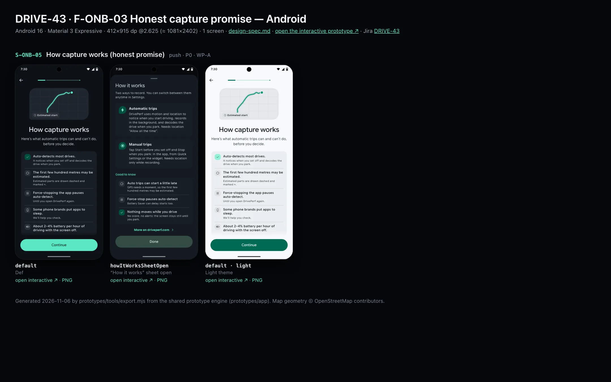
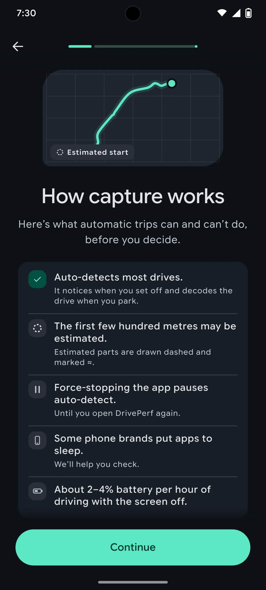
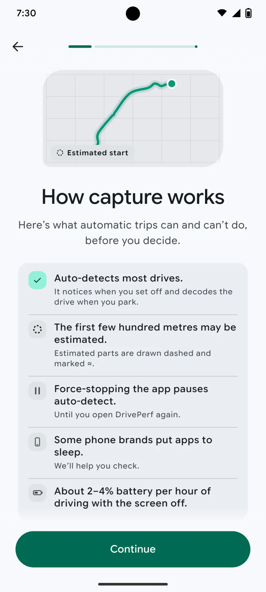

# DRIVE-43 · F-ONB-03 Honest capture promise — Android design spec

> Generated by `prototypes/tools/export.mjs` on 2026-11-06 from the shared prototype engine. **Do not edit by hand:** change the screen's `spec` in `prototypes/app/screens/wp-*.js` (see `prototypes/app/AUTHORING.md`) and re-export.

- **Jira story:** [DRIVE-43](https://thekeval.atlassian.net/browse/DRIVE-43) · F-ONB-03 · P0
- **Platform:** Android 16 · Material 3 Expressive · 412×915 dp @2.625 (≈ 1081×2402)
- **Interactive prototype:** [../../../../prototypes/android/index.html#S-ONB-05](../../../../prototypes/android/index.html#S-ONB-05) (catalog panel: every screen and state; deep links `#S-ID/state?trip=…&ent=…&theme=light&text=xl&rm=1`)
- **Contact sheet:** [mockup.html](mockup.html) · 
- **Design system (source of truth for values):** [brand](../../system/brand.md) · [components](../../system/components.md) · [motion](../../system/motion.md) · [accessibility](../../system/accessibility.md) · [screen map](../../system/screen-map.md) · [fixtures](../../system/fixtures.md) · tokens `prototypes/shared/tokens.css`

## Screens in this story

| Screen | Name | Presentation | Priority | States | Status |
|---|---|---|---|---|---|
| `S-ONB-05` | How capture works (honest promise) | Full | P0 | 2 | Prototyped |

## Tokens used on this platform

Values resolved from `prototypes/shared/tokens.css` inside the Android device (`[data-platform="android"]`). Use the token names in code; the hex values are for reference.

| Token | Dark | Light |
|---|---|---|
| `--app-bg` | `#0D1117` | `#F7F9FC` |
| `--card-bg` | `#191E25` | `#EBEEF2` |
| `--dp-bg-grouped` | `#0D1117` | `#F7F9FC` |
| `--dp-surface` | `#191E25` | `#EBEEF2` |
| `--dp-surface-2` | `#1F252D` | `#E5E8EC` |
| `--dp-surface-3` | `#2A3038` | `#DFE2E6` |
| `--dp-fill` | `#2A3038` | `#DFE2E6` |
| `--dp-fill-strong` | `#353B44` | `#D3D7DC` |
| `--dp-text` | `#E1E3E8` | `#181C20` |
| `--dp-text-2` | `#C0C7CF` | `#40474F` |
| `--dp-text-3` | `#8A929B` | `#707881` |
| `--dp-separator` | `#40474F` | `#C0C7CF` |
| `--dp-accent` | `#5BE7C4` | `#006B53` |
| `--dp-accent-text` | `#5BE7C4` | `#006B53` |
| `--dp-on-accent` | `#00382B` | `#FFFFFF` |
| `--dp-accent-container` | `#00513F` | `#91F1D8` |
| `--dp-record` | `#FFC24B` | `#7A5900` |
| `--dp-positive` | `#5BE7C4` | `#006B53` |
| `--dp-change-down` | `#C0C7CF` | `#40474F` |
| `--dp-warning` | `#F5B648` | `#7A5900` |
| `--dp-critical` | `#FFB4AB` | `#BA1A1A` |
| `--dp-glass-fill` | `#1F252DF2` | `#E5E8ECF2` |
| `--dp-glass-fill-strong` | `#2A3038` | `#DFE2E6` |
| `--dp-glass-stroke` | `#FFFFFF0F` | `#0000000A` |
| `--md-sys-color-primary` | `#5BE7C4` | `#006B53` |
| `--md-sys-color-on-primary` | `#00382B` | `#FFFFFF` |
| `--md-sys-color-primary-container` | `#00513F` | `#91F1D8` |
| `--md-sys-color-on-primary-container` | `#91F1D8` | `#002118` |
| `--md-sys-color-secondary-container` | `#344C44` | `#CEE9DF` |
| `--md-sys-color-surface` | `#0D1117` | `#F7F9FC` |
| `--md-sys-color-surface-container` | `#191E25` | `#EBEEF2` |
| `--md-sys-color-surface-container-high` | `#1F252D` | `#E5E8EC` |
| `--md-sys-color-on-surface-variant` | `#C0C7CF` | `#40474F` |
| `--dp-data-route` | `#5BE7C4` | `#079777` |
| `--dp-data-event-brake` | `#FF7A66` | `#A21F16` |
| `--dp-data-event-accel` | `#E58BD0` | `#A33A8C` |
| `--dp-data-event-corner` | `#EAD54E` | `#9A8A00` |
| `--dp-data-quality-good` | `#5FDB9C` | `#1E9E62` |
| `--dp-data-speed` | `#D6DCE4` | `#404A58` |
| `--dp-data-long-g` | `#5AB8F5` | `#0A6AB8` |
| `--dp-data-lat-g` | `#F5A142` | `#B25A00` |

| Type / layout token | Value |
|---|---|
| `--dp-font-screen-title` | `600 32px / 40px "Google Sans Flex", "Google Sans Display", "Roboto Flex", Roboto, system-ui, sans-serif` |
| `--dp-font-sheet-title` | `400 24px / 32px "Google Sans Flex", "Google Sans Display", "Roboto Flex", Roboto, system-ui, sans-serif` |
| `--dp-font-section-title` | `600 22px / 28px "Google Sans Flex", "Google Sans Display", "Roboto Flex", Roboto, system-ui, sans-serif` |
| `--dp-font-card-title` | `700 16px / 24px "Google Sans Flex", "Google Sans Text", "Roboto Flex", Roboto, system-ui, sans-serif` |
| `--dp-font-body` | `400 16px / 24px "Google Sans Flex", "Google Sans Text", "Roboto Flex", Roboto, system-ui, sans-serif` |
| `--dp-font-body-secondary` | `400 14px / 20px "Google Sans Flex", "Google Sans Text", "Roboto Flex", Roboto, system-ui, sans-serif` |
| `--dp-font-meta` | `400 12px / 16px "Google Sans Flex", "Google Sans Text", "Roboto Flex", Roboto, system-ui, sans-serif` |
| `--dp-font-caption` | `500 12px / 16px "Google Sans Flex", "Google Sans Text", "Roboto Flex", Roboto, system-ui, sans-serif` |
| `--dp-font-button` | `700 14px / 20px "Google Sans Flex", "Google Sans Text", "Roboto Flex", Roboto, system-ui, sans-serif` |
| `--dp-num-hero` | `600 72px / 72px "Google Sans Flex", "Roboto Flex", Roboto, system-ui, sans-serif` |
| `--dp-num-xl` | `600 48px / 52px "Google Sans Flex", "Roboto Flex", Roboto, system-ui, sans-serif` |
| `--dp-num-l` | `600 34px / 38px "Google Sans Flex", "Roboto Flex", Roboto, system-ui, sans-serif` |
| `--dp-num-m` | `600 24px / 28px "Google Sans Flex", "Roboto Flex", Roboto, system-ui, sans-serif` |
| `--dp-num-s` | `600 17px / 22px "Google Sans Flex", "Roboto Flex", Roboto, system-ui, sans-serif` |
| `--dp-num-xs` | `600 13px / 16px "Google Sans Flex", "Roboto Flex", Roboto, system-ui, sans-serif` |
| `--dp-screen-margin` | `16px` |
| `--dp-radius-card` | `16px` |
| `--dp-radius-card-hero` | `28px` |
| `--dp-radius-sheet` | `28px` |
| `--dp-radius-chip` | `8px` |
| `--dp-radius-button` | `999px` |
| `--dp-layout-list-row-min` | `56px` |
| `--dp-layout-touch-min` | `48px` |
| `--safe-top` | `40px` |
| `--safe-bottom` | `24px` |

Text sizes scale with `--dp-text-scale` (XL = 2.0×) and numerals with `--dp-num-scale` (XL = 1.3×). DP Numerals: Google Sans Flex wdth 120 wght 600, tabular.

---

## S-ONB-05 · How capture works (honest promise)

 

- **Presentation:** push — screen map: “Full”
- **Entry points:** S-ONB-04
- **Leads to:** S-ONB-06; "How it works" sheet
- **PRD features:** F-ONB-03 · **Priority:** P0 · **WP:** A
- **Interactive:** [S-ONB-05](../../../../prototypes/android/index.html#S-ONB-05)

**Purpose.** The honest capture promise before any permission (F-ONB-03, Gate 1 #10): what automatic capture can and can’t do, in the binding words, so nobody is surprised later.

### States

| State | PRD label | Fixture params | Screenshot |
|---|---|---|---|
| `default` | Def | — | [S-ONB-05.png](../../screens/android/S-ONB-05.webp) · [open](../../../../prototypes/android/index.html#S-ONB-05) |
| `howItWorksSheetOpen` | “How it works” sheet open | — | [S-ONB-05--howItWorksSheetOpen.png](../../screens/android/S-ONB-05--howItWorksSheetOpen.webp) · [open](../../../../prototypes/android/index.html#S-ONB-05/howItWorksSheetOpen) |
| default · light | Light theme | `theme=light` | [S-ONB-05--light.png](../../screens/android/S-ONB-05--light.webp) |

Every state also renders in light/dark (`theme=light`), XL text (`text=xl`) and reduced motion (`rm=1`).

### Layout

- Top bar: Back · step progress (2 of 9 / 2 of 11).
- Art (260 × 132): the example route on a faint grid, its first segment dashed (--dp-est-dash 4/4 at 60%) with an “≈ Estimated start” chip (provenance estimated glyph), the rest solid Glide.
- Title “How capture works”, lead.
- Promise card (one card, rows 16 padding, 0.5 separators inset 56): glyph disc 28 + bold line + supporting line: ✓ “Auto-detects most drives.” · ≈ (dashed ring) “The first few hundred metres may be estimated.” · ⏸ “Force-quitting pauses auto-detect.” (Android: “Force-stopping the app pauses auto-detect.”) · Android only: phone glyph “Some phone brands put apps to sleep.” / “We’ll help you check.” · battery “About 2–4% battery per hour of driving with the screen off.”
- “ⓘ How it works” text button under the card → the “How it works” sheet.
- Dock: “Continue”.
- howItWorksSheetOpen: sheet at the large detent (iOS glass with close button · Android ModalBottomSheet with drag handle and a Done button): “Two ways to record” → Automatic trips card · Manual trips card · “Good to know” checklist · “More on driveperf.com ›” (S-WEB-06).

### Components & tokens

| Component | Tokens / spec |
|---|---|
| `page` | --dp-bg-grouped (iOS) / --md-sys-color-surface (Android) · --dp-screen-margin 16 |
| `button` | --dp-accent / --dp-on-accent (filled) · --dp-fill-strong · --md-sys-color-secondary-container (tonal) · --dp-radius-button · height iOS 50/44/34 · Android 56/40/32 · --dp-font-button · components.md §0 |
| `card` | --dp-surface / --md-sys-color-surface-container · --dp-radius-card (24 iOS · 16 Android) · hero: --dp-radius-card-hero (32 · 28) · light iOS: --dp-elev-1 |
| `sheet` | iOS glass --dp-glass-fill-strong + --dp-glass-prominent-blur, radius --dp-radius-sheet 38 · Android ModalBottomSheet --md-sys-color-surface-container-low, top radius 28, drag handle 32×4 · motion spring.sheet |
| `provenance` | see components.md |

### Interactions & navigation

- “Continue” → S-ONB-06.
- “How it works” → howItWorksSheetOpen (capture_promise_learn_more). Close / Done / scrim tap → default.
- “More on driveperf.com” → S-WEB-06 in an in-app browser (prototype: toast).

### Motion

- Hero motion: the dashed estimated start draws first, then the solid route takes over (1600 ms total, ease.drawOn, glow head); the start dot and end pin pop (spring, overshoot).
- Sheet: slides up with spring.sheet, scrim fades 260 ms.
- RM: final route; sheet and page cross-fade 220 ms.

### Accessibility

- The promise card is a list read in order; the estimated row reads “The first few hundred metres may be estimated. Estimated parts are drawn dashed and marked approximately.”
- Sheet moves focus to “How it works” on open and returns it to the button on close.
- Focus order: Back → step progress (“Setup, step n of N”) → title → body → primary → secondary. XL: art shrinks to 60%, title and copy wrap, the dock stays pinned and scrolls content under it; nothing truncates. Every glyph in a checklist is paired with its text (colour is never the only signal).

### Platform notes

- **Android (this spec):** “Force-stopping the app pauses auto-detect.” plus the OEM line “Some phone brands put apps to sleep. We’ll help you check.” (F-ONB-03.2). Sheet: ModalBottomSheet with drag handle and a tonal Done.
- *iOS (for reference):* “Force-quitting pauses auto-detect.” with the swipe-away explanation. Sheet: .presentationDetents([.large]) with a glass close button.

### Analytics

- `capture_promise_viewed`
- `capture_promise_learn_more`

### Copy

| Key | Text |
|---|---|
| Promise | Auto-detects most drives. The first few hundred metres may be estimated. Force-quitting pauses auto-detect. |
| Battery | About 2–4% battery per hour of driving with the screen off. |
| Android force-stop | Force-stopping the app pauses auto-detect. |
| Android OEM | Some phone brands put apps to sleep. We’ll help you check. |
| Sheet lead | Two ways to record. You can switch between them anytime in Settings. |

### Free / Pro

n/a (Free).

### Data & fixtures

Promise text = DP_DATA.health.presets.allGood.promise (split into its three sentences). Art = smoothed glyph of t20261105-0742 with the first two segments drawn as the estimated start (illustrative; quality.estimatedStartM is 428 m on that drive).

### Assets

[icon-check.svg](assets/icon-check.svg) · [icon-pause.svg](assets/icon-pause.svg) · [icon-battery.svg](assets/icon-battery.svg) · [icon-phone.svg](assets/icon-phone.svg) · [icon-info.svg](assets/icon-info.svg) · [icon-bolt.svg](assets/icon-bolt.svg) · [icon-record.svg](assets/icon-record.svg) · [icon-close.svg](assets/icon-close.svg) · [icon-chevronRight.svg](assets/icon-chevronRight.svg)

UI glyphs may be swapped for SF Symbols / Material Symbols Rounded equivalents; event-pin, quality and provenance glyphs must not be (components.md global rules).

### Checklist (accessibility.md §9)

- [ ] Light and dark both render, and contrast passes.
- [ ] The XL text state reflows with no truncation.
- [ ] The RM state is defined.
- [ ] Every control has a label; every chart and map has a summary sentence.
- [ ] Every target ≥ 44 pt / 48 dp (≥ 64 in-drive).
- [ ] No meaning by colour alone.
- [ ] Speed is neutral wherever it appears and absent from social or live surfaces.
- [ ] No streak, leaderboard, speed or “beat your time” language.
- [ ] Behaviour is defined while a trip is active (D1 gate).
- [ ] Haptics come from motion.md §6 only.

---

Map geometry in the prototype: © OpenStreetMap contributors (ODbL). Speed and G are simulated fixtures (fixtures.md).
