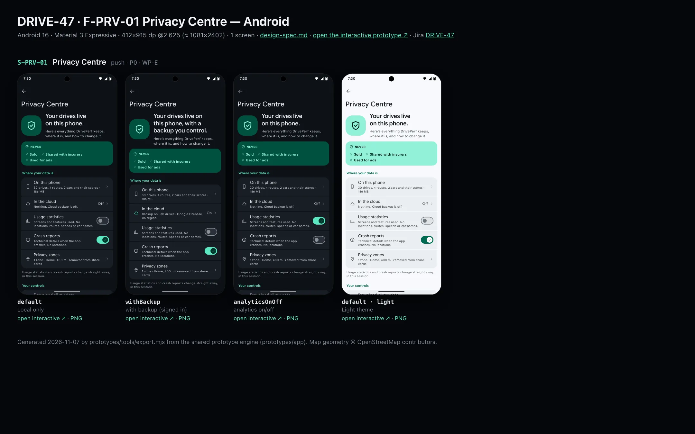
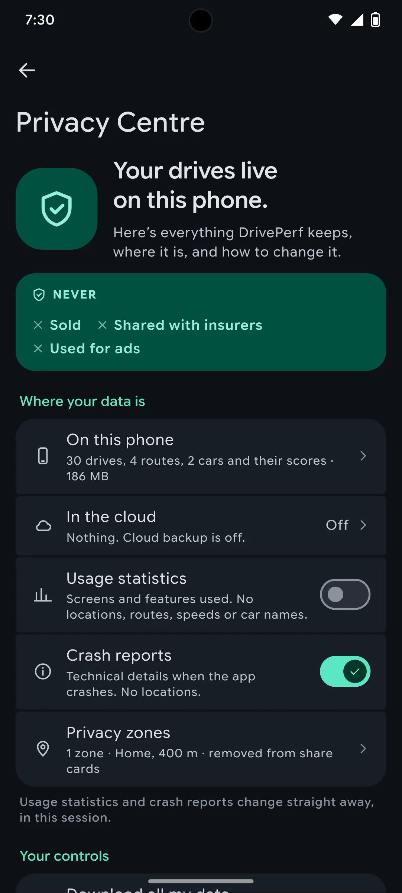
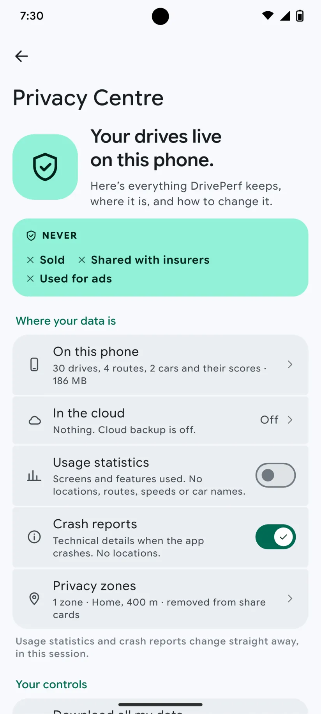

# DRIVE-47 · F-PRV-01 Privacy Centre — Android design spec

> Generated by `prototypes/tools/export.mjs` on 2026-11-06 from the shared prototype engine. **Do not edit by hand:** change the screen's `spec` in `prototypes/app/screens/wp-*.js` (see `prototypes/app/AUTHORING.md`) and re-export.

- **Jira story:** [DRIVE-47](https://thekeval.atlassian.net/browse/DRIVE-47) · F-PRV-01 · P0
- **Platform:** Android 16 · Material 3 Expressive · 412×915 dp @2.625 (≈ 1081×2402)
- **Interactive prototype:** [../../../../prototypes/android/index.html#S-PRV-01](../../../../prototypes/android/index.html#S-PRV-01) (catalog panel: every screen and state; deep links `#S-ID/state?trip=…&ent=…&theme=light&text=xl&rm=1`)
- **Contact sheet:** [mockup.html](mockup.html) · 
- **Design system (source of truth for values):** [brand](../../system/brand.md) · [components](../../system/components.md) · [motion](../../system/motion.md) · [accessibility](../../system/accessibility.md) · [screen map](../../system/screen-map.md) · [fixtures](../../system/fixtures.md) · tokens `prototypes/shared/tokens.css`

## Screens in this story

| Screen | Name | Presentation | Priority | States | Status |
|---|---|---|---|---|---|
| `S-PRV-01` | Privacy Centre | Push | P0 | 3 | Prototyped |

## Tokens used on this platform

Values resolved from `prototypes/shared/tokens.css` inside the Android device (`[data-platform="android"]`). Use the token names in code; the hex values are for reference.

| Token | Dark | Light |
|---|---|---|
| `--app-bg` | `#0D1117` | `#F7F9FC` |
| `--card-bg` | `#191E25` | `#EBEEF2` |
| `--dp-bg-grouped` | `#0D1117` | `#F7F9FC` |
| `--dp-surface` | `#191E25` | `#EBEEF2` |
| `--dp-surface-2` | `#1F252D` | `#E5E8EC` |
| `--dp-surface-3` | `#2A3038` | `#DFE2E6` |
| `--dp-fill` | `#2A3038` | `#DFE2E6` |
| `--dp-fill-strong` | `#353B44` | `#D3D7DC` |
| `--dp-text` | `#E1E3E8` | `#181C20` |
| `--dp-text-2` | `#C0C7CF` | `#40474F` |
| `--dp-text-3` | `#8A929B` | `#707881` |
| `--dp-separator` | `#40474F` | `#C0C7CF` |
| `--dp-accent` | `#5BE7C4` | `#006B53` |
| `--dp-accent-text` | `#5BE7C4` | `#006B53` |
| `--dp-on-accent` | `#00382B` | `#FFFFFF` |
| `--dp-accent-container` | `#00513F` | `#91F1D8` |
| `--dp-record` | `#FFC24B` | `#7A5900` |
| `--dp-positive` | `#5BE7C4` | `#006B53` |
| `--dp-change-down` | `#C0C7CF` | `#40474F` |
| `--dp-warning` | `#F5B648` | `#7A5900` |
| `--dp-critical` | `#FFB4AB` | `#BA1A1A` |
| `--dp-glass-fill` | `#1F252DF2` | `#E5E8ECF2` |
| `--dp-glass-fill-strong` | `#2A3038` | `#DFE2E6` |
| `--dp-glass-stroke` | `#FFFFFF0F` | `#0000000A` |
| `--md-sys-color-primary` | `#5BE7C4` | `#006B53` |
| `--md-sys-color-on-primary` | `#00382B` | `#FFFFFF` |
| `--md-sys-color-primary-container` | `#00513F` | `#91F1D8` |
| `--md-sys-color-on-primary-container` | `#91F1D8` | `#002118` |
| `--md-sys-color-secondary-container` | `#344C44` | `#CEE9DF` |
| `--md-sys-color-surface` | `#0D1117` | `#F7F9FC` |
| `--md-sys-color-surface-container` | `#191E25` | `#EBEEF2` |
| `--md-sys-color-surface-container-high` | `#1F252D` | `#E5E8EC` |
| `--md-sys-color-on-surface-variant` | `#C0C7CF` | `#40474F` |
| `--dp-data-route` | `#5BE7C4` | `#079777` |
| `--dp-data-event-brake` | `#FF7A66` | `#A21F16` |
| `--dp-data-event-accel` | `#E58BD0` | `#A33A8C` |
| `--dp-data-event-corner` | `#EAD54E` | `#9A8A00` |
| `--dp-data-quality-good` | `#5FDB9C` | `#1E9E62` |
| `--dp-data-speed` | `#D6DCE4` | `#404A58` |
| `--dp-data-long-g` | `#5AB8F5` | `#0A6AB8` |
| `--dp-data-lat-g` | `#F5A142` | `#B25A00` |

| Type / layout token | Value |
|---|---|
| `--dp-font-screen-title` | `600 32px / 40px "Google Sans Flex", "Google Sans Display", "Roboto Flex", Roboto, system-ui, sans-serif` |
| `--dp-font-sheet-title` | `400 24px / 32px "Google Sans Flex", "Google Sans Display", "Roboto Flex", Roboto, system-ui, sans-serif` |
| `--dp-font-section-title` | `600 22px / 28px "Google Sans Flex", "Google Sans Display", "Roboto Flex", Roboto, system-ui, sans-serif` |
| `--dp-font-card-title` | `700 16px / 24px "Google Sans Flex", "Google Sans Text", "Roboto Flex", Roboto, system-ui, sans-serif` |
| `--dp-font-body` | `400 16px / 24px "Google Sans Flex", "Google Sans Text", "Roboto Flex", Roboto, system-ui, sans-serif` |
| `--dp-font-body-secondary` | `400 14px / 20px "Google Sans Flex", "Google Sans Text", "Roboto Flex", Roboto, system-ui, sans-serif` |
| `--dp-font-meta` | `400 12px / 16px "Google Sans Flex", "Google Sans Text", "Roboto Flex", Roboto, system-ui, sans-serif` |
| `--dp-font-caption` | `500 12px / 16px "Google Sans Flex", "Google Sans Text", "Roboto Flex", Roboto, system-ui, sans-serif` |
| `--dp-font-button` | `700 14px / 20px "Google Sans Flex", "Google Sans Text", "Roboto Flex", Roboto, system-ui, sans-serif` |
| `--dp-num-hero` | `600 72px / 72px "Google Sans Flex", "Roboto Flex", Roboto, system-ui, sans-serif` |
| `--dp-num-xl` | `600 48px / 52px "Google Sans Flex", "Roboto Flex", Roboto, system-ui, sans-serif` |
| `--dp-num-l` | `600 34px / 38px "Google Sans Flex", "Roboto Flex", Roboto, system-ui, sans-serif` |
| `--dp-num-m` | `600 24px / 28px "Google Sans Flex", "Roboto Flex", Roboto, system-ui, sans-serif` |
| `--dp-num-s` | `600 17px / 22px "Google Sans Flex", "Roboto Flex", Roboto, system-ui, sans-serif` |
| `--dp-num-xs` | `600 13px / 16px "Google Sans Flex", "Roboto Flex", Roboto, system-ui, sans-serif` |
| `--dp-screen-margin` | `16px` |
| `--dp-radius-card` | `16px` |
| `--dp-radius-card-hero` | `28px` |
| `--dp-radius-sheet` | `28px` |
| `--dp-radius-chip` | `8px` |
| `--dp-radius-button` | `999px` |
| `--dp-layout-list-row-min` | `56px` |
| `--dp-layout-touch-min` | `48px` |
| `--safe-top` | `40px` |
| `--safe-bottom` | `24px` |

Text sizes scale with `--dp-text-scale` (XL = 2.0×) and numerals with `--dp-num-scale` (XL = 1.3×). DP Numerals: Google Sans Flex wdth 120 wght 600, tabular.

---

## S-PRV-01 · Privacy Centre

 

- **Presentation:** push · tab: profile — screen map: “Push”
- **Entry points:** S-ACC-01 · S-SET-01
- **Leads to:** S-PRV-02 · S-PRV-03 · S-PRV-04 · S-PRV-05 · S-PRV-06 · S-PRV-07 · S-ACC-04
- **PRD features:** F-PRV-01 · **Priority:** P0 · **WP:** E
- **Interactive:** [S-PRV-01](../../../../prototypes/android/index.html#S-PRV-01)

**Purpose.** One place that shows what is stored where and lets the user control it (F-PRV-01): a plain data map (phone, cloud, usage statistics, crash reports, privacy zones), the “never” promise, links to every control, and the privacy officer contact (PIPEDA, Law 25).

### States

| State | PRD label | Fixture params | Screenshot |
|---|---|---|---|
| `default` | Local only | — | [S-PRV-01.png](../../screens/android/S-PRV-01.webp) · [open](../../../../prototypes/android/index.html#S-PRV-01) |
| `withBackup` | with backup (signed in) | — | [S-PRV-01--withBackup.png](../../screens/android/S-PRV-01--withBackup.webp) · [open](../../../../prototypes/android/index.html#S-PRV-01/withBackup) |
| `analyticsOnOff` | analytics on/off | — | [S-PRV-01--analyticsOnOff.png](../../screens/android/S-PRV-01--analyticsOnOff.webp) · [open](../../../../prototypes/android/index.html#S-PRV-01/analyticsOnOff) |
| default · light | Light theme | `theme=light` | [S-PRV-01--light.png](../../screens/android/S-PRV-01--light.webp) |

Every state also renders in light/dark (`theme=light`), XL text (`text=xl`) and reduced motion (`rm=1`).

### Layout

- Push, title “Privacy Centre”. Hero: shield illustration 104 + headline (28/34) “Your drives live on this phone.” (with backup: “…, with a backup you control.”) + lead.
- “Never” card (radius 18, Glide-tinted outline): kicker “NEVER” with shield + three ✕ items: Sold · Shared with insurers · Used for ads.
- Where your data is (list): On this phone (30 drives, 4 routes, 2 cars and their scores · 186 MB) · In the cloud (Off / On + region) · Usage statistics (toggle) · Crash reports (toggle) · Privacy zones (1 zone · Home, 400 m). Footer: changes apply straight away.
- Your controls (list): Download all my data (Free, always) · Export a drive (GPX/CSV; PRO + lock on Free) · Delete data · Delete account and cloud data (signed in only) · Analytics and diagnostics.
- Questions (list): Privacy officer (email, response time) · Privacy policy (web).

### Components & tokens

| Component | Tokens / spec |
|---|---|
| `navBar` | --dp-font-card-title · --dp-font-meta · glass: --dp-glass-fill + --dp-glass-blur · components.md §2 |
| `list` | iOS inset grouped radius --dp-radius-card, rows 52 pt, separators --dp-separator inset 16 · Android ListItem 56/72 dp in --md-sys-color-surface-container |
| `row` | --dp-font-body · --dp-font-meta (supporting) · --dp-layout-list-row-min |
| `toggle` | iOS 51×31 tint --dp-accent · Android M3 Switch 52×32 --md-sys-color-primary |
| `section` | --dp-font-section-title · --dp-layout-section-gap 28 |

### Interactions & navigation

- On this phone → S-SET-07 storage · In the cloud → S-ACC-04 · toggles flip usage/crash consent immediately (toast; haptic toggleOn/Off) · Privacy zones → S-PRV-02.
- Download → S-PRV-03 · Export → S-PRV-04 (date range) or S-SUB-03 export (Free) · Delete data → S-PRV-05 · Delete account → S-PRV-06 · Analytics and diagnostics → S-PRV-07.
- Privacy officer → mailto: · Privacy policy → in-app browser (S-WEB-03).

### Motion

- Shield pops in, blocks rise 8 px with a 30 ms stagger. RM: fade.

### Accessibility

- The never card is one group: “Never sold, never shared with insurers, never used for ads”.
- Toggles are switches labelled “Usage statistics” / “Crash reports”, with the sub line as their hint.
- XL: rows wrap; the hero stacks.

### Platform notes

- **Android (this spec):** MediumFlexibleTopAppBar, M3E segmented ListItems, M3 Switch with thumb icons.
- *iOS (for reference):* Inset-grouped lists, Toggle with Glide tint, inline title + glass back.

### Analytics

- `privacy_centre_opened`
- `analytics_consent_set {usage, crash} (sent only if usage is on)`

### Copy

| Key | Text |
|---|---|
| Headline | Your drives live on this phone. · Your drives live on this phone, with a backup you control. |
| Lead | Here’s everything DrivePerf keeps, where it is, and how to change it. |
| Never | Never: Sold · Shared with insurers · Used for ads |
| Cloud | Nothing. Cloud backup is off. · Backup on · 30 drives · Google Firebase, US region |
| Usage | Screens and features used. No locations, routes, speeds or car names. |
| Crash | Technical details when the app crashes. No locations. |
| Officer | Privacy officer · privacy@driveperf.com · we answer within 30 days |

### Free / Pro

Everything here is Free, including the full download and every deletion. Only per-trip GPX/CSV export is Pro (lock → S-SUB-03 export).

### Data & fixtures

Consent defaults from DP_DATA.user.consent (usage off, crash on); analytics on/off flips both. Sizes from privacy.dataSize; counts from routes (4) and vehicles (2); zones from user.privacyZones. The privacy officer address and 30-day response are placeholders pending legal (no fixture).

### Assets

[icon-shield.svg](assets/icon-shield.svg) · [icon-close.svg](assets/icon-close.svg) · [icon-phone.svg](assets/icon-phone.svg) · [icon-cloud.svg](assets/icon-cloud.svg) · [icon-insights.svg](assets/icon-insights.svg) · [icon-info.svg](assets/icon-info.svg) · [icon-pin.svg](assets/icon-pin.svg) · [icon-export.svg](assets/icon-export.svg) · [icon-routes.svg](assets/icon-routes.svg) · [icon-trash.svg](assets/icon-trash.svg) · [icon-profile.svg](assets/icon-profile.svg) · [icon-bell.svg](assets/icon-bell.svg)

UI glyphs may be swapped for SF Symbols / Material Symbols Rounded equivalents; event-pin, quality and provenance glyphs must not be (components.md global rules).

### Checklist (accessibility.md §9)

- [ ] Light and dark both render, and contrast passes.
- [ ] The XL text state reflows with no truncation.
- [ ] The RM state is defined.
- [ ] Every control has a label; every chart and map has a summary sentence.
- [ ] Every target ≥ 44 pt / 48 dp (≥ 64 in-drive).
- [ ] No meaning by colour alone.
- [ ] Speed is neutral wherever it appears and absent from social or live surfaces.
- [ ] No streak, leaderboard, speed or “beat your time” language.
- [ ] Behaviour is defined while a trip is active (D1 gate).
- [ ] Haptics come from motion.md §6 only.

---

Map geometry in the prototype: © OpenStreetMap contributors (ODbL). Speed and G are simulated fixtures (fixtures.md).
