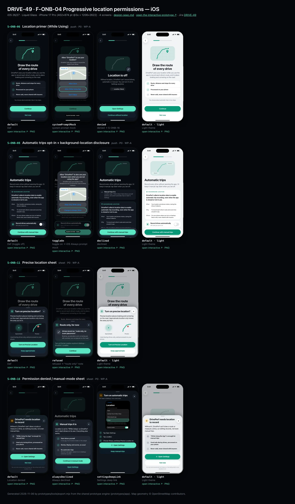
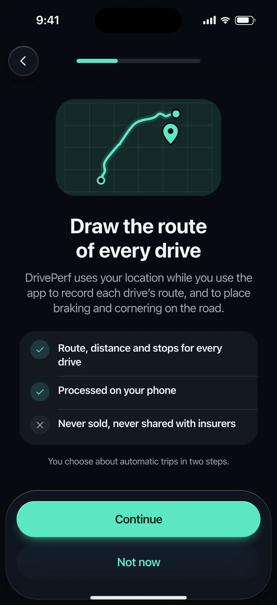
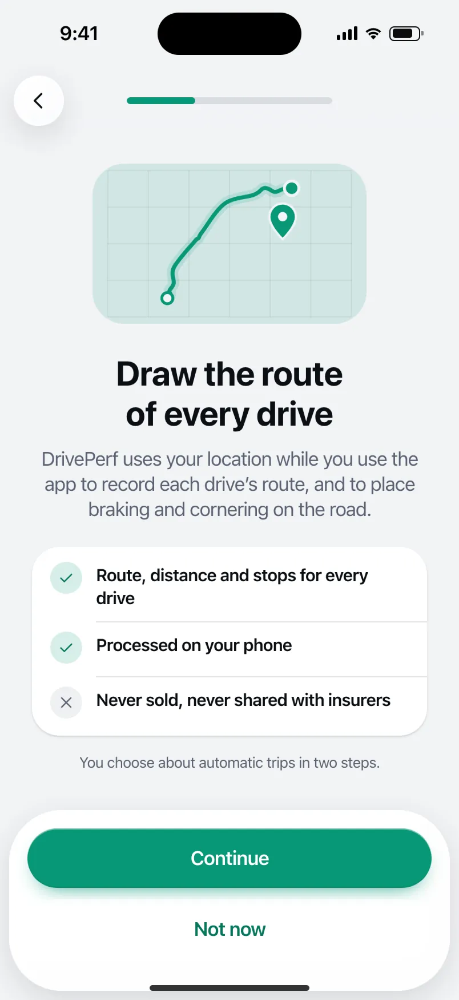
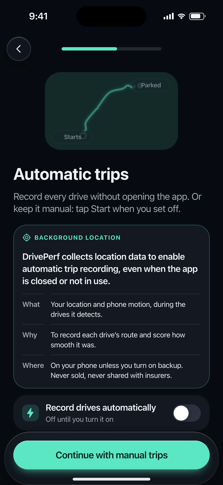
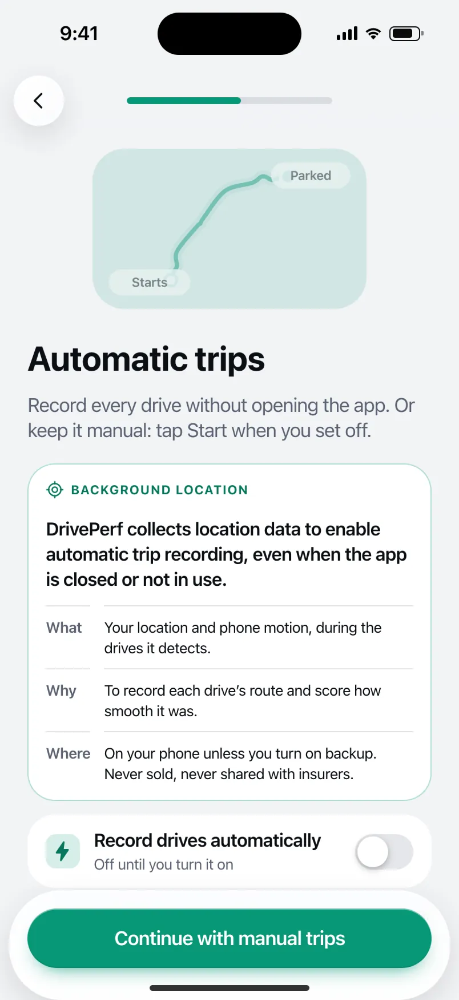
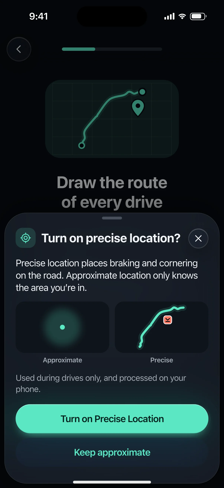
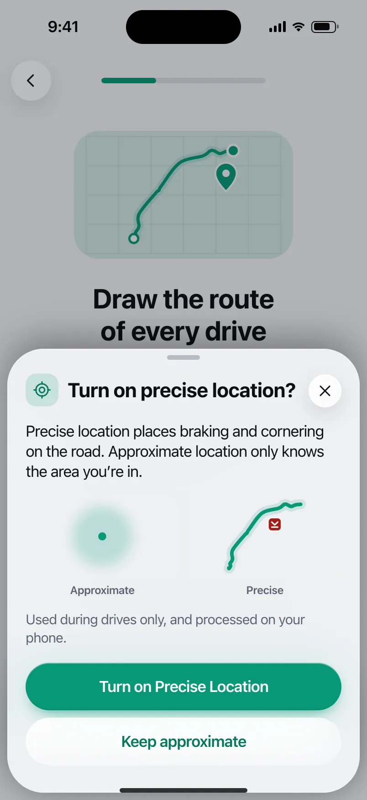
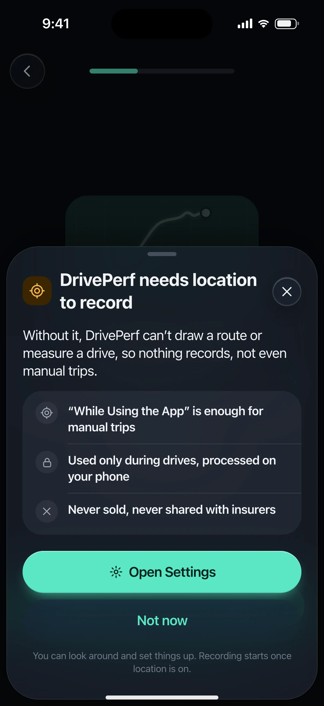
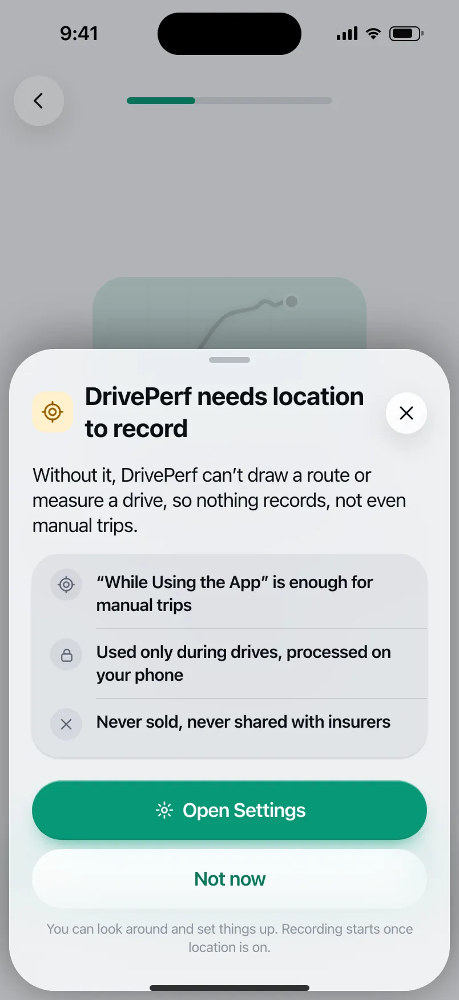

# DRIVE-49 · F-ONB-04 Progressive location permissions — iOS design spec

> Generated by `prototypes/tools/export.mjs` on 2026-11-06 from the shared prototype engine. **Do not edit by hand:** change the screen's `spec` in `prototypes/app/screens/wp-*.js` (see `prototypes/app/AUTHORING.md`) and re-export.

- **Jira story:** [DRIVE-49](https://thekeval.atlassian.net/browse/DRIVE-49) · F-ONB-04 · P0
- **Platform:** iOS 26/27 · Liquid Glass · iPhone 17 Pro (402×874 pt @3x = 1206×2622)
- **Interactive prototype:** [../../../../prototypes/ios/index.html#S-ONB-06](../../../../prototypes/ios/index.html#S-ONB-06) (catalog panel: every screen and state; deep links `#S-ID/state?trip=…&ent=…&theme=light&text=xl&rm=1`)
- **Contact sheet:** [mockup.html](mockup.html) · 
- **Design system (source of truth for values):** [brand](../../system/brand.md) · [components](../../system/components.md) · [motion](../../system/motion.md) · [accessibility](../../system/accessibility.md) · [screen map](../../system/screen-map.md) · [fixtures](../../system/fixtures.md) · tokens `prototypes/shared/tokens.css`

## Screens in this story

| Screen | Name | Presentation | Priority | States | Status |
|---|---|---|---|---|---|
| `S-ONB-06` | Location primer (While Using) | Full + Sys | P0 | 3 | Prototyped |
| `S-ONB-08` | Automatic trips opt-in + background-location disclosure | Full + Sys | P0 | 3 | Prototyped |
| `S-ONB-11` | Precise location sheet | Sheet | P0 | 2 | Prototyped |
| `S-ONB-16` | Permission denied / manual-mode sheet | Sheet | P0 | 3 | Prototyped |

## Tokens used on this platform

Values resolved from `prototypes/shared/tokens.css` inside the iOS device (`[data-platform="ios"]`). Use the token names in code; the hex values are for reference.

| Token | Dark | Light |
|---|---|---|
| `--app-bg` | `#080B10` | `#F2F3F6` |
| `--card-bg` | `#131822` | `#FFFFFF` |
| `--dp-bg-grouped` | `#080B10` | `#F2F3F6` |
| `--dp-surface` | `#131822` | `#FFFFFF` |
| `--dp-surface-2` | `#1B222D` | `#F2F3F6` |
| `--dp-surface-3` | `#262E3B` | `#E4E7EC` |
| `--dp-fill` | `#7880961F` | `#7880961F` |
| `--dp-fill-strong` | `#7880963D` | `#78809633` |
| `--dp-text` | `#F2F4F7` | `#0B0E13` |
| `--dp-text-2` | `#A3AAB6` | `#5A6271` |
| `--dp-text-3` | `#6E7787` | `#8A919D` |
| `--dp-separator` | `#96A0B429` | `#3C435024` |
| `--dp-accent` | `#5BE7C4` | `#079777` |
| `--dp-accent-text` | `#5BE7C4` | `#06775E` |
| `--dp-on-accent` | `#04241D` | `#FFFFFF` |
| `--dp-accent-container` | `#0A4439` | `#C6F8EA` |
| `--dp-record` | `#FFC24B` | `#9A6300` |
| `--dp-positive` | `#5BE7C4` | `#06775E` |
| `--dp-change-down` | `#A3AAB6` | `#5A6271` |
| `--dp-warning` | `#F5B648` | `#9A5F00` |
| `--dp-critical` | `#FF6B6B` | `#C62828` |
| `--dp-glass-fill` | `#1C222C6B` | `#FFFFFF8C` |
| `--dp-glass-fill-strong` | `#1C222CB8` | `#FFFFFFD1` |
| `--dp-glass-stroke` | `#FFFFFF24` | `#FFFFFF99` |
| `--dp-data-route` | `#5BE7C4` | `#079777` |
| `--dp-data-event-brake` | `#FF7A66` | `#A21F16` |
| `--dp-data-event-accel` | `#E58BD0` | `#A33A8C` |
| `--dp-data-event-corner` | `#EAD54E` | `#9A8A00` |
| `--dp-data-quality-good` | `#5FDB9C` | `#1E9E62` |
| `--dp-data-speed` | `#D6DCE4` | `#404A58` |
| `--dp-data-long-g` | `#5AB8F5` | `#0A6AB8` |
| `--dp-data-lat-g` | `#F5A142` | `#B25A00` |

| Type / layout token | Value |
|---|---|
| `--dp-font-screen-title` | `700 34px / 41px -apple-system, BlinkMacSystemFont, "SF Pro Display", system-ui, sans-serif` |
| `--dp-font-sheet-title` | `700 22px / 28px -apple-system, BlinkMacSystemFont, "SF Pro Display", system-ui, sans-serif` |
| `--dp-font-section-title` | `600 20px / 25px -apple-system, BlinkMacSystemFont, "SF Pro Display", system-ui, sans-serif` |
| `--dp-font-card-title` | `600 17px / 22px -apple-system, BlinkMacSystemFont, "SF Pro Text", system-ui, sans-serif` |
| `--dp-font-body` | `400 17px / 22px -apple-system, BlinkMacSystemFont, "SF Pro Text", system-ui, sans-serif` |
| `--dp-font-body-secondary` | `400 15px / 20px -apple-system, BlinkMacSystemFont, "SF Pro Text", system-ui, sans-serif` |
| `--dp-font-meta` | `400 13px / 18px -apple-system, BlinkMacSystemFont, "SF Pro Text", system-ui, sans-serif` |
| `--dp-font-caption` | `400 12px / 16px -apple-system, BlinkMacSystemFont, "SF Pro Text", system-ui, sans-serif` |
| `--dp-font-button` | `600 17px / 22px -apple-system, BlinkMacSystemFont, "SF Pro Text", system-ui, sans-serif` |
| `--dp-num-hero` | `600 72px / 72px -apple-system, BlinkMacSystemFont, "SF Pro Display", system-ui, sans-serif` |
| `--dp-num-xl` | `600 48px / 52px -apple-system, BlinkMacSystemFont, "SF Pro Display", system-ui, sans-serif` |
| `--dp-num-l` | `600 34px / 38px -apple-system, BlinkMacSystemFont, "SF Pro Display", system-ui, sans-serif` |
| `--dp-num-m` | `600 24px / 28px -apple-system, BlinkMacSystemFont, "SF Pro Display", system-ui, sans-serif` |
| `--dp-num-s` | `600 17px / 22px -apple-system, BlinkMacSystemFont, "SF Pro Display", system-ui, sans-serif` |
| `--dp-num-xs` | `600 13px / 16px -apple-system, BlinkMacSystemFont, "SF Pro Display", system-ui, sans-serif` |
| `--dp-screen-margin` | `16px` |
| `--dp-radius-card` | `24px` |
| `--dp-radius-card-hero` | `32px` |
| `--dp-radius-sheet` | `38px` |
| `--dp-radius-chip` | `999px` |
| `--dp-radius-button` | `999px` |
| `--dp-layout-list-row-min` | `52px` |
| `--dp-layout-touch-min` | `44px` |
| `--safe-top` | `62px` |
| `--safe-bottom` | `34px` |

Text sizes scale with `--dp-text-scale` (XL = 2.0×) and numerals with `--dp-num-scale` (XL = 1.3×). DP Numerals: SF Pro Expanded Semibold, tabular.

---

## S-ONB-06 · Location primer (While Using)

 

- **Presentation:** push — screen map: “Full + Sys”
- **Entry points:** S-ONB-05
- **Leads to:** S-ONB-07 (granted) · S-ONB-16 (denied) · S-ONB-11 (approximate chosen)
- **PRD features:** F-ONB-04 · **Priority:** P0 · **WP:** A
- **Interactive:** [S-ONB-06](../../../../prototypes/ios/index.html#S-ONB-06)

**Purpose.** Progressive location, step 1 (F-ONB-04.1): explain why before the system While-Using / When-In-Use prompt; the primer always shows first.

### States

| State | PRD label | Fixture params | Screenshot |
|---|---|---|---|
| `default` | Def | — | [S-ONB-06.png](../../screens/ios/S-ONB-06.webp) · [open](../../../../prototypes/ios/index.html#S-ONB-06) |
| `systemPromptMock` | system prompt mock | — | [S-ONB-06--systemPromptMock.png](../../screens/ios/S-ONB-06--systemPromptMock.webp) · [open](../../../../prototypes/ios/index.html#S-ONB-06/systemPromptMock) |
| `denied` | denied → S-ONB-16 | — | [S-ONB-06--denied.png](../../screens/ios/S-ONB-06--denied.webp) · [open](../../../../prototypes/ios/index.html#S-ONB-06/denied) |
| default · light | Light theme | `theme=light` | [S-ONB-06--light.png](../../screens/ios/S-ONB-06--light.webp) |

Every state also renders in light/dark (`theme=light`), XL text (`text=xl`) and reduced motion (`rm=1`).

### Layout

- Top bar: Back · step progress (3 of 9 / 3 of 11).
- Art 220 × 132: route on a faint grid with a location pin (Glide, white dot) and its halo.
- Title “Draw the route of every drive”, lead with the purpose (PIPEDA meaningful consent: what, why).
- Checklist: ✓ Route, distance and stops for every drive · ✓ Processed on your phone · ✕ Never sold, never shared with insurers. Fine print: “You choose about automatic trips in two steps.”
- Dock: “Continue” (triggers the system prompt) · secondary “Not now”.
- systemPromptMock: the primer dims to 50% and the OS prompt mock sits centred (iOS: “Allow “DrivePerf” to use your location?” with the purpose string, map with “Precise: On”, Allow Once / Allow While Using App (highlighted) / Don’t Allow · Android 16: precise/approximate picker, While using the app (highlighted) / Only this time / Don’t allow). Non-interactive; a “System prompt · mock” tag.
- denied: art greys out with a slashed GPS badge, title “Location is off”, honest line, a status row “Location: Never” (Android “Don’t allow”), primary “Open Settings” (→ S-ONB-16 settingsDeepLink), secondary “Continue without location” (→ S-ONB-16).

### Components & tokens

| Component | Tokens / spec |
|---|---|
| `page` | --dp-bg-grouped (iOS) / --md-sys-color-surface (Android) · --dp-screen-margin 16 |
| `button` | --dp-accent / --dp-on-accent (filled) · --dp-fill-strong · --md-sys-color-secondary-container (tonal) · --dp-radius-button · height iOS 50/44/34 · Android 56/40/32 · --dp-font-button · components.md §0 |
| `sysPermission` | see components.md |
| `icon` | see components.md |

### Interactions & navigation

- “Continue” → systemPromptMock (the real app calls requestWhenInUseAuthorization / ACCESS_FINE_LOCATION + COARSE).
- Prompt results (prototype “pick the result” bar, hidden in export shots): While using → S-ONB-07 · Approximate only → S-ONB-11 sheet over this screen · Don’t allow → denied + S-ONB-16 sheet.
- “Not now” → S-ONB-16 (location denied). denied: “Open Settings” → S-ONB-16/settingsDeepLink · “Continue without location” → S-ONB-16.

### Motion

- Hero motion: route draw-on (1500 ms) then the pin pops and its halo pulses once (scale .4 → 1.6, fade, 900 ms ease.glide).
- System prompt: system motion (prototype: none).
- RM: final art, 220 ms cross-fade.

### Accessibility

- Primary label: “Continue to the location prompt”. The prompt mock is hidden from assistive tech (the real OS prompt is accessible).
- Denied status row reads “Location: Never”.
- Focus order: Back → step progress (“Setup, step n of N”) → title → body → primary → secondary. XL: art shrinks to 60%, title and copy wrap, the dock stays pinned and scrolls content under it; nothing truncates. Every glyph in a checklist is paired with its text (colour is never the only signal).

### Platform notes

- **iOS (this spec):** requestWhenInUseAuthorization() via CLLocationManager; NSLocationWhenInUseUsageDescription = “DrivePerf uses your location to record the route of your drives.” The precise toggle lives in the prompt; choosing approximate leads to S-ONB-11.
- *Android (for reference):* ActivityResultContracts.RequestMultiplePermissions(FINE + COARSE). The Android 12+ dialog offers Precise / Approximate; Approximate → S-ONB-11. “Not now” never triggers the dialog.

### Analytics

- `permission_primer_viewed {perm: location_when_in_use}`
- `permission_result {perm: location_when_in_use, result: granted|approximate|denied}`

### Copy

| Key | Text |
|---|---|
| Title | Draw the route of every drive |
| Lead | DrivePerf uses your location while you use the app to record each drive’s route, and to place braking and cornering on the road. |
| Denied title | Location is off |
| Denied lead | Without location, DrivePerf can’t record drives, automatic or manual. You can turn it on in Settings anytime. |
| Primary | Continue |
| Secondary | Not now |

### Free / Pro

Free. Pro never depends on any location grant (Apple 5.1.1).

### Data & fixtures

Art: smoothed glyph of t20261105-0742. System prompt copy: DP_UI.sysPermission(location) defaults.

### Assets

[icon-check.svg](assets/icon-check.svg) · [icon-close.svg](assets/icon-close.svg) · [icon-gps.svg](assets/icon-gps.svg)

UI glyphs may be swapped for SF Symbols / Material Symbols Rounded equivalents; event-pin, quality and provenance glyphs must not be (components.md global rules).

### Checklist (accessibility.md §9)

- [ ] Light and dark both render, and contrast passes.
- [ ] The XL text state reflows with no truncation.
- [ ] The RM state is defined.
- [ ] Every control has a label; every chart and map has a summary sentence.
- [ ] Every target ≥ 44 pt / 48 dp (≥ 64 in-drive).
- [ ] No meaning by colour alone.
- [ ] Speed is neutral wherever it appears and absent from social or live surfaces.
- [ ] No streak, leaderboard, speed or “beat your time” language.
- [ ] Behaviour is defined while a trip is active (D1 gate).
- [ ] Haptics come from motion.md §6 only.

---

## S-ONB-08 · Automatic trips opt-in + background-location disclosure

 

- **Presentation:** push — screen map: “Full + Sys”
- **Entry points:** S-ONB-07
- **Leads to:** iOS: Always prompt → S-ONB-10 · Android: → S-ONB-09 · toggle left off → S-ONB-10 (manual mode)
- **PRD features:** F-ONB-04 · **Priority:** P0 · **WP:** A
- **Interactive:** [S-ONB-08](../../../../prototypes/ios/index.html#S-ONB-08)

**Purpose.** The opt-in for automatic trips and the background-location disclosure (F-ONB-04.2–.4, Law 25 off-by-default, Play prominent disclosure, Apple one-time Always request). Automatic trips stay off until the user switches them on.

### States

| State | PRD label | Fixture params | Screenshot |
|---|---|---|---|
| `default` | Def (toggle off) | — | [S-ONB-08.png](../../screens/ios/S-ONB-08.webp) · [open](../../../../prototypes/ios/index.html#S-ONB-08) |
| `toggleOn` | toggle on → iOS Always prompt mock | — | [S-ONB-08--toggleOn.png](../../screens/ios/S-ONB-08--toggleOn.webp) · [open](../../../../prototypes/ios/index.html#S-ONB-08/toggleOn) |
| `declined` | declined | — | [S-ONB-08--declined.png](../../screens/ios/S-ONB-08--declined.webp) · [open](../../../../prototypes/ios/index.html#S-ONB-08/declined) |
| default · light | Light theme | `theme=light` | [S-ONB-08--light.png](../../screens/ios/S-ONB-08--light.webp) |

Every state also renders in light/dark (`theme=light`), XL text (`text=xl`) and reduced motion (`rm=1`).

### Layout

- Top bar: Back · step progress (5 of 9 / 5 of 11). Start-aligned text on this screen (it is a disclosure, read top to bottom).
- Art 220 × 126: the example route with “Starts” and “Parked” tags (dimmed until the toggle is on).
- Title “Automatic trips” + lead offering both choices.
- Disclosure card (--card-bg, radius card, Glide 1 pt inner outline): “BACKGROUND LOCATION” kicker with GPS glyph; the disclosure sentence in body weight: “DrivePerf collects location data to enable automatic trip recording, even when the app is closed or not in use.”; then a What / Why / Where definition list.
- Toggle row “Record drives automatically” (bolt glyph), supporting text “Off until you turn it on” → when on: what happens next (iOS Always prompt / Android settings step).
- Fine print on where to change it later.
- Dock: toggle off → “Continue with manual trips” · toggle on → “Continue” (iOS) / “Continue to settings” (Android).
- toggleOn (iOS): the Always prompt mock “Allow “DrivePerf” to also use your location even when you are not using the app?” with the purpose string; “Change to Always Allow” highlighted. Android toggleOn: no OS dialog (Android 11+ sends the user to settings), the primary reads “Continue to settings”.
- declined: toggle off and an info banner “Manual trips it is” explaining location stays While Using and how to turn automatic trips on later.

### Components & tokens

| Component | Tokens / spec |
|---|---|
| `page` | --dp-bg-grouped (iOS) / --md-sys-color-surface (Android) · --dp-screen-margin 16 |
| `row` | --dp-font-body · --dp-font-meta (supporting) · --dp-layout-list-row-min |
| `toggle` | iOS 51×31 tint --dp-accent · Android M3 Switch 52×32 --md-sys-color-primary |
| `banner` | radius 12 (--dp-radius-sm+) · info --dp-fill · attention --dp-warning-container · critical --dp-critical-container · components.md §22 |
| `button` | --dp-accent / --dp-on-accent (filled) · --dp-fill-strong · --md-sys-color-secondary-container (tonal) · --dp-radius-button · height iOS 50/44/34 · Android 56/40/32 · --dp-font-button · components.md §0 |
| `sysPermission` | see components.md |

### Interactions & navigation

- Toggle → on/off (toggleOn / toggleOff haptic); auto_trips_toggled {on}.
- Toggle off + “Continue with manual trips” → S-ONB-10 (manual mode, auto=off).
- iOS: toggle on + “Continue” → toggleOn (requestAlwaysAuthorization, requested exactly once, never again in-app). “Change to Always Allow” → S-ONB-10 · “Keep Only While Using” → declined + S-ONB-16 alwaysDeclined sheet.
- Android: toggle on + “Continue to settings” → S-ONB-09.

### Motion

- Hero motion: route draw-on (1500 ms) with the glow head; the tags fade in with the end dot. Toggling brightens the art (opacity .45 → 1, spring.effects).
- RM: static art, 220 ms cross-fade.

### Accessibility

- The disclosure card is one group labelled “Background location disclosure” and is read before the toggle.
- Toggle: “Record drives automatically, switch, off. Off until you turn it on.”
- Primary when on (Android): “Continue to Android location settings”.
- Focus order: Back → step progress (“Setup, step n of N”) → title → body → primary → secondary. XL: art shrinks to 60%, title and copy wrap, the dock stays pinned and scrolls content under it; nothing truncates. Every glyph in a checklist is paired with its text (colour is never the only signal).

### Platform notes

- **iOS (this spec):** Same disclosure wording; requestAlwaysAuthorization() after When In Use (A3 §1.2), only once. NSLocationAlwaysAndWhenInUseUsageDescription = “DrivePerf uses your location in the background only to record the route of drives it detects.”
- *Android (for reference):* This is the Google Play prominent disclosure: in-app, shown before any background-location request, uses the word “location”, says “even when the app is closed or not in use”, names the feature (automatic trip recording), needs an affirmative action (toggle on + Continue), and must match the Play listing and the declaration video (PRD §6.3). ACCESS_BACKGROUND_LOCATION is then granted in Settings (S-ONB-09).

### Analytics

- `permission_primer_viewed {perm: location_always}`
- `auto_trips_toggled {on}`
- `permission_result {perm: location_always, result: granted|denied}`

### Copy

| Key | Text |
|---|---|
| Title | Automatic trips |
| Lead | Record every drive without opening the app. Or keep it manual: tap Start when you set off. |
| Disclosure | DrivePerf collects location data to enable automatic trip recording, even when the app is closed or not in use. |
| What | Your location and phone motion, during the drives it detects. |
| Why | To record each drive’s route and score how smooth it was. |
| Where | On your phone unless you turn on backup. Never sold, never shared with insurers. |
| Toggle | Record drives automatically |
| Toggle sub | Off until you turn it on |
| Declined banner | Manual trips it is. Location stays “While Using”. Start drives yourself anytime, and switch automatic trips on later in Settings. |

### Free / Pro

Free. No Pro feature depends on Always (Apple 5.1.1).

### Data & fixtures

Art: smoothed glyph of t20261105-0742. Disclosure text is fixed copy (legal review before launch, PRD §6.3).

### Assets

[icon-gps.svg](assets/icon-gps.svg) · [icon-bolt.svg](assets/icon-bolt.svg) · [icon-drives.svg](assets/icon-drives.svg)

UI glyphs may be swapped for SF Symbols / Material Symbols Rounded equivalents; event-pin, quality and provenance glyphs must not be (components.md global rules).

### Checklist (accessibility.md §9)

- [ ] Light and dark both render, and contrast passes.
- [ ] The XL text state reflows with no truncation.
- [ ] The RM state is defined.
- [ ] Every control has a label; every chart and map has a summary sentence.
- [ ] Every target ≥ 44 pt / 48 dp (≥ 64 in-drive).
- [ ] No meaning by colour alone.
- [ ] Speed is neutral wherever it appears and absent from social or live surfaces.
- [ ] No streak, leaderboard, speed or “beat your time” language.
- [ ] Behaviour is defined while a trip is active (D1 gate).
- [ ] Haptics come from motion.md §6 only.

---

## S-ONB-11 · Precise location sheet

 

- **Presentation:** sheet · detent: auto — screen map: “Sheet”
- **Entry points:** S-ONB-06 (approximate), S-SET-05 precise row
- **Leads to:** Back to caller
- **PRD features:** F-ONB-04 · **Priority:** P0 · **WP:** A
- **Interactive:** [S-ONB-11](../../../../prototypes/ios/index.html#S-ONB-11)

**Purpose.** When the user chose approximate location (F-ONB-04.5): explain “Precise location places braking and cornering on the road”, offer the precise request once, and say plainly what “route only” means if they refuse.

### States

| State | PRD label | Fixture params | Screenshot |
|---|---|---|---|
| `default` | Def | — | [S-ONB-11.png](../../screens/ios/S-ONB-11.webp) · [open](../../../../prototypes/ios/index.html#S-ONB-11) |
| `refused` | refused → “route only” note | — | [S-ONB-11--refused.png](../../screens/ios/S-ONB-11--refused.webp) · [open](../../../../prototypes/ios/index.html#S-ONB-11/refused) |
| default · light | Light theme | `theme=light` | [S-ONB-11--light.png](../../screens/ios/S-ONB-11--light.webp) |

Every state also renders in light/dark (`theme=light`), XL text (`text=xl`) and reduced motion (`rm=1`).

### Layout

- Sheet, auto height (iOS glass at partial height with a close button · Android ModalBottomSheet with drag handle, top radius 28).
- Header: GPS glyph (accent container 36) + “Turn on precise location?” (sheetTitle).
- Lead (body): the binding sentence + what approximate means.
- Comparison art: two 120 × 84 tiles side by side (radius 16): Approximate = a soft blurred circle; Precise = the route on the plain canvas with a hard-braking pin (rounded square) on the road. Captions under each.
- Fine print, then actions: primary “Turn on Precise Location” (iOS) / “Use precise location” (Android), secondary “Keep approximate”.
- refused: header “Route only, for now”; a card “Drives record as “route only, no event placement”.” + one line; where to change it; “Continue”.

### Components & tokens

| Component | Tokens / spec |
|---|---|
| `sheetHeader` | see components.md |
| `card` | --dp-surface / --md-sys-color-surface-container · --dp-radius-card (24 iOS · 16 Android) · hero: --dp-radius-card-hero (32 · 28) · light iOS: --dp-elev-1 |
| `button` | --dp-accent / --dp-on-accent (filled) · --dp-fill-strong · --md-sys-color-secondary-container (tonal) · --dp-radius-button · height iOS 50/44/34 · Android 56/40/32 · --dp-font-button · components.md §0 |
| `icon` | see components.md |

### Interactions & navigation

- Primary → iOS requestTemporaryFullAccuracyAuthorization(purposeKey) via CLServiceSession full-accuracy purpose / Android re-request ACCESS_FINE_LOCATION; on success a toast and the sheet closes.
- “Keep approximate” → refused · “Continue” closes the sheet.
- Back to caller: from onboarding (S-ONB-06) the flow continues to S-ONB-07; from S-SET-05’s precise row it simply closes.

### Motion

- Sheet: spring.sheet slide-up (engine). Art: the approximate blob breathes in (scale .7 → 1, 900 ms ease.glide) while the precise route draws on (1200 ms).
- RM: static art.

### Accessibility

- Sheet focus starts on the title. Comparison art is decorative; the lead states the difference in words.
- Buttons ≥ 50 pt / 56 dp. XL: the sheet opens at the large detent; tiles stack.
- Refused card is read as one paragraph.

### Platform notes

- **iOS (this spec):** Precise is a toggle in the system prompt; here we request temporary full accuracy with the NSLocationTemporaryUsageDescriptionDictionary purpose “Precise location places braking and cornering on the road.”
- *Android (for reference):* Android 12+ approximate vs precise: re-requesting FINE shows the system upgrade dialog. Play fine-location declaration (from 27 Jan 2027) uses the same justification (PRD §6.3).

### Analytics

- `permission_primer_viewed {perm: location_precise}`
- `precise_location_result {result: granted|refused}`

### Copy

| Key | Text |
|---|---|
| Title | Turn on precise location? |
| Lead | Precise location places braking and cornering on the road. Approximate location only knows the area you’re in. |
| Fine | Used during drives only, and processed on your phone. |
| Refused title | Route only, for now |
| Refused card | Drives record as “route only, no event placement”. Braking, acceleration and cornering are still counted, but not placed on the road. |

### Free / Pro

n/a (Free).

### Data & fixtures

Precise tile: smoothed glyph of t20261105-0742 + DP_ICONS.pin(brake) (illustrative placement).

### Assets

[icon-gps.svg](assets/icon-gps.svg) · [icon-routes.svg](assets/icon-routes.svg) · [icon-close.svg](assets/icon-close.svg)

UI glyphs may be swapped for SF Symbols / Material Symbols Rounded equivalents; event-pin, quality and provenance glyphs must not be (components.md global rules).

### Checklist (accessibility.md §9)

- [ ] Light and dark both render, and contrast passes.
- [ ] The XL text state reflows with no truncation.
- [ ] The RM state is defined.
- [ ] Every control has a label; every chart and map has a summary sentence.
- [ ] Every target ≥ 44 pt / 48 dp (≥ 64 in-drive).
- [ ] No meaning by colour alone.
- [ ] Speed is neutral wherever it appears and absent from social or live surfaces.
- [ ] No streak, leaderboard, speed or “beat your time” language.
- [ ] Behaviour is defined while a trip is active (D1 gate).
- [ ] Haptics come from motion.md §6 only.

---

## S-ONB-16 · Permission denied / manual-mode sheet

 

- **Presentation:** sheet · detent: auto — screen map: “Sheet”
- **Entry points:** Any denied primer; S-LIVE-04 Deny; S-HOME-01 Deny state
- **Leads to:** System Settings (deep link) · continue in manual mode
- **PRD features:** F-ONB-04 · **Priority:** P0 · **WP:** A
- **Interactive:** [S-ONB-16](../../../../prototypes/ios/index.html#S-ONB-16)

**Purpose.** One honest sheet for every denial (F-ONB-04.3/.6, EC-PERM): explain what still works, offer the Settings deep link, never re-request in-app, and continue in manual mode.

### States

| State | PRD label | Fixture params | Screenshot |
|---|---|---|---|
| `default` | Location denied | — | [S-ONB-16.png](../../screens/ios/S-ONB-16.webp) · [open](../../../../prototypes/ios/index.html#S-ONB-16) |
| `alwaysDeclined` | Always declined | — | [S-ONB-16--alwaysDeclined.png](../../screens/ios/S-ONB-16--alwaysDeclined.webp) · [open](../../../../prototypes/ios/index.html#S-ONB-16/alwaysDeclined) |
| `settingsDeepLink` | Settings deep link | — | [S-ONB-16--settingsDeepLink.png](../../screens/ios/S-ONB-16--settingsDeepLink.webp) · [open](../../../../prototypes/ios/index.html#S-ONB-16/settingsDeepLink) |
| default · light | Light theme | `theme=light` | [S-ONB-16--light.png](../../screens/ios/S-ONB-16--light.webp) |

Every state also renders in light/dark (`theme=light`), XL text (`text=xl`) and reduced motion (`rm=1`).

### Layout

- Sheet (auto height; settingsDeepLink opens at the large detent). iOS glass with close button · Android ModalBottomSheet with drag handle.
- Header: status glyph disc 36 (warning container for denials, accent container for manual) + sheetTitle (+ subtitle in settingsDeepLink).
- Location denied (default): “DrivePerf needs location to record”; lead: nothing records, not even manual trips; checklist (While Using is enough for manual trips · used only during drives · never sold); actions “Open Settings” (filled, gear) · “Not now”; fine print.
- alwaysDeclined: “Manual trips it is”; lead names the current setting (While Using / While using the app); checklist ✓ Start drives yourself (Control Center / Quick Settings / widget) · ✓ Stories, Replay and scores · ✕ No automatic trips (“We won’t ask again”); actions “Continue in manual mode” · “Open Settings”.
- settingsDeepLink: “Turn on automatic trips” + “Two taps in Settings, then come back.”; a screenshot-style guide (the OS Location page scaled 60%, radius 20, target option highlighted in Glide); 3 numbered steps; “Open Settings” · “Keep manual trips”.

### Components & tokens

| Component | Tokens / spec |
|---|---|
| `sheetHeader` | see components.md |
| `button` | --dp-accent / --dp-on-accent (filled) · --dp-fill-strong · --md-sys-color-secondary-container (tonal) · --dp-radius-button · height iOS 50/44/34 · Android 56/40/32 · --dp-font-button · components.md §0 |
| `sysSettings` | see components.md |
| `icon` | see components.md |

### Interactions & navigation

- “Open Settings” → settingsDeepLink; there, “Open Settings” → UIApplication.openSettingsURLString (iOS) / ACTION_APPLICATION_DETAILS_SETTINGS (Android). Prototype: toast.
- “Continue in manual mode” / “Keep manual trips” → inside onboarding: closes and continues at S-ONB-10 (auto=off); from Home (S-HOME-01 Deny) or S-LIVE-04 Deny: closes.
- “Not now” → inside onboarding: S-ONB-10 (auto=off, location off); elsewhere: closes. Home then shows “Auto-detect off” with a Fix action (F-ONB-04.6).
- The app never shows the iOS Always prompt again after a decline (F-ONB-04.3).

### Motion

- Sheet: spring.sheet (engine). The header glyph pops (spring.bouncy, 180 ms delay). RM: no pop.

### Accessibility

- Focus starts on the sheet title and returns to the invoking control on close.
- Guide image is decorative; the numbered steps say the same thing.
- “Open Settings” label in settingsDeepLink: “Open Settings, DrivePerf, Location”.
- XL: opens at the large detent; the guide shrinks to 220 tall; buttons stack full width.

### Platform notes

- **iOS (this spec):** Settings deep link opens the app’s own Settings page (Location row). Copy uses “While Using” / “Always”.
- *Android (for reference):* Deep link to App info › Permissions; copy uses “Allow only while using the app” / “Allow all the time”. The Android recording notification still works in manual mode.

### Analytics

- `permission_denied_sheet_viewed {perm, reason: denied|always_declined}`
- `settings_deeplink_opened {perm}`
- `manual_mode_chosen {source: onboarding|home}`

### Copy

| Key | Text |
|---|---|
| Denied title | DrivePerf needs location to record |
| Denied lead | Without it, DrivePerf can’t draw a route or measure a drive, so nothing records, not even manual trips. |
| Always declined title | Manual trips it is |
| Always declined lead | Location is set to “While Using”, so DrivePerf won’t start drives on its own. Everything else works. |
| Settings title | Turn on automatic trips |
| Settings sub | Two taps in Settings, then come back. |
| Not now fine print | You can look around and set things up. Recording starts once location is on. |

### Free / Pro

n/a (Free). Manual mode keeps every Free and Pro feature (Apple 5.1.1).

### Data & fixtures

Settings labels: iOS Location page (Never · Ask Next Time Or When I Share · While Using the App · Always · Precise Location) and Android 16 permission page; purpose string = DP_UI.sysPermission(always) text.

### Assets

[icon-gps.svg](assets/icon-gps.svg) · [icon-record.svg](assets/icon-record.svg) · [icon-gear.svg](assets/icon-gear.svg) · [icon-lock.svg](assets/icon-lock.svg) · [icon-check.svg](assets/icon-check.svg) · [icon-close.svg](assets/icon-close.svg)

UI glyphs may be swapped for SF Symbols / Material Symbols Rounded equivalents; event-pin, quality and provenance glyphs must not be (components.md global rules).

### Checklist (accessibility.md §9)

- [ ] Light and dark both render, and contrast passes.
- [ ] The XL text state reflows with no truncation.
- [ ] The RM state is defined.
- [ ] Every control has a label; every chart and map has a summary sentence.
- [ ] Every target ≥ 44 pt / 48 dp (≥ 64 in-drive).
- [ ] No meaning by colour alone.
- [ ] Speed is neutral wherever it appears and absent from social or live surfaces.
- [ ] No streak, leaderboard, speed or “beat your time” language.
- [ ] Behaviour is defined while a trip is active (D1 gate).
- [ ] Haptics come from motion.md §6 only.

---

Map geometry in the prototype: © OpenStreetMap contributors (ODbL). Speed and G are simulated fixtures (fixtures.md).
