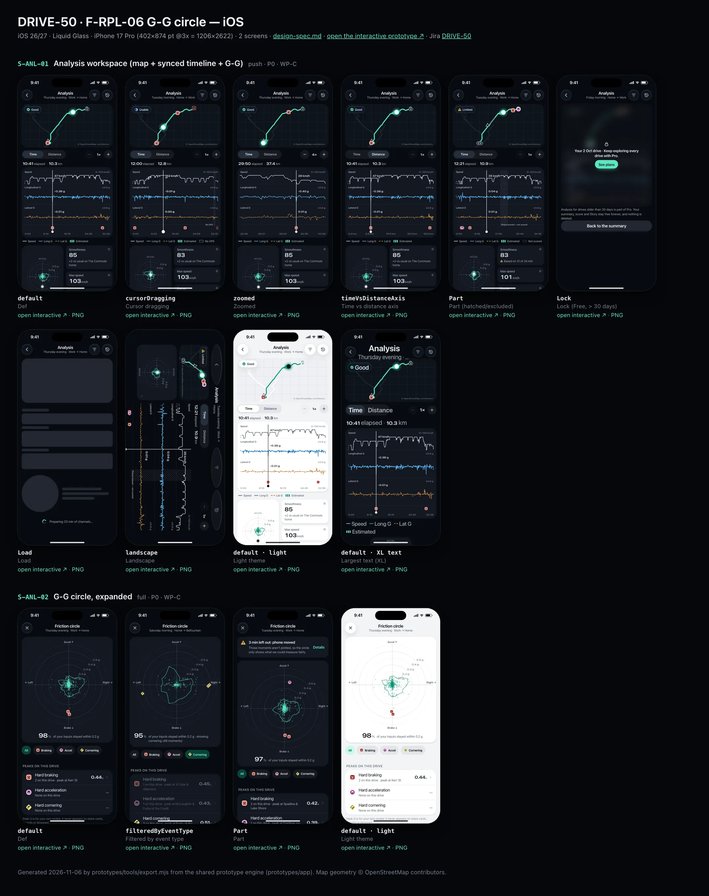
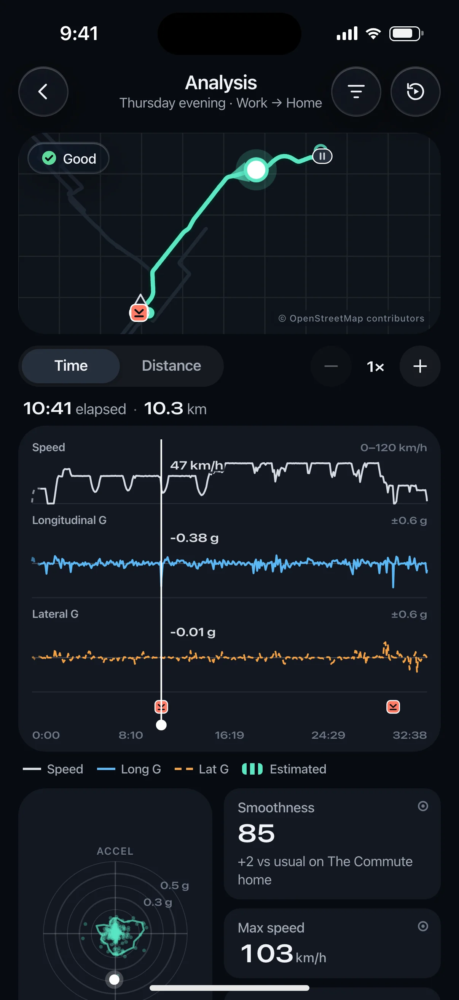
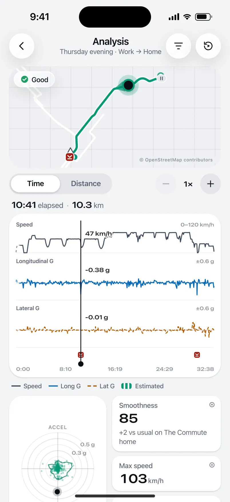
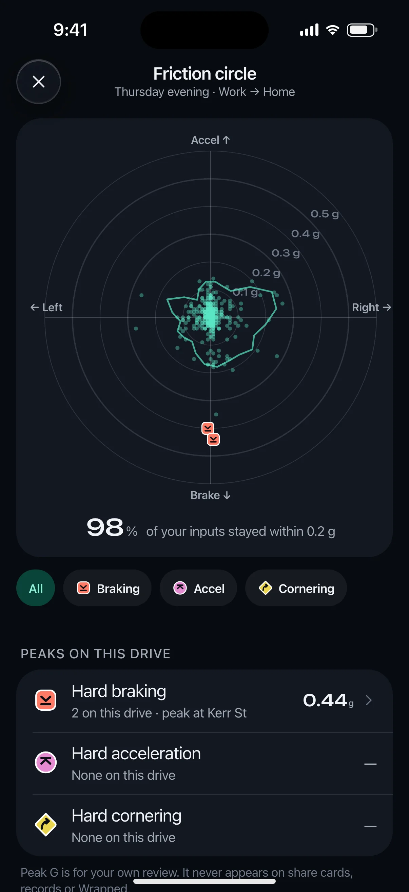
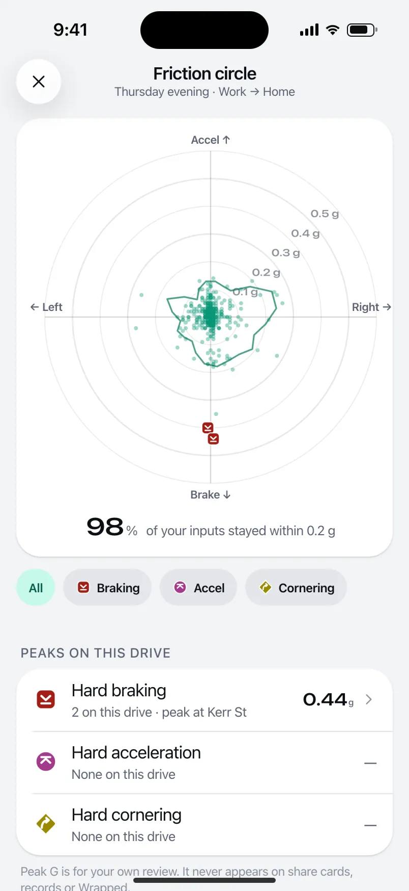

# DRIVE-50 · F-RPL-06 G-G circle — iOS design spec

> Generated by `prototypes/tools/export.mjs` on 2026-11-06 from the shared prototype engine. **Do not edit by hand:** change the screen's `spec` in `prototypes/app/screens/wp-*.js` (see `prototypes/app/AUTHORING.md`) and re-export.

- **Jira story:** [DRIVE-50](https://thekeval.atlassian.net/browse/DRIVE-50) · F-RPL-06 · P0
- **Platform:** iOS 26/27 · Liquid Glass · iPhone 17 Pro (402×874 pt @3x = 1206×2622)
- **Interactive prototype:** [../../../../prototypes/ios/index.html#S-ANL-01](../../../../prototypes/ios/index.html#S-ANL-01) (catalog panel: every screen and state; deep links `#S-ID/state?trip=…&ent=…&theme=light&text=xl&rm=1`)
- **Contact sheet:** [mockup.html](mockup.html) · 
- **Design system (source of truth for values):** [brand](../../system/brand.md) · [components](../../system/components.md) · [motion](../../system/motion.md) · [accessibility](../../system/accessibility.md) · [screen map](../../system/screen-map.md) · [fixtures](../../system/fixtures.md) · tokens `prototypes/shared/tokens.css`

## Screens in this story

| Screen | Name | Presentation | Priority | States | Status |
|---|---|---|---|---|---|
| `S-ANL-01` | Analysis workspace (map + synced timeline + G-G) | Push (immersive) | P0 | 8 | Prototyped |
| `S-ANL-02` | G-G circle, expanded | Full / zoom from G-G | P0 | 3 | Prototyped |

## Tokens used on this platform

Values resolved from `prototypes/shared/tokens.css` inside the iOS device (`[data-platform="ios"]`). Use the token names in code; the hex values are for reference.

| Token | Dark | Light |
|---|---|---|
| `--app-bg` | `#080B10` | `#F2F3F6` |
| `--card-bg` | `#131822` | `#FFFFFF` |
| `--dp-bg-grouped` | `#080B10` | `#F2F3F6` |
| `--dp-surface` | `#131822` | `#FFFFFF` |
| `--dp-surface-2` | `#1B222D` | `#F2F3F6` |
| `--dp-surface-3` | `#262E3B` | `#E4E7EC` |
| `--dp-fill` | `#7880961F` | `#7880961F` |
| `--dp-fill-strong` | `#7880963D` | `#78809633` |
| `--dp-text` | `#F2F4F7` | `#0B0E13` |
| `--dp-text-2` | `#A3AAB6` | `#5A6271` |
| `--dp-text-3` | `#6E7787` | `#8A919D` |
| `--dp-separator` | `#96A0B429` | `#3C435024` |
| `--dp-accent` | `#5BE7C4` | `#079777` |
| `--dp-accent-text` | `#5BE7C4` | `#06775E` |
| `--dp-on-accent` | `#04241D` | `#FFFFFF` |
| `--dp-accent-container` | `#0A4439` | `#C6F8EA` |
| `--dp-record` | `#FFC24B` | `#9A6300` |
| `--dp-positive` | `#5BE7C4` | `#06775E` |
| `--dp-change-down` | `#A3AAB6` | `#5A6271` |
| `--dp-warning` | `#F5B648` | `#9A5F00` |
| `--dp-critical` | `#FF6B6B` | `#C62828` |
| `--dp-glass-fill` | `#1C222C6B` | `#FFFFFF8C` |
| `--dp-glass-fill-strong` | `#1C222CB8` | `#FFFFFFD1` |
| `--dp-glass-stroke` | `#FFFFFF24` | `#FFFFFF99` |
| `--dp-data-route` | `#5BE7C4` | `#079777` |
| `--dp-data-event-brake` | `#FF7A66` | `#A21F16` |
| `--dp-data-event-accel` | `#E58BD0` | `#A33A8C` |
| `--dp-data-event-corner` | `#EAD54E` | `#9A8A00` |
| `--dp-data-quality-good` | `#5FDB9C` | `#1E9E62` |
| `--dp-data-speed` | `#D6DCE4` | `#404A58` |
| `--dp-data-long-g` | `#5AB8F5` | `#0A6AB8` |
| `--dp-data-lat-g` | `#F5A142` | `#B25A00` |

| Type / layout token | Value |
|---|---|
| `--dp-font-screen-title` | `700 34px / 41px -apple-system, BlinkMacSystemFont, "SF Pro Display", system-ui, sans-serif` |
| `--dp-font-sheet-title` | `700 22px / 28px -apple-system, BlinkMacSystemFont, "SF Pro Display", system-ui, sans-serif` |
| `--dp-font-section-title` | `600 20px / 25px -apple-system, BlinkMacSystemFont, "SF Pro Display", system-ui, sans-serif` |
| `--dp-font-card-title` | `600 17px / 22px -apple-system, BlinkMacSystemFont, "SF Pro Text", system-ui, sans-serif` |
| `--dp-font-body` | `400 17px / 22px -apple-system, BlinkMacSystemFont, "SF Pro Text", system-ui, sans-serif` |
| `--dp-font-body-secondary` | `400 15px / 20px -apple-system, BlinkMacSystemFont, "SF Pro Text", system-ui, sans-serif` |
| `--dp-font-meta` | `400 13px / 18px -apple-system, BlinkMacSystemFont, "SF Pro Text", system-ui, sans-serif` |
| `--dp-font-caption` | `400 12px / 16px -apple-system, BlinkMacSystemFont, "SF Pro Text", system-ui, sans-serif` |
| `--dp-font-button` | `600 17px / 22px -apple-system, BlinkMacSystemFont, "SF Pro Text", system-ui, sans-serif` |
| `--dp-num-hero` | `600 72px / 72px -apple-system, BlinkMacSystemFont, "SF Pro Display", system-ui, sans-serif` |
| `--dp-num-xl` | `600 48px / 52px -apple-system, BlinkMacSystemFont, "SF Pro Display", system-ui, sans-serif` |
| `--dp-num-l` | `600 34px / 38px -apple-system, BlinkMacSystemFont, "SF Pro Display", system-ui, sans-serif` |
| `--dp-num-m` | `600 24px / 28px -apple-system, BlinkMacSystemFont, "SF Pro Display", system-ui, sans-serif` |
| `--dp-num-s` | `600 17px / 22px -apple-system, BlinkMacSystemFont, "SF Pro Display", system-ui, sans-serif` |
| `--dp-num-xs` | `600 13px / 16px -apple-system, BlinkMacSystemFont, "SF Pro Display", system-ui, sans-serif` |
| `--dp-screen-margin` | `16px` |
| `--dp-radius-card` | `24px` |
| `--dp-radius-card-hero` | `32px` |
| `--dp-radius-sheet` | `38px` |
| `--dp-radius-chip` | `999px` |
| `--dp-radius-button` | `999px` |
| `--dp-layout-list-row-min` | `52px` |
| `--dp-layout-touch-min` | `44px` |
| `--safe-top` | `62px` |
| `--safe-bottom` | `34px` |

Text sizes scale with `--dp-text-scale` (XL = 2.0×) and numerals with `--dp-num-scale` (XL = 1.3×). DP Numerals: SF Pro Expanded Semibold, tabular.

---

## S-ANL-01 · Analysis workspace (map + synced timeline + G-G)

 

- **Presentation:** push · tab: drives — screen map: “Push (immersive)”
- **Entry points:** S-TRP-01 · S-RPL-01
- **Leads to:** S-ANL-02 · S-ANL-03 · S-ANL-04 · S-RPL-02 · S-SUB-03 (Lock)
- **PRD features:** F-RPL-05, F-RPL-06, F-RPL-03, F-RPL-08, F-DQ-03, F-DQ-04, F-DQ-05 · **Priority:** P0 · **WP:** C
- **Interactive:** [S-ANL-01](../../../../prototypes/ios/index.html#S-ANL-01)

**Purpose.** Study the drive: speed, longitudinal G and lateral G on one timeline synced with the map and the G-G circle (F-RPL-05/06), with honest quality overlays (F-RPL-08). Free for the last 30 days; older drives are Pro (Gate 1 #6).

### States

| State | PRD label | Fixture params | Screenshot |
|---|---|---|---|
| `default` | Def | `trip=t20261105-1745` | [S-ANL-01.png](../../screens/ios/S-ANL-01.webp) · [open](../../../../prototypes/ios/index.html#S-ANL-01) |
| `cursorDragging` | Cursor dragging | `trip=t20261020-0740` | [S-ANL-01--cursorDragging.png](../../screens/ios/S-ANL-01--cursorDragging.webp) · [open](../../../../prototypes/ios/index.html#S-ANL-01/cursorDragging) |
| `zoomed` | Zoomed | `trip=t20261105-1745` | [S-ANL-01--zoomed.png](../../screens/ios/S-ANL-01--zoomed.webp) · [open](../../../../prototypes/ios/index.html#S-ANL-01/zoomed) |
| `timeVsDistanceAxis` | Time vs distance axis | `trip=t20261105-1745` | [S-ANL-01--timeVsDistanceAxis.png](../../screens/ios/S-ANL-01--timeVsDistanceAxis.webp) · [open](../../../../prototypes/ios/index.html#S-ANL-01/timeVsDistanceAxis) |
| `Part` | Part (hatched/excluded) | `trip=t20261027-1728` | [S-ANL-01--Part.png](../../screens/ios/S-ANL-01--Part.webp) · [open](../../../../prototypes/ios/index.html#S-ANL-01/Part) |
| `Lock` | Lock (Free, > 30 days) | `trip=t20261002-0745` `ent=free` | [S-ANL-01--Lock.png](../../screens/ios/S-ANL-01--Lock.webp) · [open](../../../../prototypes/ios/index.html#S-ANL-01/Lock) |
| `Load` | Load | `trip=t20261105-1745` | [S-ANL-01--Load.png](../../screens/ios/S-ANL-01--Load.webp) · [open](../../../../prototypes/ios/index.html#S-ANL-01/Load) |
| `landscape` | Landscape | `trip=t20261027-1728` | [S-ANL-01--landscape.png](../../screens/ios/S-ANL-01--landscape.webp) · [open](../../../../prototypes/ios/index.html#S-ANL-01/landscape) |
| default · light | Light theme | `theme=light` | [S-ANL-01--light.png](../../screens/ios/S-ANL-01--light.webp) |
| default · XL | Largest text | `text=xl` | [S-ANL-01--xl.png](../../screens/ios/S-ANL-01--xl.webp) |

Every state also renders in light/dark (`theme=light`), XL text (`text=xl`) and reduced motion (`rm=1`).

### Layout

- Immersive push (no tab bar). iOS inline title “Analysis” + part of day · label, glass Channels (→ S-ANL-03) and Replay buttons · Android MediumFlexibleTopAppBar.
- Map card (full width − 32, 176 tall, radius card) with the cursor marker; quality badge (glass) top-left → S-DQ-01. Tap the map to snap the cursor.
- Toolbar: Time / Distance segmented (iOS glass segmented · Android connected button group) + zoom stepper (− 1× +, tonal 36).
- Cursor readout row: “12:04 elapsed · 9.8 km” + the span chip when the cursor is in an estimated, gap or excluded span.
- Timeline card: lanes share one x-axis — Speed 44 (neutral `--dp-data-speed`, 0–120 km/h), Longitudinal G 64 (±0.6, zero line, sky solid), Lateral G 64 (±0.6, amber dashed 6/3), optional Elevation 34 (area), Pro Jerk 40 and Sample quality 14 — each with a label (10.5/600 text2) and range (9.5 numerals text3); event lane (pins 16) aligned to the map pins; 5 x-axis ticks (time or km); cursor 1.5 px `--dp-data-cursor` with a value bubble per lane (numerals 11 with a card-colour halo).
- Quality overlay: estimated start dashed at 60% · GPS gap = line break + filled band + “No GPS” · excluded = 45° hatch band + “Phone moved — not scored”.
- Legend row (swatch + pattern): Speed · Long G · Lat G · (Elevation, Jerk) · Estimated · No GPS · Not scored.
- Bottom: G-G card 158 (cloud, envelope, cursor dot; tap → S-ANL-02 zoom) beside three stat tiles: Smoothness (with “Based on 31 of 34 min”), Max speed (neutral), Events (count by pin).
- “Select a range” card (Pro) → S-ANL-04; ⓘ footnote for long-press provenance and gestures.
- Lock: this trip’s own map + lanes blurred 14 px with lock + “Your 2 Oct drive · Keep exploring every drive with Pro.” + See plans, then “Back to the summary”. Load: skeletons that mirror the lanes + loader line. Landscape: timeline full width, map shrinks to a 30% inset with the G-G under it.

### Components & tokens

| Component | Tokens / spec |
|---|---|
| `navBar` | --dp-font-card-title · --dp-font-meta · glass: --dp-glass-fill + --dp-glass-blur · components.md §2 |
| `map` | --dp-data-map-land/road/grid · route --dp-data-route 3.8 + casing --dp-data-route-casing 7.5 · estimated dashed 4/4 at 60% · gap --dp-data-gap-stroke dotted 1/6 · pins DP_ICONS.pin 26 · attribution “© OpenStreetMap contributors” |
| `qualityBadge` | --dp-data-quality-{good\|usable\|limited\|unscorable} · components.md §10 |
| `segmented` | see components.md |
| `iconButton` | see components.md |
| `card` | --dp-surface / --md-sys-color-surface-container · --dp-radius-card (24 iOS · 16 Android) · hero: --dp-radius-card-hero (32 · 28) · light iOS: --dp-elev-1 |
| `stats` | --dp-surface-2 / --md-sys-color-surface-container-high · radius 14 iOS / 12 Android · value --dp-num-m (DP Numerals) · components.md §5 |
| `lockPanel` | blur --dp-opacity-locked-blur 14px · dim --dp-opacity-locked-dim 35% · components.md §15.2 |
| `skeleton` | --dp-fill-strong, breathe 1.2 s (dp-skeleton) |
| `loader` | see components.md |
| `proBadge` | see components.md |
| `anlLanes (local timeline)` | see components.md |
| `gg (local ggSvg)` | see components.md |

### Interactions & navigation

- Drag on the timeline: the cursor follows the finger and the map marker, lane bubbles, readout row and G-dot update in the same frame (≤ 100 ms, F-RPL-05.2); within 8 px of an event tick it snaps (haptic selection).
- Tap the map → snaps the cursor to the nearest track point (haptic selection).
- Pinch (native) or − / + → zoom 1× … 16× around the cursor; event ticks stay aligned; double-tap resets.
- Time / Distance toggles the x-axis (persisted per user).
- Long-press 450 ms then drag → range band; release → S-ANL-04 with t0/t1 (Pro; Free sees the lock there).
- Event tick → S-RPL-02 · G-G card → S-ANL-02 (zoom / container transform) · Channels → S-ANL-03 (choice persists) · Replay → S-RPL-01 · quality badge → S-DQ-01 · Lock → S-SUB-03 replayAnalysis30Days.

### Motion

- Hero: the cursor. It tracks the finger with no easing (data must not lag); the G-dot uses shared.scrubber (ζ 1, k 900) natively so it never overshoots a value the car didn’t reach.
- Enter: lanes fade in 420 ms; sections rise 8 px (30 ms stagger).
- Zoom / axis change: lanes cross-fade (spring.effects). RM: instant, no fades.

### Accessibility

- Timeline summary: “Timeline, 33 minutes. Speed peaked at 103 kilometres per hour. 2 events, the largest 0.44 g at Kerr St.” iOS Audio Graph (`accessibilityChartDescriptor`, one series per channel); Android “View as table” action (time, speed, long-G, lat-G at 30 s steps + every event).
- Event ticks are buttons: “Hard braking at the Gardiner, 10:41 into the drive. Opens the evidence.” (44/48 hit area).
- G-G card: “Friction circle. 86% of your inputs stayed within 0.2 g. Peaks: braking 0.44 g at Kerr St.” Speed tiles are neutral and never first.
- XL: lanes grow 1.5×, the legend wraps, readouts stay in the row above the chart; tiles stack under the G-G.
- Patterns, not colour: dashed lat-G, hatched excluded, broken gap, dashed estimated; legend shows swatch + pattern.

### Platform notes

- **iOS (this spec):** Swift Charts (LineMark / AreaMark / RuleMark cursor with `chartXSelection`), glass segmented and toolbar buttons, Audio Graph descriptor.
- *Android (for reference):* Compose Canvas (or Vico) with the same marks; connected ButtonGroup for Time/Distance; tonal icon buttons; MediumFlexibleTopAppBar; “View as table” custom accessibility action.

### Analytics

- `analysis_opened {source}`
- `analysis_axis {time|distance}`
- `analysis_range_selected`
- `gg_expanded`
- `locked_content_viewed {type: analysis, age_bucket}`
- `provenance_viewed {metric}`

### Copy

| Key | Text |
|---|---|
| Title | Analysis · {partOfDay} · {label} |
| Readout | {clock} elapsed · {km} km |
| Lanes | Speed 0–120 km/h · Longitudinal G ±0.6 g · Lateral G ±0.6 g · Elevation · Jerk ±0.3 g/s · Sample quality |
| Overlays | No GPS · Phone moved — not scored |
| Range | Select a range · Long-press and drag on the timeline |
| Footnote | Long-press any number to see how it was measured. Drag the timeline to move the cursor; pinch or use − / + to zoom. |
| Lock | Your {date} drive · Keep exploring every drive with Pro. · Analysis for drives older than 30 days is part of Pro. Your summary, score and Story stay free forever, and nothing is deleted. |
| Load | Preparing {duration} of channels… |

### Free / Pro

Free: Analysis for drives in the last 30 days with Speed, Long G, Lat G and Elevation. Pro: every drive, plus Jerk and Sample quality channels and range statistics (F-RPL-09). Locked drives show their own blurred lanes (F-HIS-03).

### Data & fixtures

States → trips: default/zoomed/timeVsDistanceAxis/Load t20261105-1745 · cursorDragging t20261020-0740 (cursor at 36%) · Part/landscape t20261027-1728 (excluded 1070–1254 s) · Lock t20261002-0745 (ent=free). Lane values are trip.track rows; jerk is derived (ΔlonG/Δt between rows); distance axis and the km readout are derived by integrating track positions (scaled to trip.distanceKm); G-G from trip.gg.

### Assets

[icon-filter.svg](assets/icon-filter.svg) · [icon-replay.svg](assets/icon-replay.svg) · [icon-analysis.svg](assets/icon-analysis.svg) · [icon-minus.svg](assets/icon-minus.svg) · [icon-plus.svg](assets/icon-plus.svg) · [icon-chevronRight.svg](assets/icon-chevronRight.svg) · [icon-info.svg](assets/icon-info.svg) · [icon-lock.svg](assets/icon-lock.svg)

UI glyphs may be swapped for SF Symbols / Material Symbols Rounded equivalents; event-pin, quality and provenance glyphs must not be (components.md global rules).

### Checklist (accessibility.md §9)

- [ ] Light and dark both render, and contrast passes.
- [ ] The XL text state reflows with no truncation.
- [ ] The RM state is defined.
- [ ] Every control has a label; every chart and map has a summary sentence.
- [ ] Every target ≥ 44 pt / 48 dp (≥ 64 in-drive).
- [ ] No meaning by colour alone.
- [ ] Speed is neutral wherever it appears and absent from social or live surfaces.
- [ ] No streak, leaderboard, speed or “beat your time” language.
- [ ] Behaviour is defined while a trip is active (D1 gate).
- [ ] Haptics come from motion.md §6 only.

---

## S-ANL-02 · G-G circle, expanded

 

- **Presentation:** full · tab: drives — screen map: “Full / zoom from G-G”
- **Entry points:** S-ANL-01 G-G tap
- **Leads to:** Back
- **PRD features:** F-RPL-06 · **Priority:** P0 · **WP:** C
- **Interactive:** [S-ANL-02](../../../../prototypes/ios/index.html#S-ANL-02)

**Purpose.** A full-screen friction circle (G-G plot) so an enthusiast can see how composed the inputs were, and filter by braking, acceleration or cornering (F-RPL-06.2).

### States

| State | PRD label | Fixture params | Screenshot |
|---|---|---|---|
| `default` | Def | `trip=t20261105-1745` | [S-ANL-02.png](../../screens/ios/S-ANL-02.webp) · [open](../../../../prototypes/ios/index.html#S-ANL-02) |
| `filteredByEventType` | Filtered by event type | `trip=t20261010-1015` `filter=corner` | [S-ANL-02--filteredByEventType.png](../../screens/ios/S-ANL-02--filteredByEventType.webp) · [open](../../../../prototypes/ios/index.html#S-ANL-02/filteredByEventType) |
| `Part` | Part | `trip=t20261027-1728` | [S-ANL-02--Part.png](../../screens/ios/S-ANL-02--Part.webp) · [open](../../../../prototypes/ios/index.html#S-ANL-02/Part) |
| default · light | Light theme | `theme=light` | [S-ANL-02--light.png](../../screens/ios/S-ANL-02--light.webp) |

Every state also renders in light/dark (`theme=light`), XL text (`text=xl`) and reduced motion (`rm=1`).

### Layout

- Full-screen cover (zoom from the G-G card on S-ANL-01); close button; title “Friction circle” + part of day · label.
- Card with the G-G at full width − 40 (≤ 372): rings every 0.1 g all labelled (0.1–0.5 g), axes labelled “Accel ↑ · Brake ↓ · ← Left · Right →”, cloud dots r 2 at 38%, envelope 1.6 px, event pins 16 at their peaks; under it “86% of your inputs stayed within 0.2 g”.
- Filter chips: All · Braking · Accel · Cornering (pin glyph in each); non-matching dots drop to 6%.
- Part: info banner “3 min left out: phone moved” (excluded spans are not plotted).
- “Peaks on this drive” list: per type count, place of the peak and peak G (numerals) → S-RPL-02; footer on personal-only use of peak G.
- “How to read it” two short paragraphs.

### Components & tokens

| Component | Tokens / spec |
|---|---|
| `navBar` | --dp-font-card-title · --dp-font-meta · glass: --dp-glass-fill + --dp-glass-blur · components.md §2 |
| `card` | --dp-surface / --md-sys-color-surface-container · --dp-radius-card (24 iOS · 16 Android) · hero: --dp-radius-card-hero (32 · 28) · light iOS: --dp-elev-1 |
| `chip` | --dp-radius-chip (iOS capsule · Android 8) · height 28 · --dp-font-caption |
| `banner` | radius 12 (--dp-radius-sm+) · info --dp-fill · attention --dp-warning-container · critical --dp-critical-container · components.md §22 |
| `section` | --dp-font-section-title · --dp-layout-section-gap 28 |
| `list` | iOS inset grouped radius --dp-radius-card, rows 52 pt, separators --dp-separator inset 16 · Android ListItem 56/72 dp in --md-sys-color-surface-container |
| `row` | --dp-font-body · --dp-font-meta (supporting) · --dp-layout-list-row-min |
| `gg (local ggSvg)` | see components.md |

### Interactions & navigation

- Filter chip → re-plots with the selected class emphasised (haptic selection).
- Peak row → S-RPL-02 for that event.
- Close / swipe down → back to S-ANL-01 (reverse zoom).
- Part banner Details → S-DQ-01/limited.

### Motion

- Enter: the cloud grows from the centre (scale 0.6 → 1, 520 ms ease.countUp) and the envelope draws on (600 ms). Filter change cross-fades dots. RM: static.

### Accessibility

- Chart descriptor (scatter, x lateral, y longitudinal): “Friction circle. 86% of your inputs stayed within 0.2 g. Peaks: braking 0.44 g at Kerr St.” Filter chips are a tab list.
- Colour is not the only cue: pins keep their shapes; the dim state is also stated in the caption (“showing cornering, 31 moments”).

### Platform notes

- **iOS (this spec):** fullScreenCover with zoom transition from the card; glass close button; filter chips as glass capsules.
- *Android (for reference):* Full-screen dialog with container transform; FilterChips with leading pin glyphs; ListItems in a surface-container section.

### Analytics

- `gg_expanded`
- `gg_filter {type}`

### Copy

| Key | Text |
|---|---|
| Caption | {n}% of your inputs stayed within 0.2 g |
| Filters | All · Braking · Accel · Cornering |
| Part | {n} min left out: phone moved. Those moments aren’t plotted, so the circle only shows what we could measure fairly. |
| Footer | Peak G is for your own review. It never appears on share cards, records or Wrapped. |
| How | Each dot is a moment of the drive: up is accelerating, down is braking, left and right are turns. The outline is your envelope, the furthest you went in each direction. Smoother drives stay close to the middle. The scale is fixed at ±0.6 g so drives stay comparable. |

### Free / Pro

Same window as Analysis (Free ≤ 30 days, Pro older).

### Data & fixtures

trip.gg.points / envelope; event markers at evidence[50] (the peak sample). “Within 0.2 g” and the filter classes (dominant axis per point) are derived. States: default t20261105-1745 · filteredByEventType t20261010-1015 (twisty drive, cornering) · Part t20261027-1728.

### Assets

[icon-close.svg](assets/icon-close.svg) · [icon-chevronRight.svg](assets/icon-chevronRight.svg)

UI glyphs may be swapped for SF Symbols / Material Symbols Rounded equivalents; event-pin, quality and provenance glyphs must not be (components.md global rules).

### Checklist (accessibility.md §9)

- [ ] Light and dark both render, and contrast passes.
- [ ] The XL text state reflows with no truncation.
- [ ] The RM state is defined.
- [ ] Every control has a label; every chart and map has a summary sentence.
- [ ] Every target ≥ 44 pt / 48 dp (≥ 64 in-drive).
- [ ] No meaning by colour alone.
- [ ] Speed is neutral wherever it appears and absent from social or live surfaces.
- [ ] No streak, leaderboard, speed or “beat your time” language.
- [ ] Behaviour is defined while a trip is active (D1 gate).
- [ ] Haptics come from motion.md §6 only.

---

Map geometry in the prototype: © OpenStreetMap contributors (ODbL). Speed and G are simulated fixtures (fixtures.md).
