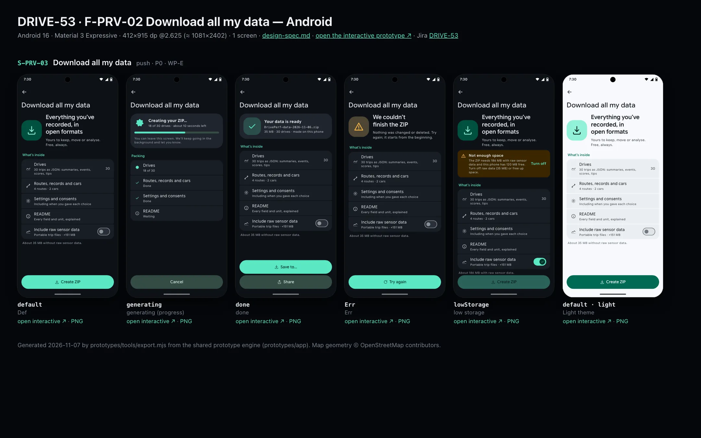
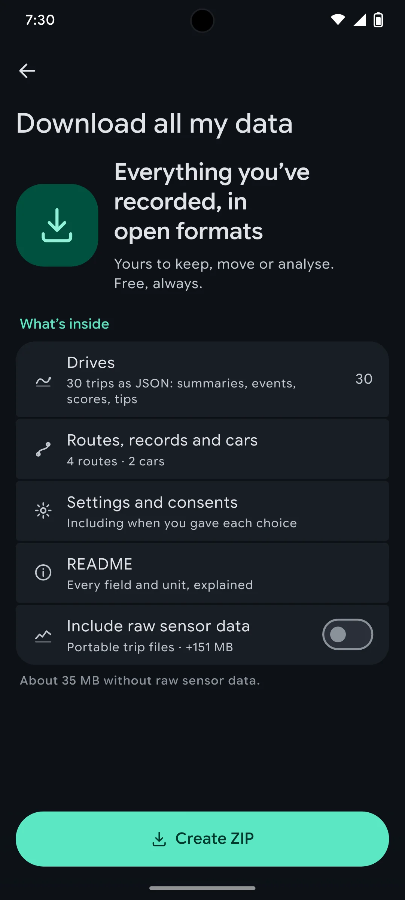
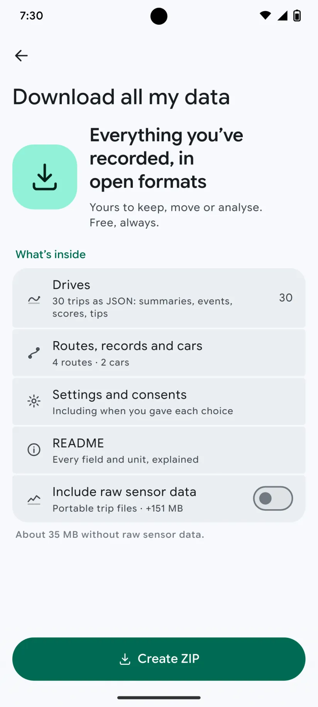

# DRIVE-53 · F-PRV-02 Download all my data — Android design spec

> Generated by `prototypes/tools/export.mjs` on 2026-11-07 from the shared prototype engine. **Do not edit by hand:** change the screen's `spec` in `prototypes/app/screens/wp-*.js` (see `prototypes/app/AUTHORING.md`) and re-export.

- **Jira story:** [DRIVE-53](https://thekeval.atlassian.net/browse/DRIVE-53) · F-PRV-02 · P0
- **Platform:** Android 16 · Material 3 Expressive · 412×915 dp @2.625 (≈ 1081×2402)
- **Interactive prototype:** [../../../../prototypes/android/index.html#S-PRV-03](../../../../prototypes/android/index.html#S-PRV-03) (catalog panel: every screen and state; deep links `#S-ID/state?trip=…&ent=…&theme=light&text=xl&rm=1`)
- **Contact sheet:** [mockup.html](mockup.html) · 
- **Design system (source of truth for values):** [brand](../../system/brand.md) · [components](../../system/components.md) · [motion](../../system/motion.md) · [accessibility](../../system/accessibility.md) · [screen map](../../system/screen-map.md) · [fixtures](../../system/fixtures.md) · tokens `prototypes/shared/tokens.css`

## Screens in this story

| Screen | Name | Presentation | Priority | States | Status |
|---|---|---|---|---|---|
| `S-PRV-03` | Download all my data | Push | P0 | 5 | Prototyped |

## Tokens used on this platform

Values resolved from `prototypes/shared/tokens.css` inside the Android device (`[data-platform="android"]`). Use the token names in code; the hex values are for reference.

| Token | Dark | Light |
|---|---|---|
| `--app-bg` | `#0D1117` | `#F7F9FC` |
| `--card-bg` | `#191E25` | `#EBEEF2` |
| `--dp-bg-grouped` | `#0D1117` | `#F7F9FC` |
| `--dp-surface` | `#191E25` | `#EBEEF2` |
| `--dp-surface-2` | `#1F252D` | `#E5E8EC` |
| `--dp-surface-3` | `#2A3038` | `#DFE2E6` |
| `--dp-fill` | `#2A3038` | `#DFE2E6` |
| `--dp-fill-strong` | `#353B44` | `#D3D7DC` |
| `--dp-text` | `#E1E3E8` | `#181C20` |
| `--dp-text-2` | `#C0C7CF` | `#40474F` |
| `--dp-text-3` | `#8A929B` | `#707881` |
| `--dp-separator` | `#40474F` | `#C0C7CF` |
| `--dp-accent` | `#5BE7C4` | `#006B53` |
| `--dp-accent-text` | `#5BE7C4` | `#006B53` |
| `--dp-on-accent` | `#00382B` | `#FFFFFF` |
| `--dp-accent-container` | `#00513F` | `#91F1D8` |
| `--dp-record` | `#FFC24B` | `#7A5900` |
| `--dp-positive` | `#5BE7C4` | `#006B53` |
| `--dp-change-down` | `#C0C7CF` | `#40474F` |
| `--dp-warning` | `#F5B648` | `#7A5900` |
| `--dp-critical` | `#FFB4AB` | `#BA1A1A` |
| `--dp-glass-fill` | `#1F252DF2` | `#E5E8ECF2` |
| `--dp-glass-fill-strong` | `#2A3038` | `#DFE2E6` |
| `--dp-glass-stroke` | `#FFFFFF0F` | `#0000000A` |
| `--md-sys-color-primary` | `#5BE7C4` | `#006B53` |
| `--md-sys-color-on-primary` | `#00382B` | `#FFFFFF` |
| `--md-sys-color-primary-container` | `#00513F` | `#91F1D8` |
| `--md-sys-color-on-primary-container` | `#91F1D8` | `#002118` |
| `--md-sys-color-secondary-container` | `#344C44` | `#CEE9DF` |
| `--md-sys-color-surface` | `#0D1117` | `#F7F9FC` |
| `--md-sys-color-surface-container` | `#191E25` | `#EBEEF2` |
| `--md-sys-color-surface-container-high` | `#1F252D` | `#E5E8EC` |
| `--md-sys-color-on-surface-variant` | `#C0C7CF` | `#40474F` |
| `--dp-data-route` | `#5BE7C4` | `#079777` |
| `--dp-data-event-brake` | `#FF7A66` | `#A21F16` |
| `--dp-data-event-accel` | `#E58BD0` | `#A33A8C` |
| `--dp-data-event-corner` | `#EAD54E` | `#9A8A00` |
| `--dp-data-quality-good` | `#5FDB9C` | `#1E9E62` |
| `--dp-data-speed` | `#D6DCE4` | `#404A58` |
| `--dp-data-long-g` | `#5AB8F5` | `#0A6AB8` |
| `--dp-data-lat-g` | `#F5A142` | `#B25A00` |

| Type / layout token | Value |
|---|---|
| `--dp-font-screen-title` | `600 32px / 40px "Google Sans Flex", "Google Sans Display", "Roboto Flex", Roboto, system-ui, sans-serif` |
| `--dp-font-sheet-title` | `400 24px / 32px "Google Sans Flex", "Google Sans Display", "Roboto Flex", Roboto, system-ui, sans-serif` |
| `--dp-font-section-title` | `600 22px / 28px "Google Sans Flex", "Google Sans Display", "Roboto Flex", Roboto, system-ui, sans-serif` |
| `--dp-font-card-title` | `700 16px / 24px "Google Sans Flex", "Google Sans Text", "Roboto Flex", Roboto, system-ui, sans-serif` |
| `--dp-font-body` | `400 16px / 24px "Google Sans Flex", "Google Sans Text", "Roboto Flex", Roboto, system-ui, sans-serif` |
| `--dp-font-body-secondary` | `400 14px / 20px "Google Sans Flex", "Google Sans Text", "Roboto Flex", Roboto, system-ui, sans-serif` |
| `--dp-font-meta` | `400 12px / 16px "Google Sans Flex", "Google Sans Text", "Roboto Flex", Roboto, system-ui, sans-serif` |
| `--dp-font-caption` | `500 12px / 16px "Google Sans Flex", "Google Sans Text", "Roboto Flex", Roboto, system-ui, sans-serif` |
| `--dp-font-button` | `700 14px / 20px "Google Sans Flex", "Google Sans Text", "Roboto Flex", Roboto, system-ui, sans-serif` |
| `--dp-num-hero` | `600 72px / 72px "Google Sans Flex", "Roboto Flex", Roboto, system-ui, sans-serif` |
| `--dp-num-xl` | `600 48px / 52px "Google Sans Flex", "Roboto Flex", Roboto, system-ui, sans-serif` |
| `--dp-num-l` | `600 34px / 38px "Google Sans Flex", "Roboto Flex", Roboto, system-ui, sans-serif` |
| `--dp-num-m` | `600 24px / 28px "Google Sans Flex", "Roboto Flex", Roboto, system-ui, sans-serif` |
| `--dp-num-s` | `600 17px / 22px "Google Sans Flex", "Roboto Flex", Roboto, system-ui, sans-serif` |
| `--dp-num-xs` | `600 13px / 16px "Google Sans Flex", "Roboto Flex", Roboto, system-ui, sans-serif` |
| `--dp-screen-margin` | `16px` |
| `--dp-radius-card` | `16px` |
| `--dp-radius-card-hero` | `28px` |
| `--dp-radius-sheet` | `28px` |
| `--dp-radius-chip` | `8px` |
| `--dp-radius-button` | `999px` |
| `--dp-layout-list-row-min` | `56px` |
| `--dp-layout-touch-min` | `48px` |
| `--safe-top` | `40px` |
| `--safe-bottom` | `24px` |

Text sizes scale with `--dp-text-scale` (XL = 2.0×) and numerals with `--dp-num-scale` (XL = 1.3×). DP Numerals: Google Sans Flex wdth 120 wght 600, tabular.

---

## S-PRV-03 · Download all my data

 

- **Presentation:** push · tab: profile — screen map: “Push”
- **Entry points:** S-PRV-01
- **Leads to:** iOS Files / share sheet · Android SAF picker
- **PRD features:** F-PRV-02 · **Priority:** P0 · **WP:** E
- **Interactive:** [S-PRV-03](../../../../prototypes/android/index.html#S-PRV-03)

**Purpose.** Give the user all of their data in open formats, free, so it is truly theirs and they can leave (F-PRV-02; Law 25 portability, US access rights).

### States

| State | PRD label | Fixture params | Screenshot |
|---|---|---|---|
| `default` | Def | — | [S-PRV-03.png](../../screens/android/S-PRV-03.webp) · [open](../../../../prototypes/android/index.html#S-PRV-03) |
| `generating` | generating (progress) | — | [S-PRV-03--generating.png](../../screens/android/S-PRV-03--generating.webp) · [open](../../../../prototypes/android/index.html#S-PRV-03/generating) |
| `done` | done | — | [S-PRV-03--done.png](../../screens/android/S-PRV-03--done.webp) · [open](../../../../prototypes/android/index.html#S-PRV-03/done) |
| `Err` | Err | — | [S-PRV-03--Err.png](../../screens/android/S-PRV-03--Err.webp) · [open](../../../../prototypes/android/index.html#S-PRV-03/Err) |
| `lowStorage` | low storage | — | [S-PRV-03--lowStorage.png](../../screens/android/S-PRV-03--lowStorage.webp) · [open](../../../../prototypes/android/index.html#S-PRV-03/lowStorage) |
| default · light | Light theme | `theme=light` | [S-PRV-03--light.png](../../screens/android/S-PRV-03--light.webp) |

Every state also renders in light/dark (`theme=light`), XL text (`text=xl`) and reduced motion (`rm=1`).

### Layout

- Push, title “Download all my data”. Hero: export illustration 104 + headline “Everything you’ve recorded, in open formats” + lead “Yours to keep, move or analyse. Free, always.”
- What’s inside (list): Drives (30 trips as JSON) · Routes, records and cars · Settings and consents · README · toggle “Include raw sensor data · +151 MB”. Footer “About 35 MB without raw sensor data.” (186 MB with).
- generating: hero card with loader + “Creating your ZIP… 18 of 30 drives · about 10 seconds left” + progress bar + “You can leave this screen…”; dock Cancel.
- done: hero card — check illustration, “Your data is ready”, file name in mono, size; dock “Save to Files” + “Share…” (iOS) / “Save to…” + “Share” (Android).
- Err: warning illustration, “We couldn’t finish the ZIP”, “Nothing was changed or deleted…”; dock “Try again”. low storage: attention banner with “Turn off” (raw data), Create disabled while raw is on.

### Components & tokens

| Component | Tokens / spec |
|---|---|
| `navBar` | --dp-font-card-title · --dp-font-meta · glass: --dp-glass-fill + --dp-glass-blur · components.md §2 |
| `list` | iOS inset grouped radius --dp-radius-card, rows 52 pt, separators --dp-separator inset 16 · Android ListItem 56/72 dp in --md-sys-color-surface-container |
| `row` | --dp-font-body · --dp-font-meta (supporting) · --dp-layout-list-row-min |
| `toggle` | iOS 51×31 tint --dp-accent · Android M3 Switch 52×32 --md-sys-color-primary |
| `card` | --dp-surface / --md-sys-color-surface-container · --dp-radius-card (24 iOS · 16 Android) · hero: --dp-radius-card-hero (32 · 28) · light iOS: --dp-elev-1 |
| `loader` | see components.md |
| `banner` | radius 12 (--dp-radius-sm+) · info --dp-fill · attention --dp-warning-container · critical --dp-critical-container · components.md §22 |
| `button` | --dp-accent / --dp-on-accent (filled) · --dp-fill-strong · --md-sys-color-secondary-container (tonal) · --dp-radius-button · height iOS 50/44/34 · Android 56/40/32 · --dp-font-button · components.md §0 |
| `section` | --dp-font-section-title · --dp-layout-section-gap 28 |

### Interactions & navigation

- Create ZIP → generating (built on the device; iOS BGContinuedProcessingTask, Android foreground work with a progress notification) → done.
- Save to Files / Save to… → iOS document picker / Android Storage Access Framework (ACTION_CREATE_DOCUMENT). Share → share sheet.
- Cancel → stops and deletes the partial file. Turn off (low storage) → raw off, back to default. Signed in: account data (profile, consents, entitlement history) is included.

### Motion

- Blocks rise 8 px; progress bar eases forward (900 ms); done: check pops + haptic success. RM: static bar, fade.

### Accessibility

- Progress is a progressbar “18 of 30 drives packed”, announced politely every 10%. File name read in full.
- XL: dock buttons stack and grow; rows wrap.

### Platform notes

- **Android (this spec):** SAF ACTION_CREATE_DOCUMENT (application/zip); foreground service notification while generating.
- *iOS (for reference):* UIDocumentPickerViewController (export) and ShareLink; BGContinuedProcessingTask where available.

### Analytics

- `data_download_started {raw}`
- `data_download_completed {size_bucket}`
- `data_download_failed {reason}`

### Copy

| Key | Text |
|---|---|
| Headline | Everything you’ve recorded, in open formats |
| Lead | Yours to keep, move or analyse. Free, always. |
| Generating | Creating your ZIP… 18 of 30 drives · about 10 seconds left. You can leave this screen. We’ll keep going in the background and let you know. |
| Done | Your data is ready · DrivePerf-data-2026-11-06.zip |
| Err | We couldn’t finish the ZIP. Nothing was changed or deleted. Try again; it starts from the beginning. |
| Low storage | Not enough space. The ZIP needs 186 MB with raw sensor data and this phone has 120 MB free. Turn off raw data (35 MB) or free up space. |

### Free / Pro

Free for everyone (Gate 1 #6). Never locked.

### Data & fixtures

Sizes from privacy.dataSize: 186 MB total, 151 MB raw → 35 MB without raw (derived). Progress 18/30, “about 10 seconds” and 120 MB free are prototype values.

### Assets

[icon-export.svg](assets/icon-export.svg) · [icon-drives.svg](assets/icon-drives.svg) · [icon-routes.svg](assets/icon-routes.svg) · [icon-gear.svg](assets/icon-gear.svg) · [icon-info.svg](assets/icon-info.svg) · [icon-analysis.svg](assets/icon-analysis.svg) · [icon-check.svg](assets/icon-check.svg) · [icon-warn.svg](assets/icon-warn.svg) · [icon-refresh.svg](assets/icon-refresh.svg) · [icon-share.svg](assets/icon-share.svg)

UI glyphs may be swapped for SF Symbols / Material Symbols Rounded equivalents; event-pin, quality and provenance glyphs must not be (components.md global rules).

### Checklist (accessibility.md §9)

- [ ] Light and dark both render, and contrast passes.
- [ ] The XL text state reflows with no truncation.
- [ ] The RM state is defined.
- [ ] Every control has a label; every chart and map has a summary sentence.
- [ ] Every target ≥ 44 pt / 48 dp (≥ 64 in-drive).
- [ ] No meaning by colour alone.
- [ ] Speed is neutral wherever it appears and absent from social or live surfaces.
- [ ] No streak, leaderboard, speed or “beat your time” language.
- [ ] Behaviour is defined while a trip is active (D1 gate).
- [ ] Haptics come from motion.md §6 only.

---

Map geometry in the prototype: © OpenStreetMap contributors (ODbL). Speed and G are simulated fixtures (fixtures.md).
