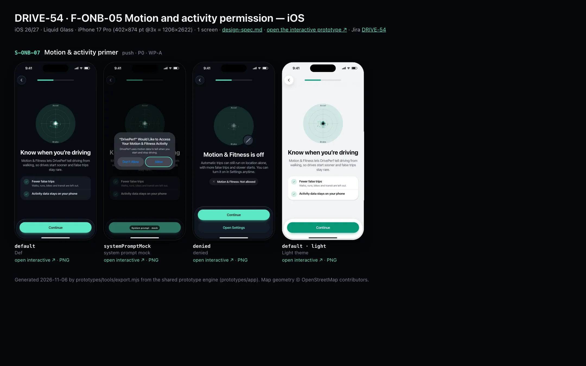
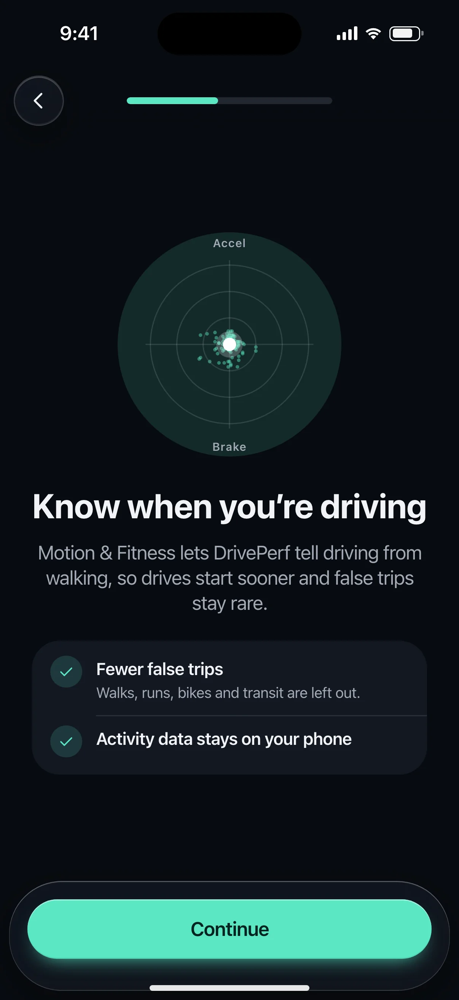
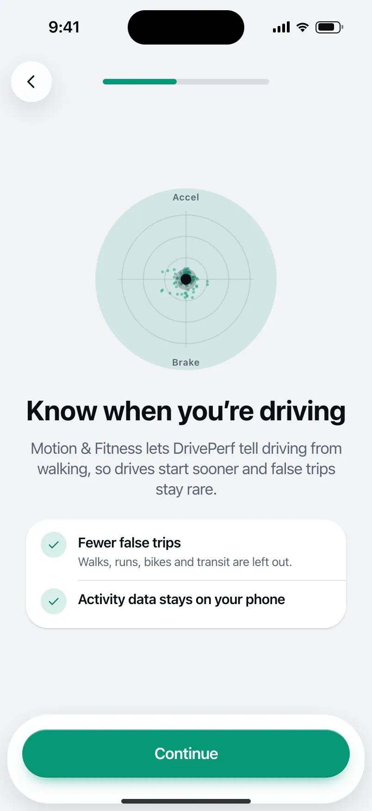

# DRIVE-54 · F-ONB-05 Motion and activity permission — iOS design spec

> Generated by `prototypes/tools/export.mjs` on 2026-11-06 from the shared prototype engine. **Do not edit by hand:** change the screen's `spec` in `prototypes/app/screens/wp-*.js` (see `prototypes/app/AUTHORING.md`) and re-export.

- **Jira story:** [DRIVE-54](https://thekeval.atlassian.net/browse/DRIVE-54) · F-ONB-05 · P0
- **Platform:** iOS 26/27 · Liquid Glass · iPhone 17 Pro (402×874 pt @3x = 1206×2622)
- **Interactive prototype:** [../../../../prototypes/ios/index.html#S-ONB-07](../../../../prototypes/ios/index.html#S-ONB-07) (catalog panel: every screen and state; deep links `#S-ID/state?trip=…&ent=…&theme=light&text=xl&rm=1`)
- **Contact sheet:** [mockup.html](mockup.html) · 
- **Design system (source of truth for values):** [brand](../../system/brand.md) · [components](../../system/components.md) · [motion](../../system/motion.md) · [accessibility](../../system/accessibility.md) · [screen map](../../system/screen-map.md) · [fixtures](../../system/fixtures.md) · tokens `prototypes/shared/tokens.css`

## Screens in this story

| Screen | Name | Presentation | Priority | States | Status |
|---|---|---|---|---|---|
| `S-ONB-07` | Motion & activity primer | Full + Sys | P0 | 3 | Prototyped |

## Tokens used on this platform

Values resolved from `prototypes/shared/tokens.css` inside the iOS device (`[data-platform="ios"]`). Use the token names in code; the hex values are for reference.

| Token | Dark | Light |
|---|---|---|
| `--app-bg` | `#080B10` | `#F2F3F6` |
| `--card-bg` | `#131822` | `#FFFFFF` |
| `--dp-bg-grouped` | `#080B10` | `#F2F3F6` |
| `--dp-surface` | `#131822` | `#FFFFFF` |
| `--dp-surface-2` | `#1B222D` | `#F2F3F6` |
| `--dp-surface-3` | `#262E3B` | `#E4E7EC` |
| `--dp-fill` | `#7880961F` | `#7880961F` |
| `--dp-fill-strong` | `#7880963D` | `#78809633` |
| `--dp-text` | `#F2F4F7` | `#0B0E13` |
| `--dp-text-2` | `#A3AAB6` | `#5A6271` |
| `--dp-text-3` | `#6E7787` | `#8A919D` |
| `--dp-separator` | `#96A0B429` | `#3C435024` |
| `--dp-accent` | `#5BE7C4` | `#079777` |
| `--dp-accent-text` | `#5BE7C4` | `#06775E` |
| `--dp-on-accent` | `#04241D` | `#FFFFFF` |
| `--dp-accent-container` | `#0A4439` | `#C6F8EA` |
| `--dp-record` | `#FFC24B` | `#9A6300` |
| `--dp-positive` | `#5BE7C4` | `#06775E` |
| `--dp-change-down` | `#A3AAB6` | `#5A6271` |
| `--dp-warning` | `#F5B648` | `#9A5F00` |
| `--dp-critical` | `#FF6B6B` | `#C62828` |
| `--dp-glass-fill` | `#1C222C6B` | `#FFFFFF8C` |
| `--dp-glass-fill-strong` | `#1C222CB8` | `#FFFFFFD1` |
| `--dp-glass-stroke` | `#FFFFFF24` | `#FFFFFF99` |
| `--dp-data-route` | `#5BE7C4` | `#079777` |
| `--dp-data-event-brake` | `#FF7A66` | `#A21F16` |
| `--dp-data-event-accel` | `#E58BD0` | `#A33A8C` |
| `--dp-data-event-corner` | `#EAD54E` | `#9A8A00` |
| `--dp-data-quality-good` | `#5FDB9C` | `#1E9E62` |
| `--dp-data-speed` | `#D6DCE4` | `#404A58` |
| `--dp-data-long-g` | `#5AB8F5` | `#0A6AB8` |
| `--dp-data-lat-g` | `#F5A142` | `#B25A00` |

| Type / layout token | Value |
|---|---|
| `--dp-font-screen-title` | `700 34px / 41px -apple-system, BlinkMacSystemFont, "SF Pro Display", system-ui, sans-serif` |
| `--dp-font-sheet-title` | `700 22px / 28px -apple-system, BlinkMacSystemFont, "SF Pro Display", system-ui, sans-serif` |
| `--dp-font-section-title` | `600 20px / 25px -apple-system, BlinkMacSystemFont, "SF Pro Display", system-ui, sans-serif` |
| `--dp-font-card-title` | `600 17px / 22px -apple-system, BlinkMacSystemFont, "SF Pro Text", system-ui, sans-serif` |
| `--dp-font-body` | `400 17px / 22px -apple-system, BlinkMacSystemFont, "SF Pro Text", system-ui, sans-serif` |
| `--dp-font-body-secondary` | `400 15px / 20px -apple-system, BlinkMacSystemFont, "SF Pro Text", system-ui, sans-serif` |
| `--dp-font-meta` | `400 13px / 18px -apple-system, BlinkMacSystemFont, "SF Pro Text", system-ui, sans-serif` |
| `--dp-font-caption` | `400 12px / 16px -apple-system, BlinkMacSystemFont, "SF Pro Text", system-ui, sans-serif` |
| `--dp-font-button` | `600 17px / 22px -apple-system, BlinkMacSystemFont, "SF Pro Text", system-ui, sans-serif` |
| `--dp-num-hero` | `600 72px / 72px -apple-system, BlinkMacSystemFont, "SF Pro Display", system-ui, sans-serif` |
| `--dp-num-xl` | `600 48px / 52px -apple-system, BlinkMacSystemFont, "SF Pro Display", system-ui, sans-serif` |
| `--dp-num-l` | `600 34px / 38px -apple-system, BlinkMacSystemFont, "SF Pro Display", system-ui, sans-serif` |
| `--dp-num-m` | `600 24px / 28px -apple-system, BlinkMacSystemFont, "SF Pro Display", system-ui, sans-serif` |
| `--dp-num-s` | `600 17px / 22px -apple-system, BlinkMacSystemFont, "SF Pro Display", system-ui, sans-serif` |
| `--dp-num-xs` | `600 13px / 16px -apple-system, BlinkMacSystemFont, "SF Pro Display", system-ui, sans-serif` |
| `--dp-screen-margin` | `16px` |
| `--dp-radius-card` | `24px` |
| `--dp-radius-card-hero` | `32px` |
| `--dp-radius-sheet` | `38px` |
| `--dp-radius-chip` | `999px` |
| `--dp-radius-button` | `999px` |
| `--dp-layout-list-row-min` | `52px` |
| `--dp-layout-touch-min` | `44px` |
| `--safe-top` | `62px` |
| `--safe-bottom` | `34px` |

Text sizes scale with `--dp-text-scale` (XL = 2.0×) and numerals with `--dp-num-scale` (XL = 1.3×). DP Numerals: SF Pro Expanded Semibold, tabular.

---

## S-ONB-07 · Motion & activity primer

 

- **Presentation:** push — screen map: “Full + Sys”
- **Entry points:** S-ONB-06
- **Leads to:** S-ONB-08 · denied → S-ONB-16 (manual)
- **PRD features:** F-ONB-05 · **Priority:** P0 · **WP:** A
- **Interactive:** [S-ONB-07](../../../../prototypes/ios/index.html#S-ONB-07)

**Purpose.** Ask for Motion & Fitness (iOS) / Physical activity (Android) with the benefit stated first (F-ONB-05): fewer false trips and faster starts.

### States

| State | PRD label | Fixture params | Screenshot |
|---|---|---|---|
| `default` | Def | — | [S-ONB-07.png](../../screens/ios/S-ONB-07.webp) · [open](../../../../prototypes/ios/index.html#S-ONB-07) |
| `systemPromptMock` | system prompt mock | — | [S-ONB-07--systemPromptMock.png](../../screens/ios/S-ONB-07--systemPromptMock.webp) · [open](../../../../prototypes/ios/index.html#S-ONB-07/systemPromptMock) |
| `denied` | denied | — | [S-ONB-07--denied.png](../../screens/ios/S-ONB-07--denied.webp) · [open](../../../../prototypes/ios/index.html#S-ONB-07/denied) |
| default · light | Light theme | `theme=light` | [S-ONB-07--light.png](../../screens/ios/S-ONB-07--light.webp) |

Every state also renders in light/dark (`theme=light`), XL text (`text=xl`) and reduced motion (`rm=1`).

### Layout

- Top bar: Back · step progress (4 of 9 / 4 of 11).
- Art: the friction circle (components.md §6) 168: rings at 0.2/0.4/0.6 g (--dp-data-gg-ring), axes, the example drive’s G cloud at 30% (--dp-data-gg-cloud) and the G-dot (8 px with halo, --dp-data-gg-dot); “Accel” / “Brake” labels.
- Title “Know when you’re driving”, lead names the permission exactly (“Motion & Fitness” on iOS, “Physical activity” on Android).
- Checklist: ✓ Fewer false trips (walks, runs, bikes and transit are left out) · ✓ Activity data stays on your phone.
- Dock: “Continue” (triggers the prompt). No “Not now”: the OS prompt has its own Don’t Allow.
- systemPromptMock: iOS “Would Like to Access Your Motion & Fitness Activity” (Don’t Allow / Allow highlighted) · Android “Allow DrivePerf to access your physical activity?” (Allow highlighted / Don’t allow).
- denied: dimmed circle with a slashed badge, title “Motion & Fitness is off” / “Physical activity is off”, the honest consequence (location-only capture: more false trips, slower starts), status row, primary “Continue” → S-ONB-08, secondary “Open Settings”.

### Components & tokens

| Component | Tokens / spec |
|---|---|
| `page` | --dp-bg-grouped (iOS) / --md-sys-color-surface (Android) · --dp-screen-margin 16 |
| `button` | --dp-accent / --dp-on-accent (filled) · --dp-fill-strong · --md-sys-color-secondary-container (tonal) · --dp-radius-button · height iOS 50/44/34 · Android 56/40/32 · --dp-font-button · components.md §0 |
| `sysPermission` | see components.md |
| `gg` | --dp-data-gg-ring/cloud/envelope/dot · fixed ±0.6 g · components.md §6 |

### Interactions & navigation

- “Continue” → systemPromptMock (CMMotionActivityManager query / ACTIVITY_RECOGNITION request).
- Allow → S-ONB-08 · Don’t allow → denied.
- denied: “Continue” → S-ONB-08 (automatic trips can still be chosen; Health Check will show “Motion access off: more false trips and slower starts”, F-ONB-05.2) · “Open Settings” → app settings (prototype toast).

### Motion

- Hero motion: the G-dot replays the example drive’s inputs for 2.8 s on the gMeter spring (ζ 0.55, k 120, motion.md §3.5) and settles in the centre.
- RM: static plot, the dot rests at the centre, no travel.

### Accessibility

- Art is decorative. Primary label names the permission: “Continue to the Motion & Fitness prompt”.
- Denied status row: “Motion & Fitness: Not allowed”.
- Focus order: Back → step progress (“Setup, step n of N”) → title → body → primary → secondary. XL: art shrinks to 60%, title and copy wrap, the dock stays pinned and scrolls content under it; nothing truncates. Every glyph in a checklist is paired with its text (colour is never the only signal).

### Platform notes

- **iOS (this spec):** NSMotionUsageDescription = “DrivePerf uses motion data to tell when you start and stop driving.” (the app crashes without it; CI checks it, F-ONB-05.3). The prompt appears on the first CMMotionActivityManager query.
- *Android (for reference):* API 29+: runtime ACTIVITY_RECOGNITION (“Physical activity”); API ≤ 28 skips the prompt and this screen auto-advances. Activity Recognition Transition API.

### Analytics

- `permission_primer_viewed {perm: motion}`
- `permission_result {perm: motion, result: granted|denied}`

### Copy

| Key | Text |
|---|---|
| Title | Know when you’re driving |
| Lead iOS | Motion & Fitness lets DrivePerf tell driving from walking, so drives start sooner and false trips stay rare. |
| Lead Android | Physical activity lets DrivePerf tell driving from walking, so drives start sooner and false trips stay rare. |
| Denied lead | Automatic trips can still run on location alone, with more false trips and slower starts. You can turn it on in Settings anytime. |

### Free / Pro

n/a (Free).

### Data & fixtures

G cloud = trips t20261105-0742 gg.points (every 2nd, ≤ 220, clamped ±0.6 g); the dot replays every 6th point (derived, illustrative). No max-G is ever shown (SAF-04).

### Assets

[icon-check.svg](assets/icon-check.svg) · [icon-drives.svg](assets/icon-drives.svg)

UI glyphs may be swapped for SF Symbols / Material Symbols Rounded equivalents; event-pin, quality and provenance glyphs must not be (components.md global rules).

### Checklist (accessibility.md §9)

- [ ] Light and dark both render, and contrast passes.
- [ ] The XL text state reflows with no truncation.
- [ ] The RM state is defined.
- [ ] Every control has a label; every chart and map has a summary sentence.
- [ ] Every target ≥ 44 pt / 48 dp (≥ 64 in-drive).
- [ ] No meaning by colour alone.
- [ ] Speed is neutral wherever it appears and absent from social or live surfaces.
- [ ] No streak, leaderboard, speed or “beat your time” language.
- [ ] Behaviour is defined while a trip is active (D1 gate).
- [ ] Haptics come from motion.md §6 only.

---

Map geometry in the prototype: © OpenStreetMap contributors (ODbL). Speed and G are simulated fixtures (fixtures.md).
