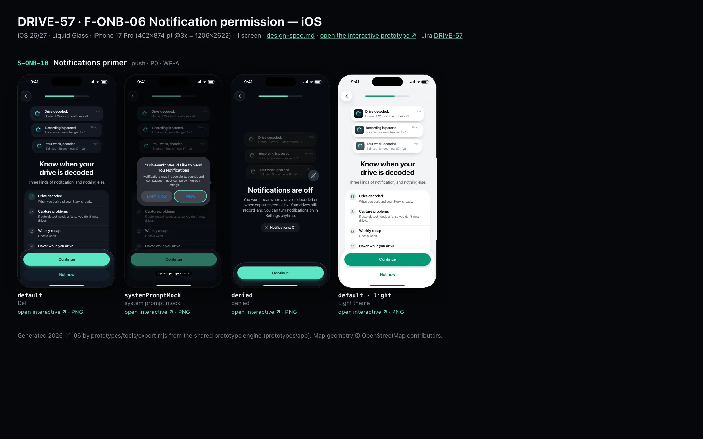
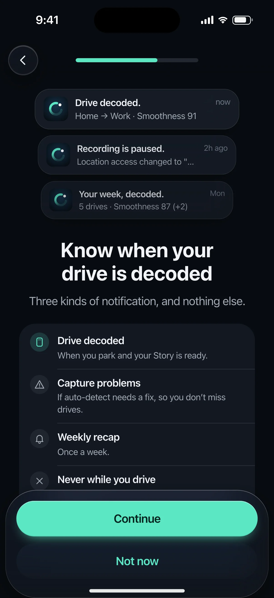
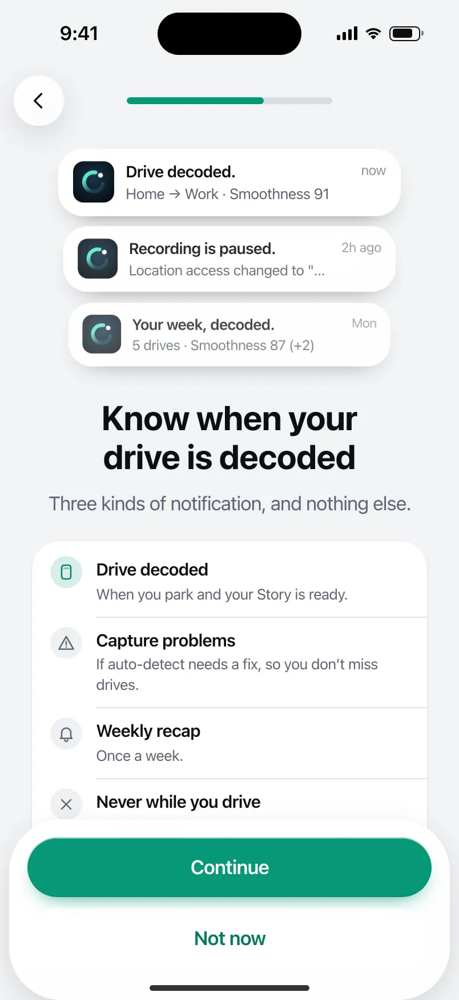

# DRIVE-57 · F-ONB-06 Notification permission — iOS design spec

> Generated by `prototypes/tools/export.mjs` on 2026-11-06 from the shared prototype engine. **Do not edit by hand:** change the screen's `spec` in `prototypes/app/screens/wp-*.js` (see `prototypes/app/AUTHORING.md`) and re-export.

- **Jira story:** [DRIVE-57](https://thekeval.atlassian.net/browse/DRIVE-57) · F-ONB-06 · P0
- **Platform:** iOS 26/27 · Liquid Glass · iPhone 17 Pro (402×874 pt @3x = 1206×2622)
- **Interactive prototype:** [../../../../prototypes/ios/index.html#S-ONB-10](../../../../prototypes/ios/index.html#S-ONB-10) (catalog panel: every screen and state; deep links `#S-ID/state?trip=…&ent=…&theme=light&text=xl&rm=1`)
- **Contact sheet:** [mockup.html](mockup.html) · 
- **Design system (source of truth for values):** [brand](../../system/brand.md) · [components](../../system/components.md) · [motion](../../system/motion.md) · [accessibility](../../system/accessibility.md) · [screen map](../../system/screen-map.md) · [fixtures](../../system/fixtures.md) · tokens `prototypes/shared/tokens.css`

## Screens in this story

| Screen | Name | Presentation | Priority | States | Status |
|---|---|---|---|---|---|
| `S-ONB-10` | Notifications primer | Full + Sys | P0 | 3 | Prototyped |

## Tokens used on this platform

Values resolved from `prototypes/shared/tokens.css` inside the iOS device (`[data-platform="ios"]`). Use the token names in code; the hex values are for reference.

| Token | Dark | Light |
|---|---|---|
| `--app-bg` | `#080B10` | `#F2F3F6` |
| `--card-bg` | `#131822` | `#FFFFFF` |
| `--dp-bg-grouped` | `#080B10` | `#F2F3F6` |
| `--dp-surface` | `#131822` | `#FFFFFF` |
| `--dp-surface-2` | `#1B222D` | `#F2F3F6` |
| `--dp-surface-3` | `#262E3B` | `#E4E7EC` |
| `--dp-fill` | `#7880961F` | `#7880961F` |
| `--dp-fill-strong` | `#7880963D` | `#78809633` |
| `--dp-text` | `#F2F4F7` | `#0B0E13` |
| `--dp-text-2` | `#A3AAB6` | `#5A6271` |
| `--dp-text-3` | `#6E7787` | `#8A919D` |
| `--dp-separator` | `#96A0B429` | `#3C435024` |
| `--dp-accent` | `#5BE7C4` | `#079777` |
| `--dp-accent-text` | `#5BE7C4` | `#06775E` |
| `--dp-on-accent` | `#04241D` | `#FFFFFF` |
| `--dp-accent-container` | `#0A4439` | `#C6F8EA` |
| `--dp-record` | `#FFC24B` | `#9A6300` |
| `--dp-positive` | `#5BE7C4` | `#06775E` |
| `--dp-change-down` | `#A3AAB6` | `#5A6271` |
| `--dp-warning` | `#F5B648` | `#9A5F00` |
| `--dp-critical` | `#FF6B6B` | `#C62828` |
| `--dp-glass-fill` | `#1C222C6B` | `#FFFFFF8C` |
| `--dp-glass-fill-strong` | `#1C222CB8` | `#FFFFFFD1` |
| `--dp-glass-stroke` | `#FFFFFF24` | `#FFFFFF99` |
| `--dp-data-route` | `#5BE7C4` | `#079777` |
| `--dp-data-event-brake` | `#FF7A66` | `#A21F16` |
| `--dp-data-event-accel` | `#E58BD0` | `#A33A8C` |
| `--dp-data-event-corner` | `#EAD54E` | `#9A8A00` |
| `--dp-data-quality-good` | `#5FDB9C` | `#1E9E62` |
| `--dp-data-speed` | `#D6DCE4` | `#404A58` |
| `--dp-data-long-g` | `#5AB8F5` | `#0A6AB8` |
| `--dp-data-lat-g` | `#F5A142` | `#B25A00` |

| Type / layout token | Value |
|---|---|
| `--dp-font-screen-title` | `700 34px / 41px -apple-system, BlinkMacSystemFont, "SF Pro Display", system-ui, sans-serif` |
| `--dp-font-sheet-title` | `700 22px / 28px -apple-system, BlinkMacSystemFont, "SF Pro Display", system-ui, sans-serif` |
| `--dp-font-section-title` | `600 20px / 25px -apple-system, BlinkMacSystemFont, "SF Pro Display", system-ui, sans-serif` |
| `--dp-font-card-title` | `600 17px / 22px -apple-system, BlinkMacSystemFont, "SF Pro Text", system-ui, sans-serif` |
| `--dp-font-body` | `400 17px / 22px -apple-system, BlinkMacSystemFont, "SF Pro Text", system-ui, sans-serif` |
| `--dp-font-body-secondary` | `400 15px / 20px -apple-system, BlinkMacSystemFont, "SF Pro Text", system-ui, sans-serif` |
| `--dp-font-meta` | `400 13px / 18px -apple-system, BlinkMacSystemFont, "SF Pro Text", system-ui, sans-serif` |
| `--dp-font-caption` | `400 12px / 16px -apple-system, BlinkMacSystemFont, "SF Pro Text", system-ui, sans-serif` |
| `--dp-font-button` | `600 17px / 22px -apple-system, BlinkMacSystemFont, "SF Pro Text", system-ui, sans-serif` |
| `--dp-num-hero` | `600 72px / 72px -apple-system, BlinkMacSystemFont, "SF Pro Display", system-ui, sans-serif` |
| `--dp-num-xl` | `600 48px / 52px -apple-system, BlinkMacSystemFont, "SF Pro Display", system-ui, sans-serif` |
| `--dp-num-l` | `600 34px / 38px -apple-system, BlinkMacSystemFont, "SF Pro Display", system-ui, sans-serif` |
| `--dp-num-m` | `600 24px / 28px -apple-system, BlinkMacSystemFont, "SF Pro Display", system-ui, sans-serif` |
| `--dp-num-s` | `600 17px / 22px -apple-system, BlinkMacSystemFont, "SF Pro Display", system-ui, sans-serif` |
| `--dp-num-xs` | `600 13px / 16px -apple-system, BlinkMacSystemFont, "SF Pro Display", system-ui, sans-serif` |
| `--dp-screen-margin` | `16px` |
| `--dp-radius-card` | `24px` |
| `--dp-radius-card-hero` | `32px` |
| `--dp-radius-sheet` | `38px` |
| `--dp-radius-chip` | `999px` |
| `--dp-radius-button` | `999px` |
| `--dp-layout-list-row-min` | `52px` |
| `--dp-layout-touch-min` | `44px` |
| `--safe-top` | `62px` |
| `--safe-bottom` | `34px` |

Text sizes scale with `--dp-text-scale` (XL = 2.0×) and numerals with `--dp-num-scale` (XL = 1.3×). DP Numerals: SF Pro Expanded Semibold, tabular.

---

## S-ONB-10 · Notifications primer

 

- **Presentation:** push — screen map: “Full + Sys”
- **Entry points:** S-ONB-08 / S-ONB-09
- **Leads to:** S-ONB-12 (Android) · S-ONB-13 (iOS)
- **PRD features:** F-ONB-06 · **Priority:** P0 · **WP:** A
- **Interactive:** [S-ONB-10](../../../../prototypes/ios/index.html#S-ONB-10)

**Purpose.** Ask for notifications by listing exactly what we send (F-ONB-06): drive decoded, capture problems, weekly recap — and “never while you drive”.

### States

| State | PRD label | Fixture params | Screenshot |
|---|---|---|---|
| `default` | Def | — | [S-ONB-10.png](../../screens/ios/S-ONB-10.webp) · [open](../../../../prototypes/ios/index.html#S-ONB-10) |
| `systemPromptMock` | system prompt mock | — | [S-ONB-10--systemPromptMock.png](../../screens/ios/S-ONB-10--systemPromptMock.webp) · [open](../../../../prototypes/ios/index.html#S-ONB-10/systemPromptMock) |
| `denied` | denied | — | [S-ONB-10--denied.png](../../screens/ios/S-ONB-10--denied.webp) · [open](../../../../prototypes/ios/index.html#S-ONB-10/denied) |
| default · light | Light theme | `theme=light` | [S-ONB-10--light.png](../../screens/ios/S-ONB-10--light.webp) |

Every state also renders in light/dark (`theme=light`), XL text (`text=xl`) and reduced motion (`rm=1`).

### Layout

- Top bar: Back · step progress (6 of 9 / 7 of 11).
- Art: three stacked notification previews (radius 22 iOS glass / 16 Android surfaceContainerHigh), Loop app icon, title + body from the fixtures, relative time.
- Title “Know when your drive is decoded”, lead “Three kinds of notification, and nothing else.”
- Checklist: Story glyph “Drive decoded” · triangle “Capture problems” · bell “Weekly recap” · ✕ “Never while you drive”.
- Dock: “Continue” (triggers the prompt) · secondary “Not now” (skips the prompt; ask again later from Settings).
- systemPromptMock: iOS “Would Like to Send You Notifications” (Allow highlighted) · Android 13+ “Allow DrivePerf to send you notifications?” (Allow highlighted).
- denied: previews dimmed with a slashed bell, honest consequence, status row; Android adds the foreground-service recording-notification note.

### Components & tokens

| Component | Tokens / spec |
|---|---|
| `page` | --dp-bg-grouped (iOS) / --md-sys-color-surface (Android) · --dp-screen-margin 16 |
| `button` | --dp-accent / --dp-on-accent (filled) · --dp-fill-strong · --md-sys-color-secondary-container (tonal) · --dp-radius-button · height iOS 50/44/34 · Android 56/40/32 · --dp-font-button · components.md §0 |
| `sysPermission` | see components.md |
| `notification` | components.md §20.6 |

### Interactions & navigation

- “Continue” → systemPromptMock (UNUserNotificationCenter.requestAuthorization / POST_NOTIFICATIONS).
- Allow → next step · Don’t allow → denied · “Not now” → next step without prompting.
- Next step: Android with automatic trips on → S-ONB-12; otherwise → S-ONB-13.

### Motion

- Hero motion: the three previews rise into a stack (translateY 18/24/30 → 0, scale .96 → 1, spring.default, 140 ms stagger).
- RM: stack shown final, 220 ms cross-fade.

### Accessibility

- Art is hidden; the checklist states the same three kinds plus “Never while you drive”.
- Primary label: “Continue to the notifications prompt”.
- Focus order: Back → step progress (“Setup, step n of N”) → title → body → primary → secondary. XL: art shrinks to 60%, title and copy wrap, the dock stays pinned and scrolls content under it; nothing truncates. Every glyph in a checklist is paired with its text (colour is never the only signal).

### Platform notes

- **iOS (this spec):** requestAuthorization([.alert, .sound, .badge]); local notifications only (no push token in v1, §8). Time Sensitive is not requested.
- *Android (for reference):* Android 13+: runtime POST_NOTIFICATIONS. Android ≤ 12: no prompt, this screen is skipped. Denied still shows the foreground-service notification while recording (required). Android 16 Live Update promotion needs POST_PROMOTED_NOTIFICATIONS declared (F-CAP-12).

### Analytics

- `permission_primer_viewed {perm: notifications}`
- `permission_result {perm: notifications, result: granted|denied|skipped}`

### Copy

| Key | Text |
|---|---|
| Title | Know when your drive is decoded |
| Lead | Three kinds of notification, and nothing else. |
| List | Drive decoded · Capture problems · Weekly recap · Never while you drive |
| Denied lead | You won’t hear when a drive is decoded or when capture needs a fix. Your drives still record, and you can turn notifications on in Settings anytime. |
| Android FGS note | While a drive records, Android still shows the recording notification. It’s required, and it’s how you stop a trip from the shade. |

### Free / Pro

n/a (Free).

### Data & fixtures

Previews = DP_DATA.notifications n_decoded (“Drive decoded.” · “Home → Work · Smoothness 91”), n_capture (“Recording is paused.”), n_week (“Your week, decoded.” · “5 drives · Smoothness 87 (+2)”). Relative times are illustrative.

### Assets

[icon-story.svg](assets/icon-story.svg) · [icon-warn.svg](assets/icon-warn.svg) · [icon-bell.svg](assets/icon-bell.svg) · [icon-close.svg](assets/icon-close.svg)

UI glyphs may be swapped for SF Symbols / Material Symbols Rounded equivalents; event-pin, quality and provenance glyphs must not be (components.md global rules).

### Checklist (accessibility.md §9)

- [ ] Light and dark both render, and contrast passes.
- [ ] The XL text state reflows with no truncation.
- [ ] The RM state is defined.
- [ ] Every control has a label; every chart and map has a summary sentence.
- [ ] Every target ≥ 44 pt / 48 dp (≥ 64 in-drive).
- [ ] No meaning by colour alone.
- [ ] Speed is neutral wherever it appears and absent from social or live surfaces.
- [ ] No streak, leaderboard, speed or “beat your time” language.
- [ ] Behaviour is defined while a trip is active (D1 gate).
- [ ] Haptics come from motion.md §6 only.

---

Map geometry in the prototype: © OpenStreetMap contributors (ODbL). Speed and G are simulated fixtures (fixtures.md).
