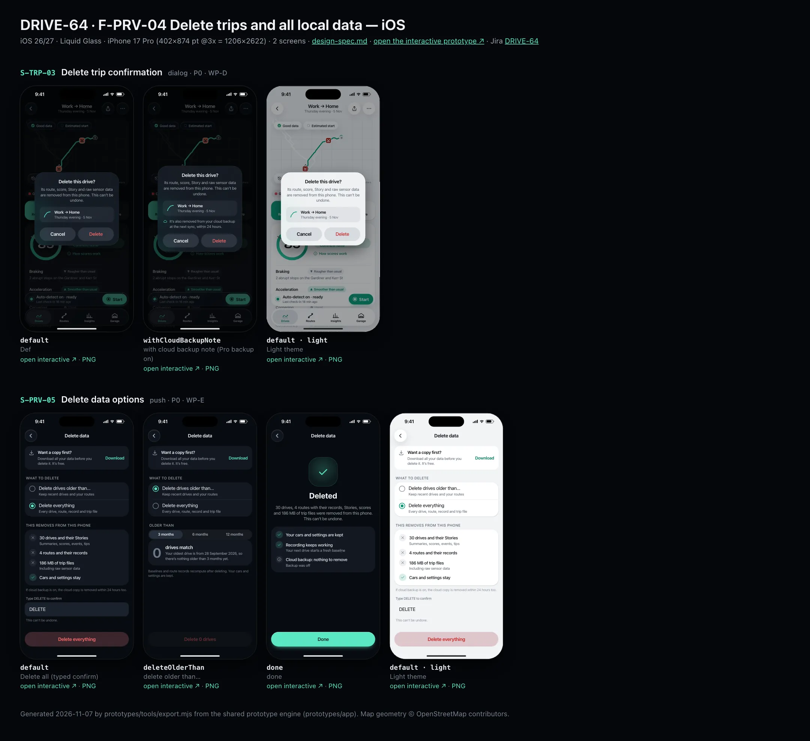
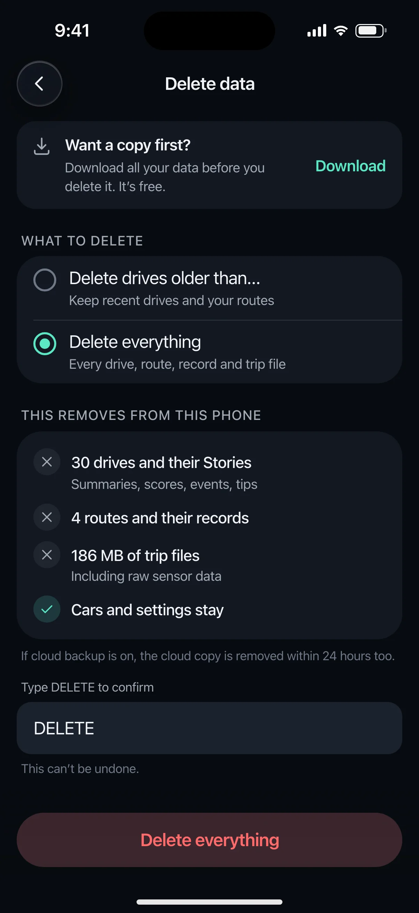
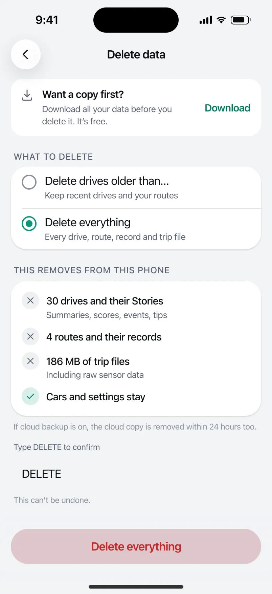

# DRIVE-64 · F-PRV-04 Delete trips and all local data — iOS design spec

> Generated by `prototypes/tools/export.mjs` on 2026-11-07 from the shared prototype engine. **Do not edit by hand:** change the screen's `spec` in `prototypes/app/screens/wp-*.js` (see `prototypes/app/AUTHORING.md`) and re-export.

- **Jira story:** [DRIVE-64](https://thekeval.atlassian.net/browse/DRIVE-64) · F-PRV-04 · P0
- **Platform:** iOS 26/27 · Liquid Glass · iPhone 17 Pro (402×874 pt @3x = 1206×2622)
- **Interactive prototype:** [../../../../prototypes/ios/index.html#S-TRP-03](../../../../prototypes/ios/index.html#S-TRP-03) (catalog panel: every screen and state; deep links `#S-ID/state?trip=…&ent=…&theme=light&text=xl&rm=1`)
- **Contact sheet:** [mockup.html](mockup.html) · 
- **Design system (source of truth for values):** [brand](../../system/brand.md) · [components](../../system/components.md) · [motion](../../system/motion.md) · [accessibility](../../system/accessibility.md) · [screen map](../../system/screen-map.md) · [fixtures](../../system/fixtures.md) · tokens `prototypes/shared/tokens.css`

## Screens in this story

| Screen | Name | Presentation | Priority | States | Status |
|---|---|---|---|---|---|
| `S-TRP-03` | Delete trip confirmation | Dialog (iOS alert / M3 dialog) | P0 | 2 | Prototyped |
| `S-PRV-05` | Delete data options | Push | P0 | 3 | Prototyped |

## Tokens used on this platform

Values resolved from `prototypes/shared/tokens.css` inside the iOS device (`[data-platform="ios"]`). Use the token names in code; the hex values are for reference.

| Token | Dark | Light |
|---|---|---|
| `--app-bg` | `#080B10` | `#F2F3F6` |
| `--card-bg` | `#131822` | `#FFFFFF` |
| `--dp-bg-grouped` | `#080B10` | `#F2F3F6` |
| `--dp-surface` | `#131822` | `#FFFFFF` |
| `--dp-surface-2` | `#1B222D` | `#F2F3F6` |
| `--dp-surface-3` | `#262E3B` | `#E4E7EC` |
| `--dp-fill` | `#7880961F` | `#7880961F` |
| `--dp-fill-strong` | `#7880963D` | `#78809633` |
| `--dp-text` | `#F2F4F7` | `#0B0E13` |
| `--dp-text-2` | `#A3AAB6` | `#5A6271` |
| `--dp-text-3` | `#6E7787` | `#8A919D` |
| `--dp-separator` | `#96A0B429` | `#3C435024` |
| `--dp-accent` | `#5BE7C4` | `#079777` |
| `--dp-accent-text` | `#5BE7C4` | `#06775E` |
| `--dp-on-accent` | `#04241D` | `#FFFFFF` |
| `--dp-accent-container` | `#0A4439` | `#C6F8EA` |
| `--dp-record` | `#FFC24B` | `#9A6300` |
| `--dp-positive` | `#5BE7C4` | `#06775E` |
| `--dp-change-down` | `#A3AAB6` | `#5A6271` |
| `--dp-warning` | `#F5B648` | `#9A5F00` |
| `--dp-critical` | `#FF6B6B` | `#C62828` |
| `--dp-glass-fill` | `#1C222C6B` | `#FFFFFF8C` |
| `--dp-glass-fill-strong` | `#1C222CB8` | `#FFFFFFD1` |
| `--dp-glass-stroke` | `#FFFFFF24` | `#FFFFFF99` |
| `--dp-data-route` | `#5BE7C4` | `#079777` |
| `--dp-data-event-brake` | `#FF7A66` | `#A21F16` |
| `--dp-data-event-accel` | `#E58BD0` | `#A33A8C` |
| `--dp-data-event-corner` | `#EAD54E` | `#9A8A00` |
| `--dp-data-quality-good` | `#5FDB9C` | `#1E9E62` |
| `--dp-data-speed` | `#D6DCE4` | `#404A58` |
| `--dp-data-long-g` | `#5AB8F5` | `#0A6AB8` |
| `--dp-data-lat-g` | `#F5A142` | `#B25A00` |

| Type / layout token | Value |
|---|---|
| `--dp-font-screen-title` | `700 34px / 41px -apple-system, BlinkMacSystemFont, "SF Pro Display", system-ui, sans-serif` |
| `--dp-font-sheet-title` | `700 22px / 28px -apple-system, BlinkMacSystemFont, "SF Pro Display", system-ui, sans-serif` |
| `--dp-font-section-title` | `600 20px / 25px -apple-system, BlinkMacSystemFont, "SF Pro Display", system-ui, sans-serif` |
| `--dp-font-card-title` | `600 17px / 22px -apple-system, BlinkMacSystemFont, "SF Pro Text", system-ui, sans-serif` |
| `--dp-font-body` | `400 17px / 22px -apple-system, BlinkMacSystemFont, "SF Pro Text", system-ui, sans-serif` |
| `--dp-font-body-secondary` | `400 15px / 20px -apple-system, BlinkMacSystemFont, "SF Pro Text", system-ui, sans-serif` |
| `--dp-font-meta` | `400 13px / 18px -apple-system, BlinkMacSystemFont, "SF Pro Text", system-ui, sans-serif` |
| `--dp-font-caption` | `400 12px / 16px -apple-system, BlinkMacSystemFont, "SF Pro Text", system-ui, sans-serif` |
| `--dp-font-button` | `600 17px / 22px -apple-system, BlinkMacSystemFont, "SF Pro Text", system-ui, sans-serif` |
| `--dp-num-hero` | `600 72px / 72px -apple-system, BlinkMacSystemFont, "SF Pro Display", system-ui, sans-serif` |
| `--dp-num-xl` | `600 48px / 52px -apple-system, BlinkMacSystemFont, "SF Pro Display", system-ui, sans-serif` |
| `--dp-num-l` | `600 34px / 38px -apple-system, BlinkMacSystemFont, "SF Pro Display", system-ui, sans-serif` |
| `--dp-num-m` | `600 24px / 28px -apple-system, BlinkMacSystemFont, "SF Pro Display", system-ui, sans-serif` |
| `--dp-num-s` | `600 17px / 22px -apple-system, BlinkMacSystemFont, "SF Pro Display", system-ui, sans-serif` |
| `--dp-num-xs` | `600 13px / 16px -apple-system, BlinkMacSystemFont, "SF Pro Display", system-ui, sans-serif` |
| `--dp-screen-margin` | `16px` |
| `--dp-radius-card` | `24px` |
| `--dp-radius-card-hero` | `32px` |
| `--dp-radius-sheet` | `38px` |
| `--dp-radius-chip` | `999px` |
| `--dp-radius-button` | `999px` |
| `--dp-layout-list-row-min` | `52px` |
| `--dp-layout-touch-min` | `44px` |
| `--safe-top` | `62px` |
| `--safe-bottom` | `34px` |

Text sizes scale with `--dp-text-scale` (XL = 2.0×) and numerals with `--dp-num-scale` (XL = 1.3×). DP Numerals: SF Pro Expanded Semibold, tabular.

---

## S-TRP-03 · Delete trip confirmation

- **Presentation:** dialog · tab: drives — screen map: “Dialog (iOS alert / M3 dialog)”
- **Entry points:** S-TRP-02 · trip card swipe
- **Leads to:** S-HIS-01
- **PRD features:** F-HIS-02, F-PRV-04 · **Priority:** P0 · **WP:** D
- **Interactive:** [S-TRP-03](../../../../prototypes/ios/index.html#S-TRP-03)

**Purpose.** Confirm a real, irreversible deletion of one drive and its raw data (F-HIS-02.3, F-PRV-04). Deletion is deletion, not hiding.

### States

| State | PRD label | Fixture params | Screenshot |
|---|---|---|---|
| `default` | Def | `trip=t20261105-1745` | — · [open](../../../../prototypes/ios/index.html#S-TRP-03) |
| `withCloudBackupNote` | with cloud backup note (Pro backup on) | `trip=t20261105-1745` | — · [open](../../../../prototypes/ios/index.html#S-TRP-03/withCloudBackupNote) |

Every state also renders in light/dark (`theme=light`), XL text (`text=xl`) and reduced motion (`rm=1`).

### Layout

- iOS alert (glass, 300 wide, radius 34): title “Delete this drive?” · message · the drive (glyph 30, label, part of day · date) · cloud note when backup is on · buttons side by side: Cancel (bold) | Delete (destructive red).
- Android M3 dialog (312 wide, radius 28, surface-container-high): trash icon (secondary), centred headline, supporting text, the drive row, the cloud note, right-aligned text buttons Cancel · Delete (error colour).

### Components & tokens

| Component | Tokens / spec |
|---|---|
| `dialog` | iOS alert 270 glass · Android M3 dialog radius 28 --md-sys-color-surface-container-high |
| `glyph` | see components.md |

### Interactions & navigation

- Cancel / scrim → back to the caller (S-TRP-02 or S-TRP-01, or the swiped list).
- Delete → removes the drive (≤ 5 s on device), toast “Drive deleted”, lands on S-HIS-01 without the row.

### Motion

- Dialog: iOS scale 1.12 → 1 + fade (spring.fast); Android scale .9 → 1 (spring.fast). RM: fade.
- Hero motion: the deleted row collapses out of S-HIS-01 (height 0 + fade, spring.default); RM: fade.

### Accessibility

- Alert dialog role; focus lands on the title, then Cancel (the safe default). Delete is announced “Delete, destructive”.
- XL: buttons stack vertically; message wraps; the drive row wraps under the glyph.

### Platform notes

- **iOS (this spec):** .alert with a .destructive “Delete” and .cancel role; the drive row is a custom message view (confirmationDialog when started from a swipe).
- *Android (for reference):* AlertDialog with icon, title, text and TextButtons (Delete in colorScheme.error).

### Analytics

- `trip_deleted {source: edit|swipe|detail, backup_on}`

### Copy

| Key | Text |
|---|---|
| Title | Delete this drive? |
| Message | Its route, score, Story and raw sensor data are removed from this phone. This can’t be undone. |
| Cloud note | It’s also removed from your cloud backup at the next sync, within 24 hours. |
| Buttons | Cancel · Delete |
| Toast | Drive deleted |

### Free / Pro

Same for every plan. The cloud note only appears when Pro cloud backup is on.

### Data & fixtures

Trip t20261105-1745. The fixture user has backup off (privacy.backup.state = off); withCloudBackupNote simulates backup = upToDate.

### Assets

[icon-trash.svg](assets/icon-trash.svg) · [icon-cloud.svg](assets/icon-cloud.svg)

UI glyphs may be swapped for SF Symbols / Material Symbols Rounded equivalents; event-pin, quality and provenance glyphs must not be (components.md global rules).

### Checklist (accessibility.md §9)

- [ ] Light and dark both render, and contrast passes.
- [ ] The XL text state reflows with no truncation.
- [ ] The RM state is defined.
- [ ] Every control has a label; every chart and map has a summary sentence.
- [ ] Every target ≥ 44 pt / 48 dp (≥ 64 in-drive).
- [ ] No meaning by colour alone.
- [ ] Speed is neutral wherever it appears and absent from social or live surfaces.
- [ ] No streak, leaderboard, speed or “beat your time” language.
- [ ] Behaviour is defined while a trip is active (D1 gate).
- [ ] Haptics come from motion.md §6 only.

---

## S-PRV-05 · Delete data options

 

- **Presentation:** push · tab: profile — screen map: “Push”
- **Entry points:** S-PRV-01 · S-SET-07
- **Leads to:** Typed confirm dialog → done
- **PRD features:** F-PRV-04 · **Priority:** P0 · **WP:** E
- **Interactive:** [S-PRV-05](../../../../prototypes/ios/index.html#S-PRV-05)

**Purpose.** Real deletion the user controls (F-PRV-04): delete drives older than 3/6/12 months, or everything with a typed “DELETE” confirmation; a confirmation states what was deleted and that it can’t be undone. Free, never paywalled.

### States

| State | PRD label | Fixture params | Screenshot |
|---|---|---|---|
| `default` | Delete all (typed confirm) | — | [S-PRV-05.png](../../screens/ios/S-PRV-05.webp) · [open](../../../../prototypes/ios/index.html#S-PRV-05) |
| `deleteOlderThan` | delete older than… | — | [S-PRV-05--deleteOlderThan.png](../../screens/ios/S-PRV-05--deleteOlderThan.webp) · [open](../../../../prototypes/ios/index.html#S-PRV-05/deleteOlderThan) |
| `done` | done | — | [S-PRV-05--done.png](../../screens/ios/S-PRV-05--done.webp) · [open](../../../../prototypes/ios/index.html#S-PRV-05/done) |
| default · light | Light theme | `theme=light` | [S-PRV-05--light.png](../../screens/ios/S-PRV-05--light.webp) |

Every state also renders in light/dark (`theme=light`), XL text (`text=xl`) and reduced motion (`rm=1`).

### Layout

- Push, title “Delete data”. Info banner “Want a copy first?” + Download → S-PRV-03.
- What to delete: radio list — Delete drives older than… · Delete everything.
- Everything: “This removes from this phone” card (✕ 30 drives and their Stories · ✕ 4 routes and records · ✕ 186 MB of trip files · ✓ cars and settings stay) + footer about the cloud copy (24 h); text field “Type DELETE to confirm” (iOS rounded field / Android OutlinedTextField) with helper “This can’t be undone.”; dock destructive “Delete everything” (enabled only when the field reads DELETE).
- Older than: segmented 3 · 6 · 12 months + match card (“0 drives match. Your oldest drive is from 28 September 2026…”) + recompute note; dock “Delete 0 drives” disabled.
- Done: positive check illustration, “Deleted”, what was removed and “This can’t be undone.”, a checklist of what stays; dock “Done”.

### Components & tokens

| Component | Tokens / spec |
|---|---|
| `navBar` | --dp-font-card-title · --dp-font-meta · glass: --dp-glass-fill + --dp-glass-blur · components.md §2 |
| `banner` | radius 12 (--dp-radius-sm+) · info --dp-fill · attention --dp-warning-container · critical --dp-critical-container · components.md §22 |
| `radios` | see components.md |
| `segmented` | see components.md |
| `card` | --dp-surface / --md-sys-color-surface-container · --dp-radius-card (24 iOS · 16 Android) · hero: --dp-radius-card-hero (32 · 28) · light iOS: --dp-elev-1 |
| `textField` | see components.md |
| `button` | --dp-accent / --dp-on-accent (filled) · --dp-fill-strong · --md-sys-color-secondary-container (tonal) · --dp-radius-button · height iOS 50/44/34 · Android 56/40/32 · --dp-font-button · components.md §0 |
| `section` | --dp-font-section-title · --dp-layout-section-gap 28 |

### Interactions & navigation

- Radio → switches mode. Months → recounts matches. Delete everything (typed DELETE) → haptic warning → deletes local data within 30 s, cancels pending uploads first, cloud within 24 h → done. Done → S-PRV-01.
- The prototype pre-fills DELETE to show the enabled state.

### Motion

- Blocks rise 8 px, 30 ms stagger; done: check pops. No celebratory motion. RM: fade.

### Accessibility

- The destructive button reads “Delete everything. This can’t be undone.” and is disabled (“dimmed”) until the field matches. The field is labelled “Type DELETE to confirm”.
- XL: radio rows wrap, dock grows.

### Platform notes

- **iOS (this spec):** Destructive glass button with critical label; the typed field uses .textInputAutocapitalization(.characters).
- *Android (for reference):* Error-container filled button; OutlinedTextField with error colours when the text doesn’t match.

### Analytics

- `data_deleted {scope: older_3m|older_6m|older_12m|all}`

### Copy

| Key | Text |
|---|---|
| Banner | Want a copy first? Download all your data before you delete it. It’s free. |
| Confirm | Type DELETE to confirm · This can’t be undone. |
| Older none | 0 drives match. Your oldest drive is from 28 September 2026, so there’s nothing older than {n} months yet. |
| Done | Deleted. 30 drives, 4 routes with their records, Stories, scores and 186 MB of trip files were removed from this phone. This can’t be undone. |

### Free / Pro

Free for everyone.

### Data & fixtures

Counts from privacy.dataSize (30 drives, 186 MB) and routes (4). Older-than matches are computed from the trips: the oldest is t20260928-1842 (28 Sep 2026), so 3/6/12 months all match 0 drives today.

### Assets

[icon-export.svg](assets/icon-export.svg) · [icon-close.svg](assets/icon-close.svg) · [icon-check.svg](assets/icon-check.svg) · [icon-trash.svg](assets/icon-trash.svg)

UI glyphs may be swapped for SF Symbols / Material Symbols Rounded equivalents; event-pin, quality and provenance glyphs must not be (components.md global rules).

### Checklist (accessibility.md §9)

- [ ] Light and dark both render, and contrast passes.
- [ ] The XL text state reflows with no truncation.
- [ ] The RM state is defined.
- [ ] Every control has a label; every chart and map has a summary sentence.
- [ ] Every target ≥ 44 pt / 48 dp (≥ 64 in-drive).
- [ ] No meaning by colour alone.
- [ ] Speed is neutral wherever it appears and absent from social or live surfaces.
- [ ] No streak, leaderboard, speed or “beat your time” language.
- [ ] Behaviour is defined while a trip is active (D1 gate).
- [ ] Haptics come from motion.md §6 only.

---

Map geometry in the prototype: © OpenStreetMap contributors (ODbL). Speed and G are simulated fixtures (fixtures.md).
