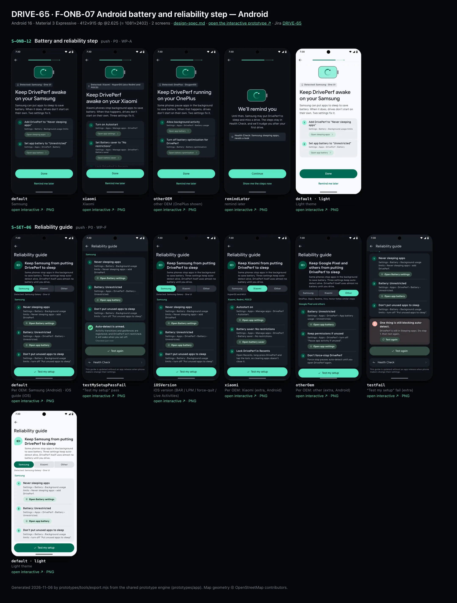
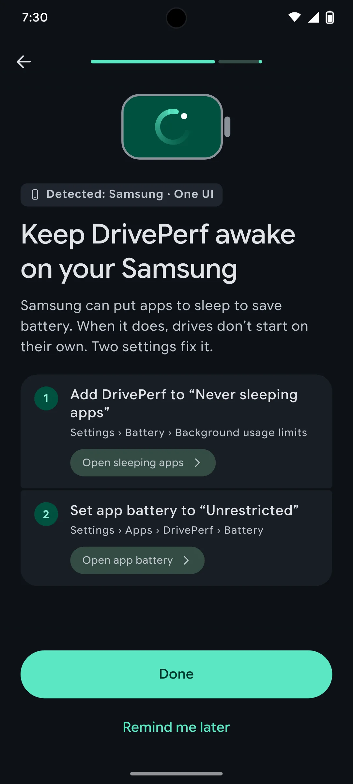
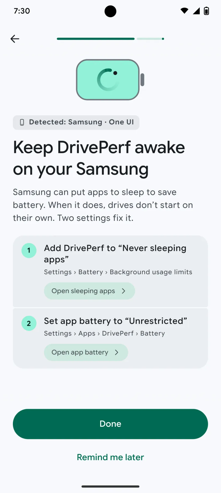
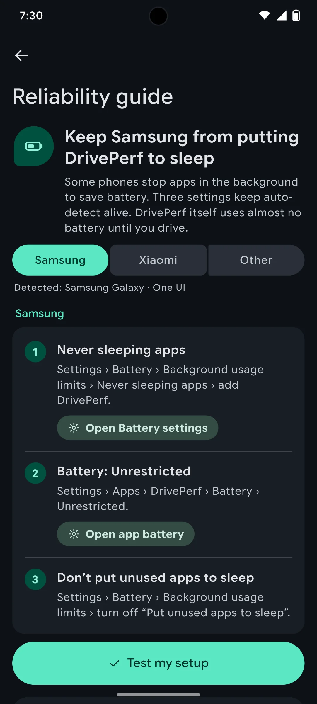
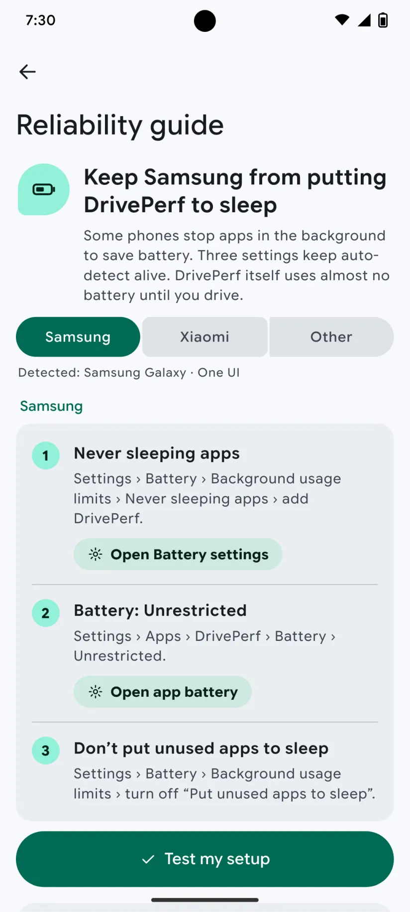

# DRIVE-65 · F-ONB-07 Android battery and reliability step — Android design spec

> Generated by `prototypes/tools/export.mjs` on 2026-11-06 from the shared prototype engine. **Do not edit by hand:** change the screen's `spec` in `prototypes/app/screens/wp-*.js` (see `prototypes/app/AUTHORING.md`) and re-export.

- **Jira story:** [DRIVE-65](https://thekeval.atlassian.net/browse/DRIVE-65) · F-ONB-07 · P0
- **Platform:** Android 16 · Material 3 Expressive · 412×915 dp @2.625 (≈ 1081×2402)
- **Interactive prototype:** [../../../../prototypes/android/index.html#S-ONB-12](../../../../prototypes/android/index.html#S-ONB-12) (catalog panel: every screen and state; deep links `#S-ID/state?trip=…&ent=…&theme=light&text=xl&rm=1`)
- **Contact sheet:** [mockup.html](mockup.html) · 
- **Design system (source of truth for values):** [brand](../../system/brand.md) · [components](../../system/components.md) · [motion](../../system/motion.md) · [accessibility](../../system/accessibility.md) · [screen map](../../system/screen-map.md) · [fixtures](../../system/fixtures.md) · tokens `prototypes/shared/tokens.css`

## Screens in this story

| Screen | Name | Presentation | Priority | States | Status |
|---|---|---|---|---|---|
| `S-ONB-12` | Battery and reliability step | Full | P0 | 4 | Prototyped |
| `S-SET-06` | Reliability guide | Push | P0 | 6 | Prototyped |

## Tokens used on this platform

Values resolved from `prototypes/shared/tokens.css` inside the Android device (`[data-platform="android"]`). Use the token names in code; the hex values are for reference.

| Token | Dark | Light |
|---|---|---|
| `--app-bg` | `#0D1117` | `#F7F9FC` |
| `--card-bg` | `#191E25` | `#EBEEF2` |
| `--dp-bg-grouped` | `#0D1117` | `#F7F9FC` |
| `--dp-surface` | `#191E25` | `#EBEEF2` |
| `--dp-surface-2` | `#1F252D` | `#E5E8EC` |
| `--dp-surface-3` | `#2A3038` | `#DFE2E6` |
| `--dp-fill` | `#2A3038` | `#DFE2E6` |
| `--dp-fill-strong` | `#353B44` | `#D3D7DC` |
| `--dp-text` | `#E1E3E8` | `#181C20` |
| `--dp-text-2` | `#C0C7CF` | `#40474F` |
| `--dp-text-3` | `#8A929B` | `#707881` |
| `--dp-separator` | `#40474F` | `#C0C7CF` |
| `--dp-accent` | `#5BE7C4` | `#006B53` |
| `--dp-accent-text` | `#5BE7C4` | `#006B53` |
| `--dp-on-accent` | `#00382B` | `#FFFFFF` |
| `--dp-accent-container` | `#00513F` | `#91F1D8` |
| `--dp-record` | `#FFC24B` | `#7A5900` |
| `--dp-positive` | `#5BE7C4` | `#006B53` |
| `--dp-change-down` | `#C0C7CF` | `#40474F` |
| `--dp-warning` | `#F5B648` | `#7A5900` |
| `--dp-critical` | `#FFB4AB` | `#BA1A1A` |
| `--dp-glass-fill` | `#1F252DF2` | `#E5E8ECF2` |
| `--dp-glass-fill-strong` | `#2A3038` | `#DFE2E6` |
| `--dp-glass-stroke` | `#FFFFFF0F` | `#0000000A` |
| `--md-sys-color-primary` | `#5BE7C4` | `#006B53` |
| `--md-sys-color-on-primary` | `#00382B` | `#FFFFFF` |
| `--md-sys-color-primary-container` | `#00513F` | `#91F1D8` |
| `--md-sys-color-on-primary-container` | `#91F1D8` | `#002118` |
| `--md-sys-color-secondary-container` | `#344C44` | `#CEE9DF` |
| `--md-sys-color-surface` | `#0D1117` | `#F7F9FC` |
| `--md-sys-color-surface-container` | `#191E25` | `#EBEEF2` |
| `--md-sys-color-surface-container-high` | `#1F252D` | `#E5E8EC` |
| `--md-sys-color-on-surface-variant` | `#C0C7CF` | `#40474F` |
| `--dp-data-route` | `#5BE7C4` | `#079777` |
| `--dp-data-event-brake` | `#FF7A66` | `#A21F16` |
| `--dp-data-event-accel` | `#E58BD0` | `#A33A8C` |
| `--dp-data-event-corner` | `#EAD54E` | `#9A8A00` |
| `--dp-data-quality-good` | `#5FDB9C` | `#1E9E62` |
| `--dp-data-speed` | `#D6DCE4` | `#404A58` |
| `--dp-data-long-g` | `#5AB8F5` | `#0A6AB8` |
| `--dp-data-lat-g` | `#F5A142` | `#B25A00` |

| Type / layout token | Value |
|---|---|
| `--dp-font-screen-title` | `600 32px / 40px "Google Sans Flex", "Google Sans Display", "Roboto Flex", Roboto, system-ui, sans-serif` |
| `--dp-font-sheet-title` | `400 24px / 32px "Google Sans Flex", "Google Sans Display", "Roboto Flex", Roboto, system-ui, sans-serif` |
| `--dp-font-section-title` | `600 22px / 28px "Google Sans Flex", "Google Sans Display", "Roboto Flex", Roboto, system-ui, sans-serif` |
| `--dp-font-card-title` | `700 16px / 24px "Google Sans Flex", "Google Sans Text", "Roboto Flex", Roboto, system-ui, sans-serif` |
| `--dp-font-body` | `400 16px / 24px "Google Sans Flex", "Google Sans Text", "Roboto Flex", Roboto, system-ui, sans-serif` |
| `--dp-font-body-secondary` | `400 14px / 20px "Google Sans Flex", "Google Sans Text", "Roboto Flex", Roboto, system-ui, sans-serif` |
| `--dp-font-meta` | `400 12px / 16px "Google Sans Flex", "Google Sans Text", "Roboto Flex", Roboto, system-ui, sans-serif` |
| `--dp-font-caption` | `500 12px / 16px "Google Sans Flex", "Google Sans Text", "Roboto Flex", Roboto, system-ui, sans-serif` |
| `--dp-font-button` | `700 14px / 20px "Google Sans Flex", "Google Sans Text", "Roboto Flex", Roboto, system-ui, sans-serif` |
| `--dp-num-hero` | `600 72px / 72px "Google Sans Flex", "Roboto Flex", Roboto, system-ui, sans-serif` |
| `--dp-num-xl` | `600 48px / 52px "Google Sans Flex", "Roboto Flex", Roboto, system-ui, sans-serif` |
| `--dp-num-l` | `600 34px / 38px "Google Sans Flex", "Roboto Flex", Roboto, system-ui, sans-serif` |
| `--dp-num-m` | `600 24px / 28px "Google Sans Flex", "Roboto Flex", Roboto, system-ui, sans-serif` |
| `--dp-num-s` | `600 17px / 22px "Google Sans Flex", "Roboto Flex", Roboto, system-ui, sans-serif` |
| `--dp-num-xs` | `600 13px / 16px "Google Sans Flex", "Roboto Flex", Roboto, system-ui, sans-serif` |
| `--dp-screen-margin` | `16px` |
| `--dp-radius-card` | `16px` |
| `--dp-radius-card-hero` | `28px` |
| `--dp-radius-sheet` | `28px` |
| `--dp-radius-chip` | `8px` |
| `--dp-radius-button` | `999px` |
| `--dp-layout-list-row-min` | `56px` |
| `--dp-layout-touch-min` | `48px` |
| `--safe-top` | `40px` |
| `--safe-bottom` | `24px` |

Text sizes scale with `--dp-text-scale` (XL = 2.0×) and numerals with `--dp-num-scale` (XL = 1.3×). DP Numerals: Google Sans Flex wdth 120 wght 600, tabular.

---

## S-ONB-12 · Battery and reliability step

 

- **Presentation:** push — screen map: “Full”
- **Entry points:** S-ONB-10 (Android); S-SET-06
- **Leads to:** S-ONB-13 · "Remind me later"
- **PRD features:** F-ONB-07, F-SET-03 · **Priority:** P0 · **WP:** A
- **Interactive:** [S-ONB-12](../../../../prototypes/android/index.html#S-ONB-12)

**Purpose.** On phones whose makers put apps to sleep (F-ONB-07, F-SET-03, EC-OEM), give that brand’s steps with deep links so auto-detect keeps working, with an honest “Remind me later”. Pixel and unlisted brands skip this step.

### States

| State | PRD label | Fixture params | Screenshot |
|---|---|---|---|
| `default` | Samsung | — | [S-ONB-12.png](../../screens/android/S-ONB-12.webp) · [open](../../../../prototypes/android/index.html#S-ONB-12) |
| `xiaomi` | Xiaomi | — | [S-ONB-12--xiaomi.png](../../screens/android/S-ONB-12--xiaomi.webp) · [open](../../../../prototypes/android/index.html#S-ONB-12/xiaomi) |
| `otherOEM` | other OEM (OnePlus shown) | — | [S-ONB-12--otherOEM.png](../../screens/android/S-ONB-12--otherOEM.webp) · [open](../../../../prototypes/android/index.html#S-ONB-12/otherOEM) |
| `remindLater` | remind later | — | [S-ONB-12--remindLater.png](../../screens/android/S-ONB-12--remindLater.webp) · [open](../../../../prototypes/android/index.html#S-ONB-12/remindLater) |
| default · light | Light theme | `theme=light` | [S-ONB-12--light.png](../../screens/android/S-ONB-12--light.webp) |

Every state also renders in light/dark (`theme=light`), XL text (`text=xl`) and reduced motion (`rm=1`).

### Layout

- Top bar: back arrow · step progress (8 of 11). Start-aligned.
- Art: a battery outline 132 × 80 (outline, radius 20) with The Loop 60 inside it.
- Kicker: phone glyph + “Detected: Samsung · One UI” (labelLarge, --dp-text-2): manufacturer and model are read locally.
- Title “Keep DrivePerf awake on your Samsung”, lead (what goes wrong, how many settings fix it).
- Numbered step list: number disc 28 (primaryContainer) · bold step · settings path (bodySmall, onSurfaceVariant) · tonal deep-link button (“Open sleeping apps ›”) where the brand has one. Xiaomi has a third step without a link (lock in Recents).
- Dock: filled “Done” · TextButton “Remind me later”.
- remindLater: battery art, “We’ll remind you”, honest consequence, a status row naming the Health Check item, “Continue” and “Show me the steps now”.

### Components & tokens

| Component | Tokens / spec |
|---|---|
| `page` | --dp-bg-grouped (iOS) / --md-sys-color-surface (Android) · --dp-screen-margin 16 |
| `button` | --dp-accent / --dp-on-accent (filled) · --dp-fill-strong · --md-sys-color-secondary-container (tonal) · --dp-radius-button · height iOS 50/44/34 · Android 56/40/32 · --dp-font-button · components.md §0 |
| `icon` | see components.md |

### Interactions & navigation

- Step buttons → OEM deep links (Samsung: com.samsung.android.lool sleeping-apps screen; Xiaomi: com.miui.securitycenter autostart / battery saver; others: ACTION_IGNORE_BATTERY_OPTIMIZATION_SETTINGS or app details). REQUEST_IGNORE_BATTERY_OPTIMIZATIONS only if Play allows it for this use case (OQ-12). Prototype: toasts.
- “Done” → S-ONB-13 (reliability_guide_done) · “Remind me later” → remindLater → “Continue” → S-ONB-13 · “Show me the steps now” → the brand state.
- Content per brand is bundled and updatable via Remote Config (F-SET-03.3); Oppo/Realme, Vivo, Huawei/Honor use the same template.

### Motion

- Hero motion: The Loop draws on inside the battery (1200 ms, dot glides into place).
- Text rises 8 px, 40 ms stagger. RM: final art, 220 ms cross-fade.

### Accessibility

- Each step is a list item: “Step 1 of 2. Add DrivePerf to Never sleeping apps. Settings, Battery, Background usage limits.” followed by its button “Open sleeping apps: Add DrivePerf to Never sleeping apps”.
- Focus order: Back → step progress (“Setup, step n of N”) → title → body → primary → secondary. XL: art shrinks to 60%, title and copy wrap, the dock stays pinned and scrolls content under it; nothing truncates. Every glyph in a checklist is paired with its text (colour is never the only signal).

### Platform notes

- **Android (this spec):** Android-only; shown only when automatic trips are on and Build.MANUFACTURER is a listed brand (Samsung, Xiaomi/Redmi/POCO, OnePlus, Oppo, Vivo, Huawei, Honor).
- *iOS (for reference):* Not shown on iOS. The iOS equivalents (Background App Refresh, Low Power Mode, force-quit, Live Activities) live in S-SET-06.

### Analytics

- `reliability_guide_viewed {oem}`
- `reliability_guide_done {oem}`
- `onboarding_step_viewed {step: reliability, oem}`

### Copy

| Key | Text |
|---|---|
| Samsung | Keep DrivePerf awake on your Samsung. Samsung can put apps to sleep to save battery. When it does, drives don’t start on their own. Two settings fix it. Steps: Add DrivePerf to “Never sleeping apps” (Settings › Battery › Background usage limits) · Set app battery to “Unrestricted” (Settings › Apps › DrivePerf › Battery) |
| Xiaomi | Keep DrivePerf awake on your Xiaomi. Xiaomi phones stop background apps to save battery. When that happens, drives don’t start on their own. Three settings fix it. Steps: Turn on Autostart (Settings › Apps › Manage apps › DrivePerf) · Set Battery saver to “No restrictions” (Settings › Apps › Manage apps › DrivePerf › Battery saver) · Lock DrivePerf in Recents (Open Recents, then pull DrivePerf down until the lock shows) |
| OnePlus | Keep DrivePerf running on your OnePlus. Some phones pause apps in the background to save battery. When that happens, drives don’t start on their own. Two settings fix it. Steps: Allow background activity (Settings › Apps › DrivePerf › Battery usage) · Turn off battery optimisation for DrivePerf (Settings › Battery › Battery optimisation) |

### Free / Pro

n/a (Free).

### Data & fixtures

Brand step content is product copy (not in DP_DATA). health.android.items oemSleep “Samsung: Never sleeping apps” and batteryOpt “Battery: Unrestricted” are the Health Check rows these steps fix.

### Assets

[icon-phone.svg](assets/icon-phone.svg) · [icon-chevronRight.svg](assets/icon-chevronRight.svg) · [icon-info.svg](assets/icon-info.svg)

UI glyphs may be swapped for SF Symbols / Material Symbols Rounded equivalents; event-pin, quality and provenance glyphs must not be (components.md global rules).

### Checklist (accessibility.md §9)

- [ ] Light and dark both render, and contrast passes.
- [ ] The XL text state reflows with no truncation.
- [ ] The RM state is defined.
- [ ] Every control has a label; every chart and map has a summary sentence.
- [ ] Every target ≥ 44 pt / 48 dp (≥ 64 in-drive).
- [ ] No meaning by colour alone.
- [ ] Speed is neutral wherever it appears and absent from social or live surfaces.
- [ ] No streak, leaderboard, speed or “beat your time” language.
- [ ] Behaviour is defined while a trip is active (D1 gate).
- [ ] Haptics come from motion.md §6 only.

---

## S-SET-06 · Reliability guide

 

- **Presentation:** push · tab: profile — screen map: “Push”
- **Entry points:** S-SET-05 · S-SET-01 · S-ONB-12
- **Leads to:** OEM settings deep links · "Test my setup"
- **PRD features:** F-SET-03, F-ONB-07 · **Priority:** P0 · **WP:** F
- **Interactive:** [S-SET-06](../../../../prototypes/android/index.html#S-SET-06)

**Purpose.** Brand-specific steps that keep auto-detect alive on phones that kill background apps, plus “Test my setup” to confirm triggers are registered (F-SET-03, F-ONB-07). iOS gets its own page for Background App Refresh, Low Power Mode, force-quit and Live Activities.

### States

| State | PRD label | Fixture params | Screenshot |
|---|---|---|---|
| `default` | Per OEM: Samsung (Android) · iOS guide (iOS) | — | [S-SET-06.png](../../screens/android/S-SET-06.webp) · [open](../../../../prototypes/android/index.html#S-SET-06) |
| `testMySetupPassFail` | “Test my setup” pass | — | [S-SET-06--testMySetupPassFail.png](../../screens/android/S-SET-06--testMySetupPassFail.webp) · [open](../../../../prototypes/android/index.html#S-SET-06/testMySetupPassFail) |
| `iOSVersion` | iOS version (BAR / LPM / force-quit / Live Activities) | — | [S-SET-06--iOSVersion.png](../../screens/android/S-SET-06--iOSVersion.webp) · [open](../../../../prototypes/android/index.html#S-SET-06/iOSVersion) |
| `xiaomi` | Per OEM: Xiaomi (extra, Android) | — | [S-SET-06--xiaomi.png](../../screens/android/S-SET-06--xiaomi.webp) · [open](../../../../prototypes/android/index.html#S-SET-06/xiaomi) |
| `otherOem` | Per OEM: other (extra, Android) | — | [S-SET-06--otherOem.png](../../screens/android/S-SET-06--otherOem.webp) · [open](../../../../prototypes/android/index.html#S-SET-06/otherOem) |
| `testFail` | “Test my setup” fail (extra) | — | [S-SET-06--testFail.png](../../screens/android/S-SET-06--testFail.webp) · [open](../../../../prototypes/android/index.html#S-SET-06/testFail) |
| default · light | Light theme | `theme=light` | [S-SET-06--light.png](../../screens/android/S-SET-06--light.webp) |

Every state also renders in light/dark (`theme=light`), XL text (`text=xl`) and reduced motion (`rm=1`).

### Layout

- Hero: glyph tile (battery / phone) + title (“Keep Samsung from putting DrivePerf to sleep” / “Keep auto-detect working on iPhone”) + one honest paragraph.
- Android: brand picker (connected ButtonGroup Samsung | Xiaomi | Other) with “Detected: Samsung Galaxy · One UI”.
- Numbered steps card: number disc (Glide container) · step title · settings path with › separators · optional tonal “Open …” deep-link button.
- “Test my setup” (filled, large, full width). Result card: running (loader + “Testing your setup…”), pass (check disc + “Auto-detect is armed.” + what was checked + “Checked just now”), fail (octagon + the blocking item + “Test again”).
- Health Check link; footer: content updates via Remote Config.

### Components & tokens

| Component | Tokens / spec |
|---|---|
| `navBar` | --dp-font-card-title · --dp-font-meta · glass: --dp-glass-fill + --dp-glass-blur · components.md §2 |
| `segmented` | see components.md |
| `card` | --dp-surface / --md-sys-color-surface-container · --dp-radius-card (24 iOS · 16 Android) · hero: --dp-radius-card-hero (32 · 28) · light iOS: --dp-elev-1 |
| `button` | --dp-accent / --dp-on-accent (filled) · --dp-fill-strong · --md-sys-color-secondary-container (tonal) · --dp-radius-button · height iOS 50/44/34 · Android 56/40/32 · --dp-font-button · components.md §0 |
| `loader` | see components.md |
| `list` | iOS inset grouped radius --dp-radius-card, rows 52 pt, separators --dp-separator inset 16 · Android ListItem 56/72 dp in --md-sys-color-surface-container |
| `row` | --dp-font-body · --dp-font-meta (supporting) · --dp-layout-list-row-min |
| `section` | --dp-font-section-title · --dp-layout-section-gap 28 |
| `sysSettings` | see components.md |

### Interactions & navigation

- Brand picker → swaps steps (selection haptic). Open … buttons → OEM/system settings deep link (prototype: OS Settings mock; tap to return).
- Test my setup → running 1.6 s → pass or fail card (success / warning haptic). Test again → re-runs.
- Health Check → S-SET-05.

### Motion

- Result card pops in (scale 0.86 → 1, spring.default) with success or warning haptic; loader = iOS Loop / Android M3E shape-morph indicator. RM: result appears in place.

### Accessibility

- Steps are a list: “Step 1 of 3. Never sleeping apps. Settings, Battery, Background usage limits, Never sleeping apps, add DrivePerf.” (› read as commas).
- Result card is a status region: “Auto-detect is armed.”
- XL text: rows grow to two or more lines and trailing values move under the title; nothing truncates. Every row is ≥ 52 pt (iOS) / 56 dp (Android).

### Platform notes

- **Android (this spec):** Brand pages (Samsung, Xiaomi/Redmi/POCO, Google and others; OnePlus, Oppo/Realme, Vivo, Huawei/Honor bundled too); detection via Build.MANUFACTURER; deep links per OEM intent where available, else ACTION_APPLICATION_DETAILS_SETTINGS. “Test my setup” checks ActivityRecognition transition + geofence registration, isIgnoringBatteryOptimizations and standby bucket.
- *iOS (for reference):* One page (no brand picker): Background App Refresh, Low Power Mode, force-quit, Live Activities, Location Always + Precise. Deep links: openSettingsURLString.

### Analytics

- `reliability_guide_viewed {oem}`
- `reliability_step_opened {oem, step}`
- `reliability_test_run {result: pass|fail}`

### Copy

| Key | Text |
|---|---|
| Samsung steps | Never sleeping apps: Settings › Battery › Background usage limits › Never sleeping apps › add DrivePerf. / Battery: Unrestricted: Settings › Apps › DrivePerf › Battery › Unrestricted. / Don’t put unused apps to sleep: Settings › Battery › Background usage limits › turn off “Put unused apps to sleep”. |
| Xiaomi steps | Autostart on: Settings › Apps › Manage apps › DrivePerf › Autostart. / Battery saver: No restrictions: Settings › Apps › Manage apps › DrivePerf › Battery saver › No restrictions. / Lock DrivePerf in Recents: Open Recents, long-press DrivePerf and tap the lock, so clearing apps doesn’t close it. |
| Other steps | Battery: Unrestricted: Settings › Apps › DrivePerf › App battery usage › Unrestricted. / Keep permissions if unused: Settings › Apps › DrivePerf › turn off “Pause app activity if unused”. / Don’t force-stop DrivePerf: Force stop pauses auto-detect until you open DrivePerf again. |
| iOS steps | Background App Refresh on: Settings › General › Background App Refresh: on, and on for DrivePerf. Without it, DrivePerf can’t wake for a drive. / Low Power Mode delays starts: With Low Power Mode on, drives still record but may start a little later. The first part is estimated. / Don’t force-quit DrivePerf: Swiping DrivePerf away in the app switcher pauses auto-detect until you open it again. Leaving it in the background costs almost no battery. / Live Activities on: Settings › DrivePerf › Live Activities, so you can see and stop a recording from the Lock Screen. / Location: Always, Precise on: Settings › DrivePerf › Location › Always, with Precise Location on. |
| Pass | Auto-detect is armed. |
| Fail | One thing is still blocking auto-detect. |

### Free / Pro

Free.

### Data & fixtures

Brand detection uses the Samsung OEM item (health.android.items oemSleep “Samsung: Never sleeping apps”). Step content is bundled copy (F-SET-03.3); setting paths follow One UI 6/7, HyperOS and Android 16 Pixel.

### Assets

[icon-battery.svg](assets/icon-battery.svg) · [icon-phone.svg](assets/icon-phone.svg) · [icon-gear.svg](assets/icon-gear.svg) · [icon-check.svg](assets/icon-check.svg) · [icon-refresh.svg](assets/icon-refresh.svg) · [icon-health.svg](assets/icon-health.svg)

UI glyphs may be swapped for SF Symbols / Material Symbols Rounded equivalents; event-pin, quality and provenance glyphs must not be (components.md global rules).

### Checklist (accessibility.md §9)

- [ ] Light and dark both render, and contrast passes.
- [ ] The XL text state reflows with no truncation.
- [ ] The RM state is defined.
- [ ] Every control has a label; every chart and map has a summary sentence.
- [ ] Every target ≥ 44 pt / 48 dp (≥ 64 in-drive).
- [ ] No meaning by colour alone.
- [ ] Speed is neutral wherever it appears and absent from social or live surfaces.
- [ ] No streak, leaderboard, speed or “beat your time” language.
- [ ] Behaviour is defined while a trip is active (D1 gate).
- [ ] Haptics come from motion.md §6 only.

---

Map geometry in the prototype: © OpenStreetMap contributors (ODbL). Speed and G are simulated fixtures (fixtures.md).
