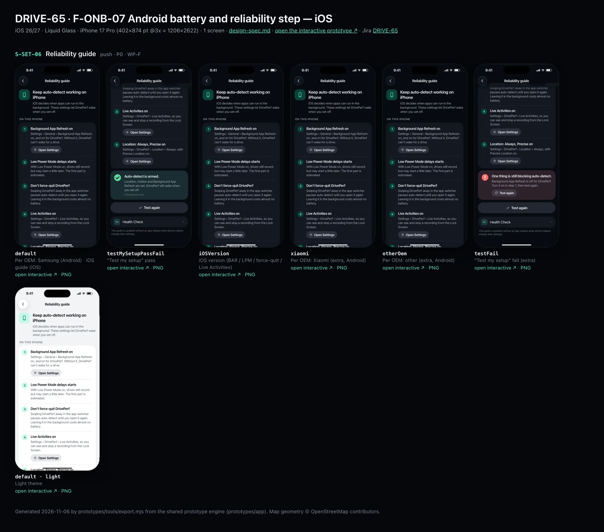
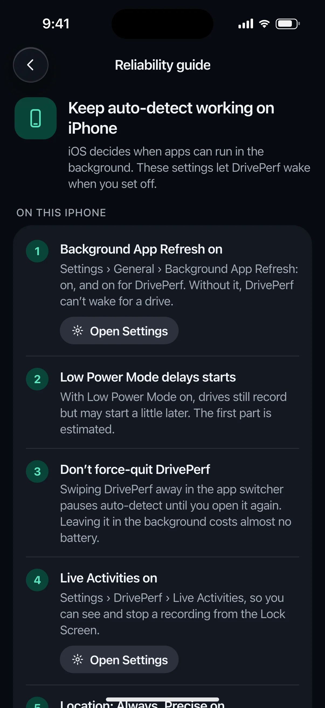
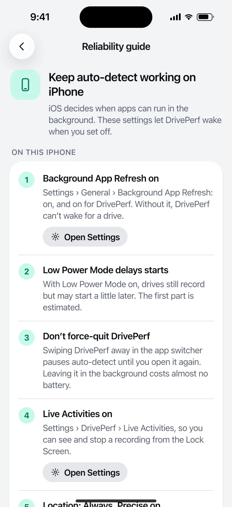

# DRIVE-65 · F-ONB-07 Android battery and reliability step — iOS design spec

> Generated by `prototypes/tools/export.mjs` on 2026-11-06 from the shared prototype engine. **Do not edit by hand:** change the screen's `spec` in `prototypes/app/screens/wp-*.js` (see `prototypes/app/AUTHORING.md`) and re-export.

- **Jira story:** [DRIVE-65](https://thekeval.atlassian.net/browse/DRIVE-65) · F-ONB-07 · P0
- **Platform:** iOS 26/27 · Liquid Glass · iPhone 17 Pro (402×874 pt @3x = 1206×2622)
- **Interactive prototype:** [../../../../prototypes/ios/index.html#S-SET-06](../../../../prototypes/ios/index.html#S-SET-06) (catalog panel: every screen and state; deep links `#S-ID/state?trip=…&ent=…&theme=light&text=xl&rm=1`)
- **Contact sheet:** [mockup.html](mockup.html) · 
- **Design system (source of truth for values):** [brand](../../system/brand.md) · [components](../../system/components.md) · [motion](../../system/motion.md) · [accessibility](../../system/accessibility.md) · [screen map](../../system/screen-map.md) · [fixtures](../../system/fixtures.md) · tokens `prototypes/shared/tokens.css`

## Screens in this story

| Screen | Name | Presentation | Priority | States | Status |
|---|---|---|---|---|---|
| `S-SET-06` | Reliability guide | Push | P0 | 6 | Prototyped |

## Tokens used on this platform

Values resolved from `prototypes/shared/tokens.css` inside the iOS device (`[data-platform="ios"]`). Use the token names in code; the hex values are for reference.

| Token | Dark | Light |
|---|---|---|
| `--app-bg` | `#080B10` | `#F2F3F6` |
| `--card-bg` | `#131822` | `#FFFFFF` |
| `--dp-bg-grouped` | `#080B10` | `#F2F3F6` |
| `--dp-surface` | `#131822` | `#FFFFFF` |
| `--dp-surface-2` | `#1B222D` | `#F2F3F6` |
| `--dp-surface-3` | `#262E3B` | `#E4E7EC` |
| `--dp-fill` | `#7880961F` | `#7880961F` |
| `--dp-fill-strong` | `#7880963D` | `#78809633` |
| `--dp-text` | `#F2F4F7` | `#0B0E13` |
| `--dp-text-2` | `#A3AAB6` | `#5A6271` |
| `--dp-text-3` | `#6E7787` | `#8A919D` |
| `--dp-separator` | `#96A0B429` | `#3C435024` |
| `--dp-accent` | `#5BE7C4` | `#079777` |
| `--dp-accent-text` | `#5BE7C4` | `#06775E` |
| `--dp-on-accent` | `#04241D` | `#FFFFFF` |
| `--dp-accent-container` | `#0A4439` | `#C6F8EA` |
| `--dp-record` | `#FFC24B` | `#9A6300` |
| `--dp-positive` | `#5BE7C4` | `#06775E` |
| `--dp-change-down` | `#A3AAB6` | `#5A6271` |
| `--dp-warning` | `#F5B648` | `#9A5F00` |
| `--dp-critical` | `#FF6B6B` | `#C62828` |
| `--dp-glass-fill` | `#1C222C6B` | `#FFFFFF8C` |
| `--dp-glass-fill-strong` | `#1C222CB8` | `#FFFFFFD1` |
| `--dp-glass-stroke` | `#FFFFFF24` | `#FFFFFF99` |
| `--dp-data-route` | `#5BE7C4` | `#079777` |
| `--dp-data-event-brake` | `#FF7A66` | `#A21F16` |
| `--dp-data-event-accel` | `#E58BD0` | `#A33A8C` |
| `--dp-data-event-corner` | `#EAD54E` | `#9A8A00` |
| `--dp-data-quality-good` | `#5FDB9C` | `#1E9E62` |
| `--dp-data-speed` | `#D6DCE4` | `#404A58` |
| `--dp-data-long-g` | `#5AB8F5` | `#0A6AB8` |
| `--dp-data-lat-g` | `#F5A142` | `#B25A00` |

| Type / layout token | Value |
|---|---|
| `--dp-font-screen-title` | `700 34px / 41px -apple-system, BlinkMacSystemFont, "SF Pro Display", system-ui, sans-serif` |
| `--dp-font-sheet-title` | `700 22px / 28px -apple-system, BlinkMacSystemFont, "SF Pro Display", system-ui, sans-serif` |
| `--dp-font-section-title` | `600 20px / 25px -apple-system, BlinkMacSystemFont, "SF Pro Display", system-ui, sans-serif` |
| `--dp-font-card-title` | `600 17px / 22px -apple-system, BlinkMacSystemFont, "SF Pro Text", system-ui, sans-serif` |
| `--dp-font-body` | `400 17px / 22px -apple-system, BlinkMacSystemFont, "SF Pro Text", system-ui, sans-serif` |
| `--dp-font-body-secondary` | `400 15px / 20px -apple-system, BlinkMacSystemFont, "SF Pro Text", system-ui, sans-serif` |
| `--dp-font-meta` | `400 13px / 18px -apple-system, BlinkMacSystemFont, "SF Pro Text", system-ui, sans-serif` |
| `--dp-font-caption` | `400 12px / 16px -apple-system, BlinkMacSystemFont, "SF Pro Text", system-ui, sans-serif` |
| `--dp-font-button` | `600 17px / 22px -apple-system, BlinkMacSystemFont, "SF Pro Text", system-ui, sans-serif` |
| `--dp-num-hero` | `600 72px / 72px -apple-system, BlinkMacSystemFont, "SF Pro Display", system-ui, sans-serif` |
| `--dp-num-xl` | `600 48px / 52px -apple-system, BlinkMacSystemFont, "SF Pro Display", system-ui, sans-serif` |
| `--dp-num-l` | `600 34px / 38px -apple-system, BlinkMacSystemFont, "SF Pro Display", system-ui, sans-serif` |
| `--dp-num-m` | `600 24px / 28px -apple-system, BlinkMacSystemFont, "SF Pro Display", system-ui, sans-serif` |
| `--dp-num-s` | `600 17px / 22px -apple-system, BlinkMacSystemFont, "SF Pro Display", system-ui, sans-serif` |
| `--dp-num-xs` | `600 13px / 16px -apple-system, BlinkMacSystemFont, "SF Pro Display", system-ui, sans-serif` |
| `--dp-screen-margin` | `16px` |
| `--dp-radius-card` | `24px` |
| `--dp-radius-card-hero` | `32px` |
| `--dp-radius-sheet` | `38px` |
| `--dp-radius-chip` | `999px` |
| `--dp-radius-button` | `999px` |
| `--dp-layout-list-row-min` | `52px` |
| `--dp-layout-touch-min` | `44px` |
| `--safe-top` | `62px` |
| `--safe-bottom` | `34px` |

Text sizes scale with `--dp-text-scale` (XL = 2.0×) and numerals with `--dp-num-scale` (XL = 1.3×). DP Numerals: SF Pro Expanded Semibold, tabular.

---

## S-SET-06 · Reliability guide

 

- **Presentation:** push · tab: profile — screen map: “Push”
- **Entry points:** S-SET-05 · S-SET-01 · S-ONB-12
- **Leads to:** OEM settings deep links · "Test my setup"
- **PRD features:** F-SET-03, F-ONB-07 · **Priority:** P0 · **WP:** F
- **Interactive:** [S-SET-06](../../../../prototypes/ios/index.html#S-SET-06)

**Purpose.** Brand-specific steps that keep auto-detect alive on phones that kill background apps, plus “Test my setup” to confirm triggers are registered (F-SET-03, F-ONB-07). iOS gets its own page for Background App Refresh, Low Power Mode, force-quit and Live Activities.

### States

| State | PRD label | Fixture params | Screenshot |
|---|---|---|---|
| `default` | Per OEM: Samsung (Android) · iOS guide (iOS) | — | [S-SET-06.png](../../screens/ios/S-SET-06.webp) · [open](../../../../prototypes/ios/index.html#S-SET-06) |
| `testMySetupPassFail` | “Test my setup” pass | — | [S-SET-06--testMySetupPassFail.png](../../screens/ios/S-SET-06--testMySetupPassFail.webp) · [open](../../../../prototypes/ios/index.html#S-SET-06/testMySetupPassFail) |
| `iOSVersion` | iOS version (BAR / LPM / force-quit / Live Activities) | — | [S-SET-06--iOSVersion.png](../../screens/ios/S-SET-06--iOSVersion.webp) · [open](../../../../prototypes/ios/index.html#S-SET-06/iOSVersion) |
| `xiaomi` | Per OEM: Xiaomi (extra, Android) | — | [S-SET-06--xiaomi.png](../../screens/ios/S-SET-06--xiaomi.webp) · [open](../../../../prototypes/ios/index.html#S-SET-06/xiaomi) |
| `otherOem` | Per OEM: other (extra, Android) | — | [S-SET-06--otherOem.png](../../screens/ios/S-SET-06--otherOem.webp) · [open](../../../../prototypes/ios/index.html#S-SET-06/otherOem) |
| `testFail` | “Test my setup” fail (extra) | — | [S-SET-06--testFail.png](../../screens/ios/S-SET-06--testFail.webp) · [open](../../../../prototypes/ios/index.html#S-SET-06/testFail) |
| default · light | Light theme | `theme=light` | [S-SET-06--light.png](../../screens/ios/S-SET-06--light.webp) |

Every state also renders in light/dark (`theme=light`), XL text (`text=xl`) and reduced motion (`rm=1`).

### Layout

- Hero: glyph tile (battery / phone) + title (“Keep Samsung from putting DrivePerf to sleep” / “Keep auto-detect working on iPhone”) + one honest paragraph.
- Android: brand picker (connected ButtonGroup Samsung | Xiaomi | Other) with “Detected: Samsung Galaxy · One UI”.
- Numbered steps card: number disc (Glide container) · step title · settings path with › separators · optional tonal “Open …” deep-link button.
- “Test my setup” (filled, large, full width). Result card: running (loader + “Testing your setup…”), pass (check disc + “Auto-detect is armed.” + what was checked + “Checked just now”), fail (octagon + the blocking item + “Test again”).
- Health Check link; footer: content updates via Remote Config.

### Components & tokens

| Component | Tokens / spec |
|---|---|
| `navBar` | --dp-font-card-title · --dp-font-meta · glass: --dp-glass-fill + --dp-glass-blur · components.md §2 |
| `segmented` | see components.md |
| `card` | --dp-surface / --md-sys-color-surface-container · --dp-radius-card (24 iOS · 16 Android) · hero: --dp-radius-card-hero (32 · 28) · light iOS: --dp-elev-1 |
| `button` | --dp-accent / --dp-on-accent (filled) · --dp-fill-strong · --md-sys-color-secondary-container (tonal) · --dp-radius-button · height iOS 50/44/34 · Android 56/40/32 · --dp-font-button · components.md §0 |
| `loader` | see components.md |
| `list` | iOS inset grouped radius --dp-radius-card, rows 52 pt, separators --dp-separator inset 16 · Android ListItem 56/72 dp in --md-sys-color-surface-container |
| `row` | --dp-font-body · --dp-font-meta (supporting) · --dp-layout-list-row-min |
| `section` | --dp-font-section-title · --dp-layout-section-gap 28 |
| `sysSettings` | see components.md |

### Interactions & navigation

- Brand picker → swaps steps (selection haptic). Open … buttons → OEM/system settings deep link (prototype: OS Settings mock; tap to return).
- Test my setup → running 1.6 s → pass or fail card (success / warning haptic). Test again → re-runs.
- Health Check → S-SET-05.

### Motion

- Result card pops in (scale 0.86 → 1, spring.default) with success or warning haptic; loader = iOS Loop / Android M3E shape-morph indicator. RM: result appears in place.

### Accessibility

- Steps are a list: “Step 1 of 3. Never sleeping apps. Settings, Battery, Background usage limits, Never sleeping apps, add DrivePerf.” (› read as commas).
- Result card is a status region: “Auto-detect is armed.”
- XL text: rows grow to two or more lines and trailing values move under the title; nothing truncates. Every row is ≥ 52 pt (iOS) / 56 dp (Android).

### Platform notes

- **iOS (this spec):** One page (no brand picker): Background App Refresh, Low Power Mode, force-quit, Live Activities, Location Always + Precise. Deep links: openSettingsURLString.
- *Android (for reference):* Brand pages (Samsung, Xiaomi/Redmi/POCO, Google and others; OnePlus, Oppo/Realme, Vivo, Huawei/Honor bundled too); detection via Build.MANUFACTURER; deep links per OEM intent where available, else ACTION_APPLICATION_DETAILS_SETTINGS. “Test my setup” checks ActivityRecognition transition + geofence registration, isIgnoringBatteryOptimizations and standby bucket.

### Analytics

- `reliability_guide_viewed {oem}`
- `reliability_step_opened {oem, step}`
- `reliability_test_run {result: pass|fail}`

### Copy

| Key | Text |
|---|---|
| Samsung steps | Never sleeping apps: Settings › Battery › Background usage limits › Never sleeping apps › add DrivePerf. / Battery: Unrestricted: Settings › Apps › DrivePerf › Battery › Unrestricted. / Don’t put unused apps to sleep: Settings › Battery › Background usage limits › turn off “Put unused apps to sleep”. |
| Xiaomi steps | Autostart on: Settings › Apps › Manage apps › DrivePerf › Autostart. / Battery saver: No restrictions: Settings › Apps › Manage apps › DrivePerf › Battery saver › No restrictions. / Lock DrivePerf in Recents: Open Recents, long-press DrivePerf and tap the lock, so clearing apps doesn’t close it. |
| Other steps | Battery: Unrestricted: Settings › Apps › DrivePerf › App battery usage › Unrestricted. / Keep permissions if unused: Settings › Apps › DrivePerf › turn off “Pause app activity if unused”. / Don’t force-stop DrivePerf: Force stop pauses auto-detect until you open DrivePerf again. |
| iOS steps | Background App Refresh on: Settings › General › Background App Refresh: on, and on for DrivePerf. Without it, DrivePerf can’t wake for a drive. / Low Power Mode delays starts: With Low Power Mode on, drives still record but may start a little later. The first part is estimated. / Don’t force-quit DrivePerf: Swiping DrivePerf away in the app switcher pauses auto-detect until you open it again. Leaving it in the background costs almost no battery. / Live Activities on: Settings › DrivePerf › Live Activities, so you can see and stop a recording from the Lock Screen. / Location: Always, Precise on: Settings › DrivePerf › Location › Always, with Precise Location on. |
| Pass | Auto-detect is armed. |
| Fail | One thing is still blocking auto-detect. |

### Free / Pro

Free.

### Data & fixtures

Brand detection uses the Samsung OEM item (health.android.items oemSleep “Samsung: Never sleeping apps”). Step content is bundled copy (F-SET-03.3); setting paths follow One UI 6/7, HyperOS and Android 16 Pixel.

### Assets

[icon-battery.svg](assets/icon-battery.svg) · [icon-phone.svg](assets/icon-phone.svg) · [icon-gear.svg](assets/icon-gear.svg) · [icon-check.svg](assets/icon-check.svg) · [icon-refresh.svg](assets/icon-refresh.svg) · [icon-health.svg](assets/icon-health.svg)

UI glyphs may be swapped for SF Symbols / Material Symbols Rounded equivalents; event-pin, quality and provenance glyphs must not be (components.md global rules).

### Checklist (accessibility.md §9)

- [ ] Light and dark both render, and contrast passes.
- [ ] The XL text state reflows with no truncation.
- [ ] The RM state is defined.
- [ ] Every control has a label; every chart and map has a summary sentence.
- [ ] Every target ≥ 44 pt / 48 dp (≥ 64 in-drive).
- [ ] No meaning by colour alone.
- [ ] Speed is neutral wherever it appears and absent from social or live surfaces.
- [ ] No streak, leaderboard, speed or “beat your time” language.
- [ ] Behaviour is defined while a trip is active (D1 gate).
- [ ] Haptics come from motion.md §6 only.

---

Map geometry in the prototype: © OpenStreetMap contributors (ODbL). Speed and G are simulated fixtures (fixtures.md).
