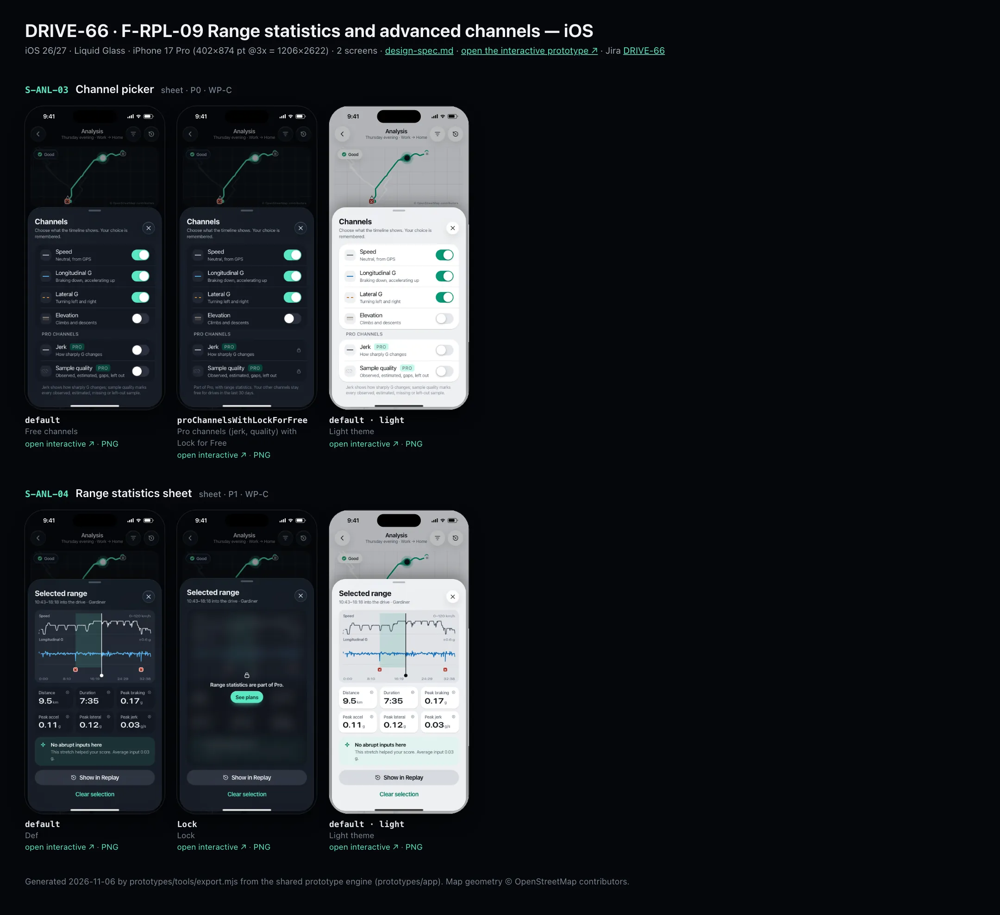
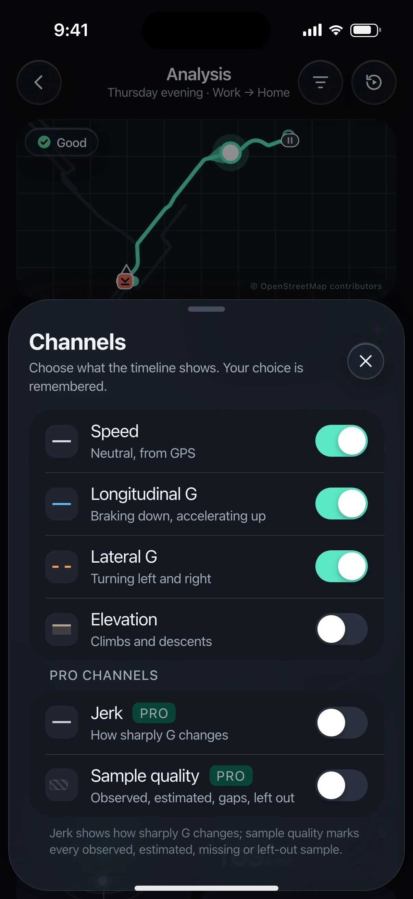
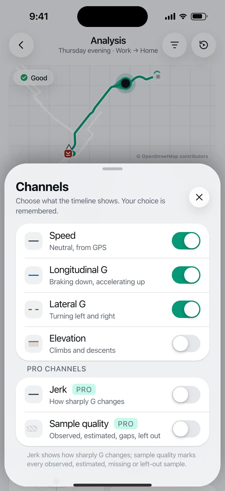
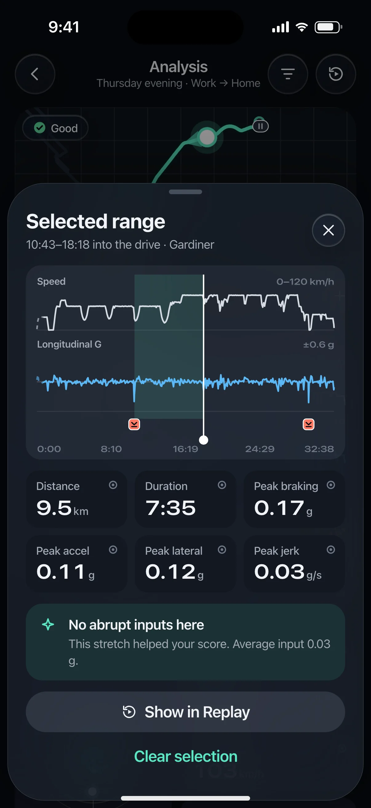
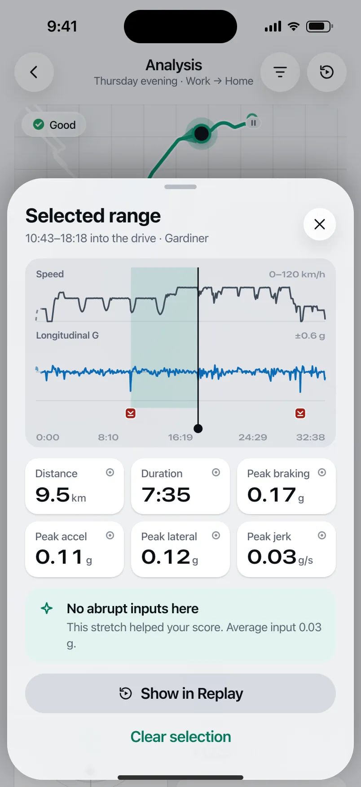

# DRIVE-66 · F-RPL-09 Range statistics and advanced channels — iOS design spec

> Generated by `prototypes/tools/export.mjs` on 2026-11-06 from the shared prototype engine. **Do not edit by hand:** change the screen's `spec` in `prototypes/app/screens/wp-*.js` (see `prototypes/app/AUTHORING.md`) and re-export.

- **Jira story:** [DRIVE-66](https://thekeval.atlassian.net/browse/DRIVE-66) · F-RPL-09 · P1
- **Platform:** iOS 26/27 · Liquid Glass · iPhone 17 Pro (402×874 pt @3x = 1206×2622)
- **Interactive prototype:** [../../../../prototypes/ios/index.html#S-ANL-03](../../../../prototypes/ios/index.html#S-ANL-03) (catalog panel: every screen and state; deep links `#S-ID/state?trip=…&ent=…&theme=light&text=xl&rm=1`)
- **Contact sheet:** [mockup.html](mockup.html) · 
- **Design system (source of truth for values):** [brand](../../system/brand.md) · [components](../../system/components.md) · [motion](../../system/motion.md) · [accessibility](../../system/accessibility.md) · [screen map](../../system/screen-map.md) · [fixtures](../../system/fixtures.md) · tokens `prototypes/shared/tokens.css`

## Screens in this story

| Screen | Name | Presentation | Priority | States | Status |
|---|---|---|---|---|---|
| `S-ANL-03` | Channel picker | Sheet (iOS menu) / bottom sheet | P0 | 2 | Prototyped |
| `S-ANL-04` | Range statistics sheet | Sheet (medium) | P1 | 2 | Prototyped |

## Tokens used on this platform

Values resolved from `prototypes/shared/tokens.css` inside the iOS device (`[data-platform="ios"]`). Use the token names in code; the hex values are for reference.

| Token | Dark | Light |
|---|---|---|
| `--app-bg` | `#080B10` | `#F2F3F6` |
| `--card-bg` | `#131822` | `#FFFFFF` |
| `--dp-bg-grouped` | `#080B10` | `#F2F3F6` |
| `--dp-surface` | `#131822` | `#FFFFFF` |
| `--dp-surface-2` | `#1B222D` | `#F2F3F6` |
| `--dp-surface-3` | `#262E3B` | `#E4E7EC` |
| `--dp-fill` | `#7880961F` | `#7880961F` |
| `--dp-fill-strong` | `#7880963D` | `#78809633` |
| `--dp-text` | `#F2F4F7` | `#0B0E13` |
| `--dp-text-2` | `#A3AAB6` | `#5A6271` |
| `--dp-text-3` | `#6E7787` | `#8A919D` |
| `--dp-separator` | `#96A0B429` | `#3C435024` |
| `--dp-accent` | `#5BE7C4` | `#079777` |
| `--dp-accent-text` | `#5BE7C4` | `#06775E` |
| `--dp-on-accent` | `#04241D` | `#FFFFFF` |
| `--dp-accent-container` | `#0A4439` | `#C6F8EA` |
| `--dp-record` | `#FFC24B` | `#9A6300` |
| `--dp-positive` | `#5BE7C4` | `#06775E` |
| `--dp-change-down` | `#A3AAB6` | `#5A6271` |
| `--dp-warning` | `#F5B648` | `#9A5F00` |
| `--dp-critical` | `#FF6B6B` | `#C62828` |
| `--dp-glass-fill` | `#1C222C6B` | `#FFFFFF8C` |
| `--dp-glass-fill-strong` | `#1C222CB8` | `#FFFFFFD1` |
| `--dp-glass-stroke` | `#FFFFFF24` | `#FFFFFF99` |
| `--dp-data-route` | `#5BE7C4` | `#079777` |
| `--dp-data-event-brake` | `#FF7A66` | `#A21F16` |
| `--dp-data-event-accel` | `#E58BD0` | `#A33A8C` |
| `--dp-data-event-corner` | `#EAD54E` | `#9A8A00` |
| `--dp-data-quality-good` | `#5FDB9C` | `#1E9E62` |
| `--dp-data-speed` | `#D6DCE4` | `#404A58` |
| `--dp-data-long-g` | `#5AB8F5` | `#0A6AB8` |
| `--dp-data-lat-g` | `#F5A142` | `#B25A00` |

| Type / layout token | Value |
|---|---|
| `--dp-font-screen-title` | `700 34px / 41px -apple-system, BlinkMacSystemFont, "SF Pro Display", system-ui, sans-serif` |
| `--dp-font-sheet-title` | `700 22px / 28px -apple-system, BlinkMacSystemFont, "SF Pro Display", system-ui, sans-serif` |
| `--dp-font-section-title` | `600 20px / 25px -apple-system, BlinkMacSystemFont, "SF Pro Display", system-ui, sans-serif` |
| `--dp-font-card-title` | `600 17px / 22px -apple-system, BlinkMacSystemFont, "SF Pro Text", system-ui, sans-serif` |
| `--dp-font-body` | `400 17px / 22px -apple-system, BlinkMacSystemFont, "SF Pro Text", system-ui, sans-serif` |
| `--dp-font-body-secondary` | `400 15px / 20px -apple-system, BlinkMacSystemFont, "SF Pro Text", system-ui, sans-serif` |
| `--dp-font-meta` | `400 13px / 18px -apple-system, BlinkMacSystemFont, "SF Pro Text", system-ui, sans-serif` |
| `--dp-font-caption` | `400 12px / 16px -apple-system, BlinkMacSystemFont, "SF Pro Text", system-ui, sans-serif` |
| `--dp-font-button` | `600 17px / 22px -apple-system, BlinkMacSystemFont, "SF Pro Text", system-ui, sans-serif` |
| `--dp-num-hero` | `600 72px / 72px -apple-system, BlinkMacSystemFont, "SF Pro Display", system-ui, sans-serif` |
| `--dp-num-xl` | `600 48px / 52px -apple-system, BlinkMacSystemFont, "SF Pro Display", system-ui, sans-serif` |
| `--dp-num-l` | `600 34px / 38px -apple-system, BlinkMacSystemFont, "SF Pro Display", system-ui, sans-serif` |
| `--dp-num-m` | `600 24px / 28px -apple-system, BlinkMacSystemFont, "SF Pro Display", system-ui, sans-serif` |
| `--dp-num-s` | `600 17px / 22px -apple-system, BlinkMacSystemFont, "SF Pro Display", system-ui, sans-serif` |
| `--dp-num-xs` | `600 13px / 16px -apple-system, BlinkMacSystemFont, "SF Pro Display", system-ui, sans-serif` |
| `--dp-screen-margin` | `16px` |
| `--dp-radius-card` | `24px` |
| `--dp-radius-card-hero` | `32px` |
| `--dp-radius-sheet` | `38px` |
| `--dp-radius-chip` | `999px` |
| `--dp-radius-button` | `999px` |
| `--dp-layout-list-row-min` | `52px` |
| `--dp-layout-touch-min` | `44px` |
| `--safe-top` | `62px` |
| `--safe-bottom` | `34px` |

Text sizes scale with `--dp-text-scale` (XL = 2.0×) and numerals with `--dp-num-scale` (XL = 1.3×). DP Numerals: SF Pro Expanded Semibold, tabular.

---

## S-ANL-03 · Channel picker

 

- **Presentation:** sheet · tab: drives · detent: auto — screen map: “Sheet (iOS menu) / bottom sheet”
- **Entry points:** S-ANL-01 channels
- **Leads to:** S-SUB-03 for Pro channels on Free
- **PRD features:** F-RPL-05, F-RPL-09 · **Priority:** P0 · **WP:** C
- **Interactive:** [S-ANL-03](../../../../prototypes/ios/index.html#S-ANL-03)

**Purpose.** Toggle the timeline channels (F-RPL-05.4); the choice persists per user. Jerk and Sample quality are Pro (F-RPL-09.2).

### States

| State | PRD label | Fixture params | Screenshot |
|---|---|---|---|
| `default` | Free channels | `trip=t20261105-1745` | [S-ANL-03.png](../../screens/ios/S-ANL-03.webp) · [open](../../../../prototypes/ios/index.html#S-ANL-03) |
| `proChannelsWithLockForFree` | Pro channels (jerk, quality) with Lock for Free | `trip=t20261105-1745` `ent=free` | [S-ANL-03--proChannelsWithLockForFree.png](../../screens/ios/S-ANL-03--proChannelsWithLockForFree.webp) · [open](../../../../prototypes/ios/index.html#S-ANL-03/proChannelsWithLockForFree) |
| default · light | Light theme | `theme=light` | [S-ANL-03--light.png](../../screens/ios/S-ANL-03--light.webp) |

Every state also renders in light/dark (`theme=light`), XL text (`text=xl`) and reduced motion (`rm=1`).

### Layout

- iOS: glass sheet styled as a compact menu (native: a glass `Menu` with toggles anchored to the Channels button) · Android: ModalBottomSheet with toggles (FilterChips are an equivalent).
- Header “Channels” + “Choose what the timeline shows. Your choice is remembered.”
- Free list: Speed · Longitudinal G · Lateral G · Elevation, each with a swatch that shows the line pattern (solid / dashed / area) + one-line description + toggle.
- “Pro channels”: Jerk · Sample quality with PRO badge; Free users see a lock instead of the toggle (row → S-SUB-03).

### Components & tokens

| Component | Tokens / spec |
|---|---|
| `sheetHeader` | see components.md |
| `section` | --dp-font-section-title · --dp-layout-section-gap 28 |
| `list` | iOS inset grouped radius --dp-radius-card, rows 52 pt, separators --dp-separator inset 16 · Android ListItem 56/72 dp in --md-sys-color-surface-container |
| `row` | --dp-font-body · --dp-font-meta (supporting) · --dp-layout-list-row-min |
| `toggle` | iOS 51×31 tint --dp-accent · Android M3 Switch 52×32 --md-sys-color-primary |
| `proBadge` | see components.md |

### Interactions & navigation

- Toggle → the timeline underneath updates immediately (at least one channel must stay on: toast).
- Locked Pro row → S-SUB-03 (default lock sheet; never during a trip).

### Motion

- Toggle spring.fast + haptic toggleOn/Off; lanes underneath cross-fade.

### Accessibility

- “Lateral G, dashed amber line. Turning left and right. On, switch.” Locked: “Jerk, Pro. See plans, button.”

### Platform notes

- **iOS (this spec):** Native glass Menu with Toggle items; the prototype uses a compact glass sheet.
- *Android (for reference):* ModalBottomSheet with M3 Switches (thumb icons).

### Analytics

- `analysis_channel_toggled {channel}`

### Copy

| Key | Text |
|---|---|
| Title | Channels |
| Sub | Choose what the timeline shows. Your choice is remembered. |
| Pro | Jerk · How sharply G changes / Sample quality · Observed, estimated, gaps, left out |
| Footer Free | Part of Pro, with range statistics. Your other channels stay free for drives in the last 30 days. |
| Footer Pro | Jerk shows how sharply G changes; sample quality marks every observed, estimated, missing or left-out sample. |
| Last channel | Keep at least one channel on |

### Free / Pro

Free: four channels. Pro/Preview/Ride-along: + Jerk and Sample quality. Lock variant: S-SUB-03 default.

### Data & fixtures

Prototype state in a module-level object (ANL_CH); persist natively per user.

### Assets

[icon-lock.svg](assets/icon-lock.svg)

UI glyphs may be swapped for SF Symbols / Material Symbols Rounded equivalents; event-pin, quality and provenance glyphs must not be (components.md global rules).

### Checklist (accessibility.md §9)

- [ ] Light and dark both render, and contrast passes.
- [ ] The XL text state reflows with no truncation.
- [ ] The RM state is defined.
- [ ] Every control has a label; every chart and map has a summary sentence.
- [ ] Every target ≥ 44 pt / 48 dp (≥ 64 in-drive).
- [ ] No meaning by colour alone.
- [ ] Speed is neutral wherever it appears and absent from social or live surfaces.
- [ ] No streak, leaderboard, speed or “beat your time” language.
- [ ] Behaviour is defined while a trip is active (D1 gate).
- [ ] Haptics come from motion.md §6 only.

---

## S-ANL-04 · Range statistics sheet

 

- **Presentation:** sheet · tab: drives · detent: auto — screen map: “Sheet (medium)”
- **Entry points:** S-ANL-01 range select
- **Leads to:** S-SUB-03 (Lock)
- **PRD features:** F-RPL-09 · **Priority:** P1 · **WP:** C
- **Interactive:** [S-ANL-04](../../../../prototypes/ios/index.html#S-ANL-04)

**Purpose.** Select a stretch (an on-ramp, a corner, a highway run) and see its own stats and Smoothness contribution (F-RPL-09, P1, Pro).

### States

| State | PRD label | Fixture params | Screenshot |
|---|---|---|---|
| `default` | Def | `trip=t20261105-1745` `t0=643` `t1=1098` | [S-ANL-04.png](../../screens/ios/S-ANL-04.webp) · [open](../../../../prototypes/ios/index.html#S-ANL-04) |
| `Lock` | Lock | `trip=t20261105-1745` `t0=643` `t1=1098` `ent=free` | [S-ANL-04--Lock.png](../../screens/ios/S-ANL-04--Lock.webp) · [open](../../../../prototypes/ios/index.html#S-ANL-04/Lock) |
| default · light | Light theme | `theme=light` | [S-ANL-04--light.png](../../screens/ios/S-ANL-04--light.webp) |

Every state also renders in light/dark (`theme=light`), XL text (`text=xl`) and reduced motion (`rm=1`).

### Layout

- Medium sheet over S-ANL-01, auto height. Header “Selected range” + “10:43–18:18 into the drive · Gardiner”.
- Mini timeline (Speed + Long G) of the whole drive with the selected band in Glide 14%.
- 3×2 stat tiles: Distance · Duration · Peak braking · Peak accel · Peak lateral · Peak jerk (each with provenance glyph).
- Contribution banner: positive “No abrupt inputs here. This stretch helped your score.” or info “n events in this range …”.
- Actions: Show in Replay (tonal, block) → S-RPL-01 at the range start · Clear selection (text).
- Lock (Free): the same content blurred 14 px + lock + “Range statistics are part of Pro.” + See plans.

### Components & tokens

| Component | Tokens / spec |
|---|---|
| `sheetHeader` | see components.md |
| `stats` | --dp-surface-2 / --md-sys-color-surface-container-high · radius 14 iOS / 12 Android · value --dp-num-m (DP Numerals) · components.md §5 |
| `banner` | radius 12 (--dp-radius-sm+) · info --dp-fill · attention --dp-warning-container · critical --dp-critical-container · components.md §22 |
| `button` | --dp-accent / --dp-on-accent (filled) · --dp-fill-strong · --md-sys-color-secondary-container (tonal) · --dp-radius-button · height iOS 50/44/34 · Android 56/40/32 · --dp-font-button · components.md §0 |
| `lockPanel` | blur --dp-opacity-locked-blur 14px · dim --dp-opacity-locked-dim 35% · components.md §15.2 |
| `anlLanes (local)` | see components.md |

### Interactions & navigation

- Show in Replay → S-RPL-01 with at = range start (paused there).
- Clear selection / drag down → back to S-ANL-01.
- Lock → S-SUB-03.

### Motion

- spring.sheet; the band fades in. RM: cross-fade.

### Accessibility

- “Selected range, 10:43 to 18:18 into the drive. 9.5 kilometres. Peak braking 0.10 g.” Each tile reads label, value, units and provenance.

### Platform notes

- **iOS (this spec):** Glass medium sheet; tiles on `--dp-surface-2`.
- *Android (for reference):* ModalBottomSheet; tiles surface-container-high, radius 12.

### Analytics

- `analysis_range_selected`
- `locked_content_viewed {type: range}`

### Copy

| Key | Text |
|---|---|
| Title | Selected range |
| Positive | No abrupt inputs here. This stretch helped your score. Average input {g} g. |
| Events | {n} events in this range · Including the hard braking at {place}, which cost the most smoothness on this drive. |
| Lock | Range statistics are part of Pro. |
| Actions | Show in Replay · Clear selection |

### Free / Pro

Pro (F-RPL-09). Free: Lock with this range’s own stats blurred → S-SUB-03.

### Data & fixtures

Default range = trip.cleanest (t20261105-1745, 643–1098 s on the Gardiner). Every tile is derived from trip.track rows in [t0, t1]; distance integrates track positions; jerk = max |ΔlonG/Δt| between rows.

### Assets

[icon-replay.svg](assets/icon-replay.svg) · [icon-sparkle.svg](assets/icon-sparkle.svg) · [icon-lock.svg](assets/icon-lock.svg)

UI glyphs may be swapped for SF Symbols / Material Symbols Rounded equivalents; event-pin, quality and provenance glyphs must not be (components.md global rules).

### Checklist (accessibility.md §9)

- [ ] Light and dark both render, and contrast passes.
- [ ] The XL text state reflows with no truncation.
- [ ] The RM state is defined.
- [ ] Every control has a label; every chart and map has a summary sentence.
- [ ] Every target ≥ 44 pt / 48 dp (≥ 64 in-drive).
- [ ] No meaning by colour alone.
- [ ] Speed is neutral wherever it appears and absent from social or live surfaces.
- [ ] No streak, leaderboard, speed or “beat your time” language.
- [ ] Behaviour is defined while a trip is active (D1 gate).
- [ ] Haptics come from motion.md §6 only.

---

Map geometry in the prototype: © OpenStreetMap contributors (ODbL). Speed and G are simulated fixtures (fixtures.md).
