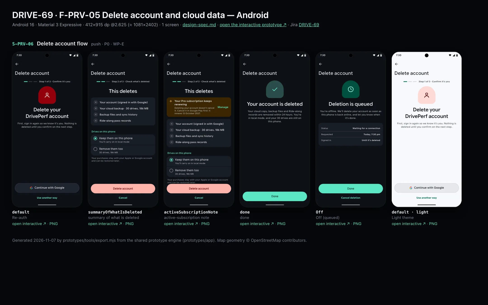
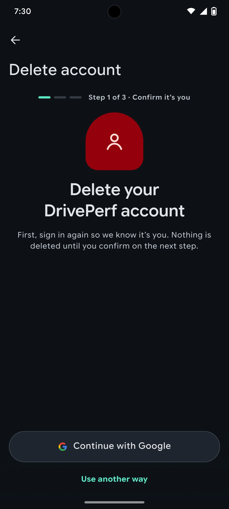
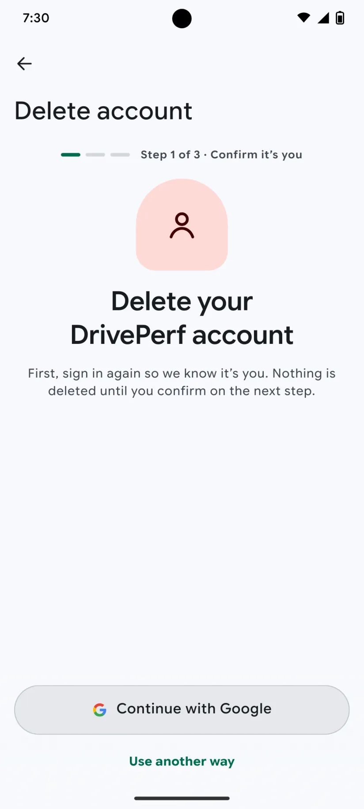

# DRIVE-69 · F-PRV-05 Delete account and cloud data — Android design spec

> Generated by `prototypes/tools/export.mjs` on 2026-11-06 from the shared prototype engine. **Do not edit by hand:** change the screen's `spec` in `prototypes/app/screens/wp-*.js` (see `prototypes/app/AUTHORING.md`) and re-export.

- **Jira story:** [DRIVE-69](https://thekeval.atlassian.net/browse/DRIVE-69) · F-PRV-05 · P0
- **Platform:** Android 16 · Material 3 Expressive · 412×915 dp @2.625 (≈ 1081×2402)
- **Interactive prototype:** [../../../../prototypes/android/index.html#S-PRV-06](../../../../prototypes/android/index.html#S-PRV-06) (catalog panel: every screen and state; deep links `#S-ID/state?trip=…&ent=…&theme=light&text=xl&rm=1`)
- **Contact sheet:** [mockup.html](mockup.html) · 
- **Design system (source of truth for values):** [brand](../../system/brand.md) · [components](../../system/components.md) · [motion](../../system/motion.md) · [accessibility](../../system/accessibility.md) · [screen map](../../system/screen-map.md) · [fixtures](../../system/fixtures.md) · tokens `prototypes/shared/tokens.css`

## Screens in this story

| Screen | Name | Presentation | Priority | States | Status |
|---|---|---|---|---|---|
| `S-PRV-06` | Delete account flow | Push (flow) | P0 | 5 | Prototyped |

## Tokens used on this platform

Values resolved from `prototypes/shared/tokens.css` inside the Android device (`[data-platform="android"]`). Use the token names in code; the hex values are for reference.

| Token | Dark | Light |
|---|---|---|
| `--app-bg` | `#0D1117` | `#F7F9FC` |
| `--card-bg` | `#191E25` | `#EBEEF2` |
| `--dp-bg-grouped` | `#0D1117` | `#F7F9FC` |
| `--dp-surface` | `#191E25` | `#EBEEF2` |
| `--dp-surface-2` | `#1F252D` | `#E5E8EC` |
| `--dp-surface-3` | `#2A3038` | `#DFE2E6` |
| `--dp-fill` | `#2A3038` | `#DFE2E6` |
| `--dp-fill-strong` | `#353B44` | `#D3D7DC` |
| `--dp-text` | `#E1E3E8` | `#181C20` |
| `--dp-text-2` | `#C0C7CF` | `#40474F` |
| `--dp-text-3` | `#8A929B` | `#707881` |
| `--dp-separator` | `#40474F` | `#C0C7CF` |
| `--dp-accent` | `#5BE7C4` | `#006B53` |
| `--dp-accent-text` | `#5BE7C4` | `#006B53` |
| `--dp-on-accent` | `#00382B` | `#FFFFFF` |
| `--dp-accent-container` | `#00513F` | `#91F1D8` |
| `--dp-record` | `#FFC24B` | `#7A5900` |
| `--dp-positive` | `#5BE7C4` | `#006B53` |
| `--dp-change-down` | `#C0C7CF` | `#40474F` |
| `--dp-warning` | `#F5B648` | `#7A5900` |
| `--dp-critical` | `#FFB4AB` | `#BA1A1A` |
| `--dp-glass-fill` | `#1F252DF2` | `#E5E8ECF2` |
| `--dp-glass-fill-strong` | `#2A3038` | `#DFE2E6` |
| `--dp-glass-stroke` | `#FFFFFF0F` | `#0000000A` |
| `--md-sys-color-primary` | `#5BE7C4` | `#006B53` |
| `--md-sys-color-on-primary` | `#00382B` | `#FFFFFF` |
| `--md-sys-color-primary-container` | `#00513F` | `#91F1D8` |
| `--md-sys-color-on-primary-container` | `#91F1D8` | `#002118` |
| `--md-sys-color-secondary-container` | `#344C44` | `#CEE9DF` |
| `--md-sys-color-surface` | `#0D1117` | `#F7F9FC` |
| `--md-sys-color-surface-container` | `#191E25` | `#EBEEF2` |
| `--md-sys-color-surface-container-high` | `#1F252D` | `#E5E8EC` |
| `--md-sys-color-on-surface-variant` | `#C0C7CF` | `#40474F` |
| `--dp-data-route` | `#5BE7C4` | `#079777` |
| `--dp-data-event-brake` | `#FF7A66` | `#A21F16` |
| `--dp-data-event-accel` | `#E58BD0` | `#A33A8C` |
| `--dp-data-event-corner` | `#EAD54E` | `#9A8A00` |
| `--dp-data-quality-good` | `#5FDB9C` | `#1E9E62` |
| `--dp-data-speed` | `#D6DCE4` | `#404A58` |
| `--dp-data-long-g` | `#5AB8F5` | `#0A6AB8` |
| `--dp-data-lat-g` | `#F5A142` | `#B25A00` |

| Type / layout token | Value |
|---|---|
| `--dp-font-screen-title` | `600 32px / 40px "Google Sans Flex", "Google Sans Display", "Roboto Flex", Roboto, system-ui, sans-serif` |
| `--dp-font-sheet-title` | `400 24px / 32px "Google Sans Flex", "Google Sans Display", "Roboto Flex", Roboto, system-ui, sans-serif` |
| `--dp-font-section-title` | `600 22px / 28px "Google Sans Flex", "Google Sans Display", "Roboto Flex", Roboto, system-ui, sans-serif` |
| `--dp-font-card-title` | `700 16px / 24px "Google Sans Flex", "Google Sans Text", "Roboto Flex", Roboto, system-ui, sans-serif` |
| `--dp-font-body` | `400 16px / 24px "Google Sans Flex", "Google Sans Text", "Roboto Flex", Roboto, system-ui, sans-serif` |
| `--dp-font-body-secondary` | `400 14px / 20px "Google Sans Flex", "Google Sans Text", "Roboto Flex", Roboto, system-ui, sans-serif` |
| `--dp-font-meta` | `400 12px / 16px "Google Sans Flex", "Google Sans Text", "Roboto Flex", Roboto, system-ui, sans-serif` |
| `--dp-font-caption` | `500 12px / 16px "Google Sans Flex", "Google Sans Text", "Roboto Flex", Roboto, system-ui, sans-serif` |
| `--dp-font-button` | `700 14px / 20px "Google Sans Flex", "Google Sans Text", "Roboto Flex", Roboto, system-ui, sans-serif` |
| `--dp-num-hero` | `600 72px / 72px "Google Sans Flex", "Roboto Flex", Roboto, system-ui, sans-serif` |
| `--dp-num-xl` | `600 48px / 52px "Google Sans Flex", "Roboto Flex", Roboto, system-ui, sans-serif` |
| `--dp-num-l` | `600 34px / 38px "Google Sans Flex", "Roboto Flex", Roboto, system-ui, sans-serif` |
| `--dp-num-m` | `600 24px / 28px "Google Sans Flex", "Roboto Flex", Roboto, system-ui, sans-serif` |
| `--dp-num-s` | `600 17px / 22px "Google Sans Flex", "Roboto Flex", Roboto, system-ui, sans-serif` |
| `--dp-num-xs` | `600 13px / 16px "Google Sans Flex", "Roboto Flex", Roboto, system-ui, sans-serif` |
| `--dp-screen-margin` | `16px` |
| `--dp-radius-card` | `16px` |
| `--dp-radius-card-hero` | `28px` |
| `--dp-radius-sheet` | `28px` |
| `--dp-radius-chip` | `8px` |
| `--dp-radius-button` | `999px` |
| `--dp-layout-list-row-min` | `56px` |
| `--dp-layout-touch-min` | `48px` |
| `--safe-top` | `40px` |
| `--safe-bottom` | `24px` |

Text sizes scale with `--dp-text-scale` (XL = 2.0×) and numerals with `--dp-num-scale` (XL = 1.3×). DP Numerals: Google Sans Flex wdth 120 wght 600, tabular.

---

## S-PRV-06 · Delete account flow

 

- **Presentation:** push · tab: profile — screen map: “Push (flow)”
- **Entry points:** S-PRV-01 · S-ACC-01
- **Leads to:** Re-auth S-ACC-02 → summary → done (local mode)
- **PRD features:** F-PRV-05 · **Priority:** P0 · **WP:** E
- **Interactive:** [S-PRV-06](../../../../prototypes/android/index.html#S-PRV-06)

**Purpose.** Delete the account and all cloud data from inside the app (F-PRV-05; Apple 5.1.1(v), Google Play account deletion): re-authenticate, see exactly what is deleted, choose what happens to local drives, be told that a store subscription must be cancelled in the store, and get a confirmation. Offline requests are queued.

### States

| State | PRD label | Fixture params | Screenshot |
|---|---|---|---|
| `default` | Re-auth | — | [S-PRV-06.png](../../screens/android/S-PRV-06.webp) · [open](../../../../prototypes/android/index.html#S-PRV-06) |
| `summaryOfWhatIsDeleted` | summary of what is deleted | — | [S-PRV-06--summaryOfWhatIsDeleted.png](../../screens/android/S-PRV-06--summaryOfWhatIsDeleted.webp) · [open](../../../../prototypes/android/index.html#S-PRV-06/summaryOfWhatIsDeleted) |
| `activeSubscriptionNote` | active-subscription note | — | [S-PRV-06--activeSubscriptionNote.png](../../screens/android/S-PRV-06--activeSubscriptionNote.webp) · [open](../../../../prototypes/android/index.html#S-PRV-06/activeSubscriptionNote) |
| `done` | done | — | [S-PRV-06--done.png](../../screens/android/S-PRV-06--done.webp) · [open](../../../../prototypes/android/index.html#S-PRV-06/done) |
| `Off` | Off (queued) | — | [S-PRV-06--Off.png](../../screens/android/S-PRV-06--Off.webp) · [open](../../../../prototypes/android/index.html#S-PRV-06/Off) |
| default · light | Light theme | `theme=light` | [S-PRV-06--light.png](../../screens/android/S-PRV-06--light.webp) |

Every state also renders in light/dark (`theme=light`), XL text (`text=xl`) and reduced motion (`rm=1`).

### Layout

- Push flow, title “Delete account”, step indicator (3 segments + “Step n of 3 · …”).
- Step 1 Re-auth: critical-tinted profile illustration, “Delete your DrivePerf account”, lead; dock: provider button (Sign in with Apple style on iOS / Google on Android, 52/56) + “Use another way” → S-ACC-02 re-auth.
- Step 2 Summary: “This deletes” card (✕ account · ✕ cloud backup 30 drives, 186 MB · ✕ backup files and sync history · ✕ Ride-along pass records); “Drives on this phone” radios (Keep them / Remove them too); footer about purchases; dock destructive “Delete account” + “Cancel”.
- active-subscription note: attention banner above the card “Your Pro subscription keeps renewing … renews 13 October 2027” + Manage.
- Done: positive check, “Your account is deleted”, what happens within 24 h, local-mode line; dock Done → S-HOME-01. Off (queued): clock illustration, “Deletion is queued”, facts card; dock Done + “Cancel deletion”.

### Components & tokens

| Component | Tokens / spec |
|---|---|
| `navBar` | --dp-font-card-title · --dp-font-meta · glass: --dp-glass-fill + --dp-glass-blur · components.md §2 |
| `banner` | radius 12 (--dp-radius-sm+) · info --dp-fill · attention --dp-warning-container · critical --dp-critical-container · components.md §22 |
| `card` | --dp-surface / --md-sys-color-surface-container · --dp-radius-card (24 iOS · 16 Android) · hero: --dp-radius-card-hero (32 · 28) · light iOS: --dp-elev-1 |
| `radios` | see components.md |
| `button` | --dp-accent / --dp-on-accent (filled) · --dp-fill-strong · --md-sys-color-secondary-container (tonal) · --dp-radius-button · height iOS 50/44/34 · Android 56/40/32 · --dp-font-button · components.md §0 |
| `section` | --dp-font-section-title · --dp-layout-section-gap 28 |

### Interactions & navigation

- Continue with Apple/Google → re-auth (prototype: toast) → summary. Use another way → S-ACC-02 (reauth = 1) → back to the summary.
- Manage → StoreKit showManageSubscriptions / Play subscriptions deep link.
- Delete account (haptic warning) → Auth user, Firestore docs and Storage files deleted within 24 h (Cloud Functions cascade, incl. RevenueCat customer and Crashlytics by installation ID where possible) → done (local mode). Offline → Off (queued, retried).

### Motion

- Blocks rise 8 px, 30 ms stagger; illustration pops. No celebration on done. RM: fade.

### Accessibility

- Step indicator reads “Step 2 of 3: Check what’s deleted”. Destructive button: “Delete account. This deletes your account and cloud data.”
- XL: dock buttons stack; the summary card wraps.

### Platform notes

- **Android (this spec):** Credential Manager re-auth; error-container destructive button; predictive back returns one step.
- *iOS (for reference):* Sign in with Apple re-auth (ASAuthorization with the existing credential); destructive role styling.

### Analytics

- `account_deletion_requested`
- `account_deleted (anonymous count)`
- `account_deletion_queued`

### Copy

| Key | Text |
|---|---|
| Step 1 | Delete your DrivePerf account. First, sign in again so we know it’s you. Nothing is deleted until you confirm on the next step. |
| Deletes | Your account (signed in with Apple) · Your cloud backup · 30 drives, 186 MB · Backup files and sync history · Ride-along pass records |
| Subscription | Your Pro subscription keeps renewing. Deleting your account doesn’t cancel it. Cancel it in App Store first: it renews 13 October 2027. |
| Done | Your account is deleted. Your cloud copy, backup files and Ride-along records are removed within 24 hours. You’re in local mode, and your 30 drives are still on this phone. |
| Queued | Deletion is queued. You’re offline. We’ll delete your account as soon as this phone is back online, and let you know when it’s done. |

### Free / Pro

Free. The subscription note appears when a store subscription is active (pro renews 2027-10-13).

### Data & fixtures

Signed-in account is a prototype value (Apple on iOS, Google on Android). Sizes from privacy.dataSize; renewal from entitlement.states.pro.renews.

### Assets

[icon-profile.svg](assets/icon-profile.svg) · [icon-check.svg](assets/icon-check.svg) · [icon-clock.svg](assets/icon-clock.svg) · [icon-sparkle.svg](assets/icon-sparkle.svg) · [icon-close.svg](assets/icon-close.svg)

UI glyphs may be swapped for SF Symbols / Material Symbols Rounded equivalents; event-pin, quality and provenance glyphs must not be (components.md global rules).

### Checklist (accessibility.md §9)

- [ ] Light and dark both render, and contrast passes.
- [ ] The XL text state reflows with no truncation.
- [ ] The RM state is defined.
- [ ] Every control has a label; every chart and map has a summary sentence.
- [ ] Every target ≥ 44 pt / 48 dp (≥ 64 in-drive).
- [ ] No meaning by colour alone.
- [ ] Speed is neutral wherever it appears and absent from social or live surfaces.
- [ ] No streak, leaderboard, speed or “beat your time” language.
- [ ] Behaviour is defined while a trip is active (D1 gate).
- [ ] Haptics come from motion.md §6 only.

---

Map geometry in the prototype: © OpenStreetMap contributors (ODbL). Speed and G are simulated fixtures (fixtures.md).
