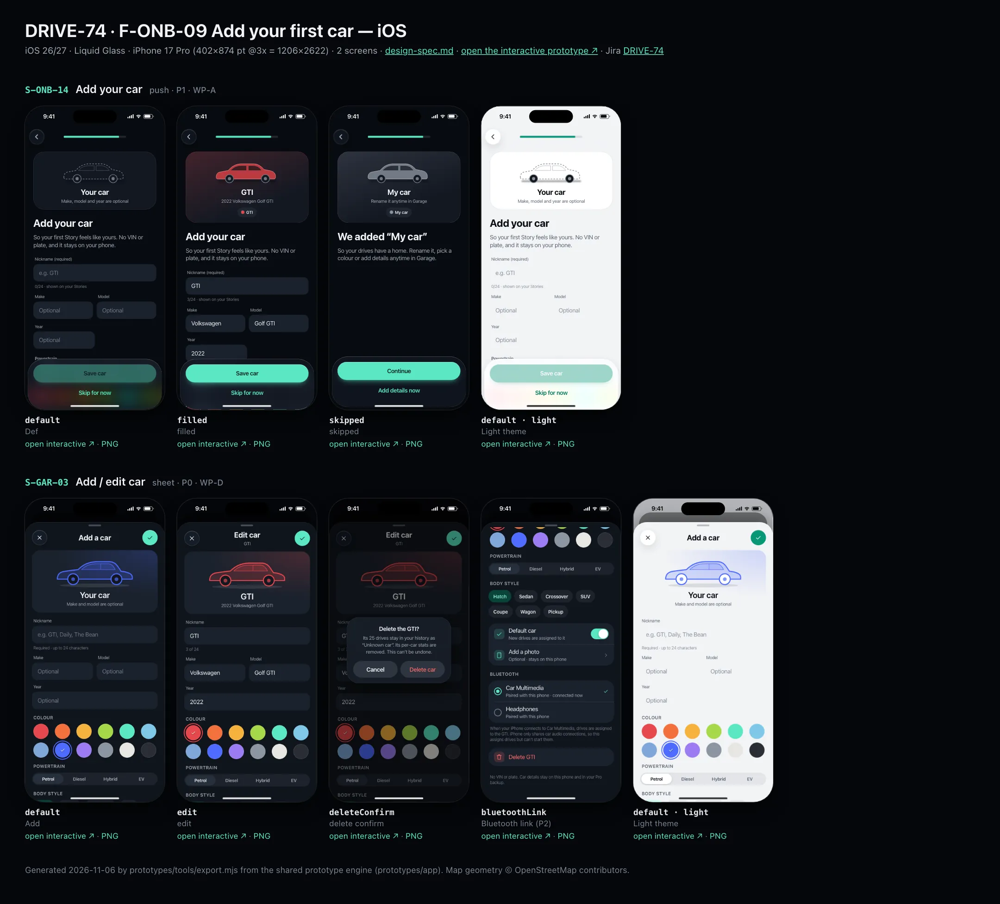
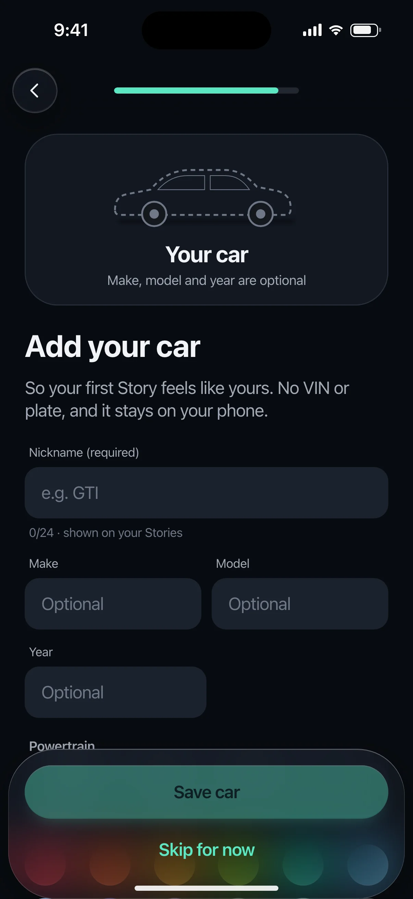
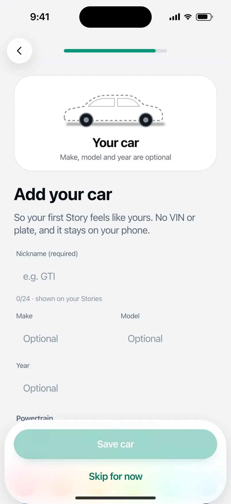
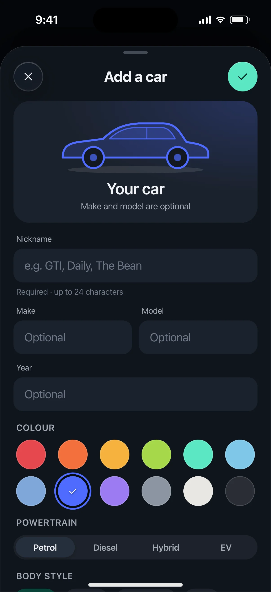
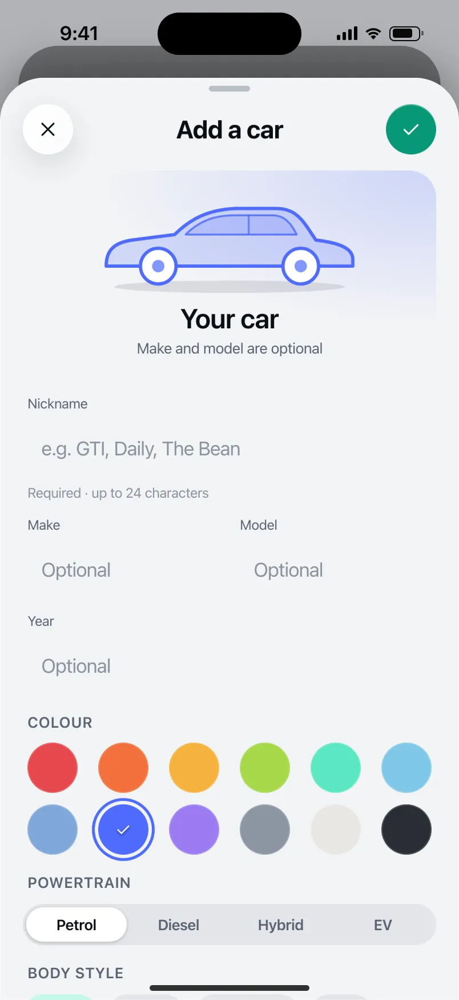

# DRIVE-74 · F-ONB-09 Add your first car — iOS design spec

> Generated by `prototypes/tools/export.mjs` on 2026-11-06 from the shared prototype engine. **Do not edit by hand:** change the screen's `spec` in `prototypes/app/screens/wp-*.js` (see `prototypes/app/AUTHORING.md`) and re-export.

- **Jira story:** [DRIVE-74](https://thekeval.atlassian.net/browse/DRIVE-74) · F-ONB-09 · P1
- **Platform:** iOS 26/27 · Liquid Glass · iPhone 17 Pro (402×874 pt @3x = 1206×2622)
- **Interactive prototype:** [../../../../prototypes/ios/index.html#S-ONB-14](../../../../prototypes/ios/index.html#S-ONB-14) (catalog panel: every screen and state; deep links `#S-ID/state?trip=…&ent=…&theme=light&text=xl&rm=1`)
- **Contact sheet:** [mockup.html](mockup.html) · 
- **Design system (source of truth for values):** [brand](../../system/brand.md) · [components](../../system/components.md) · [motion](../../system/motion.md) · [accessibility](../../system/accessibility.md) · [screen map](../../system/screen-map.md) · [fixtures](../../system/fixtures.md) · tokens `prototypes/shared/tokens.css`

## Screens in this story

| Screen | Name | Presentation | Priority | States | Status |
|---|---|---|---|---|---|
| `S-ONB-14` | Add your car | Full | P1 | 3 | Prototyped |
| `S-GAR-03` | Add / edit car | Sheet (large) | P0 | 4 | Prototyped |

## Tokens used on this platform

Values resolved from `prototypes/shared/tokens.css` inside the iOS device (`[data-platform="ios"]`). Use the token names in code; the hex values are for reference.

| Token | Dark | Light |
|---|---|---|
| `--app-bg` | `#080B10` | `#F2F3F6` |
| `--card-bg` | `#131822` | `#FFFFFF` |
| `--dp-bg-grouped` | `#080B10` | `#F2F3F6` |
| `--dp-surface` | `#131822` | `#FFFFFF` |
| `--dp-surface-2` | `#1B222D` | `#F2F3F6` |
| `--dp-surface-3` | `#262E3B` | `#E4E7EC` |
| `--dp-fill` | `#7880961F` | `#7880961F` |
| `--dp-fill-strong` | `#7880963D` | `#78809633` |
| `--dp-text` | `#F2F4F7` | `#0B0E13` |
| `--dp-text-2` | `#A3AAB6` | `#5A6271` |
| `--dp-text-3` | `#6E7787` | `#8A919D` |
| `--dp-separator` | `#96A0B429` | `#3C435024` |
| `--dp-accent` | `#5BE7C4` | `#079777` |
| `--dp-accent-text` | `#5BE7C4` | `#06775E` |
| `--dp-on-accent` | `#04241D` | `#FFFFFF` |
| `--dp-accent-container` | `#0A4439` | `#C6F8EA` |
| `--dp-record` | `#FFC24B` | `#9A6300` |
| `--dp-positive` | `#5BE7C4` | `#06775E` |
| `--dp-change-down` | `#A3AAB6` | `#5A6271` |
| `--dp-warning` | `#F5B648` | `#9A5F00` |
| `--dp-critical` | `#FF6B6B` | `#C62828` |
| `--dp-glass-fill` | `#1C222C6B` | `#FFFFFF8C` |
| `--dp-glass-fill-strong` | `#1C222CB8` | `#FFFFFFD1` |
| `--dp-glass-stroke` | `#FFFFFF24` | `#FFFFFF99` |
| `--dp-data-route` | `#5BE7C4` | `#079777` |
| `--dp-data-event-brake` | `#FF7A66` | `#A21F16` |
| `--dp-data-event-accel` | `#E58BD0` | `#A33A8C` |
| `--dp-data-event-corner` | `#EAD54E` | `#9A8A00` |
| `--dp-data-quality-good` | `#5FDB9C` | `#1E9E62` |
| `--dp-data-speed` | `#D6DCE4` | `#404A58` |
| `--dp-data-long-g` | `#5AB8F5` | `#0A6AB8` |
| `--dp-data-lat-g` | `#F5A142` | `#B25A00` |

| Type / layout token | Value |
|---|---|
| `--dp-font-screen-title` | `700 34px / 41px -apple-system, BlinkMacSystemFont, "SF Pro Display", system-ui, sans-serif` |
| `--dp-font-sheet-title` | `700 22px / 28px -apple-system, BlinkMacSystemFont, "SF Pro Display", system-ui, sans-serif` |
| `--dp-font-section-title` | `600 20px / 25px -apple-system, BlinkMacSystemFont, "SF Pro Display", system-ui, sans-serif` |
| `--dp-font-card-title` | `600 17px / 22px -apple-system, BlinkMacSystemFont, "SF Pro Text", system-ui, sans-serif` |
| `--dp-font-body` | `400 17px / 22px -apple-system, BlinkMacSystemFont, "SF Pro Text", system-ui, sans-serif` |
| `--dp-font-body-secondary` | `400 15px / 20px -apple-system, BlinkMacSystemFont, "SF Pro Text", system-ui, sans-serif` |
| `--dp-font-meta` | `400 13px / 18px -apple-system, BlinkMacSystemFont, "SF Pro Text", system-ui, sans-serif` |
| `--dp-font-caption` | `400 12px / 16px -apple-system, BlinkMacSystemFont, "SF Pro Text", system-ui, sans-serif` |
| `--dp-font-button` | `600 17px / 22px -apple-system, BlinkMacSystemFont, "SF Pro Text", system-ui, sans-serif` |
| `--dp-num-hero` | `600 72px / 72px -apple-system, BlinkMacSystemFont, "SF Pro Display", system-ui, sans-serif` |
| `--dp-num-xl` | `600 48px / 52px -apple-system, BlinkMacSystemFont, "SF Pro Display", system-ui, sans-serif` |
| `--dp-num-l` | `600 34px / 38px -apple-system, BlinkMacSystemFont, "SF Pro Display", system-ui, sans-serif` |
| `--dp-num-m` | `600 24px / 28px -apple-system, BlinkMacSystemFont, "SF Pro Display", system-ui, sans-serif` |
| `--dp-num-s` | `600 17px / 22px -apple-system, BlinkMacSystemFont, "SF Pro Display", system-ui, sans-serif` |
| `--dp-num-xs` | `600 13px / 16px -apple-system, BlinkMacSystemFont, "SF Pro Display", system-ui, sans-serif` |
| `--dp-screen-margin` | `16px` |
| `--dp-radius-card` | `24px` |
| `--dp-radius-card-hero` | `32px` |
| `--dp-radius-sheet` | `38px` |
| `--dp-radius-chip` | `999px` |
| `--dp-radius-button` | `999px` |
| `--dp-layout-list-row-min` | `52px` |
| `--dp-layout-touch-min` | `44px` |
| `--safe-top` | `62px` |
| `--safe-bottom` | `34px` |

Text sizes scale with `--dp-text-scale` (XL = 2.0×) and numerals with `--dp-num-scale` (XL = 1.3×). DP Numerals: SF Pro Expanded Semibold, tabular.

---

## S-ONB-14 · Add your car

 

- **Presentation:** push — screen map: “Full”
- **Entry points:** S-ONB-13
- **Leads to:** S-ONB-15 (filled or skipped)
- **PRD features:** F-ONB-09, F-GAR-01 · **Priority:** P1 · **WP:** A
- **Interactive:** [S-ONB-14](../../../../prototypes/ios/index.html#S-ONB-14)

**Purpose.** Add the first car during setup so the first Story feels personal (F-ONB-09, F-GAR-01): nickname required, the rest optional, a colour that tints Stories; Skip silently creates “My car”.

### States

| State | PRD label | Fixture params | Screenshot |
|---|---|---|---|
| `default` | Def | — | [S-ONB-14.png](../../screens/ios/S-ONB-14.webp) · [open](../../../../prototypes/ios/index.html#S-ONB-14) |
| `filled` | filled | — | [S-ONB-14--filled.png](../../screens/ios/S-ONB-14--filled.webp) · [open](../../../../prototypes/ios/index.html#S-ONB-14/filled) |
| `skipped` | skipped | — | [S-ONB-14--skipped.png](../../screens/ios/S-ONB-14--skipped.webp) · [open](../../../../prototypes/ios/index.html#S-ONB-14/skipped) |
| default · light | Light theme | `theme=light` | [S-ONB-14--light.png](../../screens/ios/S-ONB-14--light.webp) |

Every state also renders in light/dark (`theme=light`), XL text (`text=xl`) and reduced motion (`rm=1`).

### Layout

- Top bar: Back · step progress (8 of 9 / 10 of 11). Start-aligned.
- Live preview card (hero, radius 32/28): generic hatch silhouette 200 wide filled with the chosen car colour (gradient 85% → 55%, glass windows, neutral wheels), nickname (title3 600) + “year make model” line, and the car chip as it will appear on Stories. Empty state: outline silhouette in --dp-text-3, “Your car”.
- Title “Add your car”, lead (privacy: no VIN or plate, stays on the phone).
- Form: Nickname (required, ≤ 24, counter helper “n/24 · shown on your Stories”) · Make | Model (two columns, one column at XL) · Year · “Powertrain” segmented (Petrol · Diesel · Hybrid · EV: iOS glass segmented / Android connected button group) · “Colour” 12 swatches (36 round, 6 per row; selected = 2 pt ring + check).
- Dock: “Save car” (disabled until a nickname exists) · tertiary “Skip for now”.
- skipped: preview shows “My car” in graphite, title “We added “My car”” + rename hint; “Continue”, tertiary “Add details now”.

### Components & tokens

| Component | Tokens / spec |
|---|---|
| `page` | --dp-bg-grouped (iOS) / --md-sys-color-surface (Android) · --dp-screen-margin 16 |
| `textField` | see components.md |
| `segmented` | see components.md |
| `carChip` | see components.md |
| `button` | --dp-accent / --dp-on-accent (filled) · --dp-fill-strong · --md-sys-color-secondary-container (tonal) · --dp-radius-button · height iOS 50/44/34 · Android 56/40/32 · --dp-font-button · components.md §0 |

### Interactions & navigation

- Typing the nickname updates the preview and enables Save live (no re-render).
- Powertrain segment → selection haptic · colour swatch → preview recolours (selection haptic).
- “Save car” → S-ONB-15 (or S-ONB-15/manualOnly when automatic trips are off), the car becomes the default (car_added {source: onboarding, powertrain}).
- “Skip for now” → creates “My car” silently and goes to S-ONB-15 (toast in the prototype). skipped → Continue → S-ONB-15.

### Motion

- Hero motion: the car silhouette drives in from the left (translateX −28 → 0, spring.slow). Colour changes cross-fade the fill (spring.effects).
- RM: static car; 220 ms cross-fade.

### Accessibility

- Preview card label: “Car preview: GTI, Carmine”. Swatches are a radiogroup labelled “Colour”, each “Carmine, radio button, selected”.
- Nickname field label “Nickname (required)” with the counter as hint. Disabled Save: “Save car, unavailable until you add a nickname”.
- XL: make/model stack, swatches wrap to 4 per row, segmented labels wrap to two lines.

### Platform notes

- **iOS (this spec):** Rounded fields (--dp-surface-2, radius 14), glass segmented Picker, swatches as a LazyVGrid; keyboard toolbar “Done”.
- *Android (for reference):* OutlinedTextField (shape extraSmall), SingleChoiceSegmentedButtonRow / connected ButtonGroup, swatches in a FlowRow; IME action Next → Done.

### Analytics

- `onboarding_step_viewed {step: car}`
- `car_added {source: onboarding, powertrain}`

### Copy

| Key | Text |
|---|---|
| Title | Add your car |
| Lead | So your first Story feels like yours. No VIN or plate, and it stays on your phone. |
| Nickname | Nickname (required) · e.g. GTI · n/24 · shown on your Stories |
| Save | Save car |
| Skip | Skip for now |
| Skipped title | We added “My car” |
| Skipped lead | So your drives have a home. Rename it, pick a colour or add details anytime in Garage. |

### Free / Pro

Free includes 1 car (entitlement.freeLimits.vehicles); during the Preview more can be added later in Garage.

### Data & fixtures

filled = DP_DATA.vehicles gti (GTI · Volkswagen Golf GTI · 2022 · petrol · carmine “Kings Red”). Colour tokens: --dp-car-* (brand.md §5.3).

### Assets

[icon-check.svg](assets/icon-check.svg) · [icon-garage.svg](assets/icon-garage.svg)

UI glyphs may be swapped for SF Symbols / Material Symbols Rounded equivalents; event-pin, quality and provenance glyphs must not be (components.md global rules).

### Checklist (accessibility.md §9)

- [ ] Light and dark both render, and contrast passes.
- [ ] The XL text state reflows with no truncation.
- [ ] The RM state is defined.
- [ ] Every control has a label; every chart and map has a summary sentence.
- [ ] Every target ≥ 44 pt / 48 dp (≥ 64 in-drive).
- [ ] No meaning by colour alone.
- [ ] Speed is neutral wherever it appears and absent from social or live surfaces.
- [ ] No streak, leaderboard, speed or “beat your time” language.
- [ ] Behaviour is defined while a trip is active (D1 gate).
- [ ] Haptics come from motion.md §6 only.

---

## S-GAR-03 · Add / edit car

 

- **Presentation:** sheet · tab: garage · detent: large — screen map: “Sheet (large)”
- **Entry points:** S-GAR-01/02 · S-ONB-14 reuse
- **Leads to:** Back · delete confirm dialog
- **PRD features:** F-GAR-01, F-ONB-09, F-GAR-04 · **Priority:** P0 · **WP:** D
- **Interactive:** [S-GAR-03](../../../../prototypes/ios/index.html#S-GAR-03)

**Purpose.** Add a car or edit one: nickname (required), optional make, model and year, powertrain, body style and colour — the colour and silhouette become the car’s identity across Stories and cards (F-GAR-01, F-ONB-09). Also delete a car (trips kept as “Unknown car”) and, P2, link its Bluetooth (F-GAR-04).

### States

| State | PRD label | Fixture params | Screenshot |
|---|---|---|---|
| `default` | Add | — | [S-GAR-03.png](../../screens/ios/S-GAR-03.webp) · [open](../../../../prototypes/ios/index.html#S-GAR-03) |
| `edit` | edit | `car=gti` | [S-GAR-03--edit.png](../../screens/ios/S-GAR-03--edit.webp) · [open](../../../../prototypes/ios/index.html#S-GAR-03/edit) |
| `deleteConfirm` | delete confirm | `car=gti` | [S-GAR-03--deleteConfirm.png](../../screens/ios/S-GAR-03--deleteConfirm.webp) · [open](../../../../prototypes/ios/index.html#S-GAR-03/deleteConfirm) |
| `bluetoothLink` | Bluetooth link (P2) | `car=gti` | [S-GAR-03--bluetoothLink.png](../../screens/ios/S-GAR-03--bluetoothLink.webp) · [open](../../../../prototypes/ios/index.html#S-GAR-03/bluetoothLink) |
| default · light | Light theme | `theme=light` | [S-GAR-03--light.png](../../screens/ios/S-GAR-03--light.webp) |

Every state also renders in light/dark (`theme=light`), XL text (`text=xl`) and reduced motion (`rm=1`).

### Layout

- Large sheet with its own toolbar: × (Cancel) · “Add a car” / “Edit car” + sub · ✓ (iOS glass prominent) / “Add”/“Save” text button (Android).
- Live preview card (radius 24, the chosen car colour wash): silhouette 240 for the chosen body style in the chosen colour · nickname (“Your car” until typed) · “2022 Volkswagen Golf GTI” / “Make and model are optional”.
- Fields: Nickname (focused on Add; helper “Required · up to 24 characters” → “3 of 24”) · Make + Model side by side (stack at XL) · Year. iOS rounded fields (surface-2, radius 14) / Android OutlinedTextField.
- Colour: 12 car-colour swatches (36, ring + check when selected). Powertrain: Petrol · Diesel · Hybrid · EV segmented. Body style chips: Hatch · Sedan · Crossover · SUV · Coupe · Wagon · Pickup.
- List: Default car (switch) · Add a photo (optional, stays on this phone). Bluetooth row “Link the car’s Bluetooth” (P2). Edit only: destructive “Delete GTI”. Footer “No VIN or plate. Car details stay on this phone and in your Pro backup.”
- Delete confirm: alert / M3 dialog over the sheet — “Delete the GTI?” “Its 25 drives stay in your history as “Unknown car”. Its per-car stats are removed. This can’t be undone.” Cancel · Delete car.
- Bluetooth link (P2): paired devices as radio rows (Car Multimedia · connected now ✓, Headphones); Android adds “Start a drive when it connects” (switch); platform footnote (iOS assigns only, from car audio connections).

### Components & tokens

| Component | Tokens / spec |
|---|---|
| `sheetHeader` | see components.md |
| `iconButton` | see components.md |
| `button` | --dp-accent / --dp-on-accent (filled) · --dp-fill-strong · --md-sys-color-secondary-container (tonal) · --dp-radius-button · height iOS 50/44/34 · Android 56/40/32 · --dp-font-button · components.md §0 |
| `textField` | see components.md |
| `segmented` | see components.md |
| `chip` | --dp-radius-chip (iOS capsule · Android 8) · height 28 · --dp-font-caption |
| `list` | iOS inset grouped radius --dp-radius-card, rows 52 pt, separators --dp-separator inset 16 · Android ListItem 56/72 dp in --md-sys-color-surface-container |
| `row` | --dp-font-body · --dp-font-meta (supporting) · --dp-layout-list-row-min |
| `toggle` | iOS 51×31 tint --dp-accent · Android M3 Switch 52×32 --md-sys-color-primary |
| `dialog` | iOS alert 270 glass · Android M3 dialog radius 28 --md-sys-color-surface-container-high |

### Interactions & navigation

- Swatch / powertrain / body style → updates the preview live (selection haptic). Nickname typing updates the preview name.
- ✓ / Save: empty nickname → toast “Add a nickname first” (warning haptic); otherwise toast “GTI saved” / “Daily added to your garage” (success haptic) and dismiss to S-GAR-01/02.
- Delete → dialog; Delete car → toast “GTI deleted · drives kept as Unknown car” → S-GAR-01. Cancel / scrim → back to the edit form.
- Bluetooth row → bluetoothLink state (edit only). Photo → system photo picker (mock toast).

### Motion

- Sheet spring.sheet (iOS large detent recedes the parent). Hero motion: the preview silhouette draws on when the sheet opens (1100 ms), and its colour wash cross-fades on each swatch change (spring.default via CSS transition). RM: instant colour change.
- Delete dialog scales in (spring.fast).

### Accessibility

- Swatches are a radio group with colour names (“Carmine, selected”); the chosen colour also shows a check.
- Nickname field announces “Nickname, required, up to 24 characters”.
- Dialog: focus to title, Cancel first. Delete car is destructive.
- XL: Make/Model stack; swatches wrap to 3 rows; segmented labels stay legible (two lines allowed).

### Platform notes

- **iOS (this spec):** Sheet (large) with NavigationStack toolbar (✕ / ✓ glassProminent); Form-style sections; ColorPicker-like swatch grid; .alert for delete.
- *Android (for reference):* ModalBottomSheet full height with top row (close, title, TextButton Save); OutlinedTextFields; connected ButtonGroup; FilterChips; AlertDialog for delete; BLUETOOTH_CONNECT permission requested on first link.

### Analytics

- `car_added {source: garage|onboarding|trip_edit, powertrain}`
- `car_edited`
- `car_deleted {trips_bucket}`
- `bt_car_linked`

### Copy

| Key | Text |
|---|---|
| Title | Add a car / Edit car |
| Nickname helper | Required · up to 24 characters |
| Placeholder | e.g. GTI, Daily, The Bean |
| Empty nickname | Add a nickname first |
| Footer | No VIN or plate. Car details stay on this phone (and in your Pro backup). |
| Delete title | Delete the {car}? |
| Delete text | Its {n} drives stay in your history as “Unknown car”. Its per-car stats are removed. This can’t be undone. |
| BT iOS | When your iPhone connects to {device}, drives are assigned to the {car}. iPhone only shares car audio connections, so this assigns drives but can’t start them. |
| BT Android | When your phone connects to {device}, drives are assigned to the {car}. DrivePerf stores only the device name, on this phone. |

### Free / Pro

Editing is free. Adding a second car on Free is gated before this sheet (S-SUB-03 s2ndCar from S-GAR-01); S-ONB-14 reuses this form for the first car.

### Data & fixtures

Add: empty form, colour cobalt, petrol, hatch (defaults). Edit / delete / Bluetooth: vehicles gti (Kings Red → carmine, hatch, petrol, manual). Delete count from carStats (25 drives). Bluetooth device names are prototype examples.

### Assets

[icon-close.svg](assets/icon-close.svg) · [icon-check.svg](assets/icon-check.svg) · [icon-trash.svg](assets/icon-trash.svg) · [icon-gear.svg](assets/icon-gear.svg) · [icon-story.svg](assets/icon-story.svg) · [icon-record.svg](assets/icon-record.svg)

UI glyphs may be swapped for SF Symbols / Material Symbols Rounded equivalents; event-pin, quality and provenance glyphs must not be (components.md global rules).

### Checklist (accessibility.md §9)

- [ ] Light and dark both render, and contrast passes.
- [ ] The XL text state reflows with no truncation.
- [ ] The RM state is defined.
- [ ] Every control has a label; every chart and map has a summary sentence.
- [ ] Every target ≥ 44 pt / 48 dp (≥ 64 in-drive).
- [ ] No meaning by colour alone.
- [ ] Speed is neutral wherever it appears and absent from social or live surfaces.
- [ ] No streak, leaderboard, speed or “beat your time” language.
- [ ] Behaviour is defined while a trip is active (D1 gate).
- [ ] Haptics come from motion.md §6 only.

---

Map geometry in the prototype: © OpenStreetMap contributors (ODbL). Speed and G are simulated fixtures (fixtures.md).
