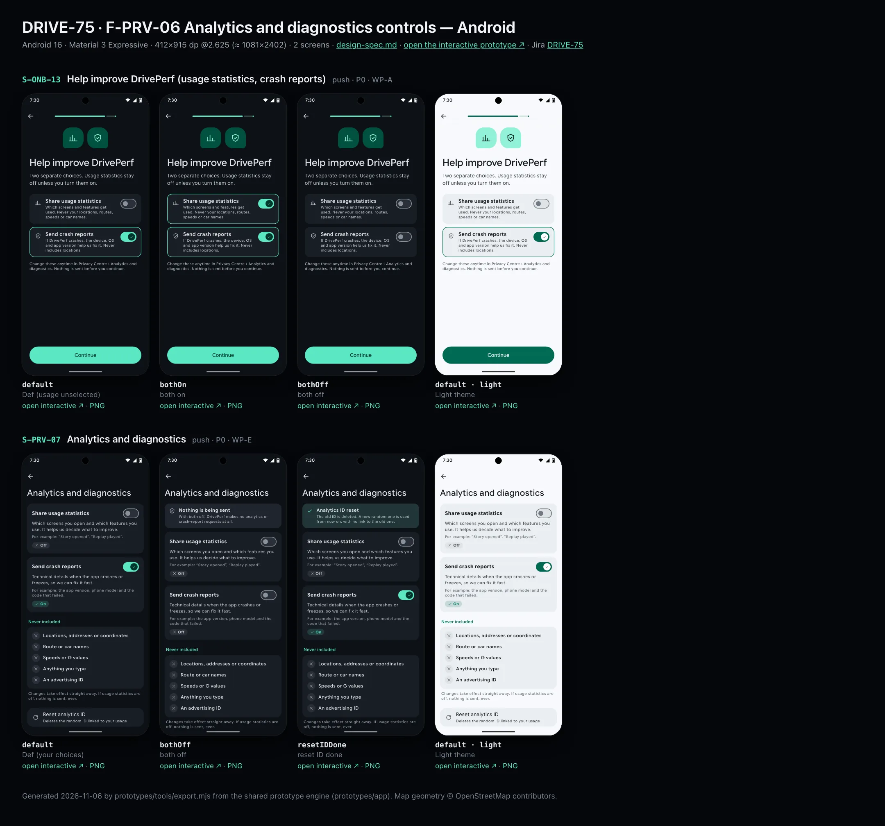
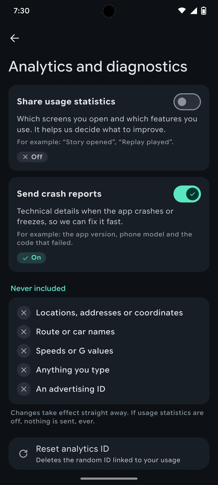
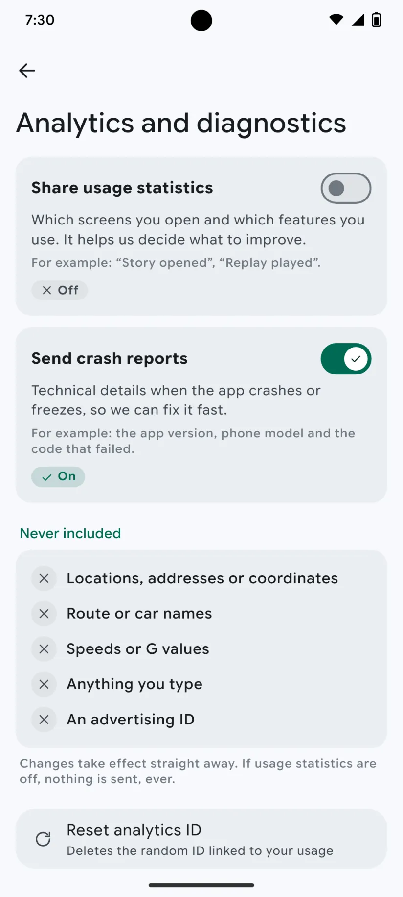

# DRIVE-75 · F-PRV-06 Analytics and diagnostics controls — Android design spec

> Generated by `prototypes/tools/export.mjs` on 2026-11-07 from the shared prototype engine. **Do not edit by hand:** change the screen's `spec` in `prototypes/app/screens/wp-*.js` (see `prototypes/app/AUTHORING.md`) and re-export.

- **Jira story:** [DRIVE-75](https://thekeval.atlassian.net/browse/DRIVE-75) · F-PRV-06 · P0
- **Platform:** Android 16 · Material 3 Expressive · 412×915 dp @2.625 (≈ 1081×2402)
- **Interactive prototype:** [../../../../prototypes/android/index.html#S-ONB-13](../../../../prototypes/android/index.html#S-ONB-13) (catalog panel: every screen and state; deep links `#S-ID/state?trip=…&ent=…&theme=light&text=xl&rm=1`)
- **Contact sheet:** [mockup.html](mockup.html) · 
- **Design system (source of truth for values):** [brand](../../system/brand.md) · [components](../../system/components.md) · [motion](../../system/motion.md) · [accessibility](../../system/accessibility.md) · [screen map](../../system/screen-map.md) · [fixtures](../../system/fixtures.md) · tokens `prototypes/shared/tokens.css`

## Screens in this story

| Screen | Name | Presentation | Priority | States | Status |
|---|---|---|---|---|---|
| `S-ONB-13` | Help improve DrivePerf (usage statistics, crash reports) | Full | P0 | 3 | Prototyped |
| `S-PRV-07` | Analytics and diagnostics | Push | P0 | 3 | Prototyped |

## Tokens used on this platform

Values resolved from `prototypes/shared/tokens.css` inside the Android device (`[data-platform="android"]`). Use the token names in code; the hex values are for reference.

| Token | Dark | Light |
|---|---|---|
| `--app-bg` | `#0D1117` | `#F7F9FC` |
| `--card-bg` | `#191E25` | `#EBEEF2` |
| `--dp-bg-grouped` | `#0D1117` | `#F7F9FC` |
| `--dp-surface` | `#191E25` | `#EBEEF2` |
| `--dp-surface-2` | `#1F252D` | `#E5E8EC` |
| `--dp-surface-3` | `#2A3038` | `#DFE2E6` |
| `--dp-fill` | `#2A3038` | `#DFE2E6` |
| `--dp-fill-strong` | `#353B44` | `#D3D7DC` |
| `--dp-text` | `#E1E3E8` | `#181C20` |
| `--dp-text-2` | `#C0C7CF` | `#40474F` |
| `--dp-text-3` | `#8A929B` | `#707881` |
| `--dp-separator` | `#40474F` | `#C0C7CF` |
| `--dp-accent` | `#5BE7C4` | `#006B53` |
| `--dp-accent-text` | `#5BE7C4` | `#006B53` |
| `--dp-on-accent` | `#00382B` | `#FFFFFF` |
| `--dp-accent-container` | `#00513F` | `#91F1D8` |
| `--dp-record` | `#FFC24B` | `#7A5900` |
| `--dp-positive` | `#5BE7C4` | `#006B53` |
| `--dp-change-down` | `#C0C7CF` | `#40474F` |
| `--dp-warning` | `#F5B648` | `#7A5900` |
| `--dp-critical` | `#FFB4AB` | `#BA1A1A` |
| `--dp-glass-fill` | `#1F252DF2` | `#E5E8ECF2` |
| `--dp-glass-fill-strong` | `#2A3038` | `#DFE2E6` |
| `--dp-glass-stroke` | `#FFFFFF0F` | `#0000000A` |
| `--md-sys-color-primary` | `#5BE7C4` | `#006B53` |
| `--md-sys-color-on-primary` | `#00382B` | `#FFFFFF` |
| `--md-sys-color-primary-container` | `#00513F` | `#91F1D8` |
| `--md-sys-color-on-primary-container` | `#91F1D8` | `#002118` |
| `--md-sys-color-secondary-container` | `#344C44` | `#CEE9DF` |
| `--md-sys-color-surface` | `#0D1117` | `#F7F9FC` |
| `--md-sys-color-surface-container` | `#191E25` | `#EBEEF2` |
| `--md-sys-color-surface-container-high` | `#1F252D` | `#E5E8EC` |
| `--md-sys-color-on-surface-variant` | `#C0C7CF` | `#40474F` |
| `--dp-data-route` | `#5BE7C4` | `#079777` |
| `--dp-data-event-brake` | `#FF7A66` | `#A21F16` |
| `--dp-data-event-accel` | `#E58BD0` | `#A33A8C` |
| `--dp-data-event-corner` | `#EAD54E` | `#9A8A00` |
| `--dp-data-quality-good` | `#5FDB9C` | `#1E9E62` |
| `--dp-data-speed` | `#D6DCE4` | `#404A58` |
| `--dp-data-long-g` | `#5AB8F5` | `#0A6AB8` |
| `--dp-data-lat-g` | `#F5A142` | `#B25A00` |

| Type / layout token | Value |
|---|---|
| `--dp-font-screen-title` | `600 32px / 40px "Google Sans Flex", "Google Sans Display", "Roboto Flex", Roboto, system-ui, sans-serif` |
| `--dp-font-sheet-title` | `400 24px / 32px "Google Sans Flex", "Google Sans Display", "Roboto Flex", Roboto, system-ui, sans-serif` |
| `--dp-font-section-title` | `600 22px / 28px "Google Sans Flex", "Google Sans Display", "Roboto Flex", Roboto, system-ui, sans-serif` |
| `--dp-font-card-title` | `700 16px / 24px "Google Sans Flex", "Google Sans Text", "Roboto Flex", Roboto, system-ui, sans-serif` |
| `--dp-font-body` | `400 16px / 24px "Google Sans Flex", "Google Sans Text", "Roboto Flex", Roboto, system-ui, sans-serif` |
| `--dp-font-body-secondary` | `400 14px / 20px "Google Sans Flex", "Google Sans Text", "Roboto Flex", Roboto, system-ui, sans-serif` |
| `--dp-font-meta` | `400 12px / 16px "Google Sans Flex", "Google Sans Text", "Roboto Flex", Roboto, system-ui, sans-serif` |
| `--dp-font-caption` | `500 12px / 16px "Google Sans Flex", "Google Sans Text", "Roboto Flex", Roboto, system-ui, sans-serif` |
| `--dp-font-button` | `700 14px / 20px "Google Sans Flex", "Google Sans Text", "Roboto Flex", Roboto, system-ui, sans-serif` |
| `--dp-num-hero` | `600 72px / 72px "Google Sans Flex", "Roboto Flex", Roboto, system-ui, sans-serif` |
| `--dp-num-xl` | `600 48px / 52px "Google Sans Flex", "Roboto Flex", Roboto, system-ui, sans-serif` |
| `--dp-num-l` | `600 34px / 38px "Google Sans Flex", "Roboto Flex", Roboto, system-ui, sans-serif` |
| `--dp-num-m` | `600 24px / 28px "Google Sans Flex", "Roboto Flex", Roboto, system-ui, sans-serif` |
| `--dp-num-s` | `600 17px / 22px "Google Sans Flex", "Roboto Flex", Roboto, system-ui, sans-serif` |
| `--dp-num-xs` | `600 13px / 16px "Google Sans Flex", "Roboto Flex", Roboto, system-ui, sans-serif` |
| `--dp-screen-margin` | `16px` |
| `--dp-radius-card` | `16px` |
| `--dp-radius-card-hero` | `28px` |
| `--dp-radius-sheet` | `28px` |
| `--dp-radius-chip` | `8px` |
| `--dp-radius-button` | `999px` |
| `--dp-layout-list-row-min` | `56px` |
| `--dp-layout-touch-min` | `48px` |
| `--safe-top` | `40px` |
| `--safe-bottom` | `24px` |

Text sizes scale with `--dp-text-scale` (XL = 2.0×) and numerals with `--dp-num-scale` (XL = 1.3×). DP Numerals: Google Sans Flex wdth 120 wght 600, tabular.

---

## S-ONB-13 · Help improve DrivePerf (usage statistics, crash reports)

- **Presentation:** push — screen map: “Full”
- **Entry points:** S-ONB-10 / S-ONB-12
- **Leads to:** S-ONB-14
- **PRD features:** F-ONB-08, F-PRV-06, F-ANA-01, F-ANA-03 · **Priority:** P0 · **WP:** A
- **Interactive:** [S-ONB-13](../../../../prototypes/android/index.html#S-ONB-13)

**Purpose.** Let the user decide whether usage statistics and crash reports leave the phone (F-ONB-08, F-PRV-06, F-ANA-01/03), as two separate choices, usage statistics not pre-selected (OQ-02).

### States

| State | PRD label | Fixture params | Screenshot |
|---|---|---|---|
| `default` | Def (usage unselected) | — | — · [open](../../../../prototypes/android/index.html#S-ONB-13) |
| `bothOn` | both on | — | — · [open](../../../../prototypes/android/index.html#S-ONB-13/bothOn) |
| `bothOff` | both off | — | — · [open](../../../../prototypes/android/index.html#S-ONB-13/bothOff) |

Every state also renders in light/dark (`theme=light`), XL text (`text=xl`) and reduced motion (`rm=1`).

### Layout

- Top bar: Back · step progress (7 of 9 / 9 of 11). Start-aligned.
- Art: two 64 glyph tiles (insights, shield) on accent container (iOS radius 20 · Android Cookie-ish 24/12).
- Title “Help improve DrivePerf”, lead “Two separate choices. Usage statistics stay off unless you turn them on.”
- Two choice cards, each a toggle row with a one-sentence explanation: “Share usage statistics” · “Send crash reports”. A card gets a 1.5 pt Glide outline when on.
- Fine print: where to change later and “Nothing is sent before you continue.”
- Dock: “Continue” (same label and weight whatever the choices: no “Accept all”).

### Components & tokens

| Component | Tokens / spec |
|---|---|
| `page` | --dp-bg-grouped (iOS) / --md-sys-color-surface (Android) · --dp-screen-margin 16 |
| `row` | --dp-font-body · --dp-font-meta (supporting) · --dp-layout-list-row-min |
| `toggle` | iOS 51×31 tint --dp-accent · Android M3 Switch 52×32 --md-sys-color-primary |
| `button` | --dp-accent / --dp-on-accent (filled) · --dp-fill-strong · --md-sys-color-secondary-container (tonal) · --dp-radius-button · height iOS 50/44/34 · Android 56/40/32 · --dp-font-button · components.md §0 |

### Interactions & navigation

- Each toggle flips independently (toggleOn / toggleOff haptic).
- “Continue” → S-ONB-14; saves both choices. Analytics events from before this screen were held in memory and are dropped if usage is off (F-ONB-08.2); analytics_consent_set is sent only if usage = on.

### Motion

- Hero motion: the art tiles pop (spring.bouncy). Toggles: spring.fast.
- RM: 220 ms cross-fade, toggles snap.

### Accessibility

- Toggle rows: “Share usage statistics, switch, off. Which screens and features get used. Never your locations, routes, speeds or car names.”
- Focus order: Back → step progress (“Setup, step n of N”) → title → body → primary → secondary. XL: art shrinks to 60%, title and copy wrap, the dock stays pinned and scrolls content under it; nothing truncates. Every glyph in a checklist is paired with its text (colour is never the only signal).

### Platform notes

- **Android (this spec):** M3 Switch with thumb icons inside surfaceContainer cards. Firebase Analytics setAnalyticsCollectionEnabled / Crashlytics setCrashlyticsCollectionEnabled; advertising ID collection off.
- *iOS (for reference):* Inset-grouped toggle rows (Glide tint). No ATT prompt and no IDFA (no AdSupport linked).

### Analytics

- `onboarding_step_viewed {step: analytics} (held until the choice)`
- `analytics_consent_set {usage, crash} (sent only if usage = on)`

### Copy

| Key | Text |
|---|---|
| Title | Help improve DrivePerf |
| Lead | Two separate choices. Usage statistics stay off unless you turn them on. |
| Usage | Share usage statistics — Which screens and features get used. Never your locations, routes, speeds or car names. |
| Crash | Send crash reports — If DrivePerf crashes, the device, OS and app version help us fix it. Never includes locations. |
| Fine | Change these anytime in Privacy Centre › Analytics and diagnostics. Nothing is sent before you continue. |

### Free / Pro

n/a (Free).

### Data & fixtures

Default = DP_DATA.user.consent (usageStats false, crashReports true: the crash default is pending OQ-02 / counsel, F-ONB-01 privacy note). bothOn / bothOff override both.

### Assets

[icon-insights.svg](assets/icon-insights.svg) · [icon-shield.svg](assets/icon-shield.svg)

UI glyphs may be swapped for SF Symbols / Material Symbols Rounded equivalents; event-pin, quality and provenance glyphs must not be (components.md global rules).

### Checklist (accessibility.md §9)

- [ ] Light and dark both render, and contrast passes.
- [ ] The XL text state reflows with no truncation.
- [ ] The RM state is defined.
- [ ] Every control has a label; every chart and map has a summary sentence.
- [ ] Every target ≥ 44 pt / 48 dp (≥ 64 in-drive).
- [ ] No meaning by colour alone.
- [ ] Speed is neutral wherever it appears and absent from social or live surfaces.
- [ ] No streak, leaderboard, speed or “beat your time” language.
- [ ] Behaviour is defined while a trip is active (D1 gate).
- [ ] Haptics come from motion.md §6 only.

---

## S-PRV-07 · Analytics and diagnostics

 

- **Presentation:** push · tab: profile — screen map: “Push”
- **Entry points:** S-PRV-01 · S-SET-01
- **Leads to:** Back
- **PRD features:** F-PRV-06, F-ONB-08, F-ANA-01, F-ANA-03 · **Priority:** P0 · **WP:** E
- **Interactive:** [S-PRV-07](../../../../prototypes/android/index.html#S-PRV-07)

**Purpose.** Change usage-statistics and crash-report choices any time, with what each sends and what is never included, and reset the pseudonymous analytics ID (F-PRV-06, F-ONB-08, F-ANA-01/03).

### States

| State | PRD label | Fixture params | Screenshot |
|---|---|---|---|
| `default` | Def (your choices) | — | [S-PRV-07.png](../../screens/android/S-PRV-07.webp) · [open](../../../../prototypes/android/index.html#S-PRV-07) |
| `bothOff` | both off | — | [S-PRV-07--bothOff.png](../../screens/android/S-PRV-07--bothOff.webp) · [open](../../../../prototypes/android/index.html#S-PRV-07/bothOff) |
| `resetIDDone` | reset ID done | — | [S-PRV-07--resetIDDone.png](../../screens/android/S-PRV-07--resetIDDone.webp) · [open](../../../../prototypes/android/index.html#S-PRV-07/resetIDDone) |
| default · light | Light theme | `theme=light` | [S-PRV-07--light.png](../../screens/android/S-PRV-07--light.webp) |

Every state also renders in light/dark (`theme=light`), XL text (`text=xl`) and reduced motion (`rm=1`).

### Layout

- Push, title “Analytics and diagnostics”.
- Two choice cards (radius = card): title + switch; one sentence of what it does; an example line (caption, text-3); a status pill “✓ On” / “✕ Off” (glyph + text).
- Never included (card): ✕ Locations, addresses or coordinates · ✕ Route or car names · ✕ Speeds or G values · ✕ Anything you type · ✕ An advertising ID. Footer “Changes take effect straight away…”.
- Reset analytics ID row (refresh glyph). reset ID done: positive banner at the top + a check on the row. both off: info banner “Nothing is being sent”.

### Components & tokens

| Component | Tokens / spec |
|---|---|
| `navBar` | --dp-font-card-title · --dp-font-meta · glass: --dp-glass-fill + --dp-glass-blur · components.md §2 |
| `card` | --dp-surface / --md-sys-color-surface-container · --dp-radius-card (24 iOS · 16 Android) · hero: --dp-radius-card-hero (32 · 28) · light iOS: --dp-elev-1 |
| `toggle` | iOS 51×31 tint --dp-accent · Android M3 Switch 52×32 --md-sys-color-primary |
| `banner` | radius 12 (--dp-radius-sm+) · info --dp-fill · attention --dp-warning-container · critical --dp-critical-container · components.md §22 |
| `list` | iOS inset grouped radius --dp-radius-card, rows 52 pt, separators --dp-separator inset 16 · Android ListItem 56/72 dp in --md-sys-color-surface-container |
| `row` | --dp-font-body · --dp-font-meta (supporting) · --dp-layout-list-row-min |
| `section` | --dp-font-section-title · --dp-layout-section-gap 28 |

### Interactions & navigation

- Switches → setAnalyticsCollectionEnabled / setCrashlyticsCollectionEnabled within the session (haptic toggleOn/Off). Reset analytics ID → deletes the ID (resetAnalyticsData) → reset ID done (haptic success).

### Motion

- Cards rise 8 px; switch thumbs use spring.fast. RM: fade.

### Accessibility

- Each card’s switch is labelled by its title, with the sentence as the hint. The status pill is hidden from screen readers (the switch state is read).
- XL: switch drops under the title when it doesn’t fit.

### Platform notes

- **Android (this spec):** M3 Switch with check/close thumb icons; tonal cards.
- *iOS (for reference):* Toggle with Glide tint; inset cards.

### Analytics

- `analytics_consent_set {usage, crash} (only when usage is on)`

### Copy

| Key | Text |
|---|---|
| Usage | Share usage statistics. Which screens you open and which features you use. It helps us decide what to improve. |
| Crash | Send crash reports. Technical details when the app crashes or freezes, so we can fix it fast. |
| Never | Locations, addresses or coordinates · Route or car names · Speeds or G values · Anything you type · An advertising ID |
| Reset | Analytics ID reset. The old ID is deleted. A new random one is used from now on, with no link to the old one. |
| Both off | Nothing is being sent. With both off, DrivePerf makes no analytics or crash-report requests at all. |

### Free / Pro

Free.

### Data & fixtures

Defaults from user.consent (usage off, crash reports on), as chosen in S-ONB-13.

### Assets

[icon-refresh.svg](assets/icon-refresh.svg) · [icon-check.svg](assets/icon-check.svg) · [icon-close.svg](assets/icon-close.svg) · [icon-shield.svg](assets/icon-shield.svg)

UI glyphs may be swapped for SF Symbols / Material Symbols Rounded equivalents; event-pin, quality and provenance glyphs must not be (components.md global rules).

### Checklist (accessibility.md §9)

- [ ] Light and dark both render, and contrast passes.
- [ ] The XL text state reflows with no truncation.
- [ ] The RM state is defined.
- [ ] Every control has a label; every chart and map has a summary sentence.
- [ ] Every target ≥ 44 pt / 48 dp (≥ 64 in-drive).
- [ ] No meaning by colour alone.
- [ ] Speed is neutral wherever it appears and absent from social or live surfaces.
- [ ] No streak, leaderboard, speed or “beat your time” language.
- [ ] Behaviour is defined while a trip is active (D1 gate).
- [ ] Haptics come from motion.md §6 only.

---

Map geometry in the prototype: © OpenStreetMap contributors (ODbL). Speed and G are simulated fixtures (fixtures.md).
