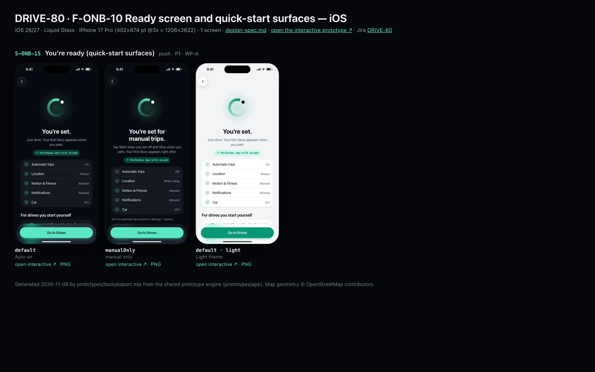
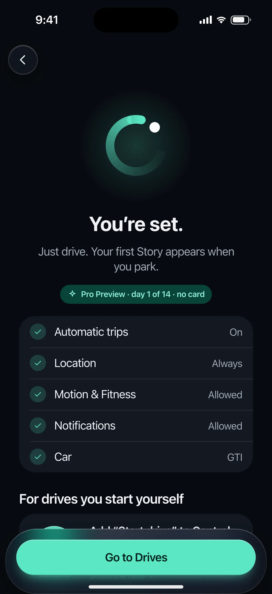
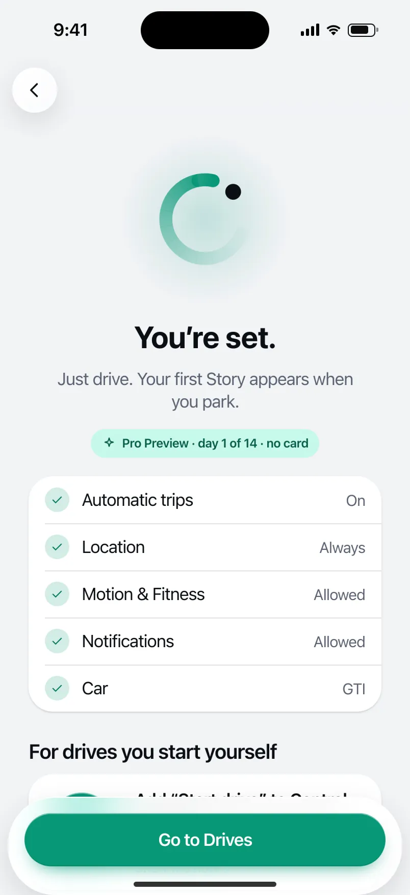

# DRIVE-80 · F-ONB-10 Ready screen and quick-start surfaces — iOS design spec

> Generated by `prototypes/tools/export.mjs` on 2026-11-06 from the shared prototype engine. **Do not edit by hand:** change the screen's `spec` in `prototypes/app/screens/wp-*.js` (see `prototypes/app/AUTHORING.md`) and re-export.

- **Jira story:** [DRIVE-80](https://thekeval.atlassian.net/browse/DRIVE-80) · F-ONB-10 · P1
- **Platform:** iOS 26/27 · Liquid Glass · iPhone 17 Pro (402×874 pt @3x = 1206×2622)
- **Interactive prototype:** [../../../../prototypes/ios/index.html#S-ONB-15](../../../../prototypes/ios/index.html#S-ONB-15) (catalog panel: every screen and state; deep links `#S-ID/state?trip=…&ent=…&theme=light&text=xl&rm=1`)
- **Contact sheet:** [mockup.html](mockup.html) · 
- **Design system (source of truth for values):** [brand](../../system/brand.md) · [components](../../system/components.md) · [motion](../../system/motion.md) · [accessibility](../../system/accessibility.md) · [screen map](../../system/screen-map.md) · [fixtures](../../system/fixtures.md) · tokens `prototypes/shared/tokens.css`

## Screens in this story

| Screen | Name | Presentation | Priority | States | Status |
|---|---|---|---|---|---|
| `S-ONB-15` | You’re ready (quick-start surfaces) | Full | P1 | 2 | Prototyped |

## Tokens used on this platform

Values resolved from `prototypes/shared/tokens.css` inside the iOS device (`[data-platform="ios"]`). Use the token names in code; the hex values are for reference.

| Token | Dark | Light |
|---|---|---|
| `--app-bg` | `#080B10` | `#F2F3F6` |
| `--card-bg` | `#131822` | `#FFFFFF` |
| `--dp-bg-grouped` | `#080B10` | `#F2F3F6` |
| `--dp-surface` | `#131822` | `#FFFFFF` |
| `--dp-surface-2` | `#1B222D` | `#F2F3F6` |
| `--dp-surface-3` | `#262E3B` | `#E4E7EC` |
| `--dp-fill` | `#7880961F` | `#7880961F` |
| `--dp-fill-strong` | `#7880963D` | `#78809633` |
| `--dp-text` | `#F2F4F7` | `#0B0E13` |
| `--dp-text-2` | `#A3AAB6` | `#5A6271` |
| `--dp-text-3` | `#6E7787` | `#8A919D` |
| `--dp-separator` | `#96A0B429` | `#3C435024` |
| `--dp-accent` | `#5BE7C4` | `#079777` |
| `--dp-accent-text` | `#5BE7C4` | `#06775E` |
| `--dp-on-accent` | `#04241D` | `#FFFFFF` |
| `--dp-accent-container` | `#0A4439` | `#C6F8EA` |
| `--dp-record` | `#FFC24B` | `#9A6300` |
| `--dp-positive` | `#5BE7C4` | `#06775E` |
| `--dp-change-down` | `#A3AAB6` | `#5A6271` |
| `--dp-warning` | `#F5B648` | `#9A5F00` |
| `--dp-critical` | `#FF6B6B` | `#C62828` |
| `--dp-glass-fill` | `#1C222C6B` | `#FFFFFF8C` |
| `--dp-glass-fill-strong` | `#1C222CB8` | `#FFFFFFD1` |
| `--dp-glass-stroke` | `#FFFFFF24` | `#FFFFFF99` |
| `--dp-data-route` | `#5BE7C4` | `#079777` |
| `--dp-data-event-brake` | `#FF7A66` | `#A21F16` |
| `--dp-data-event-accel` | `#E58BD0` | `#A33A8C` |
| `--dp-data-event-corner` | `#EAD54E` | `#9A8A00` |
| `--dp-data-quality-good` | `#5FDB9C` | `#1E9E62` |
| `--dp-data-speed` | `#D6DCE4` | `#404A58` |
| `--dp-data-long-g` | `#5AB8F5` | `#0A6AB8` |
| `--dp-data-lat-g` | `#F5A142` | `#B25A00` |

| Type / layout token | Value |
|---|---|
| `--dp-font-screen-title` | `700 34px / 41px -apple-system, BlinkMacSystemFont, "SF Pro Display", system-ui, sans-serif` |
| `--dp-font-sheet-title` | `700 22px / 28px -apple-system, BlinkMacSystemFont, "SF Pro Display", system-ui, sans-serif` |
| `--dp-font-section-title` | `600 20px / 25px -apple-system, BlinkMacSystemFont, "SF Pro Display", system-ui, sans-serif` |
| `--dp-font-card-title` | `600 17px / 22px -apple-system, BlinkMacSystemFont, "SF Pro Text", system-ui, sans-serif` |
| `--dp-font-body` | `400 17px / 22px -apple-system, BlinkMacSystemFont, "SF Pro Text", system-ui, sans-serif` |
| `--dp-font-body-secondary` | `400 15px / 20px -apple-system, BlinkMacSystemFont, "SF Pro Text", system-ui, sans-serif` |
| `--dp-font-meta` | `400 13px / 18px -apple-system, BlinkMacSystemFont, "SF Pro Text", system-ui, sans-serif` |
| `--dp-font-caption` | `400 12px / 16px -apple-system, BlinkMacSystemFont, "SF Pro Text", system-ui, sans-serif` |
| `--dp-font-button` | `600 17px / 22px -apple-system, BlinkMacSystemFont, "SF Pro Text", system-ui, sans-serif` |
| `--dp-num-hero` | `600 72px / 72px -apple-system, BlinkMacSystemFont, "SF Pro Display", system-ui, sans-serif` |
| `--dp-num-xl` | `600 48px / 52px -apple-system, BlinkMacSystemFont, "SF Pro Display", system-ui, sans-serif` |
| `--dp-num-l` | `600 34px / 38px -apple-system, BlinkMacSystemFont, "SF Pro Display", system-ui, sans-serif` |
| `--dp-num-m` | `600 24px / 28px -apple-system, BlinkMacSystemFont, "SF Pro Display", system-ui, sans-serif` |
| `--dp-num-s` | `600 17px / 22px -apple-system, BlinkMacSystemFont, "SF Pro Display", system-ui, sans-serif` |
| `--dp-num-xs` | `600 13px / 16px -apple-system, BlinkMacSystemFont, "SF Pro Display", system-ui, sans-serif` |
| `--dp-screen-margin` | `16px` |
| `--dp-radius-card` | `24px` |
| `--dp-radius-card-hero` | `32px` |
| `--dp-radius-sheet` | `38px` |
| `--dp-radius-chip` | `999px` |
| `--dp-radius-button` | `999px` |
| `--dp-layout-list-row-min` | `52px` |
| `--dp-layout-touch-min` | `44px` |
| `--safe-top` | `62px` |
| `--safe-bottom` | `34px` |

Text sizes scale with `--dp-text-scale` (XL = 2.0×) and numerals with `--dp-num-scale` (XL = 1.3×). DP Numerals: SF Pro Expanded Semibold, tabular.

---

## S-ONB-15 · You’re ready (quick-start surfaces)

 

- **Presentation:** push — screen map: “Full”
- **Entry points:** S-ONB-14
- **Leads to:** S-NAV-01 → S-HOME-01 (first run, Prev day 1)
- **PRD features:** F-ONB-10 · **Priority:** P1 · **WP:** A
- **Interactive:** [S-ONB-15](../../../../prototypes/ios/index.html#S-ONB-15)

**Purpose.** Close onboarding with what happens next (F-ONB-10): “You’re set. Just drive. Your first Story appears when you park.”, a summary of what was granted, and the quick-start surfaces for starting a trip without opening the app.

### States

| State | PRD label | Fixture params | Screenshot |
|---|---|---|---|
| `default` | Auto on | — | [S-ONB-15.png](../../screens/ios/S-ONB-15.webp) · [open](../../../../prototypes/ios/index.html#S-ONB-15) |
| `manualOnly` | manual only | — | [S-ONB-15--manualOnly.png](../../screens/ios/S-ONB-15--manualOnly.webp) · [open](../../../../prototypes/ios/index.html#S-ONB-15/manualOnly) |
| default · light | Light theme | `theme=light` | [S-ONB-15--light.png](../../screens/ios/S-ONB-15--light.webp) |

Every state also renders in light/dark (`theme=light`), XL text (`text=xl`) and reduced motion (`rm=1`).

### Layout

- Top bar: Back only (no progress: this is the end). Centred hero.
- Art: The Loop 128 (XL 96) drawing on: it bookends the welcome screen.
- Title “You’re set.” (manual: “You’re set for manual trips.”) + lead (PRD copy).
- Preview chip: sparkle + “Pro Preview · day 1 of 14 · no card” (Pro chip style, Glide on accent container, never gold).
- Summary list (inset grouped / segmented ListItems): Automatic trips · Location · Motion & Fitness (Physical activity) · Notifications · Car, each with a status disc (check = on, minus = off) and the value as text.
- Section “For drives you start yourself” (manual: “Start faster”): two tappable cards — iOS: a Control Center button mock (64, glass, record glyph, “Start drive”) “Add “Start drive” to Control Center”; Android: a Quick Settings tile mock “Add the Quick Settings tile” — and a small-widget mock “Add the DrivePerf widget”. Each ends with “Show me how ›”.
- Dock: “Go to Drives”.

### Components & tokens

| Component | Tokens / spec |
|---|---|
| `page` | --dp-bg-grouped (iOS) / --md-sys-color-surface (Android) · --dp-screen-margin 16 |
| `list` | iOS inset grouped radius --dp-radius-card, rows 52 pt, separators --dp-separator inset 16 · Android ListItem 56/72 dp in --md-sys-color-surface-container |
| `row` | --dp-font-body · --dp-font-meta (supporting) · --dp-layout-list-row-min |
| `chip` | --dp-radius-chip (iOS capsule · Android 8) · height 28 · --dp-font-caption |
| `qsTile` | see components.md |
| `widget` | see components.md |
| `button` | --dp-accent / --dp-on-accent (filled) · --dp-fill-strong · --md-sys-color-secondary-container (tonal) · --dp-radius-button · height iOS 50/44/34 · Android 56/40/32 · --dp-font-button · components.md §0 |

### Interactions & navigation

- “Go to Drives” → S-NAV-01 shell, Drives tab S-HOME-01/firstRunEmpty with ent=preview (Pro Preview day 1); manual only also sets capture=manual (accessory/toolbar shows Manual mode). Onboarding is removed from the back stack.
- Quick-start cards → iOS S-LIVE-03 (Control Center control) / S-LIVE-04 (widgets) · Android S-LIVE-07 (QS tile) / S-LIVE-08 (widget). In the app they open a short how-to; tiles cannot be added programmatically except via TileService.requestAddTileService (Android 13+), which the Android card uses.

### Motion

- Hero motion: The Loop draws on (1300 ms) with the G-dot gliding into its lead. Haptic success on “Go to Drives”; Drives fades through (Android) / cross-fades (iOS).
- RM: final mark, 220 ms cross-fade.

### Accessibility

- Summary rows read “Automatic trips, On”. Status discs pair a glyph (check / minus) with the text value.
- Quick-start cards are buttons: “Add Start drive to Control Center. Start a trip without opening the app.”
- Focus order: Back → step progress (“Setup, step n of N”) → title → body → primary → secondary. XL: art shrinks to 60%, title and copy wrap, the dock stays pinned and scrolls content under it; nothing truncates. Every glyph in a checklist is paired with its text (colour is never the only signal).

### Platform notes

- **iOS (this spec):** Control Center control (ControlWidget “Start drive”, F-CAP-10) + WidgetKit widget tip; Location value “Always”.
- *Android (for reference):* Quick Settings tile (TileService, F-CAP-13) with requestAddTileService on Android 13+, Glance widget tip; Location value “All the time”.

### Analytics

- `onboarding_completed {auto_on, precise, motion, notifications}`

### Copy

| Key | Text |
|---|---|
| Auto on | You’re set. Just drive. Your first Story appears when you park. |
| Manual only | You’re set for manual trips. Tap Start when you set off and Stop when you park. Your first Story appears right after. |
| Preview | Pro Preview · day 1 of 14 · no card |
| Quick start iOS | Add “Start drive” to Control Center · Add the DrivePerf widget |
| Quick start Android | Add the Quick Settings tile · Add the DrivePerf widget |
| Primary | Go to Drives |

### Free / Pro

Pro Preview starts at install (14 days, no card, Gate 2 OQ-08); the chip states day 1. No paywall here.

### Data & fixtures

Summary values are the onboarding results (default = all granted, car GTI from DP_DATA.vehicles gti; car=mycar → “My car”). Preview day from entitlement.states.preview with day 1.

### Assets

[icon-check.svg](assets/icon-check.svg) · [icon-minus.svg](assets/icon-minus.svg) · [icon-record.svg](assets/icon-record.svg) · [icon-sparkle.svg](assets/icon-sparkle.svg) · [icon-chevronRight.svg](assets/icon-chevronRight.svg) · [logo-a-loop.svg](assets/logo-a-loop.svg)

UI glyphs may be swapped for SF Symbols / Material Symbols Rounded equivalents; event-pin, quality and provenance glyphs must not be (components.md global rules).

### Checklist (accessibility.md §9)

- [ ] Light and dark both render, and contrast passes.
- [ ] The XL text state reflows with no truncation.
- [ ] The RM state is defined.
- [ ] Every control has a label; every chart and map has a summary sentence.
- [ ] Every target ≥ 44 pt / 48 dp (≥ 64 in-drive).
- [ ] No meaning by colour alone.
- [ ] Speed is neutral wherever it appears and absent from social or live surfaces.
- [ ] No streak, leaderboard, speed or “beat your time” language.
- [ ] Behaviour is defined while a trip is active (D1 gate).
- [ ] Haptics come from motion.md §6 only.

---

Map geometry in the prototype: © OpenStreetMap contributors (ODbL). Speed and G are simulated fixtures (fixtures.md).
