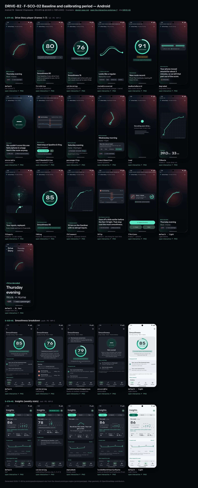
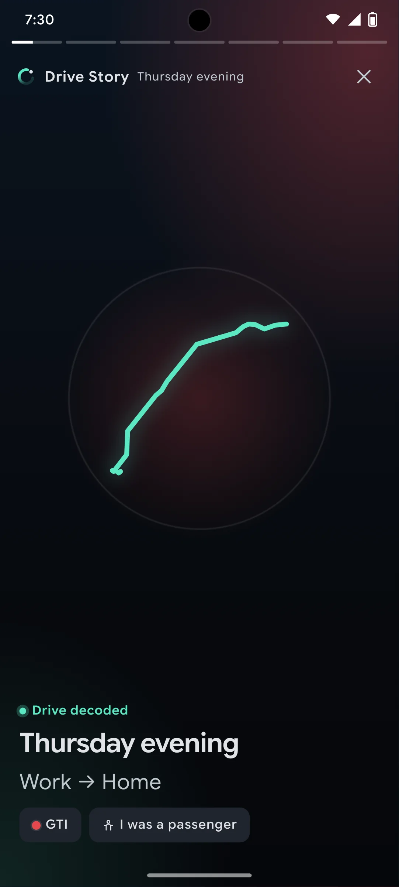
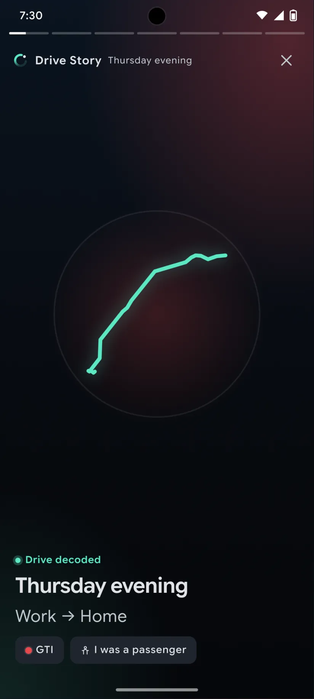
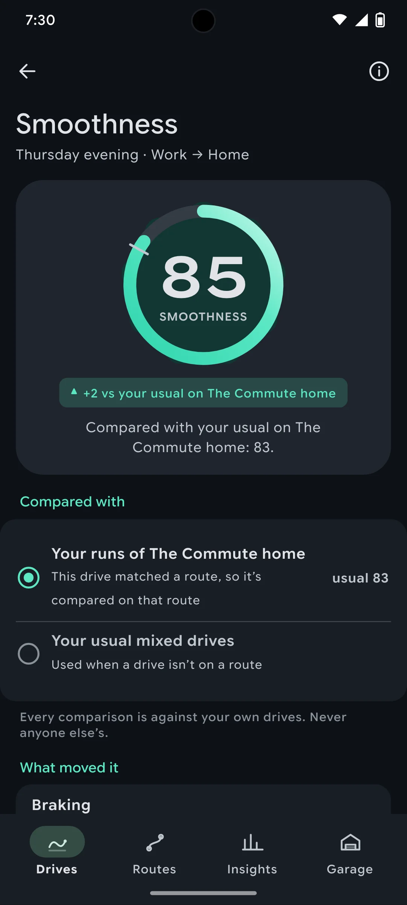
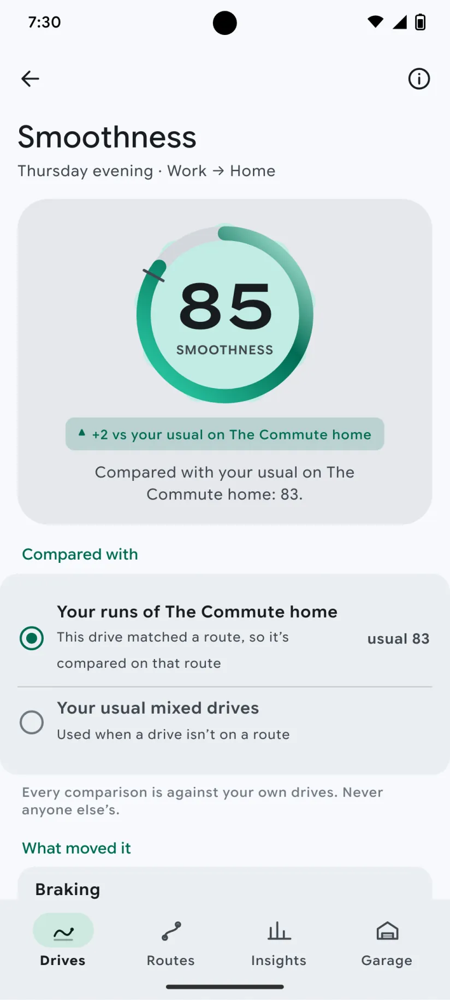
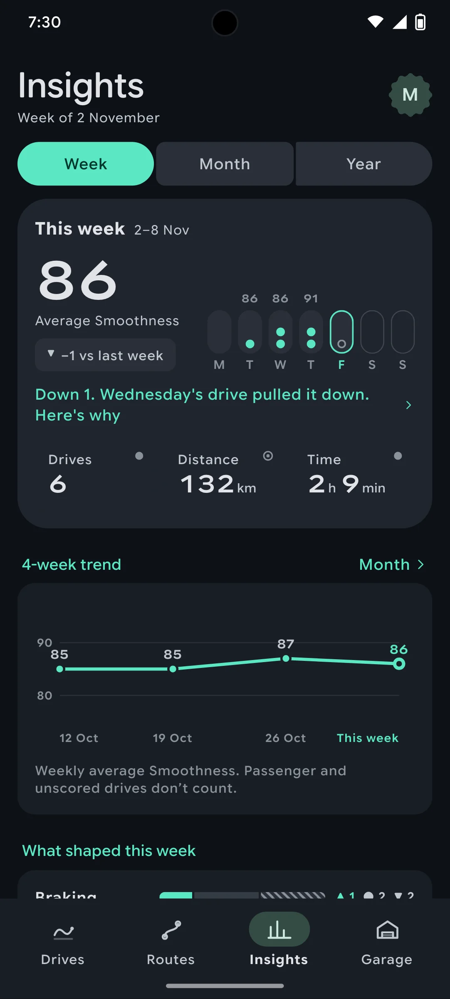
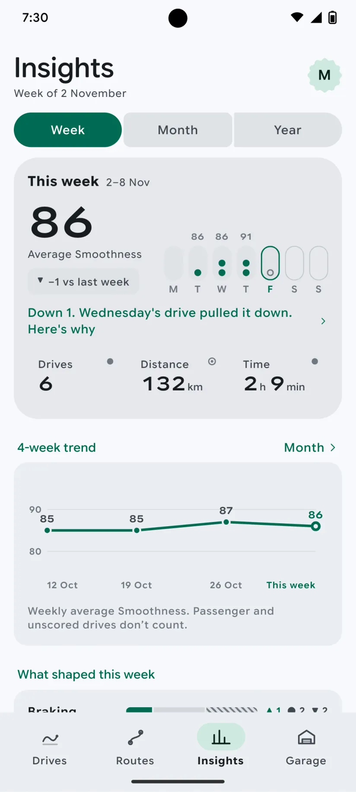

# DRIVE-82 · F-SCO-02 Baseline and calibrating period — Android design spec

> Generated by `prototypes/tools/export.mjs` on 2026-11-06 from the shared prototype engine. **Do not edit by hand:** change the screen's `spec` in `prototypes/app/screens/wp-*.js` (see `prototypes/app/AUTHORING.md`) and re-export.

- **Jira story:** [DRIVE-82](https://thekeval.atlassian.net/browse/DRIVE-82) · F-SCO-02 · P0
- **Platform:** Android 16 · Material 3 Expressive · 412×915 dp @2.625 (≈ 1081×2402)
- **Interactive prototype:** [../../../../prototypes/android/index.html#S-STY-01](../../../../prototypes/android/index.html#S-STY-01) (catalog panel: every screen and state; deep links `#S-ID/state?trip=…&ent=…&theme=light&text=xl&rm=1`)
- **Contact sheet:** [mockup.html](mockup.html) · 
- **Design system (source of truth for values):** [brand](../../system/brand.md) · [components](../../system/components.md) · [motion](../../system/motion.md) · [accessibility](../../system/accessibility.md) · [screen map](../../system/screen-map.md) · [fixtures](../../system/fixtures.md) · tokens `prototypes/shared/tokens.css`

## Screens in this story

| Screen | Name | Presentation | Priority | States | Status |
|---|---|---|---|---|---|
| `S-STY-01` | Drive Story player (frames 1–7) | Full (player) | P0 | 17 | Prototyped |
| `S-SCO-01` | Smoothness breakdown | Push | P0 | 4 | Prototyped |
| `S-STA-01` | Insights (weekly stats) | Root (Insights tab) | P0 | 4 | Prototyped |

## Tokens used on this platform

Values resolved from `prototypes/shared/tokens.css` inside the Android device (`[data-platform="android"]`). Use the token names in code; the hex values are for reference.

| Token | Dark | Light |
|---|---|---|
| `--app-bg` | `#0D1117` | `#F7F9FC` |
| `--card-bg` | `#191E25` | `#EBEEF2` |
| `--dp-bg-grouped` | `#0D1117` | `#F7F9FC` |
| `--dp-surface` | `#191E25` | `#EBEEF2` |
| `--dp-surface-2` | `#1F252D` | `#E5E8EC` |
| `--dp-surface-3` | `#2A3038` | `#DFE2E6` |
| `--dp-fill` | `#2A3038` | `#DFE2E6` |
| `--dp-fill-strong` | `#353B44` | `#D3D7DC` |
| `--dp-text` | `#E1E3E8` | `#181C20` |
| `--dp-text-2` | `#C0C7CF` | `#40474F` |
| `--dp-text-3` | `#8A929B` | `#707881` |
| `--dp-separator` | `#40474F` | `#C0C7CF` |
| `--dp-accent` | `#5BE7C4` | `#006B53` |
| `--dp-accent-text` | `#5BE7C4` | `#006B53` |
| `--dp-on-accent` | `#00382B` | `#FFFFFF` |
| `--dp-accent-container` | `#00513F` | `#91F1D8` |
| `--dp-record` | `#FFC24B` | `#7A5900` |
| `--dp-positive` | `#5BE7C4` | `#006B53` |
| `--dp-change-down` | `#C0C7CF` | `#40474F` |
| `--dp-warning` | `#F5B648` | `#7A5900` |
| `--dp-critical` | `#FFB4AB` | `#BA1A1A` |
| `--dp-glass-fill` | `#1F252DF2` | `#E5E8ECF2` |
| `--dp-glass-fill-strong` | `#2A3038` | `#DFE2E6` |
| `--dp-glass-stroke` | `#FFFFFF0F` | `#0000000A` |
| `--md-sys-color-primary` | `#5BE7C4` | `#006B53` |
| `--md-sys-color-on-primary` | `#00382B` | `#FFFFFF` |
| `--md-sys-color-primary-container` | `#00513F` | `#91F1D8` |
| `--md-sys-color-on-primary-container` | `#91F1D8` | `#002118` |
| `--md-sys-color-secondary-container` | `#344C44` | `#CEE9DF` |
| `--md-sys-color-surface` | `#0D1117` | `#F7F9FC` |
| `--md-sys-color-surface-container` | `#191E25` | `#EBEEF2` |
| `--md-sys-color-surface-container-high` | `#1F252D` | `#E5E8EC` |
| `--md-sys-color-on-surface-variant` | `#C0C7CF` | `#40474F` |
| `--dp-data-route` | `#5BE7C4` | `#079777` |
| `--dp-data-event-brake` | `#FF7A66` | `#A21F16` |
| `--dp-data-event-accel` | `#E58BD0` | `#A33A8C` |
| `--dp-data-event-corner` | `#EAD54E` | `#9A8A00` |
| `--dp-data-quality-good` | `#5FDB9C` | `#1E9E62` |
| `--dp-data-speed` | `#D6DCE4` | `#404A58` |
| `--dp-data-long-g` | `#5AB8F5` | `#0A6AB8` |
| `--dp-data-lat-g` | `#F5A142` | `#B25A00` |

| Type / layout token | Value |
|---|---|
| `--dp-font-screen-title` | `600 32px / 40px "Google Sans Flex", "Google Sans Display", "Roboto Flex", Roboto, system-ui, sans-serif` |
| `--dp-font-sheet-title` | `400 24px / 32px "Google Sans Flex", "Google Sans Display", "Roboto Flex", Roboto, system-ui, sans-serif` |
| `--dp-font-section-title` | `600 22px / 28px "Google Sans Flex", "Google Sans Display", "Roboto Flex", Roboto, system-ui, sans-serif` |
| `--dp-font-card-title` | `700 16px / 24px "Google Sans Flex", "Google Sans Text", "Roboto Flex", Roboto, system-ui, sans-serif` |
| `--dp-font-body` | `400 16px / 24px "Google Sans Flex", "Google Sans Text", "Roboto Flex", Roboto, system-ui, sans-serif` |
| `--dp-font-body-secondary` | `400 14px / 20px "Google Sans Flex", "Google Sans Text", "Roboto Flex", Roboto, system-ui, sans-serif` |
| `--dp-font-meta` | `400 12px / 16px "Google Sans Flex", "Google Sans Text", "Roboto Flex", Roboto, system-ui, sans-serif` |
| `--dp-font-caption` | `500 12px / 16px "Google Sans Flex", "Google Sans Text", "Roboto Flex", Roboto, system-ui, sans-serif` |
| `--dp-font-button` | `700 14px / 20px "Google Sans Flex", "Google Sans Text", "Roboto Flex", Roboto, system-ui, sans-serif` |
| `--dp-num-hero` | `600 72px / 72px "Google Sans Flex", "Roboto Flex", Roboto, system-ui, sans-serif` |
| `--dp-num-xl` | `600 48px / 52px "Google Sans Flex", "Roboto Flex", Roboto, system-ui, sans-serif` |
| `--dp-num-l` | `600 34px / 38px "Google Sans Flex", "Roboto Flex", Roboto, system-ui, sans-serif` |
| `--dp-num-m` | `600 24px / 28px "Google Sans Flex", "Roboto Flex", Roboto, system-ui, sans-serif` |
| `--dp-num-s` | `600 17px / 22px "Google Sans Flex", "Roboto Flex", Roboto, system-ui, sans-serif` |
| `--dp-num-xs` | `600 13px / 16px "Google Sans Flex", "Roboto Flex", Roboto, system-ui, sans-serif` |
| `--dp-screen-margin` | `16px` |
| `--dp-radius-card` | `16px` |
| `--dp-radius-card-hero` | `28px` |
| `--dp-radius-sheet` | `28px` |
| `--dp-radius-chip` | `8px` |
| `--dp-radius-button` | `999px` |
| `--dp-layout-list-row-min` | `56px` |
| `--dp-layout-touch-min` | `48px` |
| `--safe-top` | `40px` |
| `--safe-bottom` | `24px` |

Text sizes scale with `--dp-text-scale` (XL = 2.0×) and numerals with `--dp-num-scale` (XL = 1.3×). DP Numerals: Google Sans Flex wdth 120 wght 600, tabular.

---

## S-STY-01 · Drive Story player (frames 1–7)

 

- **Presentation:** full · tab: drives — screen map: “Full (player)”
- **Entry points:** S-NTF-01 "Drive decoded" · S-HOME-01 card · S-DRV-04 · S-TRP-01 "Story" · S-LIVE-04/08
- **Leads to:** f7: S-RPL-01 (Explore) · S-SHR-01 (Share) · Done → caller · chips: S-RTE-03, S-SCO-03, S-TRP-02 (passenger/car), S-DQ-01
- **PRD features:** F-STY-01, F-STY-03, F-STY-04, F-STY-06, F-SCO-01, F-SCO-02, F-SCO-05, F-SCO-06, F-RTE-01, F-RTE-03, F-HIS-02, F-GAR-02, F-CAP-04, F-DQ-02, F-DQ-04, F-SHR-01, F-DQ-01 · **Priority:** P0 · **WP:** C
- **Interactive:** [S-STY-01](../../../../prototypes/android/index.html#S-STY-01)

**Purpose.** The “wow” after every drive (F-STY-01): a ~15 s full-screen Story that leads with what went well, scores the drive against the user’s own baseline, then gives exactly one tip. No speed or max speed appears in any frame (F-STY-01.3).

### States

| State | PRD label | Fixture params | Screenshot |
|---|---|---|---|
| `default` | Def (frame 1) | `trip=t20261105-1745` | [S-STY-01.png](../../screens/android/S-STY-01.webp) · [open](../../../../prototypes/android/index.html#S-STY-01) |
| `firstDrive` | First drive (baseline) | `trip=t20260928-1842` | [S-STY-01--firstDrive.png](../../screens/android/S-STY-01--firstDrive.webp) · [open](../../../../prototypes/android/index.html#S-STY-01/firstDrive) |
| `calibrating` | Calibrating (2 of 3) | `trip=t20260929-0738` | [S-STY-01--calibrating.png](../../screens/android/S-STY-01--calibrating.webp) · [open](../../../../prototypes/android/index.html#S-STY-01/calibrating) |
| `routeDiscovered` | Route discovered (merge + name) | `trip=t20261002-0745` | [S-STY-01--routeDiscovered.png](../../screens/android/S-STY-01--routeDiscovered.webp) · [open](../../../../prototypes/android/index.html#S-STY-01/routeDiscovered) |
| `newRouteRecord` | New route record | `trip=t20261105-0742` | [S-STY-01--newRouteRecord.png](../../screens/android/S-STY-01--newRouteRecord.webp) · [open](../../../../prototypes/android/index.html#S-STY-01/newRouteRecord) |
| `degraded` | Degraded (Part) | `trip=t20261027-1728` | [S-STY-01--degraded.png](../../screens/android/S-STY-01--degraded.webp) · [open](../../../../prototypes/android/index.html#S-STY-01/degraded) |
| `unscorable` | Unscorable | `trip=t20261106-1210` | [S-STY-01--unscorable.png](../../screens/android/S-STY-01--unscorable.webp) · [open](../../../../prototypes/android/index.html#S-STY-01/unscorable) |
| `wasItNeededInline` | “Was it needed?” inline | `trip=t20261020-0740` | [S-STY-01--wasItNeededInline.png](../../screens/android/S-STY-01--wasItNeededInline.webp) · [open](../../../../prototypes/android/index.html#S-STY-01/wasItNeededInline) |
| `passengerChip` | Passenger chip | `trip=t20261031-1905` | [S-STY-01--passengerChip.png](../../screens/android/S-STY-01--passengerChip.webp) · [open](../../../../prototypes/android/index.html#S-STY-01/passengerChip) |
| `transitQuestion` | Transit question | `trip=t20261104-0650` | [S-STY-01--transitQuestion.png](../../screens/android/S-STY-01--transitQuestion.webp) · [open](../../../../prototypes/android/index.html#S-STY-01/transitQuestion) |
| `Load` | Load | `trip=t20261105-1745` | [S-STY-01--Load.png](../../screens/android/S-STY-01--Load.webp) · [open](../../../../prototypes/android/index.html#S-STY-01/Load) |
| `f2Route` | Frame 2 · route draw-on | `trip=t20261105-1745` | [S-STY-01--f2Route.png](../../screens/android/S-STY-01--f2Route.webp) · [open](../../../../prototypes/android/index.html#S-STY-01/f2Route) |
| `f3Inputs` | Frame 3 · G-dot replay | `trip=t20261105-1745` | [S-STY-01--f3Inputs.png](../../screens/android/S-STY-01--f3Inputs.webp) · [open](../../../../prototypes/android/index.html#S-STY-01/f3Inputs) |
| `f4Ring` | Frame 4 · Smoothness ring | `trip=t20261105-1745` | [S-STY-01--f4Ring.png](../../screens/android/S-STY-01--f4Ring.webp) · [open](../../../../prototypes/android/index.html#S-STY-01/f4Ring) |
| `f5Cleanest` | Frame 5 · cleanest stretch | `trip=t20261105-1745` | [S-STY-01--f5Cleanest.png](../../screens/android/S-STY-01--f5Cleanest.webp) · [open](../../../../prototypes/android/index.html#S-STY-01/f5Cleanest) |
| `f6Tip` | Frame 6 · one thing for next time | `trip=t20261105-1745` | [S-STY-01--f6Tip.png](../../screens/android/S-STY-01--f6Tip.webp) · [open](../../../../prototypes/android/index.html#S-STY-01/f6Tip) |
| `f7Actions` | Frame 7 · actions | `trip=t20261105-1745` | [S-STY-01--f7Actions.png](../../screens/android/S-STY-01--f7Actions.webp) · [open](../../../../prototypes/android/index.html#S-STY-01/f7Actions) |
| default · light | Light theme | `theme=light` | [S-STY-01--light.png](../../screens/android/S-STY-01--light.webp) |
| default · XL | Largest text | `text=xl` | [S-STY-01--xl.png](../../screens/android/S-STY-01--xl.webp) |

Every state also renders in light/dark (`theme=light`), XL text (`text=xl`) and reduced motion (`rm=1`).

### Layout

- Full-screen player, always on the night stage (`--dp-gradient-night-sky`) with a car-colour wash (radial 30% of `--dp-car-{colour}` top-trailing, 14% Glide bottom-leading). Status bar light. Dark tokens are forced inside the player in both themes.
- Top (safe-top + 4): progress segments (3 px, gap 4, white 26% track, white fill) · header row: Loop mark 22 + “Drive Story” (14/600) + part of day (meta, text2) + glass close button (44).
- Frame stage: art region (flex, centred) above a bottom-left copy block: kicker (13/600, accent-text) · `storyHeadline` (28/34 iOS bold, 28/36 Android) · `storyBody` (20/25, text2) · chip row. Bottom padding safe-bottom + 24.
- f1 title: route glyph 250 (share-safe trip.glyph, Glide 5 px) · kicker “● Drive decoded” · part of day (headline) · route label (body) · car chip + “I was a passenger” chip (glass).
- f2 route: plain-canvas map, full width − 40, ≤ 380 tall, radius 28, estimated start dashed, “© OpenStreetMap contributors” · two DP Numerals 48 (“39.0 km” “33 min”) counting up.
- f3 inputs: friction circle 260 (±0.6 g, rings at 0.1 g, 0.3/0.5 labelled) with the G-dot and a 1.2 s trail; under it a 112-tall mini map with the tracking tick (marker).
- f4 ring: Smoothness ring 224 (stroke 15, baseline notch, gold record notch) · comparison chip (and gold “New route record” chip) · “Score based on 31 of 34 min” with the quality glyph for Limited trips. Tap the ring → S-SCO-01.
- f5 cleanest stretch: the map with the route dimmed to 45% and the cleanest span drawn in Glide 200 with a 14 px glow · kicker “✦ Cleanest stretch”.
- f6 tip: glass trace card (event pin 22 + type + place, the −10…+10 s evidence trace, legend) · kicker “One thing for next time” · tip as headline · chips “See the moment” → S-RPL-02, “More on this tip” → S-SCO-04.
- Variant frames: fDegraded (coverage strip with the hatched excluded span) · fUnscorable (dashed ring “—”, Why not? → S-DQ-01) · fRoute (two Glide lines merging + chips Commute/Gym/School run/Custom… → S-RTE-03) · fNeeded (evidence trace + “Yes, it was needed” / “No”, inline confirmation).
- f7 end: glass summary card (glyph 52 · label · part of day · car · km · min · ring 64) · full quality badge (“Good data · phone mounted”) · first-drive loop card · actions: Explore the drive (filled large, block) · Share + Done (glass large, side by side). Passenger trips drop Share.
- Load: Loop loader 64 (iOS) / M3E shape loader (Android) + “Decoding your drive…” + skeleton lines; segments empty.

### Components & tokens

| Component | Tokens / spec |
|---|---|
| `ring` | track --dp-fill-strong · arc --dp-gradient-ring (glide-400 → accent → glide-100) · baseline notch --dp-text-2 · record notch --dp-record · Android container Cookie9Sided --md-sys-color-primary-container 42% · components.md §3 |
| `deltaChip` | better: --dp-accent-text on --dp-accent 18% · lower: --dp-text-2 on --dp-fill (never red) · record: --dp-record on --dp-record 18% · components.md §4 |
| `chip` | --dp-radius-chip (iOS capsule · Android 8) · height 28 · --dp-font-caption |
| `carChip` | see components.md |
| `glyph` | see components.md |
| `map` | --dp-data-map-land/road/grid · route --dp-data-route 3.8 + casing --dp-data-route-casing 7.5 · estimated dashed 4/4 at 60% · gap --dp-data-gap-stroke dotted 1/6 · pins DP_ICONS.pin 26 · attribution “© OpenStreetMap contributors” |
| `evidenceTrace` | see components.md |
| `qualityBadge` | --dp-data-quality-{good\|usable\|limited\|unscorable} · components.md §10 |
| `button` | --dp-accent / --dp-on-accent (filled) · --dp-fill-strong · --md-sys-color-secondary-container (tonal) · --dp-radius-button · height iOS 50/44/34 · Android 56/40/32 · --dp-font-button · components.md §0 |
| `iconButton` | see components.md |
| `loader` | see components.md |
| `skeleton` | --dp-fill-strong, breathe 1.2 s (dp-skeleton) |
| `gg (local ggSvg)` | see components.md |
| `coverageStrip (local)` | see components.md |

### Interactions & navigation

- Tap the right 68% → next frame; tap the left 32% → previous; press and hold → pause (segment freezes); swipe down → exit (content scales to 0.9 and rounds its corners with the drag, commits past 120 pt with haptic gestureEnd); close button → back to the caller.
- f1: car chip → S-TRP-02/carPicker · “I was a passenger” → S-TRP-02/typePicker (≤ 2 taps, F-HIS-02.4) · transit question chips Bus/Train/Streetcar → moved to Not drives (toast + Undo, back) · “No, I drove” → dismisses the question.
- f4: ring → S-SCO-01 · “New route record” chip → S-RTE-02 · f6: “See the moment” → S-RPL-02/thisDrivesTip · “More on this tip” → S-SCO-04 · f5/fDegraded/fUnscorable badges → S-DQ-01 · placement chip → S-DQ-02.
- fRoute chips → S-RTE-03 (preset name) or S-RTE-03/custom · fNeeded “Yes, it was needed” → marks it inline, the score recomputes ≤ 1 s and the Story continues (F-STY-04.3); “No” → next frame; “Not sure?” → S-SCO-03.
- f7: Explore the drive → S-RPL-01 · Share → S-SHR-01 · Done → back. Quality badge → S-DQ-01. No paywall, share prompt or rating prompt ever follows a Story (D12, F-SUB-08).
- D1 gate: opened while moving or during a driver trip → S-DRV-05 (“Your Story will be ready when you’ve parked.”), which opens the Story once stationary for 60 s.
- Deep link a frame: `#S-STY-01?trip=…&frame=f4`.

### Motion

- Segments fill linearly over the frame duration (3 s; 3.5 s for f2/f3; 6 s for question frames; ×1.5 at XL); f7 waits.
- Frame change: outgoing frame fades (220 ms); incoming copy rises 12 px line by line (60 ms stagger, spring.default) while the frame’s hero runs.
- Heroes: f1 glyph draw-on 1100 ms · f2 route draw-on 1800 ms (ease.drawOn) + numbers count up 1200 ms (ease.countUp) · f3 G-dot replay 3000 ms (shared.gMeter ζ 0.55 k 120, 1.2 s tapering trail, cloud fades in and the envelope draws on at the end) · f4 ring reveal 1400 ms with baseline notch, record notch flip + doubleSuccess haptic, chip pop at 1600 ms · f5 cleanest-stretch draw-on · f6 trace draw-on · fRoute lines slide 14 px together (spring.default) then chips pop (spring.fast, 40 ms stagger).
- RM: 220 ms cross-fades; route, ring and numbers appear complete; f3 shows the static G-G plot with the trail (F-STY-06.2); auto-advance continues (tap and hold still pause). Haptics kept except ring ticks.

### Accessibility

- Each frame is one focusable element whose label is the full frame copy, e.g. “Frame 4 of 7. Smoothness 85. 2 above your usual on The Commute home.” Focus pauses auto-advance (F-STY-06.1); actions Next frame / Previous frame / Close.
- f3 summary: “Your inputs, replayed. Mostly gentle, with 2 firm stops.” (derived from the trip’s events).
- Focus is trapped inside the player until closed. Tap zones are buttons “Previous frame” / “Next frame”.
- XL: the copy block grows upward and the art shrinks (zoom 0.62); frames run 1.5× longer; nothing truncates.
- Never colour alone: ▲/▼/● on chips, rosette on records, hatched + dashed spans in the coverage strip, glyphs on quality badges.

### Platform notes

- **Android (this spec):** Full-screen dialog destination with fade-rise; tonal surface-container-high chips (no blur); Google Sans Flex story styles (28/36 600, body 22/28); ring sits on the Cookie9Sided primaryContainer shape that rotates during the count; M3E loading indicator for Load; Explore = filled button with shape morph, Share/Done = tonal.
- *iOS (for reference):* fullScreenCover; glass chips and glass close button (`.glassEffect(.clear)` over art with a 35% dim); SF Pro Display Bold story headline; Loop loader for Load; buttons glassProminent (Explore) and glass (Share/Done).

### Analytics

- `story_opened {source}`
- `story_frame_viewed {frame}`
- `story_completed`
- `story_action {action: explore|share|done}`
- `story_variant {degraded|unscorable}`
- `event_marked_needed {type, source: story}`
- `trip_flagged_transit`
- `trip_corrected {to: transit|passenger}`
- `a11y_story_mode {screen_reader, reduce_motion}`

### Copy

| Key | Text |
|---|---|
| f1 | {partOfDay} · {label} (trip.story.frames.f1.title) · kicker “Drive decoded” · chips “{car}” · “I was a passenger” |
| f2 | {distance} km · {duration} min (frames.f2.line) |
| f3 | Your inputs, replayed. / Every brake and turn in 3 seconds. |
| f4 | Smoothness {n} · {compareText} · record: “New route record.” + “{n} on {route}, beating {m} from {date}.” · first drive: “Your baseline. Every drive from here is compared to you, not to anyone else.” · calibrating: “Calibrating your baseline · k of 3” |
| f5 | Cleanest stretch: {km} km on {road} with no abrupt inputs. |
| f6 | One thing for next time: {tip} |
| fDegraded | Your phone moved around for about 3 minutes, so we left that part out of the score. |
| fUnscorable | We couldn’t score this one fairly (phone in a bag). Here’s the route anyway. |
| fRoute | Looks like a regular. Name this route? · Commute · Gym · School run · Custom… |
| fNeeded | Hard stop at Spadina & King. Was it needed? · Yes, it was needed · No · done: “Marked as needed. It doesn’t count. Your Smoothness is 83 without it.” |
| Transit | Was this a bus or train? It stopped and started like transit. If it was, we’ll leave it out of your scores. · Bus · Train · Streetcar · No, I drove |
| Passenger | Passenger · not scored · Change — Not scored, and it doesn’t count toward your baseline, routes or recaps. |
| f7 | Explore the drive · Share · Done · {badge} data · phone {state} · first drive: “That’s the loop. Every drive gets a Story. Explore it in Replay, and repeat trips become Routes.” |
| Load | Decoding your drive… Building the replay |

### Free / Pro

Free on every trip, forever (F-STY-01). Explore the drive opens S-RPL-01; on Free for a trip older than 30 days the replay shows its own lock (S-SUB-03 replayAnalysis30Days), never the Story. No paywall after any Story, and never after a worse-than-usual one (F-SUB-08).

### Data & fixtures

Copy: trip.story.frames (exact). States → trips: default t20261105-1745 · firstDrive t20260928-1842 · calibrating t20260929-0738 (2 of 3) · routeDiscovered t20261002-0745 (fRoute) · newRouteRecord t20261105-0742 · degraded t20261027-1728 (fDegraded) · unscorable t20261106-1210 · wasItNeededInline t20261020-0740 (fNeeded, e3) · passengerChip t20261031-1905 · transitQuestion t20261104-0650 (no fixture trip is flagged as transit; the question is simulated on a stop-start trip). Frame order follows the fixture keys, except Unscorable (f1, f2, fUnscorable, f7 per F-STY-04.2; the fixture’s f3 is dropped) and passenger (f1, f2, f7: the G-dot replay would show someone else’s inputs). The f3 accessibility sentence and the G-dot path are derived from trip.track (lonG/latG) and trip.events.

### Assets

[icon-story.svg](assets/icon-story.svg) · [icon-close.svg](assets/icon-close.svg) · [icon-passenger.svg](assets/icon-passenger.svg) · [icon-replay.svg](assets/icon-replay.svg) · [icon-share.svg](assets/icon-share.svg) · [icon-routes.svg](assets/icon-routes.svg) · [icon-rosette.svg](assets/icon-rosette.svg) · [icon-info.svg](assets/icon-info.svg) · [icon-phone.svg](assets/icon-phone.svg) · [icon-check.svg](assets/icon-check.svg) · [icon-sparkle.svg](assets/icon-sparkle.svg) · [icon-pinStop.svg](assets/icon-pinStop.svg) · [logo-a-loop.svg](assets/logo-a-loop.svg)

UI glyphs may be swapped for SF Symbols / Material Symbols Rounded equivalents; event-pin, quality and provenance glyphs must not be (components.md global rules).

### Checklist (accessibility.md §9)

- [ ] Light and dark both render, and contrast passes.
- [ ] The XL text state reflows with no truncation.
- [ ] The RM state is defined.
- [ ] Every control has a label; every chart and map has a summary sentence.
- [ ] Every target ≥ 44 pt / 48 dp (≥ 64 in-drive).
- [ ] No meaning by colour alone.
- [ ] Speed is neutral wherever it appears and absent from social or live surfaces.
- [ ] No streak, leaderboard, speed or “beat your time” language.
- [ ] Behaviour is defined while a trip is active (D1 gate).
- [ ] Haptics come from motion.md §6 only.

---

## S-SCO-01 · Smoothness breakdown

 

- **Presentation:** push · tab: drives — screen map: “Push”
- **Entry points:** S-TRP-01 ring · S-STY-01 f4 tap
- **Leads to:** S-RPL-02 (contributor events) · S-SCO-02
- **PRD features:** F-SCO-01, F-SCO-02, F-SCO-03 · **Priority:** P0 · **WP:** C
- **Interactive:** [S-SCO-01](../../../../prototypes/android/index.html#S-SCO-01)

**Purpose.** Show which inputs moved the score, against the user’s own baseline (F-SCO-01/02/03): four contributors with evidence-linked reasons, and what the drive is compared with.

### States

| State | PRD label | Fixture params | Screenshot |
|---|---|---|---|
| `default` | Def | `trip=t20261105-1745` | [S-SCO-01.png](../../screens/android/S-SCO-01.webp) · [open](../../../../prototypes/android/index.html#S-SCO-01) |
| `calibrating` | Calibrating | `trip=t20260929-0738` | [S-SCO-01--calibrating.png](../../screens/android/S-SCO-01--calibrating.webp) · [open](../../../../prototypes/android/index.html#S-SCO-01/calibrating) |
| `routeVsContextComparison` | Route vs context comparison | `trip=t20261002-0745` | [S-SCO-01--routeVsContextComparison.png](../../screens/android/S-SCO-01--routeVsContextComparison.webp) · [open](../../../../prototypes/android/index.html#S-SCO-01/routeVsContextComparison) |
| `unscorable` | Unscorable | `trip=t20261106-1210` | [S-SCO-01--unscorable.png](../../screens/android/S-SCO-01--unscorable.webp) · [open](../../../../prototypes/android/index.html#S-SCO-01/unscorable) |
| default · light | Light theme | `theme=light` | [S-SCO-01--light.png](../../screens/android/S-SCO-01--light.webp) |

Every state also renders in light/dark (`theme=light`), XL text (`text=xl`) and reduced motion (`rm=1`).

### Layout

- Push (Drives tab), title “Smoothness” + part of day · label, ⓘ → S-SCO-02.
- Hero card: ring 168 (stroke 13, baseline notch, record notch) + comparison chip + record line (gold rosette) + basis sentence (“Compared with your usual on The Commute home: 83.”). Calibrating: dots chip + “We compare each drive with your own usual once we’ve seen three…”.
- “Compared with”: radio-style card with two options — the route’s runs vs usual city/highway/mixed drives — the used one selected with its usual value; footer “Every comparison is against your own drives.”
- “What moved it”: Braking · Acceleration · Cornering · Consistency rows (label 15/600, band chip ▲ Smoother than usual / ● Usual / ▼ Rougher than usual, reason in meta) with a chevron when there are events; open rows list their event rows → S-RPL-02.
- “Your last n runs of {route}”: area sparkline (Glide) ending at this drive.
- Links: How scores work · Braked for a good reason? (hint).
- Unscorable: dashed ring “—” + reason + “What would help” (S-DQ-02, S-DQ-01).

### Components & tokens

| Component | Tokens / spec |
|---|---|
| `navBar` | --dp-font-card-title · --dp-font-meta · glass: --dp-glass-fill + --dp-glass-blur · components.md §2 |
| `card` | --dp-surface / --md-sys-color-surface-container · --dp-radius-card (24 iOS · 16 Android) · hero: --dp-radius-card-hero (32 · 28) · light iOS: --dp-elev-1 |
| `ring` | track --dp-fill-strong · arc --dp-gradient-ring (glide-400 → accent → glide-100) · baseline notch --dp-text-2 · record notch --dp-record · Android container Cookie9Sided --md-sys-color-primary-container 42% · components.md §3 |
| `deltaChip` | better: --dp-accent-text on --dp-accent 18% · lower: --dp-text-2 on --dp-fill (never red) · record: --dp-record on --dp-record 18% · components.md §4 |
| `chip` | --dp-radius-chip (iOS capsule · Android 8) · height 28 · --dp-font-caption |
| `section` | --dp-font-section-title · --dp-layout-section-gap 28 |
| `eventRow` | pin 28 (shape = meaning) · meta --dp-num-xs · min height 44 · components.md §9.2 |
| `sparkline` | see components.md |
| `list` | iOS inset grouped radius --dp-radius-card, rows 52 pt, separators --dp-separator inset 16 · Android ListItem 56/72 dp in --md-sys-color-surface-container |
| `row` | --dp-font-body · --dp-font-meta (supporting) · --dp-layout-list-row-min |
| `banner` | radius 12 (--dp-radius-sm+) · info --dp-fill · attention --dp-warning-container · critical --dp-critical-container · components.md §22 |
| `iconButton` | see components.md |

### Interactions & navigation

- Contributor with events → expands its event rows (haptic tap); event row → S-RPL-02 (trip, event).
- ⓘ / How scores work → S-SCO-02 · placement → S-DQ-02 · quality → S-DQ-01.

### Motion

- Hero: ring reveal (motion.md §3.4), 1400 ms with baseline notch; contributor rows rise 8 px (30 ms stagger) after 300 ms; expansion uses spring.default. RM: static ring, instant expand.

### Accessibility

- Ring: “Smoothness 85. 2 above your usual on The Commute home.” Contributor rows: “Braking, rougher than usual. 2 abrupt stops on the Gardiner and Kerr St. Show events.”
- Bands carry ▲/●/▼ and words; “rougher” is neutral grey, never red.
- XL: contributor label and chip stack; sparkline keeps its text summary.

### Platform notes

- **Android (this spec):** MediumFlexibleTopAppBar; ring on Cookie9Sided; contributor rows as M3E segmented ListItems with expand icons.
- *iOS (for reference):* Inline title; hero card radius 32; inset-grouped contributor card.

### Analytics

- `score_viewed {surface: breakdown}`
- `contributor_tapped {contributor}`

### Copy

| Key | Text |
|---|---|
| Basis | Compared with your usual on {route}: {baseline}. \| Compared with your usual {context} drives: {baseline}. |
| Calibrating | Calibrating your baseline · k of 3. We compare each drive with your own usual once we’ve seen three, and make no trend claims before then. |
| Route vs context | {route} started here. A drive is compared on its route once that route exists. Before then, it’s compared with your usual drives of the same kind. |
| Footer | Every comparison is against your own drives. Never anyone else’s. |
| Unscorable | Not scored. {reason}. When the phone moves freely, we can’t tell its movement from the car’s, so any score would be a guess. |

### Free / Pro

Free on every trip, forever.

### Data & fixtures

trip.smoothness (score, baseline, delta, basis, routeName, calibrating, record, contributors[].eventIds). States: default t20261105-1745 · calibrating t20260929-0738 (2 of 3) · routeVsContextComparison t20261002-0745 (basis context; r_commute created that day) · unscorable t20261106-1210. The runs sparkline is derived from trips on the same routeId up to this drive.

### Assets

[icon-info.svg](assets/icon-info.svg) · [icon-rosette.svg](assets/icon-rosette.svg) · [icon-routes.svg](assets/icon-routes.svg) · [icon-phone.svg](assets/icon-phone.svg) · [icon-check.svg](assets/icon-check.svg) · [icon-up.svg](assets/icon-up.svg) · [icon-down.svg](assets/icon-down.svg)

UI glyphs may be swapped for SF Symbols / Material Symbols Rounded equivalents; event-pin, quality and provenance glyphs must not be (components.md global rules).

### Checklist (accessibility.md §9)

- [ ] Light and dark both render, and contrast passes.
- [ ] The XL text state reflows with no truncation.
- [ ] The RM state is defined.
- [ ] Every control has a label; every chart and map has a summary sentence.
- [ ] Every target ≥ 44 pt / 48 dp (≥ 64 in-drive).
- [ ] No meaning by colour alone.
- [ ] Speed is neutral wherever it appears and absent from social or live surfaces.
- [ ] No streak, leaderboard, speed or “beat your time” language.
- [ ] Behaviour is defined while a trip is active (D1 gate).
- [ ] Haptics come from motion.md §6 only.

---

## S-STA-01 · Insights (weekly stats)

 

- **Presentation:** root · tab: insights — screen map: “Root (Insights tab)”
- **Entry points:** Tab
- **Leads to:** S-STA-02 (Pro) or S-SUB-03 (Free) · S-SCO-05 · S-RCP-01 (latest recap card) · S-WRP-01 card
- **PRD features:** F-HIS-04, F-HIS-05, F-SCO-02 · **Priority:** P0 · **WP:** D
- **Interactive:** [S-STA-01](../../../../prototypes/android/index.html#S-STA-01)

**Purpose.** The Insights tab: a calm weekly view of driving and Smoothness — this week vs last, a 4-week line, what shaped the week, the current focus and the recap/Wrapped cards (F-HIS-04). Month, year, per-car and per-route trends are Pro and shown “locked, not lost” on Free (F-HIS-05, Gate 2 OQ-07).

### States

| State | PRD label | Fixture params | Screenshot |
|---|---|---|---|
| `default` | Def | — | [S-STA-01.png](../../screens/android/S-STA-01.webp) · [open](../../../../prototypes/android/index.html#S-STA-01) |
| `calibrating` | calibrating (Preview day 2, 2 of 3) | `ent=preview` | [S-STA-01--calibrating.png](../../screens/android/S-STA-01--calibrating.webp) · [open](../../../../prototypes/android/index.html#S-STA-01/calibrating) |
| `emptyWeek` | Empty week | — | [S-STA-01--emptyWeek.png](../../screens/android/S-STA-01--emptyWeek.webp) · [open](../../../../prototypes/android/index.html#S-STA-01/emptyWeek) |
| `lockOnMonthYearCarRoute` | Lock on Month/Year/Car/Route (Free) | `ent=free` | [S-STA-01--lockOnMonthYearCarRoute.png](../../screens/android/S-STA-01--lockOnMonthYearCarRoute.webp) · [open](../../../../prototypes/android/index.html#S-STA-01/lockOnMonthYearCarRoute) |
| default · light | Light theme | `theme=light` | [S-STA-01--light.png](../../screens/android/S-STA-01--light.webp) |

Every state also renders in light/dark (`theme=light`), XL text (`text=xl`) and reduced motion (`rm=1`).

### Layout

- Large title “Insights” (iOS 34 bold · Android LargeFlexibleTopAppBar with “Week of 2 November” subtitle); trailing Preview badge (when active) + avatar.
- Period selector: Week · Month · Year (iOS glass segmented, 36 tall · Android connected button group, 40 dp). On Free, Month and Year carry a lock glyph.
- Hero card (radius 32 / 28): “This week · 2–8 Nov”; average Smoothness (DP Numerals 48) + “Average Smoothness” + comparison chip (“▼ −1 vs last week”, neutral, never red); 7-day strip (dots per drive, best score above, today outlined, future days hollow); explain-don’t-blame link “Down 1. Wednesday’s drive pulled it down. Here’s why ›”; 3 stat tiles Drives · Distance · Time with provenance glyphs.
- “4-week trend” card: weekly averages as a Glide line with value labels, this week as the ringed last point; caption “Weekly average Smoothness. Passenger and unscored drives don’t count.” Section action “Month ›” (Pro) / “More in Pro ›” (Free).
- “What shaped this week”: four contributor rows (Braking · Acceleration · Cornering · Consistency), each a 3-part bar (▲ smoother / ● usual / ▼ rougher) with counts in text.
- “Your focus” card → S-SCO-05: habit name, “Gentler in 3 of 5 drives this week.”, a 3-week meter (share of gentler drives, not a streak).
- “Recaps”: latest weekly recap card → S-RCP-01 and the October Wrapped card → S-WRP-01.
- “Trends”: Pro = list rows Month · Year · By car · By route → S-STA-02 states. Free = lock panel with the user’s own October trend, car averages and route trend blurred 14 px + “See how your driving changes month to month with Pro.” + See plans, then the same rows with lock + PRO → S-SUB-03 trends.

### Components & tokens

| Component | Tokens / spec |
|---|---|
| `largeTitle` | --dp-font-screen-title (iOS 34/41 bold · Android 32/40) · components.md §2 |
| `avatar` | see components.md |
| `previewBadge` | see components.md |
| `segmented` | see components.md |
| `card` | --dp-surface / --md-sys-color-surface-container · --dp-radius-card (24 iOS · 16 Android) · hero: --dp-radius-card-hero (32 · 28) · light iOS: --dp-elev-1 |
| `chip` | --dp-radius-chip (iOS capsule · Android 8) · height 28 · --dp-font-caption |
| `deltaChip` | better: --dp-accent-text on --dp-accent 18% · lower: --dp-text-2 on --dp-fill (never red) · record: --dp-record on --dp-record 18% · components.md §4 |
| `stats` | --dp-surface-2 / --md-sys-color-surface-container-high · radius 14 iOS / 12 Android · value --dp-num-m (DP Numerals) · components.md §5 |
| `section` | --dp-font-section-title · --dp-layout-section-gap 28 |
| `list` | iOS inset grouped radius --dp-radius-card, rows 52 pt, separators --dp-separator inset 16 · Android ListItem 56/72 dp in --md-sys-color-surface-container |
| `row` | --dp-font-body · --dp-font-meta (supporting) · --dp-layout-list-row-min |
| `lockPanel` | blur --dp-opacity-locked-blur 14px · dim --dp-opacity-locked-dim 35% · components.md §15.2 |
| `artMerge` | see components.md |
| `carDot` | see components.md |

### Interactions & navigation

- Month / Year segment → S-STA-02 (Month) / S-STA-02/year (Pro) · S-SUB-03/trends (Free). Trend rows → S-STA-02 default/year/perCar/perRoute (Pro) or S-SUB-03/trends (Free).
- “Here’s why ›” → S-TRP-01 for the drive that pulled the week down (t20261104-0650). Focus card → S-SCO-05. Recap card → S-RCP-01. Wrapped card → S-WRP-01 (Recap/Wrapped pass the D1 gate).
- Avatar → S-ACC-01; Preview badge → S-SUB-01. No paywall is ever auto-opened here.

### Motion

- Hero motion: the 4-week line draws on (1100 ms, ease.drawOn) and its points pop (shared.pinPop, 60 ms stagger); blocks rise 8 px, 40 ms stagger. RM: line and points appear complete (220 ms fade).
- Segmented change: selection haptic; tab switch cross-fade (iOS) / fade-through (Android).

### Accessibility

- Hero card is one element: “This week, 2–8 Nov: 6 drives, 132.1 kilometres, 2 h 9 min. Average Smoothness 86, 1 down on last week.”
- Trend chart summary: “Four-week trend of your weekly average Smoothness: week of 12 October, 85; … week of 2 November, 86.” (iOS Audio Graph descriptor; Android “View as table”).
- Contributor rows: “Braking: smoother than usual on 2 of 5 drives, usual on 1, rougher on 2.” Glyphs ▲ ● ▼ + text carry meaning, never colour alone.
- XL: hero stacks the number above the day strip; tiles go to 2 columns; segmented labels stay on one line (icons drop); lock panel text wraps.
- No streak or “don’t break it” language anywhere (D7); the focus meter is a share, not a chain.

### Platform notes

- **Android (this spec):** LargeFlexibleTopAppBar with subtitle; connected ButtonGroup with selection morph; hero card surface-container-high radius 28; segmented ListItems; NavigationBar (no capture toolbar on this tab).
- *iOS (for reference):* Large title + glass toolbar avatar; glass segmented Picker; cards opaque --dp-surface (radius 24/32); lists inset-grouped; floating tab bar + capture accessory.

### Analytics

- `insights_opened {state}`
- `insights_period_tapped {period: month|year, locked}`
- `insights_dimension_tapped {dimension: car|route, locked}`
- `locked_content_viewed {type: trends}`

### Copy

| Key | Text |
|---|---|
| Title | Insights |
| Hero | This week · {range} · Average Smoothness · ▼ −1 vs last week |
| Down explanation | Down 1. Wednesday’s drive pulled it down. Here’s why › |
| Trend caption | Weekly average Smoothness. Passenger and unscored drives don’t count. |
| Calibrating | Calibrating your baseline · 2 of 3. Your trend starts after 3 scored drives. Until then there’s nothing to compare against, so we won’t guess. |
| Empty week | No drives this week. Your car got a rest. Your averages pick up again with your next drive. |
| Lock | See how your driving changes month to month with Pro. (entitlement.lockSheets.trends) · Your data is all here. Longer trends are part of Pro. |
| Focus | One habit at a time · Braking into stops · Gentler in 3 of 5 drives this week. |

### Free / Pro

Free: Week view + 4-week trend, contributors, focus, recap and Wrapped cards in full. Month/Year segments, the Trends rows and the section action open S-SUB-03 trends; the Trends panel blurs the user’s own October data. Pro/Preview/Ride-along: everything opens S-STA-02.

### Data & fixtures

Default: recaps[0] (week 2 Nov: 6 drives · 132.1 km · 2 h 9 min · 86, −1 vs recaps[1] 87, trend4w 85/85/87/86, focus 3 of 5); hero numbers via weekSummary (derived, equal to the recap). Contributor counts derived from the 5 scored drives. Calibrating: as of t20260929-0738 (2 of 3), week of 28 Sep, ent preview day 2. Empty week: recapExamples.emptyWeek with this week’s point hollow (simulated). Lock: ent free. Latest recap card = latestCompleteRecap (26 Oct, 87, up 2); Wrapped = wrapped.monthly.

### Assets

[icon-insights.svg](assets/icon-insights.svg) · [icon-lock.svg](assets/icon-lock.svg) · [icon-chevronRight.svg](assets/icon-chevronRight.svg) · [icon-sparkle.svg](assets/icon-sparkle.svg) · [icon-story.svg](assets/icon-story.svg) · [icon-car.svg](assets/icon-car.svg) · [icon-routes.svg](assets/icon-routes.svg) · [icon-clock.svg](assets/icon-clock.svg)

UI glyphs may be swapped for SF Symbols / Material Symbols Rounded equivalents; event-pin, quality and provenance glyphs must not be (components.md global rules).

### Checklist (accessibility.md §9)

- [ ] Light and dark both render, and contrast passes.
- [ ] The XL text state reflows with no truncation.
- [ ] The RM state is defined.
- [ ] Every control has a label; every chart and map has a summary sentence.
- [ ] Every target ≥ 44 pt / 48 dp (≥ 64 in-drive).
- [ ] No meaning by colour alone.
- [ ] Speed is neutral wherever it appears and absent from social or live surfaces.
- [ ] No streak, leaderboard, speed or “beat your time” language.
- [ ] Behaviour is defined while a trip is active (D1 gate).
- [ ] Haptics come from motion.md §6 only.

---

Map geometry in the prototype: © OpenStreetMap contributors (ODbL). Speed and G are simulated fixtures (fixtures.md).
