# DRIVE-85 · F-CAP-01 Manual start and stop — iOS design spec

> Generated by `prototypes/tools/export.mjs` on 2026-11-06 from the shared prototype engine. **Do not edit by hand:** change the screen's `spec` in `prototypes/app/screens/wp-*.js` (see `prototypes/app/AUTHORING.md`) and re-export.

- **Jira story:** [DRIVE-85](https://thekeval.atlassian.net/browse/DRIVE-85) · F-CAP-01 · P0
- **Platform:** iOS 26/27 · Liquid Glass · iPhone 17 Pro (402×874 pt @3x = 1206×2622)
- **Interactive prototype:** [../../../../prototypes/ios/index.html#S-HOME-01](../../../../prototypes/ios/index.html#S-HOME-01) (catalog panel: every screen and state; deep links `#S-ID/state?trip=…&ent=…&theme=light&text=xl&rm=1`)
- **Contact sheet:** [mockup.html](mockup.html) · 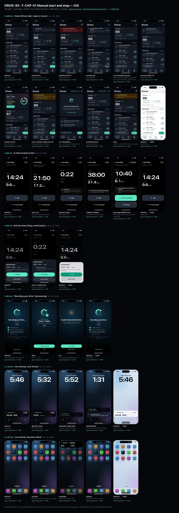
- **Design system (source of truth for values):** [brand](../../system/brand.md) · [components](../../system/components.md) · [motion](../../system/motion.md) · [accessibility](../../system/accessibility.md) · [screen map](../../system/screen-map.md) · [fixtures](../../system/fixtures.md) · tokens `prototypes/shared/tokens.css`

## Screens in this story

| Screen | Name | Presentation | Priority | States | Status |
|---|---|---|---|---|---|
| `S-HOME-01` | Home (Drives tab): ready to record | Root (Drives tab) | P0 | 11 | Prototyped |
| `S-DRV-01` | In-drive locked screen | Full (locked) | P0 | 5 | Prototyped |
| `S-DRV-02` | End trip sheet (Stop confirmation) | Sheet (small) | P0 | 2 | Prototyped |
| `S-DRV-04` | “Decoding your drive” (processing) | Full | P0 | 3 | Prototyped |
| `S-LIVE-01` | Live Activity, Lock Screen | Live (iOS Lock Screen) | P0 | 4 | Prototyped |
| `S-LIVE-02` | Live Activity, Dynamic Island | Live (iOS Dynamic Island) | P0 | 4 | Prototyped |

## Tokens used on this platform

Values resolved from `prototypes/shared/tokens.css` inside the iOS device (`[data-platform="ios"]`). Use the token names in code; the hex values are for reference.

| Token | Dark | Light |
|---|---|---|
| `--app-bg` | `#080B10` | `#F2F3F6` |
| `--card-bg` | `#131822` | `#FFFFFF` |
| `--dp-bg-grouped` | `#080B10` | `#F2F3F6` |
| `--dp-surface` | `#131822` | `#FFFFFF` |
| `--dp-surface-2` | `#1B222D` | `#F2F3F6` |
| `--dp-surface-3` | `#262E3B` | `#E4E7EC` |
| `--dp-fill` | `#7880961F` | `#7880961F` |
| `--dp-fill-strong` | `#7880963D` | `#78809633` |
| `--dp-text` | `#F2F4F7` | `#0B0E13` |
| `--dp-text-2` | `#A3AAB6` | `#5A6271` |
| `--dp-text-3` | `#6E7787` | `#8A919D` |
| `--dp-separator` | `#96A0B429` | `#3C435024` |
| `--dp-accent` | `#5BE7C4` | `#079777` |
| `--dp-accent-text` | `#5BE7C4` | `#06775E` |
| `--dp-on-accent` | `#04241D` | `#FFFFFF` |
| `--dp-accent-container` | `#0A4439` | `#C6F8EA` |
| `--dp-record` | `#FFC24B` | `#9A6300` |
| `--dp-positive` | `#5BE7C4` | `#06775E` |
| `--dp-change-down` | `#A3AAB6` | `#5A6271` |
| `--dp-warning` | `#F5B648` | `#9A5F00` |
| `--dp-critical` | `#FF6B6B` | `#C62828` |
| `--dp-glass-fill` | `#1C222C6B` | `#FFFFFF8C` |
| `--dp-glass-fill-strong` | `#1C222CB8` | `#FFFFFFD1` |
| `--dp-glass-stroke` | `#FFFFFF24` | `#FFFFFF99` |
| `--dp-data-route` | `#5BE7C4` | `#079777` |
| `--dp-data-event-brake` | `#FF7A66` | `#A21F16` |
| `--dp-data-event-accel` | `#E58BD0` | `#A33A8C` |
| `--dp-data-event-corner` | `#EAD54E` | `#9A8A00` |
| `--dp-data-quality-good` | `#5FDB9C` | `#1E9E62` |
| `--dp-data-speed` | `#D6DCE4` | `#404A58` |
| `--dp-data-long-g` | `#5AB8F5` | `#0A6AB8` |
| `--dp-data-lat-g` | `#F5A142` | `#B25A00` |

| Type / layout token | Value |
|---|---|
| `--dp-font-screen-title` | `700 34px / 41px -apple-system, BlinkMacSystemFont, "SF Pro Display", system-ui, sans-serif` |
| `--dp-font-sheet-title` | `700 22px / 28px -apple-system, BlinkMacSystemFont, "SF Pro Display", system-ui, sans-serif` |
| `--dp-font-section-title` | `600 20px / 25px -apple-system, BlinkMacSystemFont, "SF Pro Display", system-ui, sans-serif` |
| `--dp-font-card-title` | `600 17px / 22px -apple-system, BlinkMacSystemFont, "SF Pro Text", system-ui, sans-serif` |
| `--dp-font-body` | `400 17px / 22px -apple-system, BlinkMacSystemFont, "SF Pro Text", system-ui, sans-serif` |
| `--dp-font-body-secondary` | `400 15px / 20px -apple-system, BlinkMacSystemFont, "SF Pro Text", system-ui, sans-serif` |
| `--dp-font-meta` | `400 13px / 18px -apple-system, BlinkMacSystemFont, "SF Pro Text", system-ui, sans-serif` |
| `--dp-font-caption` | `400 12px / 16px -apple-system, BlinkMacSystemFont, "SF Pro Text", system-ui, sans-serif` |
| `--dp-font-button` | `600 17px / 22px -apple-system, BlinkMacSystemFont, "SF Pro Text", system-ui, sans-serif` |
| `--dp-num-hero` | `600 72px / 72px -apple-system, BlinkMacSystemFont, "SF Pro Display", system-ui, sans-serif` |
| `--dp-num-xl` | `600 48px / 52px -apple-system, BlinkMacSystemFont, "SF Pro Display", system-ui, sans-serif` |
| `--dp-num-l` | `600 34px / 38px -apple-system, BlinkMacSystemFont, "SF Pro Display", system-ui, sans-serif` |
| `--dp-num-m` | `600 24px / 28px -apple-system, BlinkMacSystemFont, "SF Pro Display", system-ui, sans-serif` |
| `--dp-num-s` | `600 17px / 22px -apple-system, BlinkMacSystemFont, "SF Pro Display", system-ui, sans-serif` |
| `--dp-num-xs` | `600 13px / 16px -apple-system, BlinkMacSystemFont, "SF Pro Display", system-ui, sans-serif` |
| `--dp-screen-margin` | `16px` |
| `--dp-radius-card` | `24px` |
| `--dp-radius-card-hero` | `32px` |
| `--dp-radius-sheet` | `38px` |
| `--dp-radius-chip` | `999px` |
| `--dp-radius-button` | `999px` |
| `--dp-layout-list-row-min` | `52px` |
| `--dp-layout-touch-min` | `44px` |
| `--safe-top` | `62px` |
| `--safe-bottom` | `34px` |

Text sizes scale with `--dp-text-scale` (XL = 2.0×) and numerals with `--dp-num-scale` (XL = 1.3×). DP Numerals: SF Pro Expanded Semibold, tabular.

---

## S-HOME-01 · Home (Drives tab): ready to record

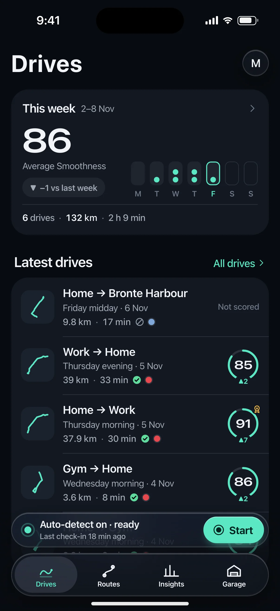 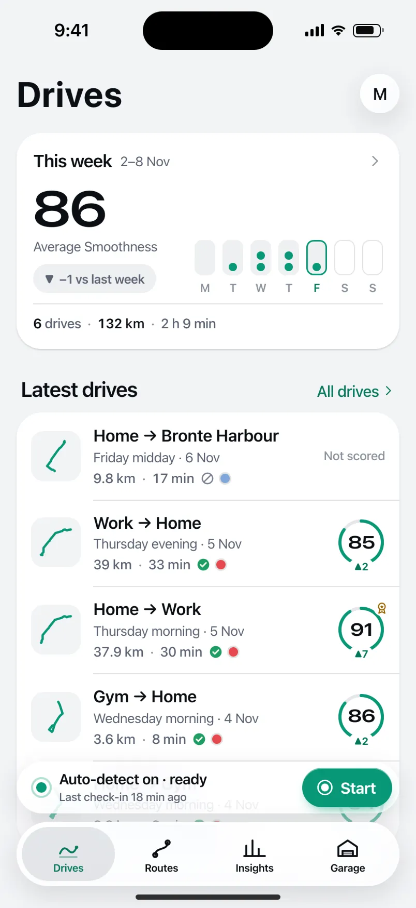

- **Presentation:** root · tab: drives — screen map: “Root (Drives tab)”
- **Entry points:** Tab · S-ONB-15 · S-DRV-04 done (new Story card)
- **Leads to:** S-STY-01 (new Story) · S-TRP-01 · S-HIS-01 ("All drives") · S-HOME-02 · S-HOME-03 · S-DRV-01 (Start) · S-SET-05 (needs attention) · S-SUB-01 (Prev badge)
- **PRD features:** F-CAP-01, F-CAP-02, F-CAP-06, F-CAP-14, F-SET-02, F-SUB-02 · **Priority:** P0 · **WP:** B
- **Interactive:** [S-HOME-01](../../../../prototypes/ios/index.html#S-HOME-01)

**Purpose.** The Drives tab root: glanceable capture status, the newest decoded drive (Story card), this week at a glance and the latest drives. It never shows live speed, score or record pace while recording (SAF-02).

### States

| State | PRD label | Fixture params | Screenshot |
|---|---|---|---|
| `default` | Def auto ready | — | [S-HOME-01.png](../../screens/ios/S-HOME-01.webp) · [open](../../../../prototypes/ios/index.html#S-HOME-01) |
| `manualOnly` | Manual only (auto off) | `capture=manual` | [S-HOME-01--manualOnly.png](../../screens/ios/S-HOME-01--manualOnly.webp) · [open](../../../../prototypes/ios/index.html#S-HOME-01/manualOnly) |
| `needsAttention` | Needs attention | `health=alwaysLost` | [S-HOME-01--needsAttention.png](../../screens/ios/S-HOME-01--needsAttention.webp) · [open](../../../../prototypes/ios/index.html#S-HOME-01/needsAttention) |
| `autoPaused` | Auto paused | `capture=paused` | [S-HOME-01--autoPaused.png](../../screens/ios/S-HOME-01--autoPaused.webp) · [open](../../../../prototypes/ios/index.html#S-HOME-01/autoPaused) |
| `recordingInProgress` | Recording in progress (passenger trip: content allowed, banner live) | — | [S-HOME-01--recordingInProgress.png](../../screens/ios/S-HOME-01--recordingInProgress.webp) · [open](../../../../prototypes/ios/index.html#S-HOME-01/recordingInProgress) |
| `processingATrip` | Processing a trip | — | [S-HOME-01--processingATrip.png](../../screens/ios/S-HOME-01--processingATrip.webp) · [open](../../../../prototypes/ios/index.html#S-HOME-01/processingATrip) |
| `newStoryCard` | New Story card | `trip=t20261105-0742` | [S-HOME-01--newStoryCard.png](../../screens/ios/S-HOME-01--newStoryCard.webp) · [open](../../../../prototypes/ios/index.html#S-HOME-01/newStoryCard) |
| `interruptedTripRecovered` | Interrupted trip recovered | `trip=t20261013-1742` | [S-HOME-01--interruptedTripRecovered.png](../../screens/ios/S-HOME-01--interruptedTripRecovered.webp) · [open](../../../../prototypes/ios/index.html#S-HOME-01/interruptedTripRecovered) |
| `firstRunEmpty` | First run Empty (Preview day 1) | `ent=preview` | [S-HOME-01--firstRunEmpty.png](../../screens/ios/S-HOME-01--firstRunEmpty.webp) · [open](../../../../prototypes/ios/index.html#S-HOME-01/firstRunEmpty) |
| `prevDayCounter` | Prev day counter | `ent=preview` | [S-HOME-01--prevDayCounter.png](../../screens/ios/S-HOME-01--prevDayCounter.webp) · [open](../../../../prototypes/ios/index.html#S-HOME-01/prevDayCounter) |
| `Deny` | Deny (location While Using / denied) | `capture=denied` | [S-HOME-01--Deny.png](../../screens/ios/S-HOME-01--Deny.webp) · [open](../../../../prototypes/ios/index.html#S-HOME-01/Deny) |
| default · light | Light theme | `theme=light` | [S-HOME-01--light.png](../../screens/ios/S-HOME-01--light.webp) |

Every state also renders in light/dark (`theme=light`), XL text (`text=xl`) and reduced motion (`rm=1`).

### Layout

- Large title “Drives” (iOS 34/41 bold large title · Android LargeFlexibleTopAppBar 32/40 with the date as subtitle); trailing: Preview/Ride-along badge (when active) + profile avatar (dot = needs attention).
- State banner slot (needs attention · paused · manual · denied · interrupted recovered · processing), full width, 16 margins.
- New Story card (state newStoryCard): hero card (radius 32 iOS / 28 Android) tinted 18% with the car colour; kicker “● Drive decoded”, route label, part of day · car, distance · duration, record + delta chips, “Watch Story” filled small button; Smoothness ring 116 with baseline and record notches.
- “This week” card: average Smoothness (DP Numerals 48), delta vs last week (neutral when lower, never red), 7-day dot strip (Mon–Sun, ≤ 3 dots per day, future days dimmed), drives · km · time footer. Tap → Insights tab.
- “Latest drives” section (title + “All drives” → S-HIS-01): 5 trip cards in one card, newest first (components.md §12).
- Capture status: iOS tabViewBottomAccessory glass capsule (50 pt, 8 above the floating tab bar) · Android M3E floating toolbar (64 dp, primaryContainer, 16 above the navigation bar, Drives tab only). Start → S-DRV-01 with the trip-start expansion.

### Components & tokens

| Component | Tokens / spec |
|---|---|
| `largeTitle` | --dp-font-screen-title (iOS 34/41 bold · Android 32/40) · components.md §2 |
| `previewBadge` | see components.md |
| `avatar` | see components.md |
| `banner` | radius 12 (--dp-radius-sm+) · info --dp-fill · attention --dp-warning-container · critical --dp-critical-container · components.md §22 |
| `card` | --dp-surface / --md-sys-color-surface-container · --dp-radius-card (24 iOS · 16 Android) · hero: --dp-radius-card-hero (32 · 28) · light iOS: --dp-elev-1 |
| `ring` | track --dp-fill-strong · arc --dp-gradient-ring (glide-400 → accent → glide-100) · baseline notch --dp-text-2 · record notch --dp-record · Android container Cookie9Sided --md-sys-color-primary-container 42% · components.md §3 |
| `deltaChip` | better: --dp-accent-text on --dp-accent 18% · lower: --dp-text-2 on --dp-fill (never red) · record: --dp-record on --dp-record 18% · components.md §4 |
| `chip` | --dp-radius-chip (iOS capsule · Android 8) · height 28 · --dp-font-caption |
| `button` | --dp-accent / --dp-on-accent (filled) · --dp-fill-strong · --md-sys-color-secondary-container (tonal) · --dp-radius-button · height iOS 50/44/34 · Android 56/40/32 · --dp-font-button · components.md §0 |
| `tripRow` | glyph 40 on --dp-surface-2 · --dp-font-card-title · --dp-font-meta · components.md §12 |
| `scoreBadge` | iOS mini ring 46 · Android Cookie9Sided 46 · --dp-num-s |
| `qualityBadge` | --dp-data-quality-{good\|usable\|limited\|unscorable} · components.md §10 |
| `section` | --dp-font-section-title · --dp-layout-section-gap 28 |
| `empty` | illustration 120 in --dp-accent · --dp-font-section-title · components.md §21 |
| `loader` | see components.md |
| `skeleton` | --dp-fill-strong, breathe 1.2 s (dp-skeleton) |
| `list` | iOS inset grouped radius --dp-radius-card, rows 52 pt, separators --dp-separator inset 16 · Android ListItem 56/72 dp in --md-sys-color-surface-container |
| `row` | --dp-font-body · --dp-font-meta (supporting) · --dp-layout-list-row-min |
| `tabBar` | iOS floating glass: inset 16, bottom 21, height 62, lens --dp-fill-strong · Android NavigationBar 64 dp + indicator 56×32 --md-sys-color-secondary-container · components.md §1 |
| `accessory` | iOS tabViewBottomAccessory glass 48 pt, 8 above tab bar · Android floating toolbar 64 dp --md-sys-color-primary-container, 16 above nav bar · Start: --dp-accent |

### Interactions & navigation

- Trip card → S-TRP-01 (zoom transition on iOS, container transform on Android).
- New Story card / “Watch Story” → S-STY-01 (D1 gate: held on S-DRV-05 while moving).
- “This week” card → Insights tab (S-STA-01). “All drives” → S-HIS-01.
- Accessory/toolbar body → S-HOME-02 capture status sheet; Start → S-DRV-01 (manual trip; gate locks the app to the in-drive screen); recording banner → S-DRV-01; needs attention → S-SET-05; denied → S-ONB-16.
- Avatar → S-ACC-01 (iOS sheet, Android full-screen). Preview badge → S-SUB-01.
- Banners: Fix → S-SET-05 / S-ONB-16 · Turn on → S-SET-03 · Resume → resumes auto-detect (toast) · View → S-TRP-01/interrupted.
- Scroll: large title collapses to an inline title; iOS tab bar minimises to a compact capsule with the accessory inline; Android toolbar slides away and returns on scroll up.

### Motion

- Blocks rise 8 px and fade in, 40 ms stagger, spring.default (RM: 220 ms cross-fade).
- Story card ring: ring reveal (motion.md §3.4) 1400 ms count-up locked to the arc; record notch turns solid gold as the arc passes 89 (doubleSuccess haptic); RM: full ring, static number.
- Start: press scale 0.96 (spring.fast) + confirm haptic, then the accessory/toolbar expands into the in-drive surface (spring.slow container transform, motion.md §3.1).
- Recording banner dot: continuous livePulse breathe 2400 ms (passenger trip / finalising only); RM: static dot.
- Tab switch: iOS cross-fade + lens slides (spring.default); Android fade-through.

### Accessibility

- Trip card label: “Home to Work, Thursday morning, 5 November. 37.9 kilometres, 30 minutes. Smoothness 91. Good data.” (one element, button).
- This-week card is one element: “This week: 6 drives, 132.1 kilometres, 2 h 9 min. Average Smoothness 86, 1 down on last week.”
- Accessory: “Auto-detect on · ready. Last check-in 18 min ago” + separate “Start drive” button (≥ 44 pt / 48 dp).
- XL text: trip cards stack (glyph above), stats wrap; the accessory keeps one line with ellipsis and the full text in its label.
- Colour never carries meaning alone: ▲/▼/● glyphs on deltas, shapes on quality glyphs, the attention state has a triangle glyph and text.

### Platform notes

- **iOS (this spec):** Floating Liquid Glass tab bar (inset 16, bottom 21, 62 tall) with lens selection; tabViewBottomAccessory carries capture status on every tab; glass avatar toolbar item opens Profile as a sheet; score badges are mini rings; large title collapses to the inline title with a scroll-edge fade.
- *Android (for reference):* NavigationBar (64 dp + gesture area) with 56×32 secondaryContainer indicator; capture status is an M3E floating toolbar on the Drives tab only (other tabs show a status chip when it needs attention); avatar in a Cookie12Sided shape opens Profile full-screen; score badges use Cookie9Sided; LargeFlexibleTopAppBar with date subtitle.

### Analytics

- `home_viewed {state}`
- `story_card_tapped {trip_age}`
- `manual_start_tapped {source: accessory|toolbar}`
- `capture_status_opened`
- `history_opened {source: home}`

### Copy

| Key | Text |
|---|---|
| Accessory ready | Auto-detect on · ready / Last check-in {n} min ago |
| Accessory manual | Manual mode / Auto-detect is off |
| Accessory paused | Auto-detect paused / Until 8:00 tomorrow · Resume |
| Accessory attention | Auto-detect needs attention / Location is set to While Using |
| Accessory recording | Recording · {min} min · {km} km / Passenger trip · tap to open |
| Empty | Your drives will appear here. Just drive. DrivePerf notices when you set off and decodes each drive when you park. |
| Interrupted | We saved your drive. {part of day} · {label}. {iOS ended DrivePerf in the background \| Android stopped DrivePerf in the background}. Everything before then is saved. |
| Story card kicker | Drive decoded |

### Free / Pro

Free: identical layout (summaries are free forever); trips older than 30 days show a small lock after the score for “Replay & Analysis in Pro”. Preview/Ride-along: “PRO PREVIEW · DAY n” / “RIDE-ALONG · DAY n” badge → S-SUB-01. No paywall is ever shown here during or right after a trip (D12, F-SUB-08).

### Data & fixtures

This-week numbers are derived from DP_DATA.trips for the current week (they equal recaps[0]: 6 drives · 132.1 km · 2 h 9 min · 86, −1 vs 87). In newStoryCard the week is computed as of the Story trip’s end (Thu 5 Nov 08:13).

### Assets

[icon-drives.svg](assets/icon-drives.svg) · [icon-routes.svg](assets/icon-routes.svg) · [icon-insights.svg](assets/icon-insights.svg) · [icon-garage.svg](assets/icon-garage.svg) · [icon-record.svg](assets/icon-record.svg) · [icon-story.svg](assets/icon-story.svg) · [icon-chevronRight.svg](assets/icon-chevronRight.svg) · [icon-rosette.svg](assets/icon-rosette.svg) · [icon-lock.svg](assets/icon-lock.svg) · [icon-gps.svg](assets/icon-gps.svg) · [icon-shield.svg](assets/icon-shield.svg) · [icon-pause.svg](assets/icon-pause.svg) · [logo-a-loop.svg](assets/logo-a-loop.svg)

UI glyphs may be swapped for SF Symbols / Material Symbols Rounded equivalents; event-pin, quality and provenance glyphs must not be (components.md global rules).

### Checklist (accessibility.md §9)

- [ ] Light and dark both render, and contrast passes.
- [ ] The XL text state reflows with no truncation.
- [ ] The RM state is defined.
- [ ] Every control has a label; every chart and map has a summary sentence.
- [ ] Every target ≥ 44 pt / 48 dp (≥ 64 in-drive).
- [ ] No meaning by colour alone.
- [ ] Speed is neutral wherever it appears and absent from social or live surfaces.
- [ ] No streak, leaderboard, speed or “beat your time” language.
- [ ] Behaviour is defined while a trip is active (D1 gate).
- [ ] Haptics come from motion.md §6 only.

---

## S-DRV-01 · In-drive locked screen

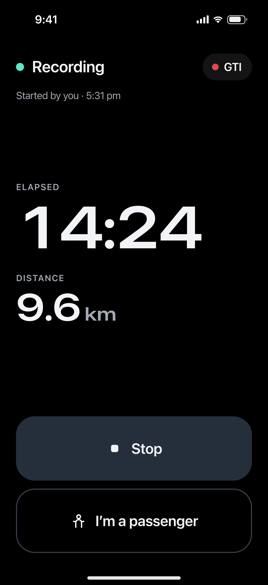 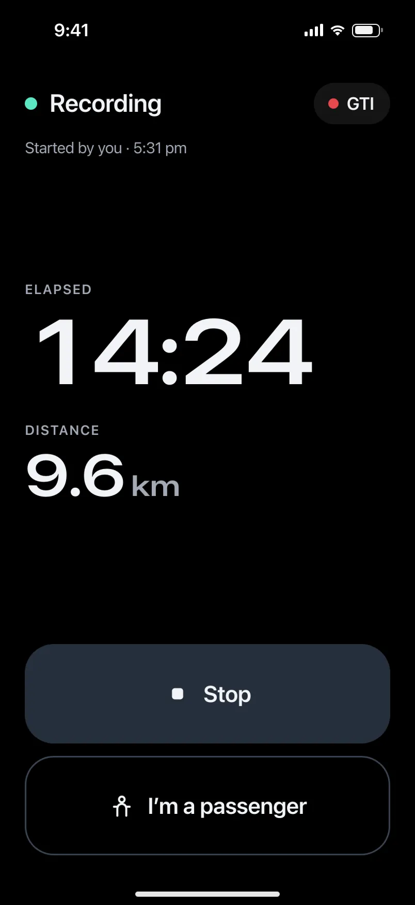

- **Presentation:** full — screen map: “Full (locked)”
- **Entry points:** Start (S-HOME-01, S-LIVE-03/04/07/08) · any deep link during a driver trip · S-LIVE-09 tap
- **Leads to:** S-DRV-02 (Stop) · S-DRV-03 (passenger) · auto end → S-DRV-04
- **PRD features:** F-CAP-01, F-CAP-02, F-CAP-07, F-CAP-08 · **Priority:** P0 · **WP:** B
- **Interactive:** [S-DRV-01](../../../../prototypes/ios/index.html#S-DRV-01)

**Purpose.** The only screen the app shows while a driver trip is active (D1, F-CAP-07): proof that it is recording — elapsed time, distance and car — plus two huge exits, Stop and I’m a passenger. Nothing else: no score, speed, events, tips, map, navigation or tab bar.

### States

| State | PRD label | Fixture params | Screenshot |
|---|---|---|---|
| `default` | Manual trip | — | [S-DRV-01.png](../../screens/ios/S-DRV-01.webp) · [open](../../../../prototypes/ios/index.html#S-DRV-01) |
| `autoTrip` | Auto trip (estimated start) | `live=auto` | [S-DRV-01--autoTrip.png](../../screens/ios/S-DRV-01--autoTrip.webp) · [open](../../../../prototypes/ios/index.html#S-DRV-01/autoTrip) |
| `gpsSearching` | GPS searching | `live=gpsSearching` | [S-DRV-01--gpsSearching.png](../../screens/ios/S-DRV-01--gpsSearching.webp) · [open](../../../../prototypes/ios/index.html#S-DRV-01/gpsSearching) |
| `lowBatteryMode` | Low battery mode (Ioniq) | `live=lowBattery` | [S-DRV-01--lowBatteryMode.png](../../screens/ios/S-DRV-01--lowBatteryMode.webp) · [open](../../../../prototypes/ios/index.html#S-DRV-01/lowBatteryMode) |
| `passengerModeActive` | Passenger mode active (content unlocked) | `live=passenger` | [S-DRV-01--passengerModeActive.png](../../screens/ios/S-DRV-01--passengerModeActive.webp) · [open](../../../../prototypes/ios/index.html#S-DRV-01/passengerModeActive) |
| default · light | Light theme | `theme=light` | [S-DRV-01--light.png](../../screens/ios/S-DRV-01--light.webp) |

Every state also renders in light/dark (`theme=light`), XL text (`text=xl`) and reduced motion (`rm=1`).

### Layout

- Full-screen cover on --dp-drive-bg #000 on both platforms and in both themes (status bar light). Content is a single column with 24 side margins.
- Top row (safe top + 18): 12 px live dot (--wb-drv-live = Glide #5BE7C4) + “Recording” (600 24/28) · car chip trailing (car dot in the car colour + nickname, 600 17, #F2F4F7 on #ffffff14, capsule 40 tall) or a “Passenger” chip.
- Source line (meta 15/20, #A3AAB6): “Started by you · 5:31 pm” / “Started automatically · 5:31 pm” + “First 340 m estimated” with the estimated provenance glyph (auto trips) / “Marked as passenger · not scored”.
- Numbers block, vertically centred in the free space: label “Elapsed” (caps 13, #A3AAB6) over the timer in DP Numerals 96/96 (tabular, 125% stretch, scales with Dynamic Type up to the container width), then “Distance” over 9.6 + “km” at 50%. GPS searching shows “—”. Times ≥ 1 h render h:mm:ss.
- Status card when needed (radius 20, #ffffff10, 16 padding, 22 icon): Finding GPS… · Battery saver: recording at lower detail · You’re a passenger, so DrivePerf is unlocked.
- Bottom stack (safe bottom + 16, 12 gap): Stop = 96 tall, full width, radius 28, --dp-surface-3 (#262E3B) with a 26 stop glyph and 600 22 label · I’m a passenger = 96 tall, 1.5 px #3A4351 outline. Passenger mode: “Browse DrivePerf” (Glide filled, on-accent text) + “End trip”.

### Components & tokens

| Component | Tokens / spec |
|---|---|
| `page` | --dp-bg-grouped (iOS) / --md-sys-color-surface (Android) · --dp-screen-margin 16 |
| `drvButton (local, 96 tall)` | see components.md |
| `carChip (in-drive variant)` | see components.md |
| `provenance` | see components.md |
| `liveDot` | see components.md |

### Interactions & navigation

- Stop → S-DRV-02 (sheet). I’m a passenger → S-DRV-03 (sheet). Both are the only destinations allowed by the D1 gate besides S-DRV-05.
- Passenger mode: Browse DrivePerf → S-NAV-01 recording banner (live=passenger, content unlocked); End trip → S-DRV-02 (passenger copy).
- Every other deep link, notification, widget, Control Center / QS tile and Live Activity tap lands here while a driver trip is active (DP.gate; the target waits in DP.session.pending and opens on S-DRV-05 rules after the trip).
- Auto end (stationary for the stop timer, F-CAP-03) → S-DRV-04 with no tap. There is no swipe, back gesture or tab bar.

### Motion

- Manual start: the accessory (iOS) / floating toolbar (Android) expands into this screen (container transform, spring.slow), then the rows rise 8 px with a 60 ms stagger (spring.default) — motion.md §3.1. Auto trip: 220 ms cross-fade, no theatre.
- Live dot: halo scale 1 → 1.9, opacity .5 → 0, 900 ms ease.glide once per second for 10 s after appearing or after any touch, then still (§3.2). The timer updates once per second; nothing else moves. RM / shot: static dot.
- Haptics: none on this screen (confirm fires only on the Stop / passenger confirmation in the sheets).

### Accessibility

- One summary element: “Recording. 14 minutes, 9.6 kilometres, GTI.” — no live region, so the timer is never announced every second.
- Buttons: “Stop” and “I’m a passenger” (96 tall, ≥ 64 rule); order: summary → Stop → I’m a passenger.
- XL: numerals scale but are capped to the screen width (never truncated); the status card wraps; buttons keep 96 minimum height and grow with the label.
- Contrast: #F2F4F7 on #000 (19:1), #A3AAB6 on #000 (8.7:1). Meaning never by colour: the dot is paired with the word Recording.

### Platform notes

- **iOS (this spec):** .fullScreenCover with .interactiveDismissDisabled(); .persistentSystemOverlays(.hidden) not used (status bar stays for the recording indicator); Live Activity runs alongside (S-LIVE-01/02).
- *Android (for reference):* Full-screen destination with BackHandler consumed (back does nothing while driving); FLAG_KEEP_SCREEN_ON optional; the Live Update / FGS notification runs alongside (S-LIVE-05/06).

### Analytics

- `in_drive_screen_viewed {mode: manual|auto, gps, battery_saver}`
- `in_drive_stop_tapped`
- `in_drive_passenger_tapped`
- `content_blocked_while_moving {target} (from the gate)`

### Copy

| Key | Text |
|---|---|
| Title | Recording |
| Manual | Started by you · {5:31 pm} |
| Auto | Started automatically · {5:31 pm} · First {340} m estimated |
| GPS | Finding GPS… · Motion is already recording. Distance starts with the first fix. |
| Low battery | Battery saver: recording at lower detail · Your route and Story are still saved. |
| Passenger | You’re a passenger, so DrivePerf is unlocked. · This trip won’t be scored or count toward your baseline. |
| Buttons | Stop · I’m a passenger · Browse DrivePerf · End trip |

### Free / Pro

Identical for every plan. No upsell, badge, paywall or share prompt can appear while this screen is up (D12).

### Data & fixtures

DP_DATA.liveTrip.states: manual (default, 14:24 · 9.6 km · GTI) · auto (21:50 · 17.2 km · estimatedStartM 340) · gpsSearching (0:22, no distance) · lowBattery (38:00 · 31.4 km · Ioniq, batterySaver) · passenger (10:40 · 6.1 km). Start time = startedAt (5:31 pm). Only these fields are used (fixtures.md §8). The prototype timer ticks from elapsedS once per second.

### Assets

[icon-stop.svg](assets/icon-stop.svg) · [icon-passenger.svg](assets/icon-passenger.svg) · [icon-gps.svg](assets/icon-gps.svg) · [icon-battery.svg](assets/icon-battery.svg) · [icon-drives.svg](assets/icon-drives.svg)

UI glyphs may be swapped for SF Symbols / Material Symbols Rounded equivalents; event-pin, quality and provenance glyphs must not be (components.md global rules).

### Checklist (accessibility.md §9)

- [ ] Light and dark both render, and contrast passes.
- [ ] The XL text state reflows with no truncation.
- [ ] The RM state is defined.
- [ ] Every control has a label; every chart and map has a summary sentence.
- [ ] Every target ≥ 44 pt / 48 dp (≥ 64 in-drive).
- [ ] No meaning by colour alone.
- [ ] Speed is neutral wherever it appears and absent from social or live surfaces.
- [ ] No streak, leaderboard, speed or “beat your time” language.
- [ ] Behaviour is defined while a trip is active (D1 gate).
- [ ] Haptics come from motion.md §6 only.

---

## S-DRV-02 · End trip sheet (Stop confirmation)

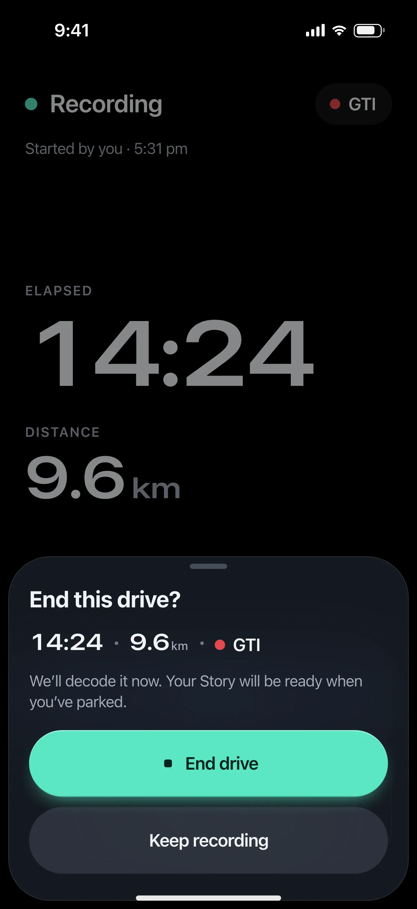 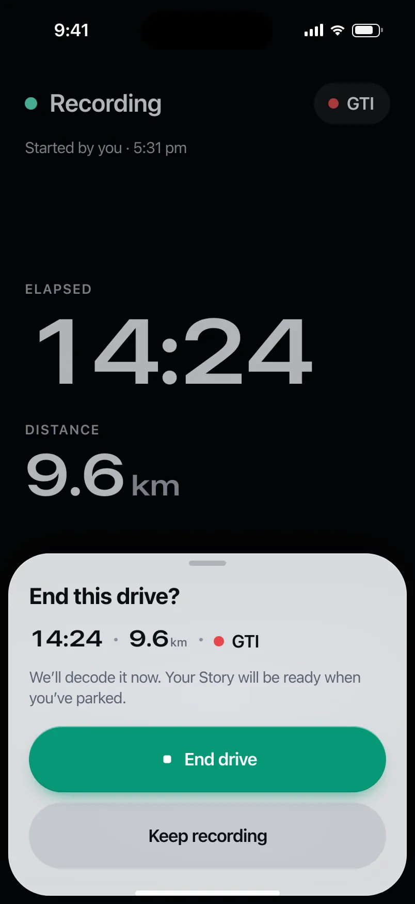

- **Presentation:** sheet · detent: auto — screen map: “Sheet (small)”
- **Entry points:** S-DRV-01 Stop
- **Leads to:** S-DRV-04 · Cancel → S-DRV-01
- **PRD features:** F-CAP-01 · **Priority:** P0 · **WP:** B
- **Interactive:** [S-DRV-02](../../../../prototypes/ios/index.html#S-DRV-02)

**Purpose.** A deliberate second step before a manual trip ends, so a mis-tap on the in-drive Stop never ends a drive (F-CAP-01). It also explains short trips (F-CAP-17).

### States

| State | PRD label | Fixture params | Screenshot |
|---|---|---|---|
| `default` | Def | — | [S-DRV-02.png](../../screens/ios/S-DRV-02.webp) · [open](../../../../prototypes/ios/index.html#S-DRV-02) |
| `shortTripWarning` | Short-trip warning | `live=gpsSearching` | [S-DRV-02--shortTripWarning.png](../../screens/ios/S-DRV-02--shortTripWarning.webp) · [open](../../../../prototypes/ios/index.html#S-DRV-02/shortTripWarning) |
| default · light | Light theme | `theme=light` | [S-DRV-02--light.png](../../screens/ios/S-DRV-02--light.webp) |

Every state also renders in light/dark (`theme=light`), XL text (`text=xl`) and reduced motion (`rm=1`).

### Layout

- Sheet over S-DRV-01, fitted to content (≈ small detent). Header “End this drive?” (passenger trip: “End this trip?”), no close button — the two buttons are the only exits besides drag/scrim.
- Facts row (DP Numerals 22, text2 separators): 14:24 · 9.6 km · ● GTI.
- One line (body, text2): “We’ll decode it now. Your Story will be ready when you’ve parked.” · short-trip: info banner “This drive is very short — Under 500 m or 2 minutes. It’s kept with a “Short trip” label, without a score.”
- Two full-width buttons, 64 tall (in-drive minimum), 12 gap: End drive (filled Glide, stop glyph) · Keep recording (tonal).

### Components & tokens

| Component | Tokens / spec |
|---|---|
| `sheet` | iOS glass --dp-glass-fill-strong + --dp-glass-prominent-blur, radius --dp-radius-sheet 38 · Android ModalBottomSheet --md-sys-color-surface-container-low, top radius 28, drag handle 32×4 · motion spring.sheet |
| `sheetHeader` | see components.md |
| `banner` | radius 12 (--dp-radius-sm+) · info --dp-fill · attention --dp-warning-container · critical --dp-critical-container · components.md §22 |
| `button` | --dp-accent / --dp-on-accent (filled) · --dp-fill-strong · --md-sys-color-secondary-container (tonal) · --dp-radius-button · height iOS 50/44/34 · Android 56/40/32 · --dp-font-button · components.md §0 |
| `num` | see components.md |

### Interactions & navigation

- End drive → S-DRV-04 (Decoding your drive), clearing live (the D1 gate unlocks); confirm haptic (the only haptic allowed during a trip).
- End anyway (short) → trip kept as “Short trip”, back to S-HOME-01 with a toast. End trip (passenger) → S-HOME-01, toast “Passenger trip saved · not scored”.
- Keep recording / scrim / drag down → back to S-DRV-01, nothing changes.

### Motion

- spring.sheet in from the bottom over the black screen; buttons press-scale .97 (spring.fast). Then (motion.md §3.1 trip end) the S-DRV-01 dot’s trail retracts while S-DRV-04 cross-fades in. RM: cross-fade.

### Accessibility

- Facts read as one: “14 minutes 24 seconds, 9.6 kilometres so far”. Buttons “End drive” / “Keep recording”, 64 tall.
- Focus starts on the title, then Keep recording is the escape (Android back = Keep recording).
- XL: facts wrap onto two lines; buttons grow with the label.

### Platform notes

- **iOS (this spec):** Glass sheet over the black in-drive screen, .presentationDetents([.height(…)]), glassProminent End drive.
- *Android (for reference):* ModalBottomSheet with drag handle; filled End drive with shape morph, FilledTonalButton Keep recording.

### Analytics

- `trip_stop_confirm_viewed {short: bool, passenger: bool}`
- `trip_stopped {by: user, short: bool}`
- `trip_stop_cancelled`

### Copy

| Key | Text |
|---|---|
| Title | End this drive? / End this trip? |
| Line | We’ll decode it now. Your Story will be ready when you’ve parked. |
| Passenger | It’s saved as a passenger trip, without a score. |
| Short | This drive is very short · Under 500 m or 2 minutes. It’s kept with a “Short trip” label, without a score. |
| Buttons | End drive · End anyway · End trip · Keep recording |

### Free / Pro

Same for every plan.

### Data & fixtures

Facts from DP_DATA.liveTrip.states.manual (default) and gpsSearching (short-trip: 0:22, 0.0 km — the only fixture under the 500 m / 2 min rule). End drive decodes the hero fixture t20261105-0742 (there is no finalised trip that matches the live fixture).

### Assets

[icon-stop.svg](assets/icon-stop.svg) · [icon-info.svg](assets/icon-info.svg) · [icon-passenger.svg](assets/icon-passenger.svg) · [icon-check.svg](assets/icon-check.svg)

UI glyphs may be swapped for SF Symbols / Material Symbols Rounded equivalents; event-pin, quality and provenance glyphs must not be (components.md global rules).

### Checklist (accessibility.md §9)

- [ ] Light and dark both render, and contrast passes.
- [ ] The XL text state reflows with no truncation.
- [ ] The RM state is defined.
- [ ] Every control has a label; every chart and map has a summary sentence.
- [ ] Every target ≥ 44 pt / 48 dp (≥ 64 in-drive).
- [ ] No meaning by colour alone.
- [ ] Speed is neutral wherever it appears and absent from social or live surfaces.
- [ ] No streak, leaderboard, speed or “beat your time” language.
- [ ] Behaviour is defined while a trip is active (D1 gate).
- [ ] Haptics come from motion.md §6 only.

---

## S-DRV-04 · “Decoding your drive” (processing)

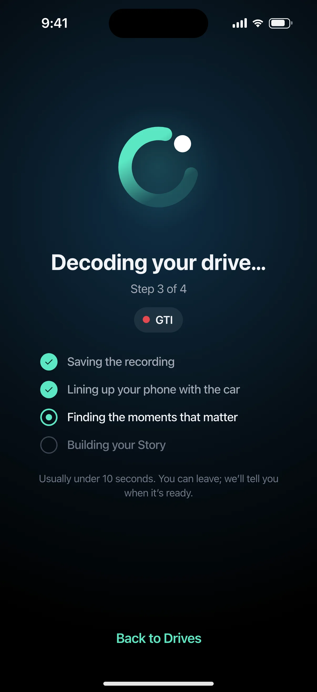 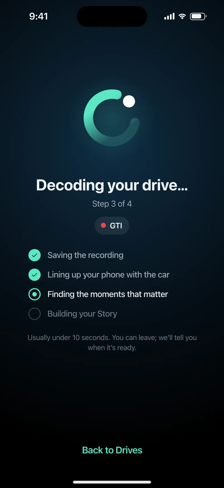

- **Presentation:** full — screen map: “Full”
- **Entry points:** S-DRV-02 · auto trip end with app foreground
- **Leads to:** S-STY-01 (or S-DRV-05 if still moving) · Err → retry
- **PRD features:** F-CAP-01, F-CAP-03, F-STY-01 · **Priority:** P0 · **WP:** B
- **Interactive:** [S-DRV-04](../../../../prototypes/ios/index.html#S-DRV-04)

**Purpose.** Bridges Stop (or an auto trip ending with the app open) and the Story: the drive is finalised, aligned, scored and turned into a Story in ≤ 10 s (F-CAP-01, F-CAP-03, F-STY-01, Q18). It never shows a score itself.

### States

| State | PRD label | Fixture params | Screenshot |
|---|---|---|---|
| `default` | Load (decoding, step 3 of 4) | `trip=t20261105-0742` | [S-DRV-04.png](../../screens/ios/S-DRV-04.webp) · [open](../../../../prototypes/ios/index.html#S-DRV-04) |
| `done` | Done → Story | `trip=t20261105-0742` | [S-DRV-04--done.png](../../screens/ios/S-DRV-04--done.webp) · [open](../../../../prototypes/ios/index.html#S-DRV-04/done) |
| `Err` | Err (processing failed, retry) | `trip=t20261105-0742` | [S-DRV-04--Err.png](../../screens/ios/S-DRV-04--Err.webp) · [open](../../../../prototypes/ios/index.html#S-DRV-04/Err) |
| default · light | Light theme | `theme=light` | [S-DRV-04--light.png](../../screens/ios/S-DRV-04--light.webp) |

Every state also renders in light/dark (`theme=light`), XL text (`text=xl`) and reduced motion (`rm=1`).

### Layout

- Full-screen cover, dark on both themes (#000 → Night gradient at 40% height), status bar light. Single centred column, 32 side margins.
- Loader 132: iOS = the Loop, its dot orbiting the trail at 1.6 s/rev (linear) · Android = M3E ContainedLoadingIndicator (7-shape morph) on a 132 primaryContainer disc.
- Title “Decoding your drive…” (story headline 28/34, #F2F4F7), sub “Step 3 of 4” (meta, #A3AAB6), car chip (car dot + nickname).
- Steps list (4 rows, 15/20): ✓ Saving the recording · ✓ Lining up your phone with the car · ● Finding the moments that matter · ○ Building your Story. Done rows #A3AAB6 with a Glide check; the running row is white with a Glide ring.
- Footnote “Usually under 10 seconds. You can leave; we’ll tell you when it’s ready.” + text button “Back to Drives”.
- done: the Loop with a Glide check badge, kicker “● Drive decoded”, route label (card title 24), part of day · km · min, car chip, “Watch your Story” (filled 52/56) + “Later”.
- Err: warning glyph in a 96 tonal disc, “Couldn’t decode this drive.”, reassurance, Try again (filled, refresh icon) + Back to Drives.

### Components & tokens

| Component | Tokens / spec |
|---|---|
| `page` | --dp-bg-grouped (iOS) / --md-sys-color-surface (Android) · --dp-screen-margin 16 |
| `loader` | see components.md |
| `button` | --dp-accent / --dp-on-accent (filled) · --dp-fill-strong · --md-sys-color-secondary-container (tonal) · --dp-radius-button · height iOS 50/44/34 · Android 56/40/32 · --dp-font-button · components.md §0 |
| `num` | see components.md |
| `carChip` | see components.md |

### Interactions & navigation

- Load → done automatically when finalisation completes (prototype: 3.4 s), then the Story opens by itself 1.5 s later; tapping Watch your Story opens it at once. Story goes through the D1 gate: if the phone is still moving (> 10 km/h or automotive) it lands on S-DRV-05 instead.
- Later → S-HOME-01 with the new Story card. Back to Drives (while decoding) → S-HOME-01 “processing a trip” state; the “Drive decoded.” notification (S-NTF-01) follows if the app is backgrounded.
- Err: Try again → Load; Back to Drives → S-HOME-01 (the trip shows as “Couldn’t decode · Try again” there).
- In the prototype Done opens S-HOME-01/newStoryCard underneath, then S-STY-01, so closing the Story lands on Home.

### Motion

- Entry from S-DRV-02: the in-drive dot’s trail retracts (450 ms), the decoding loader runs (iOS Loop orbit 1.6 s/rev · Android shape morph 1.4 s). Steps tick over with a check pop (spring.fast).
- Done: the loader ring becomes the Story progress bar (shared element, spring.default) — prototype: check badge pops, text rises 8 px (50 ms stagger).
- RM: static Loop, “Step 3 of 4” text only, cross-fade to done. Haptic tap on Watch your Story; none on auto-open.

### Accessibility

- Loader is a progressbar “Decoding your drive”; the step counter is announced when it changes (polite), not every frame.
- Done reads “Drive decoded. Home → Work, Thursday morning, 37.9 kilometres, 30 minutes. Watch your Story, button.”
- XL: steps wrap; buttons grow; loader stays 132.

### Platform notes

- **iOS (this spec):** .fullScreenCover; the Loop loader (brand.md §3.1) animated with a TimelineView rotation; glassProminent primary.
- *Android (for reference):* Full-screen destination; ContainedLoadingIndicator (M3E) and filled button with shape morph; predictive back = Back to Drives.

### Analytics

- `trip_finalise_ms {bucket}`
- `decoding_screen_viewed {source: stop|auto_end}`
- `story_opened {source: decoding, auto: bool}`
- `decode_failed {reason}`
- `decode_retry_tapped`

### Copy

| Key | Text |
|---|---|
| Load | Decoding your drive… · Step {3} of 4 · Saving the recording · Lining up your phone with the car · Finding the moments that matter · Building your Story |
| Note | Usually under 10 seconds. You can leave; we’ll tell you when it’s ready. |
| Done | Drive decoded · {Home → Work} · {Thursday morning} · {37.9 km} · {30 min} · Watch your Story · Later |
| Err | Couldn’t decode this drive. · Your recording is safe on this phone. We’ll try again on its own, or you can retry now. · Try again · Back to Drives |

### Free / Pro

Same for every plan (the Story is Free forever). No paywall or share prompt here or right after (D12).

### Data & fixtures

Decodes trip param (default t20261105-0742, Home → Work, Thursday morning, 37.9 km, 30 min, GTI). The score is deliberately not shown: it is revealed by the Story’s ring frame.

### Assets

[icon-check.svg](assets/icon-check.svg) · [icon-story.svg](assets/icon-story.svg) · [icon-warn.svg](assets/icon-warn.svg) · [icon-refresh.svg](assets/icon-refresh.svg) · [logo-a-loop.svg](assets/logo-a-loop.svg)

UI glyphs may be swapped for SF Symbols / Material Symbols Rounded equivalents; event-pin, quality and provenance glyphs must not be (components.md global rules).

### Checklist (accessibility.md §9)

- [ ] Light and dark both render, and contrast passes.
- [ ] The XL text state reflows with no truncation.
- [ ] The RM state is defined.
- [ ] Every control has a label; every chart and map has a summary sentence.
- [ ] Every target ≥ 44 pt / 48 dp (≥ 64 in-drive).
- [ ] No meaning by colour alone.
- [ ] Speed is neutral wherever it appears and absent from social or live surfaces.
- [ ] No streak, leaderboard, speed or “beat your time” language.
- [ ] Behaviour is defined while a trip is active (D1 gate).
- [ ] Haptics come from motion.md §6 only.

---

## S-LIVE-01 · Live Activity, Lock Screen

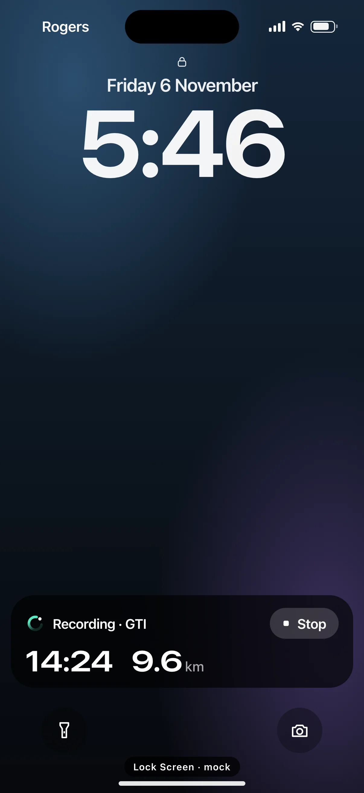 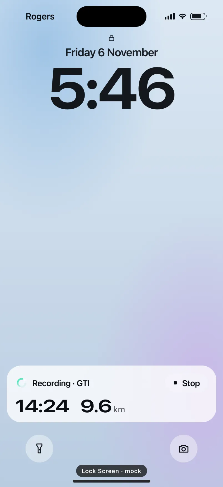

- **Presentation:** live — screen map: “Live (iOS Lock Screen)”
- **Entry points:** Manual start; S-LIVE-03 "Show live drive"
- **Leads to:** Tap → S-DRV-01 · Stop → trip ends (S-DRV-04 on next open)
- **PRD features:** F-CAP-01, F-CAP-09, F-CAP-17 · **Priority:** P0 · **WP:** B
- **Interactive:** [S-LIVE-01](../../../../prototypes/ios/index.html#S-LIVE-01)

**Purpose.** A quiet, glanceable “it’s recording” on the Lock Screen for manual trips (F-CAP-09), with a Stop that works without unlocking. Status only: elapsed time, distance and car — never speed, score or record pace (SAF-02).

### States

| State | PRD label | Fixture params | Screenshot |
|---|---|---|---|
| `default` | Recording | — | [S-LIVE-01.png](../../screens/ios/S-LIVE-01.webp) · [open](../../../../prototypes/ios/index.html#S-LIVE-01) |
| `gpsSearching` | GPS searching | `live=gpsSearching` | [S-LIVE-01--gpsSearching.png](../../screens/ios/S-LIVE-01--gpsSearching.webp) · [open](../../../../prototypes/ios/index.html#S-LIVE-01/gpsSearching) |
| `endingDriveDecoded` | Ending / “Drive decoded” | — | [S-LIVE-01--endingDriveDecoded.png](../../screens/ios/S-LIVE-01--endingDriveDecoded.webp) · [open](../../../../prototypes/ios/index.html#S-LIVE-01/endingDriveDecoded) |
| `s8HCapEnded` | 8 h cap ended (still recording) | `live=cap8h` | [S-LIVE-01--s8HCapEnded.png](../../screens/ios/S-LIVE-01--s8HCapEnded.webp) · [open](../../../../prototypes/ios/index.html#S-LIVE-01/s8HCapEnded) |
| default · light | Light theme | `theme=light` | [S-LIVE-01--light.png](../../screens/ios/S-LIVE-01--light.webp) |

Every state also renders in light/dark (`theme=light`), XL text (`text=xl`) and reduced motion (`rm=1`).

### Layout

- iOS Lock Screen mock: carrier + status icons, lock glyph, date, 104 pt clock, Live Activity in the system slot above the bottom quick actions (flashlight · camera), home indicator.
- Live Activity (radius 26, activityBackgroundTint black 55% + system blur, 16 padding): row 1 = Loop glyph 22 (Glide, static) + “Recording · GTI” (600 15) + trailing Stop capsule (44 pt hit area, #ffffff2b, stop glyph 14 + “Stop”). Row 2 = timer “14:24” and “9.6 km” in DP Numerals 32/32, units at 65% opacity, 20 gap. No progress bar (a trip has no end point).
- GPS searching: “0:22” + “Finding GPS…” instead of distance. Ending: Loop + “Drive decoded.” + “Open to see your Story.” (stays 15 min, then dismissed). 8 h cap: Loop + “Still recording.” + “Open DrivePerf to see it.”, with the “Recording your drive” notification below it.

### Components & tokens

| Component | Tokens / spec |
|---|---|
| `lockScreen` | see components.md |
| `liveActivity` | background black 55% · Glide accent · components.md §20 |
| `notification` | components.md §20.6 |

### Interactions & navigation

- Tap the activity → opens DrivePerf on S-DRV-01 (D1: never to content). Ending → S-STY-01 for the decoded trip (gate → S-DRV-05 if still moving).
- Stop (LiveActivityIntent, no unlock needed) → ends the trip; the activity switches to “Drive decoded.” after finalisation (prototype: → ending state). Next app open shows S-DRV-04 / the Story.
- Started by: in-app Start, the Control Center control or the widget (S-LIVE-03/04). Never started for auto trips in the background (A3 §3); “Show live drive” attaches one.

### Motion

- System-driven only: ActivityKit presents and updates the activity; the timer is Text(timerInterval:) and ticks itself. No custom animation, no pulsing dot (motion.md §3.2). Prototype: the activity rises 8 px on load. RM: none.

### Accessibility

- Live surfaces never announce the timer as it changes; each surface has one summary label (“DrivePerf, recording, GTI. 14 minutes, 9.6 kilometres.”) and a separate “Stop drive” button.
- Stop has its own label “Stop drive” and a 44 pt target.
- Supports the Lock Screen’s large text: the numbers row wraps under the title at AX sizes.

### Platform notes

- **iOS (this spec):** ActivityKit Live Activity (ActivityConfiguration lock-screen presentation), local updates only (≤ every 5 s, distance step 0.1 km or 15 s), payload ≤ 4 KB, staleDate = now + 60 s.
- *Android (for reference):* n/a (iOS only). Android equivalent: S-LIVE-05 Live Update / S-LIVE-06 ongoing notification.

### Analytics

- `live_activity_started {source: app|control|widget|show_live}`
- `live_activity_stop_tapped`
- `live_activity_ended {reason: decoded|cap_8h|user}`

### Copy

| Key | Text |
|---|---|
| Recording | Recording · {GTI} · {14:24} · {9.6} km · Stop |
| GPS | Recording · {GTI} · {0:22} · Finding GPS… · Stop |
| Ending | Drive decoded. · Open to see your Story. |
| Cap | Still recording. · Open DrivePerf to see it. |
| Cap notification | Recording your drive · Tap to open. Stop it any time after you park. |

### Free / Pro

Same for every plan.

### Data & fixtures

ContentState = {startedAt, distanceKm, vehicleNickname, gpsState, phase}. Fixtures: liveTrip.states.manual (default), gpsSearching, cap8h. Lock Screen clock = manual.startedAt + elapsedS (5:46; 5:32 for GPS; Sat 1:31 for the 8 h cap); the ending clock (5:52) is illustrative.

### Assets

[icon-stop.svg](assets/icon-stop.svg) · [icon-lock.svg](assets/icon-lock.svg) · [logo-a-loop.svg](assets/logo-a-loop.svg)

UI glyphs may be swapped for SF Symbols / Material Symbols Rounded equivalents; event-pin, quality and provenance glyphs must not be (components.md global rules).

### Checklist (accessibility.md §9)

- [ ] Light and dark both render, and contrast passes.
- [ ] The XL text state reflows with no truncation.
- [ ] The RM state is defined.
- [ ] Every control has a label; every chart and map has a summary sentence.
- [ ] Every target ≥ 44 pt / 48 dp (≥ 64 in-drive).
- [ ] No meaning by colour alone.
- [ ] Speed is neutral wherever it appears and absent from social or live surfaces.
- [ ] No streak, leaderboard, speed or “beat your time” language.
- [ ] Behaviour is defined while a trip is active (D1 gate).
- [ ] Haptics come from motion.md §6 only.

---

## S-LIVE-02 · Live Activity, Dynamic Island

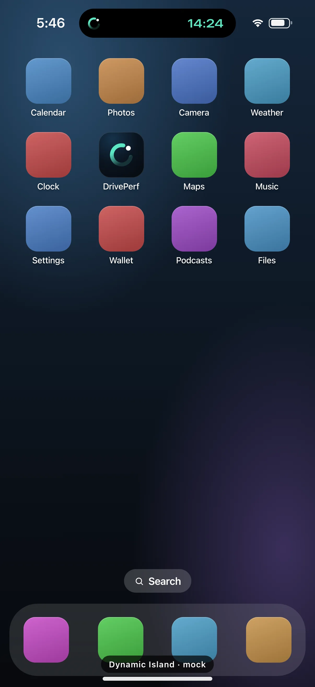 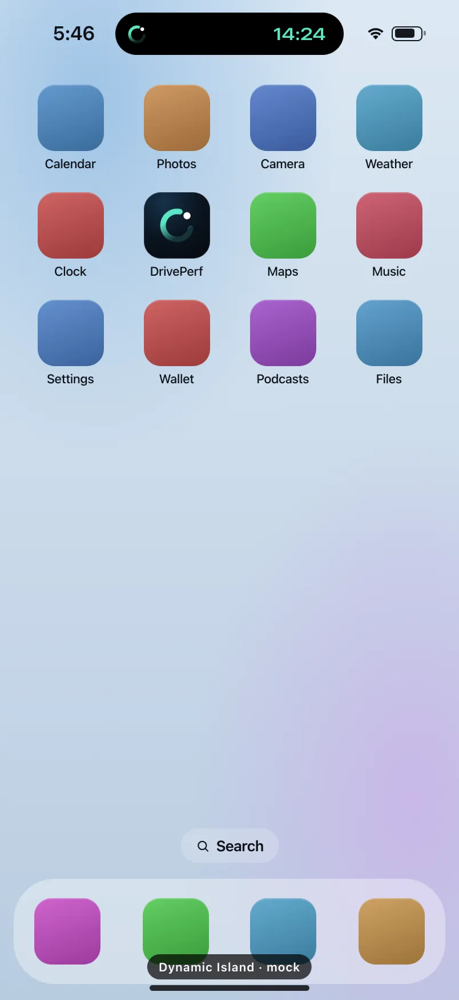

- **Presentation:** live — screen map: “Live (iOS Dynamic Island)”
- **Entry points:** Same Live Activity as S-LIVE-01
- **Leads to:** Tap → S-DRV-01 · long-press → expanded · Stop
- **PRD features:** F-CAP-01, F-CAP-09 · **Priority:** P0 · **WP:** B
- **Interactive:** [S-LIVE-02](../../../../prototypes/ios/index.html#S-LIVE-02)

**Purpose.** The same manual-trip Live Activity in the Dynamic Island while the phone is unlocked (F-CAP-09): a static Loop and a self-ticking timer, nothing that invites a look while driving.

### States

| State | PRD label | Fixture params | Screenshot |
|---|---|---|---|
| `default` | Compact | — | [S-LIVE-02.png](../../screens/ios/S-LIVE-02.webp) · [open](../../../../prototypes/ios/index.html#S-LIVE-02) |
| `minimal` | Minimal (another activity is running) | — | [S-LIVE-02--minimal.png](../../screens/ios/S-LIVE-02--minimal.webp) · [open](../../../../prototypes/ios/index.html#S-LIVE-02/minimal) |
| `expanded` | Expanded (long-press) | — | [S-LIVE-02--expanded.png](../../screens/ios/S-LIVE-02--expanded.webp) · [open](../../../../prototypes/ios/index.html#S-LIVE-02/expanded) |
| `ending` | Ending (“Drive decoded”) | — | [S-LIVE-02--ending.png](../../screens/ios/S-LIVE-02--ending.webp) · [open](../../../../prototypes/ios/index.html#S-LIVE-02/ending) |
| default · light | Light theme | `theme=light` | [S-LIVE-02--light.png](../../screens/ios/S-LIVE-02--light.webp) |

Every state also renders in light/dark (`theme=light`), XL text (`text=xl`) and reduced motion (`rm=1`).

### Layout

- Compact (default): leading = Loop glyph 20 (Glide, static) · trailing = timer “14:24” (600 15 DP Numerals, Glide). Width ≈ 196, height 37, around the hardware island; the status bar keeps the time and battery.
- Minimal (another app’s activity owns the compact slot): a detached 37 pt circle with the Loop only.
- Expanded (long-press): 378 wide, radius 46, 18/20 padding. Leading “Recording” + car (GTI at 60%) · trailing timer 28 · bottom row: distance “9.6 km” (28, unit 60%) + Stop capsule. No centre content.
- Ending: compact with “Drive decoded ✓”, auto-dismissed after a few seconds.
- Background in the mock: an iOS Home Screen (labelled icons, dock); expanded dims it 20%.

### Components & tokens

| Component | Tokens / spec |
|---|---|
| `island` | see components.md |
| `homeScreen` | see components.md |

### Interactions & navigation

- Tap (compact, minimal, expanded) → DrivePerf on S-DRV-01. Long-press compact → expanded (longPress haptic). Stop (expanded) → ends the trip → ending.
- Ending tap → S-STY-01 through the D1 gate (S-DRV-05 while moving).

### Motion

- System morphs between compact, expanded and minimal (prototype: bouncy spring scale from the pill). The timer is Text(timerInterval:). No custom animation, no pulse. RM: system cross-fade.

### Accessibility

- Live surfaces never announce the timer as it changes; each surface has one summary label (“DrivePerf, recording, GTI. 14 minutes, 9.6 kilometres.”) and a separate “Stop drive” button.
- Compact reads “DrivePerf, recording, 14 minutes”. Expanded exposes “Stop drive”.

### Platform notes

- **iOS (this spec):** ActivityConfiguration dynamicIsland { DynamicIslandExpandedRegion(.leading/.trailing/.bottom) } compactLeading/compactTrailing/minimal; keylineTint Glide.
- *Android (for reference):* n/a (iOS only). Android shows the status-bar chip (S-LIVE-05 statusChip).

### Analytics

- `live_activity_expanded`
- `live_activity_tapped {presentation: compact|minimal|expanded}`
- `live_activity_stop_tapped {presentation: expanded}`

### Copy

| Key | Text |
|---|---|
| Compact | [Loop] {14:24} |
| Expanded | Recording · {GTI} · {14:24} · {9.6} km · Stop |
| Ending | Drive decoded ✓ |

### Free / Pro

Same for every plan.

### Data & fixtures

liveTrip.states.manual (14:24 · 9.6 km · GTI). Status-bar clock = startedAt + elapsedS (5:46).

### Assets

[icon-stop.svg](assets/icon-stop.svg) · [icon-check.svg](assets/icon-check.svg) · [logo-a-loop.svg](assets/logo-a-loop.svg)

UI glyphs may be swapped for SF Symbols / Material Symbols Rounded equivalents; event-pin, quality and provenance glyphs must not be (components.md global rules).

### Checklist (accessibility.md §9)

- [ ] Light and dark both render, and contrast passes.
- [ ] The XL text state reflows with no truncation.
- [ ] The RM state is defined.
- [ ] Every control has a label; every chart and map has a summary sentence.
- [ ] Every target ≥ 44 pt / 48 dp (≥ 64 in-drive).
- [ ] No meaning by colour alone.
- [ ] Speed is neutral wherever it appears and absent from social or live surfaces.
- [ ] No streak, leaderboard, speed or “beat your time” language.
- [ ] Behaviour is defined while a trip is active (D1 gate).
- [ ] Haptics come from motion.md §6 only.

---

Map geometry in the prototype: © OpenStreetMap contributors (ODbL). Speed and G are simulated fixtures (fixtures.md).
