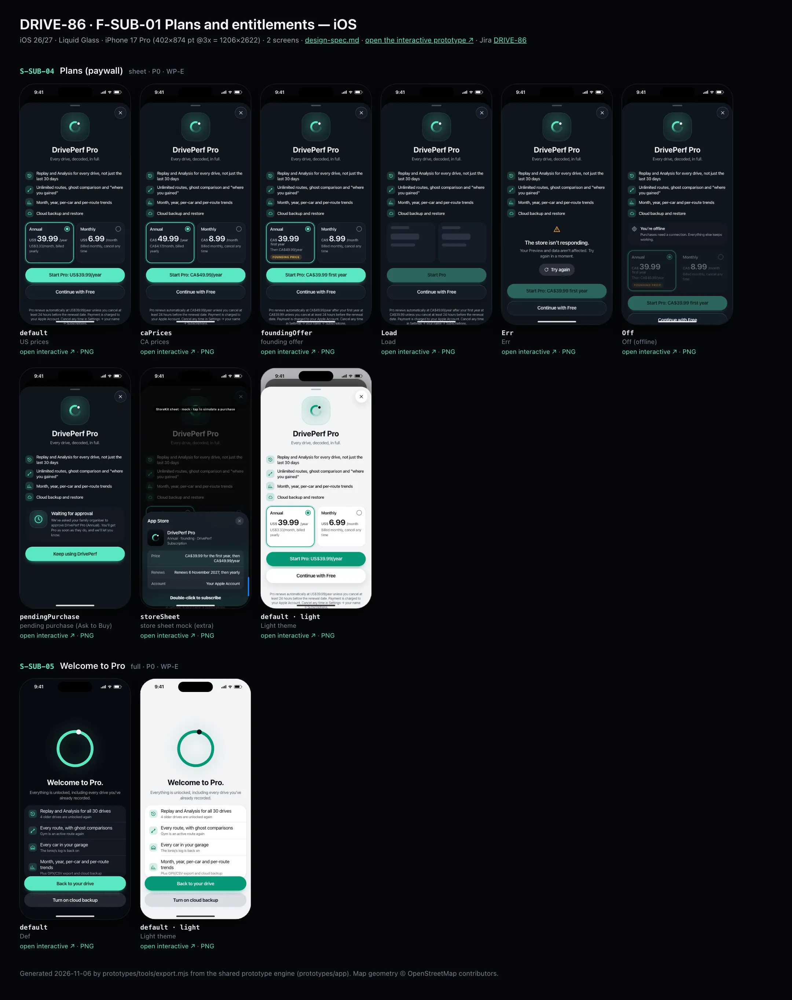
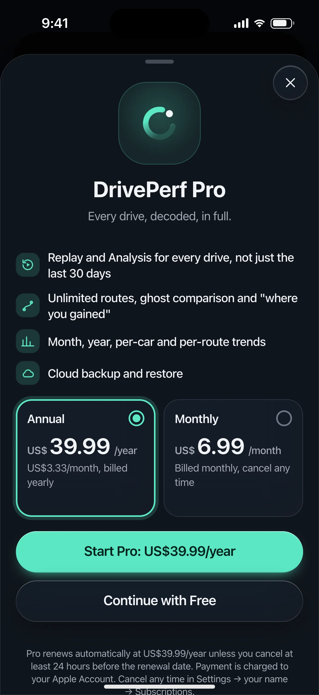
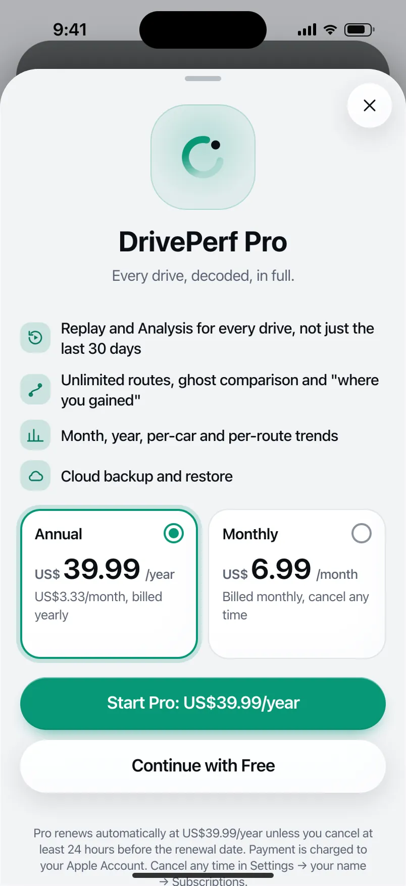
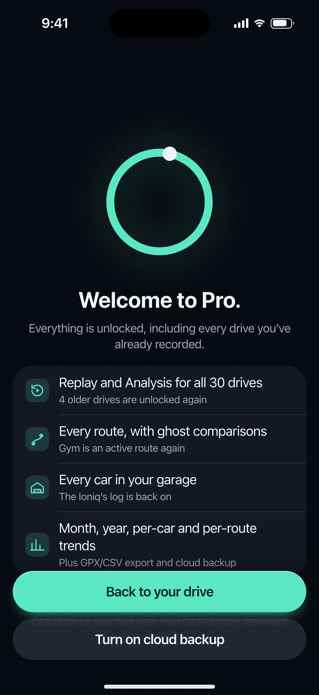
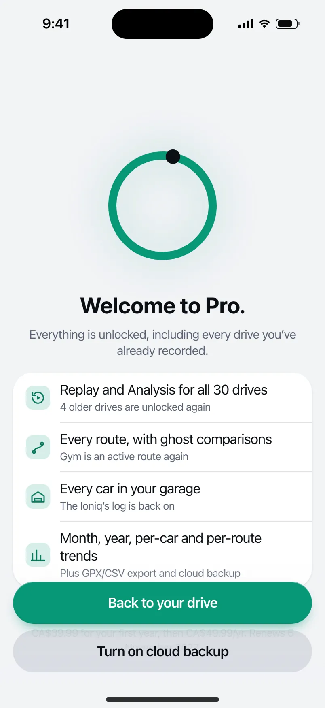

# DRIVE-86 · F-SUB-01 Plans and entitlements — iOS design spec

> Generated by `prototypes/tools/export.mjs` on 2026-11-06 from the shared prototype engine. **Do not edit by hand:** change the screen's `spec` in `prototypes/app/screens/wp-*.js` (see `prototypes/app/AUTHORING.md`) and re-export.

- **Jira story:** [DRIVE-86](https://thekeval.atlassian.net/browse/DRIVE-86) · F-SUB-01 · P0
- **Platform:** iOS 26/27 · Liquid Glass · iPhone 17 Pro (402×874 pt @3x = 1206×2622)
- **Interactive prototype:** [../../../../prototypes/ios/index.html#S-SUB-04](../../../../prototypes/ios/index.html#S-SUB-04) (catalog panel: every screen and state; deep links `#S-ID/state?trip=…&ent=…&theme=light&text=xl&rm=1`)
- **Contact sheet:** [mockup.html](mockup.html) · 
- **Design system (source of truth for values):** [brand](../../system/brand.md) · [components](../../system/components.md) · [motion](../../system/motion.md) · [accessibility](../../system/accessibility.md) · [screen map](../../system/screen-map.md) · [fixtures](../../system/fixtures.md) · tokens `prototypes/shared/tokens.css`

## Screens in this story

| Screen | Name | Presentation | Priority | States | Status |
|---|---|---|---|---|---|
| `S-SUB-04` | Plans (paywall) | Sheet (large) / Full | P0 | 8 | Prototyped |
| `S-SUB-05` | Welcome to Pro | Full (celebration) | P0 | 1 | Prototyped |

## Tokens used on this platform

Values resolved from `prototypes/shared/tokens.css` inside the iOS device (`[data-platform="ios"]`). Use the token names in code; the hex values are for reference.

| Token | Dark | Light |
|---|---|---|
| `--app-bg` | `#080B10` | `#F2F3F6` |
| `--card-bg` | `#131822` | `#FFFFFF` |
| `--dp-bg-grouped` | `#080B10` | `#F2F3F6` |
| `--dp-surface` | `#131822` | `#FFFFFF` |
| `--dp-surface-2` | `#1B222D` | `#F2F3F6` |
| `--dp-surface-3` | `#262E3B` | `#E4E7EC` |
| `--dp-fill` | `#7880961F` | `#7880961F` |
| `--dp-fill-strong` | `#7880963D` | `#78809633` |
| `--dp-text` | `#F2F4F7` | `#0B0E13` |
| `--dp-text-2` | `#A3AAB6` | `#5A6271` |
| `--dp-text-3` | `#6E7787` | `#8A919D` |
| `--dp-separator` | `#96A0B429` | `#3C435024` |
| `--dp-accent` | `#5BE7C4` | `#079777` |
| `--dp-accent-text` | `#5BE7C4` | `#06775E` |
| `--dp-on-accent` | `#04241D` | `#FFFFFF` |
| `--dp-accent-container` | `#0A4439` | `#C6F8EA` |
| `--dp-record` | `#FFC24B` | `#9A6300` |
| `--dp-positive` | `#5BE7C4` | `#06775E` |
| `--dp-change-down` | `#A3AAB6` | `#5A6271` |
| `--dp-warning` | `#F5B648` | `#9A5F00` |
| `--dp-critical` | `#FF6B6B` | `#C62828` |
| `--dp-glass-fill` | `#1C222C6B` | `#FFFFFF8C` |
| `--dp-glass-fill-strong` | `#1C222CB8` | `#FFFFFFD1` |
| `--dp-glass-stroke` | `#FFFFFF24` | `#FFFFFF99` |
| `--dp-data-route` | `#5BE7C4` | `#079777` |
| `--dp-data-event-brake` | `#FF7A66` | `#A21F16` |
| `--dp-data-event-accel` | `#E58BD0` | `#A33A8C` |
| `--dp-data-event-corner` | `#EAD54E` | `#9A8A00` |
| `--dp-data-quality-good` | `#5FDB9C` | `#1E9E62` |
| `--dp-data-speed` | `#D6DCE4` | `#404A58` |
| `--dp-data-long-g` | `#5AB8F5` | `#0A6AB8` |
| `--dp-data-lat-g` | `#F5A142` | `#B25A00` |

| Type / layout token | Value |
|---|---|
| `--dp-font-screen-title` | `700 34px / 41px -apple-system, BlinkMacSystemFont, "SF Pro Display", system-ui, sans-serif` |
| `--dp-font-sheet-title` | `700 22px / 28px -apple-system, BlinkMacSystemFont, "SF Pro Display", system-ui, sans-serif` |
| `--dp-font-section-title` | `600 20px / 25px -apple-system, BlinkMacSystemFont, "SF Pro Display", system-ui, sans-serif` |
| `--dp-font-card-title` | `600 17px / 22px -apple-system, BlinkMacSystemFont, "SF Pro Text", system-ui, sans-serif` |
| `--dp-font-body` | `400 17px / 22px -apple-system, BlinkMacSystemFont, "SF Pro Text", system-ui, sans-serif` |
| `--dp-font-body-secondary` | `400 15px / 20px -apple-system, BlinkMacSystemFont, "SF Pro Text", system-ui, sans-serif` |
| `--dp-font-meta` | `400 13px / 18px -apple-system, BlinkMacSystemFont, "SF Pro Text", system-ui, sans-serif` |
| `--dp-font-caption` | `400 12px / 16px -apple-system, BlinkMacSystemFont, "SF Pro Text", system-ui, sans-serif` |
| `--dp-font-button` | `600 17px / 22px -apple-system, BlinkMacSystemFont, "SF Pro Text", system-ui, sans-serif` |
| `--dp-num-hero` | `600 72px / 72px -apple-system, BlinkMacSystemFont, "SF Pro Display", system-ui, sans-serif` |
| `--dp-num-xl` | `600 48px / 52px -apple-system, BlinkMacSystemFont, "SF Pro Display", system-ui, sans-serif` |
| `--dp-num-l` | `600 34px / 38px -apple-system, BlinkMacSystemFont, "SF Pro Display", system-ui, sans-serif` |
| `--dp-num-m` | `600 24px / 28px -apple-system, BlinkMacSystemFont, "SF Pro Display", system-ui, sans-serif` |
| `--dp-num-s` | `600 17px / 22px -apple-system, BlinkMacSystemFont, "SF Pro Display", system-ui, sans-serif` |
| `--dp-num-xs` | `600 13px / 16px -apple-system, BlinkMacSystemFont, "SF Pro Display", system-ui, sans-serif` |
| `--dp-screen-margin` | `16px` |
| `--dp-radius-card` | `24px` |
| `--dp-radius-card-hero` | `32px` |
| `--dp-radius-sheet` | `38px` |
| `--dp-radius-chip` | `999px` |
| `--dp-radius-button` | `999px` |
| `--dp-layout-list-row-min` | `52px` |
| `--dp-layout-touch-min` | `44px` |
| `--safe-top` | `62px` |
| `--safe-bottom` | `34px` |

Text sizes scale with `--dp-text-scale` (XL = 2.0×) and numerals with `--dp-num-scale` (XL = 1.3×). DP Numerals: SF Pro Expanded Semibold, tabular.

---

## S-SUB-04 · Plans (paywall)

 

- **Presentation:** sheet (iOS sheet, Android full) · tab: profile · detent: large — screen map: “Sheet (large) / Full”
- **Entry points:** S-SUB-01 · S-SUB-02 · S-SUB-03 · S-SUB-06
- **Leads to:** Store sheet mock → S-SUB-05 · Err/Off states
- **PRD features:** F-SUB-01, F-SUB-05, F-SUB-08, F-SUB-03 · **Priority:** P0 · **WP:** E
- **Interactive:** [S-SUB-04](../../../../prototypes/ios/index.html#S-SUB-04)

**Purpose.** Clear monthly and annual plans at fair local prices with every required disclosure (F-SUB-01, F-SUB-05; Apple 3.1.2, Play subscriptions policy): Annual pre-selected, Monthly equal in size, “Continue with Free” equal in weight to the purchase button, close visible immediately, no weekly or lifetime plan, no countdown, no strikethrough.

### States

| State | PRD label | Fixture params | Screenshot |
|---|---|---|---|
| `default` | US prices | `region=US` | [S-SUB-04.png](../../screens/ios/S-SUB-04.webp) · [open](../../../../prototypes/ios/index.html#S-SUB-04) |
| `caPrices` | CA prices | `region=CA` | [S-SUB-04--caPrices.png](../../screens/ios/S-SUB-04--caPrices.webp) · [open](../../../../prototypes/ios/index.html#S-SUB-04/caPrices) |
| `foundingOffer` | founding offer | `region=CA` `founding=1` | [S-SUB-04--foundingOffer.png](../../screens/ios/S-SUB-04--foundingOffer.webp) · [open](../../../../prototypes/ios/index.html#S-SUB-04/foundingOffer) |
| `Load` | Load | `region=CA` `founding=1` | [S-SUB-04--Load.png](../../screens/ios/S-SUB-04--Load.webp) · [open](../../../../prototypes/ios/index.html#S-SUB-04/Load) |
| `Err` | Err | `region=CA` `founding=1` | [S-SUB-04--Err.png](../../screens/ios/S-SUB-04--Err.webp) · [open](../../../../prototypes/ios/index.html#S-SUB-04/Err) |
| `Off` | Off (offline) | `region=CA` `founding=1` | [S-SUB-04--Off.png](../../screens/ios/S-SUB-04--Off.webp) · [open](../../../../prototypes/ios/index.html#S-SUB-04/Off) |
| `pendingPurchase` | pending purchase (Ask to Buy) | `region=CA` `founding=1` | [S-SUB-04--pendingPurchase.png](../../screens/ios/S-SUB-04--pendingPurchase.webp) · [open](../../../../prototypes/ios/index.html#S-SUB-04/pendingPurchase) |
| `storeSheet` | store sheet mock (extra) | `region=CA` `founding=1` | [S-SUB-04--storeSheet.png](../../screens/ios/S-SUB-04--storeSheet.webp) · [open](../../../../prototypes/ios/index.html#S-SUB-04/storeSheet) |
| default · light | Light theme | `theme=light` | [S-SUB-04--light.png](../../screens/ios/S-SUB-04--light.webp) |

Every state also renders in light/dark (`theme=light`), XL text (`text=xl`) and reduced motion (`rm=1`).

### Layout

- iOS: sheet at the large detent, glass close top-trailing. Android: full-screen dialog with close leading.
- Header: Loop in a 104 illustration tile, “DrivePerf Pro” (28/34), “Every drive, decoded, in full.”
- Value list: 4 Pro features with glyphs (replay, routes, insights, cloud) from entitlement.proFeatures.
- Plan cards side by side, identical (radius 20 iOS / 16 → selected 28 Android, min height 148): label + radio, price in DP Numerals with the currency at 50% (“US$ 39.99 /year”), sub line, optional gold “FOUNDING PRICE” capsule. US: Annual US$39.99/year · US$3.33/month, billed yearly · Monthly US$6.99/month. CA: CA$49.99 · CA$4.17 · CA$8.99. Founding: Annual “CA$39.99 first year · Then CA$49.99/year”.
- Equal-weight pair: “Start Pro: US$39.99/year” (filled) + “Continue with Free” (glass / secondaryContainer), same size and type, stacked.
- Legal (caption, text-2, never truncated): auto-renewal at the plan price, 24-hour rule, where it is charged and how to cancel; Terms · Privacy · Restore purchases.
- Load: plan-card skeletons, Start Pro disabled. Err: error state “The store isn’t responding. Your Preview and data aren’t affected.” + Try again. Off: info banner “You’re offline. Purchases need a connection.” + cards and Start Pro disabled (Continue with Free stays). pending: “Waiting for approval” card (Ask to Buy) / “Your purchase is pending” (Play) + “Keep using DrivePerf”. Store sheet: StoreKit / Play Billing mock over the paywall.

### Components & tokens

| Component | Tokens / spec |
|---|---|
| `sheet` | iOS glass --dp-glass-fill-strong + --dp-glass-prominent-blur, radius --dp-radius-sheet 38 · Android ModalBottomSheet --md-sys-color-surface-container-low, top radius 28, drag handle 32×4 · motion spring.sheet |
| `iconButton` | see components.md |
| `button` | --dp-accent / --dp-on-accent (filled) · --dp-fill-strong · --md-sys-color-secondary-container (tonal) · --dp-radius-button · height iOS 50/44/34 · Android 56/40/32 · --dp-font-button · components.md §0 |
| `banner` | radius 12 (--dp-radius-sm+) · info --dp-fill · attention --dp-warning-container · critical --dp-critical-container · components.md §22 |
| `error` | see components.md |
| `skeleton` | --dp-fill-strong, breathe 1.2 s (dp-skeleton) |
| `card` | --dp-surface / --md-sys-color-surface-container · --dp-radius-card (24 iOS · 16 Android) · hero: --dp-radius-card-hero (32 · 28) · light iOS: --dp-elev-1 |

### Interactions & navigation

- Plan card → select (ring slides between cards, spring.fast, haptic selection); the primary label and legal text follow the plan.
- Start Pro → StoreKit purchase sheet / Play Billing flow (mocked: tap = purchase) → entitlement active within 5 s → S-SUB-05. Failure → toast + error haptic. Ask to Buy / pending → pending state.
- Continue with Free / close / drag down → back to where the user was. Restore purchases → store restore (toast with the result).
- Gate: S-SUB-04 is never reachable during a trip or while moving (D1 → S-DRV-05) and never auto-opens.

### Motion

- Present: spring.sheet (iOS) / slide-up full-screen dialog + scrim fade (Android), ≈ 520 ms. Illustration pops; value rows and plan cards rise 8 px, 50 ms stagger; the button pair rises as one block. No pulsing or shimmering CTA. RM: fade.

### Accessibility

- Plan cards are a radio group: “Annual, US$39.99 /year. US$3.33/month, billed yearly, selected”. Close is the first focusable element.
- XL: plan cards stack (Annual first), the legal block stays fully visible and scrolls.
- Prices are read as “39 dollars 99 US” by the system from the store’s localized string.

### Platform notes

- **iOS (this spec):** Sheet .large; glass plan cards with a Glide selection ring; .glassProminent + .glass buttons at equal size; StoreKit 2 purchase + Ask to Buy (.pending).
- *Android (for reference):* Full-screen dialog; plan cards surfaceContainerHigh → selected primaryContainer with shape morph to extraLargeIncreased; filled + FilledTonal buttons at equal size; Play Billing (PENDING purchase state).

### Analytics

- `paywall_viewed {source}`
- `plan_selected {plan}`
- `purchase_started`
- `purchase_completed {plan, offer}`
- `purchase_failed {reason}`
- `offer_shown {offer: founding}`

### Copy

| Key | Text |
|---|---|
| Header | DrivePerf Pro · Every drive, decoded, in full. |
| US plans | Annual US$39.99/year (US$3.33/month, billed yearly) · Monthly US$6.99/month (Billed monthly, cancel any time) |
| CA plans | Annual CA$49.99/year (CA$4.17/month, billed yearly) · Monthly CA$8.99/month |
| Founding | Annual CA$39.99 first year · Then CA$49.99/year · Founding price (US: US$29.99 then US$39.99/yr) |
| Err | The store isn’t responding. Your Preview and data aren’t affected. Try again in a moment. |
| Off | You’re offline. Purchases need a connection. Everything else keeps working. |
| Pending | Waiting for approval. We’ve asked your family organiser to approve DrivePerf Pro (Annual). You’ll get Pro as soon as they do, and we’ll let you know. |
| Legal | Pro renews automatically at {price} unless you cancel at least 24 hours before the renewal date. Payment is charged to your Apple Account / Google Play account. Cancel any time in Settings → your name → Subscriptions / Google Play → Payments and subscriptions. |

### Free / Pro

Shown to Free and Preview users. Prices come from the store at runtime (RevenueCat offerings); the prototype uses entitlement.prices. One subscription group “DrivePerf Pro”; no weekly, no lifetime product.

### Data & fixtures

entitlement.prices.US / CA (annualPerMonth derived by the fixture). Founding = user.founding; the default state shows standard US prices per the PRD state list. Renewal in the store mock = today + 1 year.

### Assets

[icon-replay.svg](assets/icon-replay.svg) · [icon-routes.svg](assets/icon-routes.svg) · [icon-insights.svg](assets/icon-insights.svg) · [icon-cloud.svg](assets/icon-cloud.svg) · [icon-close.svg](assets/icon-close.svg) · [icon-clock.svg](assets/icon-clock.svg) · [icon-gps.svg](assets/icon-gps.svg) · [icon-refresh.svg](assets/icon-refresh.svg) · [logo-a-loop.svg](assets/logo-a-loop.svg)

UI glyphs may be swapped for SF Symbols / Material Symbols Rounded equivalents; event-pin, quality and provenance glyphs must not be (components.md global rules).

### Checklist (accessibility.md §9)

- [ ] Light and dark both render, and contrast passes.
- [ ] The XL text state reflows with no truncation.
- [ ] The RM state is defined.
- [ ] Every control has a label; every chart and map has a summary sentence.
- [ ] Every target ≥ 44 pt / 48 dp (≥ 64 in-drive).
- [ ] No meaning by colour alone.
- [ ] Speed is neutral wherever it appears and absent from social or live surfaces.
- [ ] No streak, leaderboard, speed or “beat your time” language.
- [ ] Behaviour is defined while a trip is active (D1 gate).
- [ ] Haptics come from motion.md §6 only.

---

## S-SUB-05 · Welcome to Pro

 

- **Presentation:** full · tab: profile — screen map: “Full (celebration)”
- **Entry points:** Successful purchase
- **Leads to:** Back to the unlocked feature
- **PRD features:** F-SUB-01 · **Priority:** P0 · **WP:** E
- **Interactive:** [S-SUB-05](../../../../prototypes/ios/index.html#S-SUB-05)

**Purpose.** Confirm a successful purchase and what it unlocked, in the user’s own terms (F-SUB-01.3), then send them straight back to the feature they wanted. Calm pride, no confetti.

### States

| State | PRD label | Fixture params | Screenshot |
|---|---|---|---|
| `default` | Def | `ent=pro` | [S-SUB-05.png](../../screens/ios/S-SUB-05.webp) · [open](../../../../prototypes/ios/index.html#S-SUB-05) |
| default · light | Light theme | `theme=light` | [S-SUB-05--light.png](../../screens/ios/S-SUB-05--light.webp) |

Every state also renders in light/dark (`theme=light`), XL text (`text=xl`) and reduced motion (`rm=1`).

### Layout

- Full-screen cover (theme-following). Centre: the Loop at 168 (10 stroke track + Glide arc + G-dot) — the only screen where the Loop closes.
- Title “Welcome to Pro.” (28/34) + lead “Everything is unlocked, including every drive you’ve already recorded.”
- Unlocked list (4 rows, icon tiles): Replay and Analysis for all 30 drives (4 older drives unlocked) · Every route, with ghost comparisons (Gym active again) · Every car (the Ioniq’s log is back on) · Trends, plus export and backup.
- Plan line: gold “FOUNDING MEMBER” capsule + “CA$39.99 for your first year, then CA$49.99/yr. Renews 6 November 2027.”
- Dock: “Back to your drive” (filled) · “Turn on cloud backup” (tonal).

### Components & tokens

| Component | Tokens / spec |
|---|---|
| `page` | --dp-bg-grouped (iOS) / --md-sys-color-surface (Android) · --dp-screen-margin 16 |
| `list` | iOS inset grouped radius --dp-radius-card, rows 52 pt, separators --dp-separator inset 16 · Android ListItem 56/72 dp in --md-sys-color-surface-container |
| `row` | --dp-font-body · --dp-font-meta (supporting) · --dp-layout-list-row-min |
| `button` | --dp-accent / --dp-on-accent (filled) · --dp-fill-strong · --md-sys-color-secondary-container (tonal) · --dp-radius-button · height iOS 50/44/34 · Android 56/40/32 · --dp-font-button · components.md §0 |

### Interactions & navigation

- Back to your drive → dismiss back to the unlocked feature (e.g. the trip whose Replay was locked). Turn on cloud backup → S-ACC-04.

### Motion

- Loop close (motion.md §3.9): the G-dot travels across the gap and the ring completes (700 ms, ease.glide ≈ spring.slow), holds 400 ms, then reopens as the dot moves ahead (600 ms); haptic success when it closes. Text and list rise 8 px from 500 ms (50 ms stagger). RM / export shot: the Loop is shown closed, then open, with no travel.

### Accessibility

- Focus lands on “Welcome to Pro.”; the Loop is decorative. List rows are static text. XL: rows wrap; the Loop shrinks to 132.

### Platform notes

- **iOS (this spec):** fullScreenCover; .sensoryFeedback(.success).
- *Android (for reference):* Full-screen destination; HapticFeedbackConstants.CONFIRM.

### Analytics

- `purchase_completed {plan, offer}`
- `welcome_pro_viewed`
- `welcome_pro_action {back|backup}`

### Copy

| Key | Text |
|---|---|
| Title | Welcome to Pro. |
| Lead | Everything is unlocked, including every drive you’ve already recorded. |
| Plan | Founding member · CA$39.99 for your first year, then CA$49.99/yr. Renews {date}. |
| Buttons | Back to your drive · Turn on cloud backup |

### Free / Pro

Shown once after a purchase. Monthly purchase: the plan line reads “CA$8.99/month. Renews {date}.” without the founding badge.

### Data & fixtures

Unlock counts derived from the fixtures: 30 trips, 4 archive trips locked on Free (util.isLocked), r_gym (3rd route), Ioniq (2nd car). Prices from entitlement.prices.CA; renewal = purchase day + 1 year (prototype: today).

### Assets

[icon-replay.svg](assets/icon-replay.svg) · [icon-routes.svg](assets/icon-routes.svg) · [icon-garage.svg](assets/icon-garage.svg) · [icon-insights.svg](assets/icon-insights.svg) · [logo-a-loop.svg](assets/logo-a-loop.svg)

UI glyphs may be swapped for SF Symbols / Material Symbols Rounded equivalents; event-pin, quality and provenance glyphs must not be (components.md global rules).

### Checklist (accessibility.md §9)

- [ ] Light and dark both render, and contrast passes.
- [ ] The XL text state reflows with no truncation.
- [ ] The RM state is defined.
- [ ] Every control has a label; every chart and map has a summary sentence.
- [ ] Every target ≥ 44 pt / 48 dp (≥ 64 in-drive).
- [ ] No meaning by colour alone.
- [ ] Speed is neutral wherever it appears and absent from social or live surfaces.
- [ ] No streak, leaderboard, speed or “beat your time” language.
- [ ] Behaviour is defined while a trip is active (D1 gate).
- [ ] Haptics come from motion.md §6 only.

---

Map geometry in the prototype: © OpenStreetMap contributors (ODbL). Speed and G are simulated fixtures (fixtures.md).
