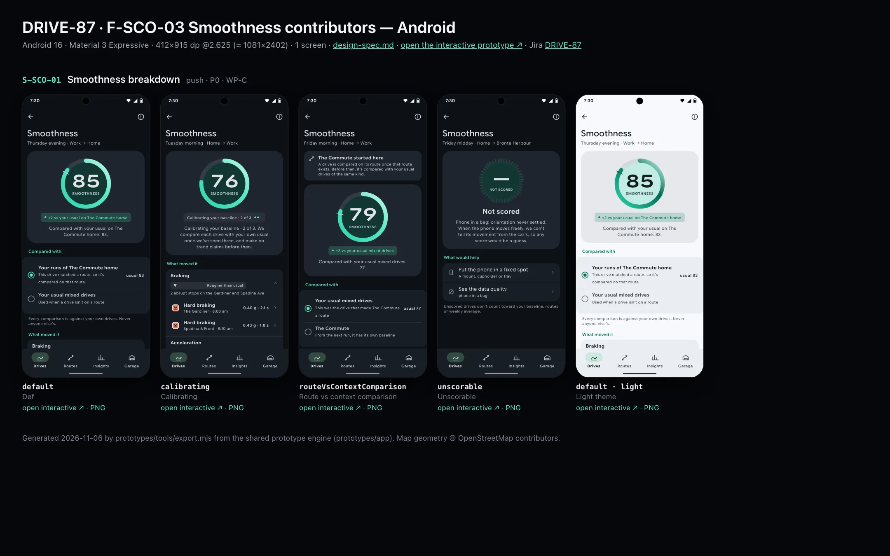
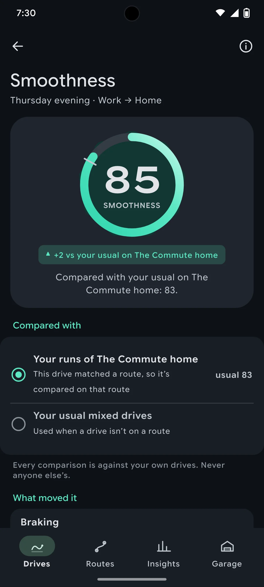
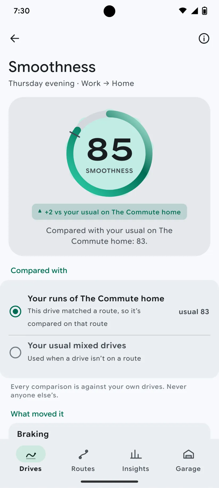

# DRIVE-87 · F-SCO-03 Smoothness contributors — Android design spec

> Generated by `prototypes/tools/export.mjs` on 2026-11-06 from the shared prototype engine. **Do not edit by hand:** change the screen's `spec` in `prototypes/app/screens/wp-*.js` (see `prototypes/app/AUTHORING.md`) and re-export.

- **Jira story:** [DRIVE-87](https://thekeval.atlassian.net/browse/DRIVE-87) · F-SCO-03 · P0
- **Platform:** Android 16 · Material 3 Expressive · 412×915 dp @2.625 (≈ 1081×2402)
- **Interactive prototype:** [../../../../prototypes/android/index.html#S-SCO-01](../../../../prototypes/android/index.html#S-SCO-01) (catalog panel: every screen and state; deep links `#S-ID/state?trip=…&ent=…&theme=light&text=xl&rm=1`)
- **Contact sheet:** [mockup.html](mockup.html) · 
- **Design system (source of truth for values):** [brand](../../system/brand.md) · [components](../../system/components.md) · [motion](../../system/motion.md) · [accessibility](../../system/accessibility.md) · [screen map](../../system/screen-map.md) · [fixtures](../../system/fixtures.md) · tokens `prototypes/shared/tokens.css`

## Screens in this story

| Screen | Name | Presentation | Priority | States | Status |
|---|---|---|---|---|---|
| `S-SCO-01` | Smoothness breakdown | Push | P0 | 4 | Prototyped |

## Tokens used on this platform

Values resolved from `prototypes/shared/tokens.css` inside the Android device (`[data-platform="android"]`). Use the token names in code; the hex values are for reference.

| Token | Dark | Light |
|---|---|---|
| `--app-bg` | `#0D1117` | `#F7F9FC` |
| `--card-bg` | `#191E25` | `#EBEEF2` |
| `--dp-bg-grouped` | `#0D1117` | `#F7F9FC` |
| `--dp-surface` | `#191E25` | `#EBEEF2` |
| `--dp-surface-2` | `#1F252D` | `#E5E8EC` |
| `--dp-surface-3` | `#2A3038` | `#DFE2E6` |
| `--dp-fill` | `#2A3038` | `#DFE2E6` |
| `--dp-fill-strong` | `#353B44` | `#D3D7DC` |
| `--dp-text` | `#E1E3E8` | `#181C20` |
| `--dp-text-2` | `#C0C7CF` | `#40474F` |
| `--dp-text-3` | `#8A929B` | `#707881` |
| `--dp-separator` | `#40474F` | `#C0C7CF` |
| `--dp-accent` | `#5BE7C4` | `#006B53` |
| `--dp-accent-text` | `#5BE7C4` | `#006B53` |
| `--dp-on-accent` | `#00382B` | `#FFFFFF` |
| `--dp-accent-container` | `#00513F` | `#91F1D8` |
| `--dp-record` | `#FFC24B` | `#7A5900` |
| `--dp-positive` | `#5BE7C4` | `#006B53` |
| `--dp-change-down` | `#C0C7CF` | `#40474F` |
| `--dp-warning` | `#F5B648` | `#7A5900` |
| `--dp-critical` | `#FFB4AB` | `#BA1A1A` |
| `--dp-glass-fill` | `#1F252DF2` | `#E5E8ECF2` |
| `--dp-glass-fill-strong` | `#2A3038` | `#DFE2E6` |
| `--dp-glass-stroke` | `#FFFFFF0F` | `#0000000A` |
| `--md-sys-color-primary` | `#5BE7C4` | `#006B53` |
| `--md-sys-color-on-primary` | `#00382B` | `#FFFFFF` |
| `--md-sys-color-primary-container` | `#00513F` | `#91F1D8` |
| `--md-sys-color-on-primary-container` | `#91F1D8` | `#002118` |
| `--md-sys-color-secondary-container` | `#344C44` | `#CEE9DF` |
| `--md-sys-color-surface` | `#0D1117` | `#F7F9FC` |
| `--md-sys-color-surface-container` | `#191E25` | `#EBEEF2` |
| `--md-sys-color-surface-container-high` | `#1F252D` | `#E5E8EC` |
| `--md-sys-color-on-surface-variant` | `#C0C7CF` | `#40474F` |
| `--dp-data-route` | `#5BE7C4` | `#079777` |
| `--dp-data-event-brake` | `#FF7A66` | `#A21F16` |
| `--dp-data-event-accel` | `#E58BD0` | `#A33A8C` |
| `--dp-data-event-corner` | `#EAD54E` | `#9A8A00` |
| `--dp-data-quality-good` | `#5FDB9C` | `#1E9E62` |
| `--dp-data-speed` | `#D6DCE4` | `#404A58` |
| `--dp-data-long-g` | `#5AB8F5` | `#0A6AB8` |
| `--dp-data-lat-g` | `#F5A142` | `#B25A00` |

| Type / layout token | Value |
|---|---|
| `--dp-font-screen-title` | `600 32px / 40px "Google Sans Flex", "Google Sans Display", "Roboto Flex", Roboto, system-ui, sans-serif` |
| `--dp-font-sheet-title` | `400 24px / 32px "Google Sans Flex", "Google Sans Display", "Roboto Flex", Roboto, system-ui, sans-serif` |
| `--dp-font-section-title` | `600 22px / 28px "Google Sans Flex", "Google Sans Display", "Roboto Flex", Roboto, system-ui, sans-serif` |
| `--dp-font-card-title` | `700 16px / 24px "Google Sans Flex", "Google Sans Text", "Roboto Flex", Roboto, system-ui, sans-serif` |
| `--dp-font-body` | `400 16px / 24px "Google Sans Flex", "Google Sans Text", "Roboto Flex", Roboto, system-ui, sans-serif` |
| `--dp-font-body-secondary` | `400 14px / 20px "Google Sans Flex", "Google Sans Text", "Roboto Flex", Roboto, system-ui, sans-serif` |
| `--dp-font-meta` | `400 12px / 16px "Google Sans Flex", "Google Sans Text", "Roboto Flex", Roboto, system-ui, sans-serif` |
| `--dp-font-caption` | `500 12px / 16px "Google Sans Flex", "Google Sans Text", "Roboto Flex", Roboto, system-ui, sans-serif` |
| `--dp-font-button` | `700 14px / 20px "Google Sans Flex", "Google Sans Text", "Roboto Flex", Roboto, system-ui, sans-serif` |
| `--dp-num-hero` | `600 72px / 72px "Google Sans Flex", "Roboto Flex", Roboto, system-ui, sans-serif` |
| `--dp-num-xl` | `600 48px / 52px "Google Sans Flex", "Roboto Flex", Roboto, system-ui, sans-serif` |
| `--dp-num-l` | `600 34px / 38px "Google Sans Flex", "Roboto Flex", Roboto, system-ui, sans-serif` |
| `--dp-num-m` | `600 24px / 28px "Google Sans Flex", "Roboto Flex", Roboto, system-ui, sans-serif` |
| `--dp-num-s` | `600 17px / 22px "Google Sans Flex", "Roboto Flex", Roboto, system-ui, sans-serif` |
| `--dp-num-xs` | `600 13px / 16px "Google Sans Flex", "Roboto Flex", Roboto, system-ui, sans-serif` |
| `--dp-screen-margin` | `16px` |
| `--dp-radius-card` | `16px` |
| `--dp-radius-card-hero` | `28px` |
| `--dp-radius-sheet` | `28px` |
| `--dp-radius-chip` | `8px` |
| `--dp-radius-button` | `999px` |
| `--dp-layout-list-row-min` | `56px` |
| `--dp-layout-touch-min` | `48px` |
| `--safe-top` | `40px` |
| `--safe-bottom` | `24px` |

Text sizes scale with `--dp-text-scale` (XL = 2.0×) and numerals with `--dp-num-scale` (XL = 1.3×). DP Numerals: Google Sans Flex wdth 120 wght 600, tabular.

---

## S-SCO-01 · Smoothness breakdown

 

- **Presentation:** push · tab: drives — screen map: “Push”
- **Entry points:** S-TRP-01 ring · S-STY-01 f4 tap
- **Leads to:** S-RPL-02 (contributor events) · S-SCO-02
- **PRD features:** F-SCO-01, F-SCO-02, F-SCO-03 · **Priority:** P0 · **WP:** C
- **Interactive:** [S-SCO-01](../../../../prototypes/android/index.html#S-SCO-01)

**Purpose.** Show which inputs moved the score, against the user’s own baseline (F-SCO-01/02/03): four contributors with evidence-linked reasons, and what the drive is compared with.

### States

| State | PRD label | Fixture params | Screenshot |
|---|---|---|---|
| `default` | Def | `trip=t20261105-1745` | [S-SCO-01.png](../../screens/android/S-SCO-01.webp) · [open](../../../../prototypes/android/index.html#S-SCO-01) |
| `calibrating` | Calibrating | `trip=t20260929-0738` | [S-SCO-01--calibrating.png](../../screens/android/S-SCO-01--calibrating.webp) · [open](../../../../prototypes/android/index.html#S-SCO-01/calibrating) |
| `routeVsContextComparison` | Route vs context comparison | `trip=t20261002-0745` | [S-SCO-01--routeVsContextComparison.png](../../screens/android/S-SCO-01--routeVsContextComparison.webp) · [open](../../../../prototypes/android/index.html#S-SCO-01/routeVsContextComparison) |
| `unscorable` | Unscorable | `trip=t20261106-1210` | [S-SCO-01--unscorable.png](../../screens/android/S-SCO-01--unscorable.webp) · [open](../../../../prototypes/android/index.html#S-SCO-01/unscorable) |
| default · light | Light theme | `theme=light` | [S-SCO-01--light.png](../../screens/android/S-SCO-01--light.webp) |

Every state also renders in light/dark (`theme=light`), XL text (`text=xl`) and reduced motion (`rm=1`).

### Layout

- Push (Drives tab), title “Smoothness” + part of day · label, ⓘ → S-SCO-02.
- Hero card: ring 168 (stroke 13, baseline notch, record notch) + comparison chip + record line (gold rosette) + basis sentence (“Compared with your usual on The Commute home: 83.”). Calibrating: dots chip + “We compare each drive with your own usual once we’ve seen three…”.
- “Compared with”: radio-style card with two options — the route’s runs vs usual city/highway/mixed drives — the used one selected with its usual value; footer “Every comparison is against your own drives.”
- “What moved it”: Braking · Acceleration · Cornering · Consistency rows (label 15/600, band chip ▲ Smoother than usual / ● Usual / ▼ Rougher than usual, reason in meta) with a chevron when there are events; open rows list their event rows → S-RPL-02.
- “Your last n runs of {route}”: area sparkline (Glide) ending at this drive.
- Links: How scores work · Braked for a good reason? (hint).
- Unscorable: dashed ring “—” + reason + “What would help” (S-DQ-02, S-DQ-01).

### Components & tokens

| Component | Tokens / spec |
|---|---|
| `navBar` | --dp-font-card-title · --dp-font-meta · glass: --dp-glass-fill + --dp-glass-blur · components.md §2 |
| `card` | --dp-surface / --md-sys-color-surface-container · --dp-radius-card (24 iOS · 16 Android) · hero: --dp-radius-card-hero (32 · 28) · light iOS: --dp-elev-1 |
| `ring` | track --dp-fill-strong · arc --dp-gradient-ring (glide-400 → accent → glide-100) · baseline notch --dp-text-2 · record notch --dp-record · Android container Cookie9Sided --md-sys-color-primary-container 42% · components.md §3 |
| `deltaChip` | better: --dp-accent-text on --dp-accent 18% · lower: --dp-text-2 on --dp-fill (never red) · record: --dp-record on --dp-record 18% · components.md §4 |
| `chip` | --dp-radius-chip (iOS capsule · Android 8) · height 28 · --dp-font-caption |
| `section` | --dp-font-section-title · --dp-layout-section-gap 28 |
| `eventRow` | pin 28 (shape = meaning) · meta --dp-num-xs · min height 44 · components.md §9.2 |
| `sparkline` | see components.md |
| `list` | iOS inset grouped radius --dp-radius-card, rows 52 pt, separators --dp-separator inset 16 · Android ListItem 56/72 dp in --md-sys-color-surface-container |
| `row` | --dp-font-body · --dp-font-meta (supporting) · --dp-layout-list-row-min |
| `banner` | radius 12 (--dp-radius-sm+) · info --dp-fill · attention --dp-warning-container · critical --dp-critical-container · components.md §22 |
| `iconButton` | see components.md |

### Interactions & navigation

- Contributor with events → expands its event rows (haptic tap); event row → S-RPL-02 (trip, event).
- ⓘ / How scores work → S-SCO-02 · placement → S-DQ-02 · quality → S-DQ-01.

### Motion

- Hero: ring reveal (motion.md §3.4), 1400 ms with baseline notch; contributor rows rise 8 px (30 ms stagger) after 300 ms; expansion uses spring.default. RM: static ring, instant expand.

### Accessibility

- Ring: “Smoothness 85. 2 above your usual on The Commute home.” Contributor rows: “Braking, rougher than usual. 2 abrupt stops on the Gardiner and Kerr St. Show events.”
- Bands carry ▲/●/▼ and words; “rougher” is neutral grey, never red.
- XL: contributor label and chip stack; sparkline keeps its text summary.

### Platform notes

- **Android (this spec):** MediumFlexibleTopAppBar; ring on Cookie9Sided; contributor rows as M3E segmented ListItems with expand icons.
- *iOS (for reference):* Inline title; hero card radius 32; inset-grouped contributor card.

### Analytics

- `score_viewed {surface: breakdown}`
- `contributor_tapped {contributor}`

### Copy

| Key | Text |
|---|---|
| Basis | Compared with your usual on {route}: {baseline}. \| Compared with your usual {context} drives: {baseline}. |
| Calibrating | Calibrating your baseline · k of 3. We compare each drive with your own usual once we’ve seen three, and make no trend claims before then. |
| Route vs context | {route} started here. A drive is compared on its route once that route exists. Before then, it’s compared with your usual drives of the same kind. |
| Footer | Every comparison is against your own drives. Never anyone else’s. |
| Unscorable | Not scored. {reason}. When the phone moves freely, we can’t tell its movement from the car’s, so any score would be a guess. |

### Free / Pro

Free on every trip, forever.

### Data & fixtures

trip.smoothness (score, baseline, delta, basis, routeName, calibrating, record, contributors[].eventIds). States: default t20261105-1745 · calibrating t20260929-0738 (2 of 3) · routeVsContextComparison t20261002-0745 (basis context; r_commute created that day) · unscorable t20261106-1210. The runs sparkline is derived from trips on the same routeId up to this drive.

### Assets

[icon-info.svg](assets/icon-info.svg) · [icon-rosette.svg](assets/icon-rosette.svg) · [icon-routes.svg](assets/icon-routes.svg) · [icon-phone.svg](assets/icon-phone.svg) · [icon-check.svg](assets/icon-check.svg) · [icon-up.svg](assets/icon-up.svg) · [icon-down.svg](assets/icon-down.svg)

UI glyphs may be swapped for SF Symbols / Material Symbols Rounded equivalents; event-pin, quality and provenance glyphs must not be (components.md global rules).

### Checklist (accessibility.md §9)

- [ ] Light and dark both render, and contrast passes.
- [ ] The XL text state reflows with no truncation.
- [ ] The RM state is defined.
- [ ] Every control has a label; every chart and map has a summary sentence.
- [ ] Every target ≥ 44 pt / 48 dp (≥ 64 in-drive).
- [ ] No meaning by colour alone.
- [ ] Speed is neutral wherever it appears and absent from social or live surfaces.
- [ ] No streak, leaderboard, speed or “beat your time” language.
- [ ] Behaviour is defined while a trip is active (D1 gate).
- [ ] Haptics come from motion.md §6 only.

---

Map geometry in the prototype: © OpenStreetMap contributors (ODbL). Speed and G are simulated fixtures (fixtures.md).
