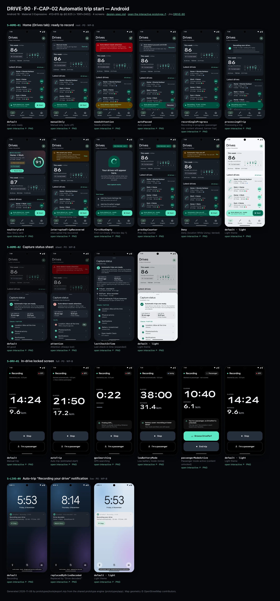
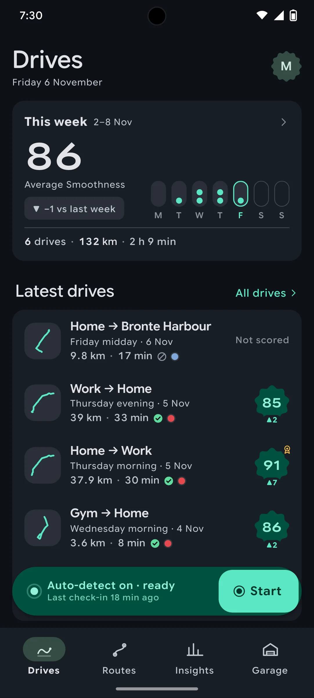
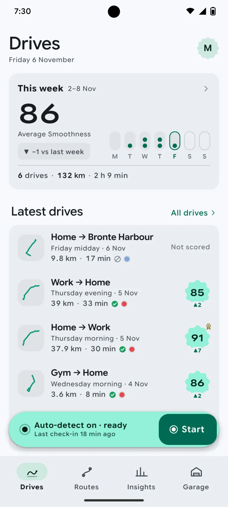
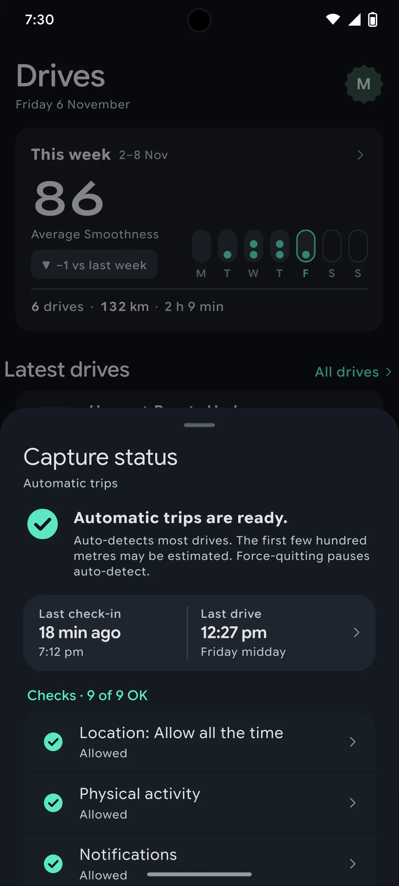
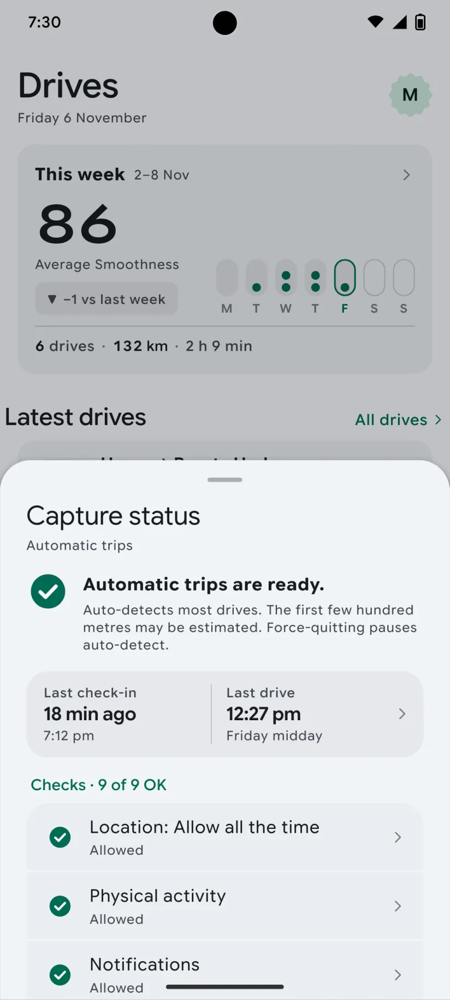
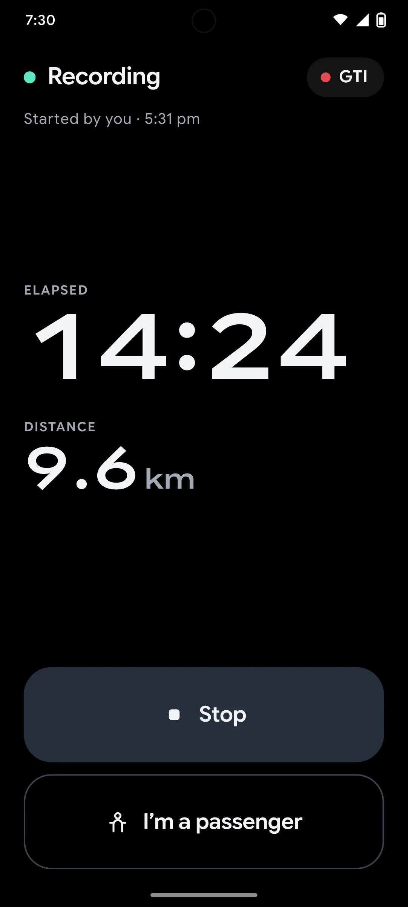
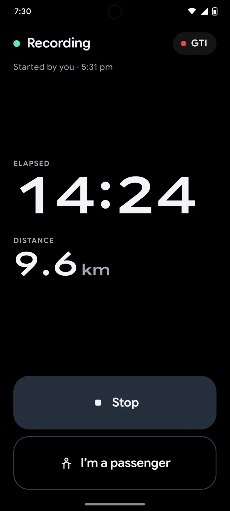
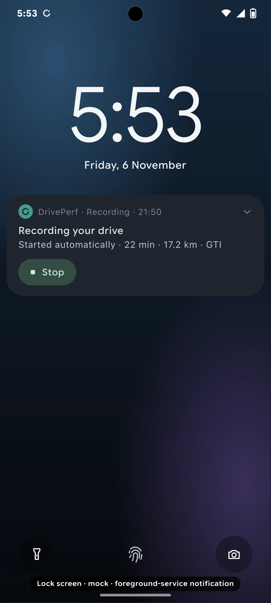
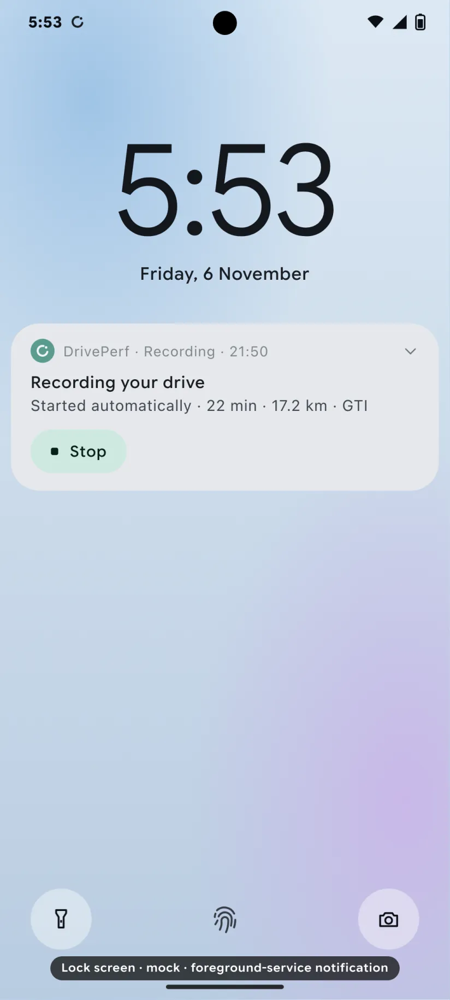

# DRIVE-90 · F-CAP-02 Automatic trip start — Android design spec

> Generated by `prototypes/tools/export.mjs` on 2026-11-06 from the shared prototype engine. **Do not edit by hand:** change the screen's `spec` in `prototypes/app/screens/wp-*.js` (see `prototypes/app/AUTHORING.md`) and re-export.

- **Jira story:** [DRIVE-90](https://thekeval.atlassian.net/browse/DRIVE-90) · F-CAP-02 · P0
- **Platform:** Android 16 · Material 3 Expressive · 412×915 dp @2.625 (≈ 1081×2402)
- **Interactive prototype:** [../../../../prototypes/android/index.html#S-HOME-01](../../../../prototypes/android/index.html#S-HOME-01) (catalog panel: every screen and state; deep links `#S-ID/state?trip=…&ent=…&theme=light&text=xl&rm=1`)
- **Contact sheet:** [mockup.html](mockup.html) · 
- **Design system (source of truth for values):** [brand](../../system/brand.md) · [components](../../system/components.md) · [motion](../../system/motion.md) · [accessibility](../../system/accessibility.md) · [screen map](../../system/screen-map.md) · [fixtures](../../system/fixtures.md) · tokens `prototypes/shared/tokens.css`

## Screens in this story

| Screen | Name | Presentation | Priority | States | Status |
|---|---|---|---|---|---|
| `S-HOME-01` | Home (Drives tab): ready to record | Root (Drives tab) | P0 | 11 | Prototyped |
| `S-HOME-02` | Capture status sheet | Sheet (medium) | P0 | 3 | Prototyped |
| `S-DRV-01` | In-drive locked screen | Full (locked) | P0 | 5 | Prototyped |
| `S-LIVE-09` | Auto-trip “Recording your drive” notification | Live (notification) | P0 | 2 | Prototyped |

## Tokens used on this platform

Values resolved from `prototypes/shared/tokens.css` inside the Android device (`[data-platform="android"]`). Use the token names in code; the hex values are for reference.

| Token | Dark | Light |
|---|---|---|
| `--app-bg` | `#0D1117` | `#F7F9FC` |
| `--card-bg` | `#191E25` | `#EBEEF2` |
| `--dp-bg-grouped` | `#0D1117` | `#F7F9FC` |
| `--dp-surface` | `#191E25` | `#EBEEF2` |
| `--dp-surface-2` | `#1F252D` | `#E5E8EC` |
| `--dp-surface-3` | `#2A3038` | `#DFE2E6` |
| `--dp-fill` | `#2A3038` | `#DFE2E6` |
| `--dp-fill-strong` | `#353B44` | `#D3D7DC` |
| `--dp-text` | `#E1E3E8` | `#181C20` |
| `--dp-text-2` | `#C0C7CF` | `#40474F` |
| `--dp-text-3` | `#8A929B` | `#707881` |
| `--dp-separator` | `#40474F` | `#C0C7CF` |
| `--dp-accent` | `#5BE7C4` | `#006B53` |
| `--dp-accent-text` | `#5BE7C4` | `#006B53` |
| `--dp-on-accent` | `#00382B` | `#FFFFFF` |
| `--dp-accent-container` | `#00513F` | `#91F1D8` |
| `--dp-record` | `#FFC24B` | `#7A5900` |
| `--dp-positive` | `#5BE7C4` | `#006B53` |
| `--dp-change-down` | `#C0C7CF` | `#40474F` |
| `--dp-warning` | `#F5B648` | `#7A5900` |
| `--dp-critical` | `#FFB4AB` | `#BA1A1A` |
| `--dp-glass-fill` | `#1F252DF2` | `#E5E8ECF2` |
| `--dp-glass-fill-strong` | `#2A3038` | `#DFE2E6` |
| `--dp-glass-stroke` | `#FFFFFF0F` | `#0000000A` |
| `--md-sys-color-primary` | `#5BE7C4` | `#006B53` |
| `--md-sys-color-on-primary` | `#00382B` | `#FFFFFF` |
| `--md-sys-color-primary-container` | `#00513F` | `#91F1D8` |
| `--md-sys-color-on-primary-container` | `#91F1D8` | `#002118` |
| `--md-sys-color-secondary-container` | `#344C44` | `#CEE9DF` |
| `--md-sys-color-surface` | `#0D1117` | `#F7F9FC` |
| `--md-sys-color-surface-container` | `#191E25` | `#EBEEF2` |
| `--md-sys-color-surface-container-high` | `#1F252D` | `#E5E8EC` |
| `--md-sys-color-on-surface-variant` | `#C0C7CF` | `#40474F` |
| `--dp-data-route` | `#5BE7C4` | `#079777` |
| `--dp-data-event-brake` | `#FF7A66` | `#A21F16` |
| `--dp-data-event-accel` | `#E58BD0` | `#A33A8C` |
| `--dp-data-event-corner` | `#EAD54E` | `#9A8A00` |
| `--dp-data-quality-good` | `#5FDB9C` | `#1E9E62` |
| `--dp-data-speed` | `#D6DCE4` | `#404A58` |
| `--dp-data-long-g` | `#5AB8F5` | `#0A6AB8` |
| `--dp-data-lat-g` | `#F5A142` | `#B25A00` |

| Type / layout token | Value |
|---|---|
| `--dp-font-screen-title` | `600 32px / 40px "Google Sans Flex", "Google Sans Display", "Roboto Flex", Roboto, system-ui, sans-serif` |
| `--dp-font-sheet-title` | `400 24px / 32px "Google Sans Flex", "Google Sans Display", "Roboto Flex", Roboto, system-ui, sans-serif` |
| `--dp-font-section-title` | `600 22px / 28px "Google Sans Flex", "Google Sans Display", "Roboto Flex", Roboto, system-ui, sans-serif` |
| `--dp-font-card-title` | `700 16px / 24px "Google Sans Flex", "Google Sans Text", "Roboto Flex", Roboto, system-ui, sans-serif` |
| `--dp-font-body` | `400 16px / 24px "Google Sans Flex", "Google Sans Text", "Roboto Flex", Roboto, system-ui, sans-serif` |
| `--dp-font-body-secondary` | `400 14px / 20px "Google Sans Flex", "Google Sans Text", "Roboto Flex", Roboto, system-ui, sans-serif` |
| `--dp-font-meta` | `400 12px / 16px "Google Sans Flex", "Google Sans Text", "Roboto Flex", Roboto, system-ui, sans-serif` |
| `--dp-font-caption` | `500 12px / 16px "Google Sans Flex", "Google Sans Text", "Roboto Flex", Roboto, system-ui, sans-serif` |
| `--dp-font-button` | `700 14px / 20px "Google Sans Flex", "Google Sans Text", "Roboto Flex", Roboto, system-ui, sans-serif` |
| `--dp-num-hero` | `600 72px / 72px "Google Sans Flex", "Roboto Flex", Roboto, system-ui, sans-serif` |
| `--dp-num-xl` | `600 48px / 52px "Google Sans Flex", "Roboto Flex", Roboto, system-ui, sans-serif` |
| `--dp-num-l` | `600 34px / 38px "Google Sans Flex", "Roboto Flex", Roboto, system-ui, sans-serif` |
| `--dp-num-m` | `600 24px / 28px "Google Sans Flex", "Roboto Flex", Roboto, system-ui, sans-serif` |
| `--dp-num-s` | `600 17px / 22px "Google Sans Flex", "Roboto Flex", Roboto, system-ui, sans-serif` |
| `--dp-num-xs` | `600 13px / 16px "Google Sans Flex", "Roboto Flex", Roboto, system-ui, sans-serif` |
| `--dp-screen-margin` | `16px` |
| `--dp-radius-card` | `16px` |
| `--dp-radius-card-hero` | `28px` |
| `--dp-radius-sheet` | `28px` |
| `--dp-radius-chip` | `8px` |
| `--dp-radius-button` | `999px` |
| `--dp-layout-list-row-min` | `56px` |
| `--dp-layout-touch-min` | `48px` |
| `--safe-top` | `40px` |
| `--safe-bottom` | `24px` |

Text sizes scale with `--dp-text-scale` (XL = 2.0×) and numerals with `--dp-num-scale` (XL = 1.3×). DP Numerals: Google Sans Flex wdth 120 wght 600, tabular.

---

## S-HOME-01 · Home (Drives tab): ready to record

 

- **Presentation:** root · tab: drives — screen map: “Root (Drives tab)”
- **Entry points:** Tab · S-ONB-15 · S-DRV-04 done (new Story card)
- **Leads to:** S-STY-01 (new Story) · S-TRP-01 · S-HIS-01 ("All drives") · S-HOME-02 · S-HOME-03 · S-DRV-01 (Start) · S-SET-05 (needs attention) · S-SUB-01 (Prev badge)
- **PRD features:** F-CAP-01, F-CAP-02, F-CAP-06, F-CAP-14, F-SET-02, F-SUB-02 · **Priority:** P0 · **WP:** B
- **Interactive:** [S-HOME-01](../../../../prototypes/android/index.html#S-HOME-01)

**Purpose.** The Drives tab root: glanceable capture status, the newest decoded drive (Story card), this week at a glance and the latest drives. It never shows live speed, score or record pace while recording (SAF-02).

### States

| State | PRD label | Fixture params | Screenshot |
|---|---|---|---|
| `default` | Def auto ready | — | [S-HOME-01.png](../../screens/android/S-HOME-01.webp) · [open](../../../../prototypes/android/index.html#S-HOME-01) |
| `manualOnly` | Manual only (auto off) | `capture=manual` | [S-HOME-01--manualOnly.png](../../screens/android/S-HOME-01--manualOnly.webp) · [open](../../../../prototypes/android/index.html#S-HOME-01/manualOnly) |
| `needsAttention` | Needs attention | `health=alwaysLost` | [S-HOME-01--needsAttention.png](../../screens/android/S-HOME-01--needsAttention.webp) · [open](../../../../prototypes/android/index.html#S-HOME-01/needsAttention) |
| `autoPaused` | Auto paused | `capture=paused` | [S-HOME-01--autoPaused.png](../../screens/android/S-HOME-01--autoPaused.webp) · [open](../../../../prototypes/android/index.html#S-HOME-01/autoPaused) |
| `recordingInProgress` | Recording in progress (passenger trip: content allowed, banner live) | — | [S-HOME-01--recordingInProgress.png](../../screens/android/S-HOME-01--recordingInProgress.webp) · [open](../../../../prototypes/android/index.html#S-HOME-01/recordingInProgress) |
| `processingATrip` | Processing a trip | — | [S-HOME-01--processingATrip.png](../../screens/android/S-HOME-01--processingATrip.webp) · [open](../../../../prototypes/android/index.html#S-HOME-01/processingATrip) |
| `newStoryCard` | New Story card | `trip=t20261105-0742` | [S-HOME-01--newStoryCard.png](../../screens/android/S-HOME-01--newStoryCard.webp) · [open](../../../../prototypes/android/index.html#S-HOME-01/newStoryCard) |
| `interruptedTripRecovered` | Interrupted trip recovered | `trip=t20261013-1742` | [S-HOME-01--interruptedTripRecovered.png](../../screens/android/S-HOME-01--interruptedTripRecovered.webp) · [open](../../../../prototypes/android/index.html#S-HOME-01/interruptedTripRecovered) |
| `firstRunEmpty` | First run Empty (Preview day 1) | `ent=preview` | [S-HOME-01--firstRunEmpty.png](../../screens/android/S-HOME-01--firstRunEmpty.webp) · [open](../../../../prototypes/android/index.html#S-HOME-01/firstRunEmpty) |
| `prevDayCounter` | Prev day counter | `ent=preview` | [S-HOME-01--prevDayCounter.png](../../screens/android/S-HOME-01--prevDayCounter.webp) · [open](../../../../prototypes/android/index.html#S-HOME-01/prevDayCounter) |
| `Deny` | Deny (location While Using / denied) | `capture=denied` | [S-HOME-01--Deny.png](../../screens/android/S-HOME-01--Deny.webp) · [open](../../../../prototypes/android/index.html#S-HOME-01/Deny) |
| default · light | Light theme | `theme=light` | [S-HOME-01--light.png](../../screens/android/S-HOME-01--light.webp) |

Every state also renders in light/dark (`theme=light`), XL text (`text=xl`) and reduced motion (`rm=1`).

### Layout

- Large title “Drives” (iOS 34/41 bold large title · Android LargeFlexibleTopAppBar 32/40 with the date as subtitle); trailing: Preview/Ride-along badge (when active) + profile avatar (dot = needs attention).
- State banner slot (needs attention · paused · manual · denied · interrupted recovered · processing), full width, 16 margins.
- New Story card (state newStoryCard): hero card (radius 32 iOS / 28 Android) tinted 18% with the car colour; kicker “● Drive decoded”, route label, part of day · car, distance · duration, record + delta chips, “Watch Story” filled small button; Smoothness ring 116 with baseline and record notches.
- “This week” card: average Smoothness (DP Numerals 48), delta vs last week (neutral when lower, never red), 7-day dot strip (Mon–Sun, ≤ 3 dots per day, future days dimmed), drives · km · time footer. Tap → Insights tab.
- “Latest drives” section (title + “All drives” → S-HIS-01): 5 trip cards in one card, newest first (components.md §12).
- Capture status: iOS tabViewBottomAccessory glass capsule (50 pt, 8 above the floating tab bar) · Android M3E floating toolbar (64 dp, primaryContainer, 16 above the navigation bar, Drives tab only). Start → S-DRV-01 with the trip-start expansion.

### Components & tokens

| Component | Tokens / spec |
|---|---|
| `largeTitle` | --dp-font-screen-title (iOS 34/41 bold · Android 32/40) · components.md §2 |
| `previewBadge` | see components.md |
| `avatar` | see components.md |
| `banner` | radius 12 (--dp-radius-sm+) · info --dp-fill · attention --dp-warning-container · critical --dp-critical-container · components.md §22 |
| `card` | --dp-surface / --md-sys-color-surface-container · --dp-radius-card (24 iOS · 16 Android) · hero: --dp-radius-card-hero (32 · 28) · light iOS: --dp-elev-1 |
| `ring` | track --dp-fill-strong · arc --dp-gradient-ring (glide-400 → accent → glide-100) · baseline notch --dp-text-2 · record notch --dp-record · Android container Cookie9Sided --md-sys-color-primary-container 42% · components.md §3 |
| `deltaChip` | better: --dp-accent-text on --dp-accent 18% · lower: --dp-text-2 on --dp-fill (never red) · record: --dp-record on --dp-record 18% · components.md §4 |
| `chip` | --dp-radius-chip (iOS capsule · Android 8) · height 28 · --dp-font-caption |
| `button` | --dp-accent / --dp-on-accent (filled) · --dp-fill-strong · --md-sys-color-secondary-container (tonal) · --dp-radius-button · height iOS 50/44/34 · Android 56/40/32 · --dp-font-button · components.md §0 |
| `tripRow` | glyph 40 on --dp-surface-2 · --dp-font-card-title · --dp-font-meta · components.md §12 |
| `scoreBadge` | iOS mini ring 46 · Android Cookie9Sided 46 · --dp-num-s |
| `qualityBadge` | --dp-data-quality-{good\|usable\|limited\|unscorable} · components.md §10 |
| `section` | --dp-font-section-title · --dp-layout-section-gap 28 |
| `empty` | illustration 120 in --dp-accent · --dp-font-section-title · components.md §21 |
| `loader` | see components.md |
| `skeleton` | --dp-fill-strong, breathe 1.2 s (dp-skeleton) |
| `list` | iOS inset grouped radius --dp-radius-card, rows 52 pt, separators --dp-separator inset 16 · Android ListItem 56/72 dp in --md-sys-color-surface-container |
| `row` | --dp-font-body · --dp-font-meta (supporting) · --dp-layout-list-row-min |
| `tabBar` | iOS floating glass: inset 16, bottom 21, height 62, lens --dp-fill-strong · Android NavigationBar 64 dp + indicator 56×32 --md-sys-color-secondary-container · components.md §1 |
| `accessory` | iOS tabViewBottomAccessory glass 48 pt, 8 above tab bar · Android floating toolbar 64 dp --md-sys-color-primary-container, 16 above nav bar · Start: --dp-accent |

### Interactions & navigation

- Trip card → S-TRP-01 (zoom transition on iOS, container transform on Android).
- New Story card / “Watch Story” → S-STY-01 (D1 gate: held on S-DRV-05 while moving).
- “This week” card → Insights tab (S-STA-01). “All drives” → S-HIS-01.
- Accessory/toolbar body → S-HOME-02 capture status sheet; Start → S-DRV-01 (manual trip; gate locks the app to the in-drive screen); recording banner → S-DRV-01; needs attention → S-SET-05; denied → S-ONB-16.
- Avatar → S-ACC-01 (iOS sheet, Android full-screen). Preview badge → S-SUB-01.
- Banners: Fix → S-SET-05 / S-ONB-16 · Turn on → S-SET-03 · Resume → resumes auto-detect (toast) · View → S-TRP-01/interrupted.
- Scroll: large title collapses to an inline title; iOS tab bar minimises to a compact capsule with the accessory inline; Android toolbar slides away and returns on scroll up.

### Motion

- Blocks rise 8 px and fade in, 40 ms stagger, spring.default (RM: 220 ms cross-fade).
- Story card ring: ring reveal (motion.md §3.4) 1400 ms count-up locked to the arc; record notch turns solid gold as the arc passes 89 (doubleSuccess haptic); RM: full ring, static number.
- Start: press scale 0.96 (spring.fast) + confirm haptic, then the accessory/toolbar expands into the in-drive surface (spring.slow container transform, motion.md §3.1).
- Recording banner dot: continuous livePulse breathe 2400 ms (passenger trip / finalising only); RM: static dot.
- Tab switch: iOS cross-fade + lens slides (spring.default); Android fade-through.

### Accessibility

- Trip card label: “Home to Work, Thursday morning, 5 November. 37.9 kilometres, 30 minutes. Smoothness 91. Good data.” (one element, button).
- This-week card is one element: “This week: 6 drives, 132.1 kilometres, 2 h 9 min. Average Smoothness 86, 1 down on last week.”
- Accessory: “Auto-detect on · ready. Last check-in 18 min ago” + separate “Start drive” button (≥ 44 pt / 48 dp).
- XL text: trip cards stack (glyph above), stats wrap; the accessory keeps one line with ellipsis and the full text in its label.
- Colour never carries meaning alone: ▲/▼/● glyphs on deltas, shapes on quality glyphs, the attention state has a triangle glyph and text.

### Platform notes

- **Android (this spec):** NavigationBar (64 dp + gesture area) with 56×32 secondaryContainer indicator; capture status is an M3E floating toolbar on the Drives tab only (other tabs show a status chip when it needs attention); avatar in a Cookie12Sided shape opens Profile full-screen; score badges use Cookie9Sided; LargeFlexibleTopAppBar with date subtitle.
- *iOS (for reference):* Floating Liquid Glass tab bar (inset 16, bottom 21, 62 tall) with lens selection; tabViewBottomAccessory carries capture status on every tab; glass avatar toolbar item opens Profile as a sheet; score badges are mini rings; large title collapses to the inline title with a scroll-edge fade.

### Analytics

- `home_viewed {state}`
- `story_card_tapped {trip_age}`
- `manual_start_tapped {source: accessory|toolbar}`
- `capture_status_opened`
- `history_opened {source: home}`

### Copy

| Key | Text |
|---|---|
| Accessory ready | Auto-detect on · ready / Last check-in {n} min ago |
| Accessory manual | Manual mode / Auto-detect is off |
| Accessory paused | Auto-detect paused / Until 8:00 tomorrow · Resume |
| Accessory attention | Auto-detect needs attention / Location is set to While Using |
| Accessory recording | Recording · {min} min · {km} km / Passenger trip · tap to open |
| Empty | Your drives will appear here. Just drive. DrivePerf notices when you set off and decodes each drive when you park. |
| Interrupted | We saved your drive. {part of day} · {label}. {iOS ended DrivePerf in the background \| Android stopped DrivePerf in the background}. Everything before then is saved. |
| Story card kicker | Drive decoded |

### Free / Pro

Free: identical layout (summaries are free forever); trips older than 30 days show a small lock after the score for “Replay & Analysis in Pro”. Preview/Ride-along: “PRO PREVIEW · DAY n” / “RIDE-ALONG · DAY n” badge → S-SUB-01. No paywall is ever shown here during or right after a trip (D12, F-SUB-08).

### Data & fixtures

This-week numbers are derived from DP_DATA.trips for the current week (they equal recaps[0]: 6 drives · 132.1 km · 2 h 9 min · 86, −1 vs 87). In newStoryCard the week is computed as of the Story trip’s end (Thu 5 Nov 08:13).

### Assets

[icon-drives.svg](assets/icon-drives.svg) · [icon-routes.svg](assets/icon-routes.svg) · [icon-insights.svg](assets/icon-insights.svg) · [icon-garage.svg](assets/icon-garage.svg) · [icon-record.svg](assets/icon-record.svg) · [icon-story.svg](assets/icon-story.svg) · [icon-chevronRight.svg](assets/icon-chevronRight.svg) · [icon-rosette.svg](assets/icon-rosette.svg) · [icon-lock.svg](assets/icon-lock.svg) · [icon-gps.svg](assets/icon-gps.svg) · [icon-shield.svg](assets/icon-shield.svg) · [icon-pause.svg](assets/icon-pause.svg) · [logo-a-loop.svg](assets/logo-a-loop.svg)

UI glyphs may be swapped for SF Symbols / Material Symbols Rounded equivalents; event-pin, quality and provenance glyphs must not be (components.md global rules).

### Checklist (accessibility.md §9)

- [ ] Light and dark both render, and contrast passes.
- [ ] The XL text state reflows with no truncation.
- [ ] The RM state is defined.
- [ ] Every control has a label; every chart and map has a summary sentence.
- [ ] Every target ≥ 44 pt / 48 dp (≥ 64 in-drive).
- [ ] No meaning by colour alone.
- [ ] Speed is neutral wherever it appears and absent from social or live surfaces.
- [ ] No streak, leaderboard, speed or “beat your time” language.
- [ ] Behaviour is defined while a trip is active (D1 gate).
- [ ] Haptics come from motion.md §6 only.

---

## S-HOME-02 · Capture status sheet

 

- **Presentation:** sheet · tab: drives · detent: auto — screen map: “Sheet (medium)”
- **Entry points:** S-HOME-01 status, iOS accessory, Android toolbar
- **Leads to:** S-SET-05 · S-HOME-03
- **PRD features:** F-CAP-02, F-SET-02 · **Priority:** P0 · **WP:** B
- **Interactive:** [S-HOME-02](../../../../prototypes/android/index.html#S-HOME-02)

**Purpose.** Answers “will my next drive be recorded?” in one glance from the capture accessory / floating toolbar: the Health Check summary, last check-in and last drive times, the few checks that matter, and a way to pause (F-CAP-02, F-SET-02). Fixes live in S-SET-05.

### States

| State | PRD label | Fixture params | Screenshot |
|---|---|---|---|
| `default` | All good | — | [S-HOME-02.png](../../screens/android/S-HOME-02.webp) · [open](../../../../prototypes/android/index.html#S-HOME-02) |
| `attention` | Attention (Always lost) | `health=alwaysLost` | [S-HOME-02--attention.png](../../screens/android/S-HOME-02--attention.webp) · [open](../../../../prototypes/android/index.html#S-HOME-02/attention) |
| `lastCheckInTime` | Last check-in time (expanded) | — | [S-HOME-02--lastCheckInTime.png](../../screens/android/S-HOME-02--lastCheckInTime.webp) · [open](../../../../prototypes/android/index.html#S-HOME-02/lastCheckInTime) |
| default · light | Light theme | `theme=light` | [S-HOME-02--light.png](../../screens/android/S-HOME-02--light.webp) |

Every state also renders in light/dark (`theme=light`), XL text (`text=xl`) and reduced motion (`rm=1`).

### Layout

- Sheet at the medium detent (iOS glass sheet, radius 38 at partial detents · Android ModalBottomSheet, top radius 28, drag handle 32×4). The expanded check-in state moves to the large detent.
- Header “Capture status” + subtitle (“Automatic trips” / “Automatic trips are paused”); iOS glass close button, Android none (drag handle + scrim).
- Summary block: status glyph 36 (green check disc · amber triangle · red octagon) + summary in card-title weight + one-line promise or the red item’s detail (DP_DATA.health).
- Check-in card (tile radius 14 iOS / 12 Android, --tile-bg-in): two cells split by a hairline — “Last check-in 18 min ago · 7:12 pm” and “Last drive 12:27 pm · Friday midday” — trailing chevron. Tap expands it in place (state lastCheckInTime): explanation + a 3-step timeline (checked in · drive recorded · watchdog only if nothing by 7:12 pm tomorrow).
- Checks list (caption header “Checks · 9 of 9 OK” or “1 to fix”): red first, then amber, then the four core green checks (location, motion, notifications, Background App Refresh on iOS / Battery: Unrestricted on Android). Bad rows end in a tonal “Fix” button; good rows in a chevron. Last row “Open Health Check · All 9 checks”.
- Pause row (pause icon) → S-HOME-03, footer “Checks run on this phone. Nothing is sent anywhere.”
- Attention only: full-width filled “Fix it in Health Check” (52 / 56) at the bottom.

### Components & tokens

| Component | Tokens / spec |
|---|---|
| `sheet` | iOS glass --dp-glass-fill-strong + --dp-glass-prominent-blur, radius --dp-radius-sheet 38 · Android ModalBottomSheet --md-sys-color-surface-container-low, top radius 28, drag handle 32×4 · motion spring.sheet |
| `sheetHeader` | see components.md |
| `list` | iOS inset grouped radius --dp-radius-card, rows 52 pt, separators --dp-separator inset 16 · Android ListItem 56/72 dp in --md-sys-color-surface-container |
| `row` | --dp-font-body · --dp-font-meta (supporting) · --dp-layout-list-row-min |
| `button` | --dp-accent / --dp-on-accent (filled) · --dp-fill-strong · --md-sys-color-secondary-container (tonal) · --dp-radius-button · height iOS 50/44/34 · Android 56/40/32 · --dp-font-button · components.md §0 |
| `section` | --dp-font-section-title · --dp-layout-section-gap 28 |
| `healthGlyph (local hGlyph)` | see components.md |

### Interactions & navigation

- Check-in card → toggles the expanded state (lastCheckInTime ↔ default), selection haptic.
- Any check row / “Open Health Check” / “Fix” / “Fix it in Health Check” → S-SET-05 (push, with the same health preset). Fix on a red Location row may deep-link straight to the OS Settings page (S-SET-05 handles it).
- “Pause auto-detect” → S-HOME-03 (sheet over this sheet on iOS; replaces it on Android).
- Dismiss: scrim tap, drag down, iOS close button. While a driver trip is active the sheet is unreachable (D1 gate → S-DRV-01); the accessory then opens S-DRV-01 instead.

### Motion

- Sheet: spring.sheet up from the accessory/toolbar; detent change medium → large on expand uses the system detent spring.
- Status glyph pops in (scale .86 → 1, spring.default) 120 ms after the sheet lands; sections rise 8 px, 30 ms stagger. RM: 220 ms cross-fade, no pop.
- Haptic: warning when the sheet opens with a red item (motion.md §6); none otherwise.

### Accessibility

- Summary is a status element: “Automatic trips are ready. Auto-detects most drives…” / “Auto-detect needs attention. Location access changed to While Using…”. The glyph has its own label (OK / Needs fixing / Worth knowing) so colour never carries the state.
- Check-in card is one button: “Last check-in 18 min ago, at 7:12 pm. Last drive recorded at 12:27 pm, Friday midday. Show details.”
- Rows read “Location: Always, Always” / “Location: Always, While Using only, Fix, button”. Focus order: close, summary, check-in, rows, pause, CTA.
- XL: the sheet opens at the large detent; check-in cells stack vertically; Fix buttons wrap under the text.

### Platform notes

- **Android (this spec):** ModalBottomSheet (surfaceContainerLow), M3E segmented ListItems 56 dp with TextButton/FilledTonalButton “Fix”; items from DP_DATA.health.android (Allow all the time, Battery: Unrestricted, Samsung sleeping apps, Battery Saver).
- *iOS (for reference):* Glass sheet (.presentationDetents([.medium, .large])), inset-grouped List rows 52 pt, SF-style glyphs; items from DP_DATA.health.ios (Background App Refresh, Live Activities, Low Power Mode).

### Analytics

- `capture_status_opened {source: accessory|toolbar|home, reds, ambers}`
- `capture_status_checkin_expanded`
- `health_fix_tapped {item, source: capture_status}`
- `pause_sheet_opened {source: capture_status}`

### Copy

| Key | Text |
|---|---|
| All good | Automatic trips are ready. · Auto-detects most drives. The first few hundred metres may be estimated. Force-quitting pauses auto-detect. |
| Attention | Auto-detect needs attention. · Location access changed to "While Using". Automatic trips are paused. Two taps to fix it. |
| Check-in | Last check-in {18 min ago} · {7:12 pm} \| Last drive {12:27 pm} · {Friday midday} |
| Check-in detail | DrivePerf checks in each time your phone wakes it: a drive, a reboot, opening the app. Auto-detect re-arms every time. · Only if nothing by {7:12 pm} tomorrow — We’ll remind you to open DrivePerf once |
| Footer | Checks run on this phone. Nothing is sent anywhere. |
| CTA | Fix it in Health Check |

### Free / Pro

Identical on every plan (capture is Free forever). No upsell, badge or paywall on this sheet.

### Data & fixtures

DP_DATA.health.{ios|android}.items with presets allGood (default, lastCheckInTime) and alwaysLost (attention; any health=<preset> param is honoured). Last check-in = presets.allGood.lastCheckIn (19:12 → “18 min ago” at 19:30); last drive = newest trip end (t20261106-1210, 12:27 pm, Friday midday). The watchdog time (check-in + 24 h) is derived.

### Assets

[icon-health.svg](assets/icon-health.svg) · [icon-pause.svg](assets/icon-pause.svg) · [icon-chevronRight.svg](assets/icon-chevronRight.svg) · [icon-chevronDown.svg](assets/icon-chevronDown.svg) · [icon-close.svg](assets/icon-close.svg)

UI glyphs may be swapped for SF Symbols / Material Symbols Rounded equivalents; event-pin, quality and provenance glyphs must not be (components.md global rules).

### Checklist (accessibility.md §9)

- [ ] Light and dark both render, and contrast passes.
- [ ] The XL text state reflows with no truncation.
- [ ] The RM state is defined.
- [ ] Every control has a label; every chart and map has a summary sentence.
- [ ] Every target ≥ 44 pt / 48 dp (≥ 64 in-drive).
- [ ] No meaning by colour alone.
- [ ] Speed is neutral wherever it appears and absent from social or live surfaces.
- [ ] No streak, leaderboard, speed or “beat your time” language.
- [ ] Behaviour is defined while a trip is active (D1 gate).
- [ ] Haptics come from motion.md §6 only.

---

## S-DRV-01 · In-drive locked screen

 

- **Presentation:** full — screen map: “Full (locked)”
- **Entry points:** Start (S-HOME-01, S-LIVE-03/04/07/08) · any deep link during a driver trip · S-LIVE-09 tap
- **Leads to:** S-DRV-02 (Stop) · S-DRV-03 (passenger) · auto end → S-DRV-04
- **PRD features:** F-CAP-01, F-CAP-02, F-CAP-07, F-CAP-08 · **Priority:** P0 · **WP:** B
- **Interactive:** [S-DRV-01](../../../../prototypes/android/index.html#S-DRV-01)

**Purpose.** The only screen the app shows while a driver trip is active (D1, F-CAP-07): proof that it is recording — elapsed time, distance and car — plus two huge exits, Stop and I’m a passenger. Nothing else: no score, speed, events, tips, map, navigation or tab bar.

### States

| State | PRD label | Fixture params | Screenshot |
|---|---|---|---|
| `default` | Manual trip | — | [S-DRV-01.png](../../screens/android/S-DRV-01.webp) · [open](../../../../prototypes/android/index.html#S-DRV-01) |
| `autoTrip` | Auto trip (estimated start) | `live=auto` | [S-DRV-01--autoTrip.png](../../screens/android/S-DRV-01--autoTrip.webp) · [open](../../../../prototypes/android/index.html#S-DRV-01/autoTrip) |
| `gpsSearching` | GPS searching | `live=gpsSearching` | [S-DRV-01--gpsSearching.png](../../screens/android/S-DRV-01--gpsSearching.webp) · [open](../../../../prototypes/android/index.html#S-DRV-01/gpsSearching) |
| `lowBatteryMode` | Low battery mode (Ioniq) | `live=lowBattery` | [S-DRV-01--lowBatteryMode.png](../../screens/android/S-DRV-01--lowBatteryMode.webp) · [open](../../../../prototypes/android/index.html#S-DRV-01/lowBatteryMode) |
| `passengerModeActive` | Passenger mode active (content unlocked) | `live=passenger` | [S-DRV-01--passengerModeActive.png](../../screens/android/S-DRV-01--passengerModeActive.webp) · [open](../../../../prototypes/android/index.html#S-DRV-01/passengerModeActive) |
| default · light | Light theme | `theme=light` | [S-DRV-01--light.png](../../screens/android/S-DRV-01--light.webp) |

Every state also renders in light/dark (`theme=light`), XL text (`text=xl`) and reduced motion (`rm=1`).

### Layout

- Full-screen cover on --dp-drive-bg #000 on both platforms and in both themes (status bar light). Content is a single column with 24 side margins.
- Top row (safe top + 18): 12 px live dot (--wb-drv-live = Glide #5BE7C4) + “Recording” (600 24/28) · car chip trailing (car dot in the car colour + nickname, 600 17, #F2F4F7 on #ffffff14, capsule 40 tall) or a “Passenger” chip.
- Source line (meta 15/20, #A3AAB6): “Started by you · 5:31 pm” / “Started automatically · 5:31 pm” + “First 340 m estimated” with the estimated provenance glyph (auto trips) / “Marked as passenger · not scored”.
- Numbers block, vertically centred in the free space: label “Elapsed” (caps 13, #A3AAB6) over the timer in DP Numerals 96/96 (tabular, 125% stretch, scales with Dynamic Type up to the container width), then “Distance” over 9.6 + “km” at 50%. GPS searching shows “—”. Times ≥ 1 h render h:mm:ss.
- Status card when needed (radius 20, #ffffff10, 16 padding, 22 icon): Finding GPS… · Battery saver: recording at lower detail · You’re a passenger, so DrivePerf is unlocked.
- Bottom stack (safe bottom + 16, 12 gap): Stop = 96 tall, full width, radius 28, --dp-surface-3 (#262E3B) with a 26 stop glyph and 600 22 label · I’m a passenger = 96 tall, 1.5 px #3A4351 outline. Passenger mode: “Browse DrivePerf” (Glide filled, on-accent text) + “End trip”.

### Components & tokens

| Component | Tokens / spec |
|---|---|
| `page` | --dp-bg-grouped (iOS) / --md-sys-color-surface (Android) · --dp-screen-margin 16 |
| `drvButton (local, 96 tall)` | see components.md |
| `carChip (in-drive variant)` | see components.md |
| `provenance` | see components.md |
| `liveDot` | see components.md |

### Interactions & navigation

- Stop → S-DRV-02 (sheet). I’m a passenger → S-DRV-03 (sheet). Both are the only destinations allowed by the D1 gate besides S-DRV-05.
- Passenger mode: Browse DrivePerf → S-NAV-01 recording banner (live=passenger, content unlocked); End trip → S-DRV-02 (passenger copy).
- Every other deep link, notification, widget, Control Center / QS tile and Live Activity tap lands here while a driver trip is active (DP.gate; the target waits in DP.session.pending and opens on S-DRV-05 rules after the trip).
- Auto end (stationary for the stop timer, F-CAP-03) → S-DRV-04 with no tap. There is no swipe, back gesture or tab bar.

### Motion

- Manual start: the accessory (iOS) / floating toolbar (Android) expands into this screen (container transform, spring.slow), then the rows rise 8 px with a 60 ms stagger (spring.default) — motion.md §3.1. Auto trip: 220 ms cross-fade, no theatre.
- Live dot: halo scale 1 → 1.9, opacity .5 → 0, 900 ms ease.glide once per second for 10 s after appearing or after any touch, then still (§3.2). The timer updates once per second; nothing else moves. RM / shot: static dot.
- Haptics: none on this screen (confirm fires only on the Stop / passenger confirmation in the sheets).

### Accessibility

- One summary element: “Recording. 14 minutes, 9.6 kilometres, GTI.” — no live region, so the timer is never announced every second.
- Buttons: “Stop” and “I’m a passenger” (96 tall, ≥ 64 rule); order: summary → Stop → I’m a passenger.
- XL: numerals scale but are capped to the screen width (never truncated); the status card wraps; buttons keep 96 minimum height and grow with the label.
- Contrast: #F2F4F7 on #000 (19:1), #A3AAB6 on #000 (8.7:1). Meaning never by colour: the dot is paired with the word Recording.

### Platform notes

- **Android (this spec):** Full-screen destination with BackHandler consumed (back does nothing while driving); FLAG_KEEP_SCREEN_ON optional; the Live Update / FGS notification runs alongside (S-LIVE-05/06).
- *iOS (for reference):* .fullScreenCover with .interactiveDismissDisabled(); .persistentSystemOverlays(.hidden) not used (status bar stays for the recording indicator); Live Activity runs alongside (S-LIVE-01/02).

### Analytics

- `in_drive_screen_viewed {mode: manual|auto, gps, battery_saver}`
- `in_drive_stop_tapped`
- `in_drive_passenger_tapped`
- `content_blocked_while_moving {target} (from the gate)`

### Copy

| Key | Text |
|---|---|
| Title | Recording |
| Manual | Started by you · {5:31 pm} |
| Auto | Started automatically · {5:31 pm} · First {340} m estimated |
| GPS | Finding GPS… · Motion is already recording. Distance starts with the first fix. |
| Low battery | Battery saver: recording at lower detail · Your route and Story are still saved. |
| Passenger | You’re a passenger, so DrivePerf is unlocked. · This trip won’t be scored or count toward your baseline. |
| Buttons | Stop · I’m a passenger · Browse DrivePerf · End trip |

### Free / Pro

Identical for every plan. No upsell, badge, paywall or share prompt can appear while this screen is up (D12).

### Data & fixtures

DP_DATA.liveTrip.states: manual (default, 14:24 · 9.6 km · GTI) · auto (21:50 · 17.2 km · estimatedStartM 340) · gpsSearching (0:22, no distance) · lowBattery (38:00 · 31.4 km · Ioniq, batterySaver) · passenger (10:40 · 6.1 km). Start time = startedAt (5:31 pm). Only these fields are used (fixtures.md §8). The prototype timer ticks from elapsedS once per second.

### Assets

[icon-stop.svg](assets/icon-stop.svg) · [icon-passenger.svg](assets/icon-passenger.svg) · [icon-gps.svg](assets/icon-gps.svg) · [icon-battery.svg](assets/icon-battery.svg) · [icon-drives.svg](assets/icon-drives.svg)

UI glyphs may be swapped for SF Symbols / Material Symbols Rounded equivalents; event-pin, quality and provenance glyphs must not be (components.md global rules).

### Checklist (accessibility.md §9)

- [ ] Light and dark both render, and contrast passes.
- [ ] The XL text state reflows with no truncation.
- [ ] The RM state is defined.
- [ ] Every control has a label; every chart and map has a summary sentence.
- [ ] Every target ≥ 44 pt / 48 dp (≥ 64 in-drive).
- [ ] No meaning by colour alone.
- [ ] Speed is neutral wherever it appears and absent from social or live surfaces.
- [ ] No streak, leaderboard, speed or “beat your time” language.
- [ ] Behaviour is defined while a trip is active (D1 gate).
- [ ] Haptics come from motion.md §6 only.

---

## S-LIVE-09 · Auto-trip “Recording your drive” notification

 

- **Presentation:** live — screen map: “Live (notification)”
- **Entry points:** Auto trip confirmed
- **Leads to:** Tap → S-DRV-01 · replaced by "Drive decoded" (S-NTF-01)
- **PRD features:** F-CAP-02, F-CAP-03, F-CAP-11 · **Priority:** P0 · **WP:** B
- **Interactive:** [S-LIVE-09](../../../../prototypes/android/index.html#S-LIVE-09)

**Purpose.** Tells the user, silently, that an automatic drive is being recorded, and is replaced by the post-drive notification when it ends (F-CAP-02/03/11). It never opens content (D1).

### States

| State | PRD label | Fixture params | Screenshot |
|---|---|---|---|
| `default` | Recording | `live=auto` | [S-LIVE-09.png](../../screens/android/S-LIVE-09.webp) · [open](../../../../prototypes/android/index.html#S-LIVE-09) |
| `replacedByDriveDecoded` | Replaced by “Drive decoded.” | — | [S-LIVE-09--replacedByDriveDecoded.png](../../screens/android/S-LIVE-09--replacedByDriveDecoded.webp) · [open](../../../../prototypes/android/index.html#S-LIVE-09/replacedByDriveDecoded) |
| default · light | Light theme | `theme=light` | [S-LIVE-09--light.png](../../screens/android/S-LIVE-09--light.webp) |

Every state also renders in light/dark (`theme=light`), XL text (`text=xl`) and reduced motion (`rm=1`).

### Layout

- iOS: Lock Screen mock with one passive notification (radius 24, system material): app icon (the Loop) · “Recording your drive” · “Tap to open. Stop it any time after you park.” · “21m ago”. No map, numbers or place names.
- Android: lock screen with the foreground-service notification: “DrivePerf · Recording · 21:50” · “Recording your drive” · “Started automatically · 21 min · 17.2 km · GTI” · Stop. On Android 16 it is promoted to the Live Update after confirmation (S-LIVE-05 autoRecording).
- Replaced: the same slot shows “Drive decoded.” · “Home → Work · Smoothness 91” (posted only once parked; Android adds Watch Story).

### Components & tokens

| Component | Tokens / spec |
|---|---|
| `notification` | components.md §20.6 |
| `lockScreen` | see components.md |

### Interactions & navigation

- Tap “Recording your drive” → DrivePerf on S-DRV-01 (auto trip state), never to content. Android Stop → ends the trip (prototype → replaced).
- Tap “Drive decoded.” → S-STY-01 for that trip through the gate (S-DRV-05 if still moving).

### Motion

- System presentation only; iOS interruption level .passive (no sound, no vibration, no wake); Android low-importance channel. RM: n/a.

### Accessibility

- Notification reads “DrivePerf. Recording your drive. Tap to open. Stop it any time after you park.”
- No haptic or sound (motion.md §6: never on notifications).

### Platform notes

- **Android (this spec):** This is the FGS notification (channel “Recording”, IMPORTANCE_LOW, ongoing); on trip end the service posts the Drive decoded notification on its own channel and stops.
- *iOS (for reference):* UNNotificationContent with interruptionLevel .passive, threadIdentifier = trip id; replaced by the Drive decoded notification using the same identifier (no Time Sensitive). With notifications denied nothing shows (blue location indicator only).

### Analytics

- `auto_trip_notification_posted`
- `auto_trip_notification_tapped`
- `notification_sent {type: drive_decoded}`

### Copy

| Key | Text |
|---|---|
| Recording | Recording your drive · Tap to open. Stop it any time after you park. |
| Android body | Started automatically · {21} min · {17.2} km · {GTI} |
| Replaced | Drive decoded. · Home → Work · Smoothness 91 |

### Free / Pro

Same for every plan.

### Data & fixtures

DP_DATA.notifications n_recording + liveTrip.states.auto (clock 5:53 = startedAt + elapsedS, “21m ago”); replaced uses n_decoded (t20261105-0742, scene Thu 5 Nov 8:14).

### Assets

[icon-stop.svg](assets/icon-stop.svg) · [icon-chevronDown.svg](assets/icon-chevronDown.svg) · [logo-a-loop.svg](assets/logo-a-loop.svg) · [icon-android-notification.svg](assets/icon-android-notification.svg)

UI glyphs may be swapped for SF Symbols / Material Symbols Rounded equivalents; event-pin, quality and provenance glyphs must not be (components.md global rules).

### Checklist (accessibility.md §9)

- [ ] Light and dark both render, and contrast passes.
- [ ] The XL text state reflows with no truncation.
- [ ] The RM state is defined.
- [ ] Every control has a label; every chart and map has a summary sentence.
- [ ] Every target ≥ 44 pt / 48 dp (≥ 64 in-drive).
- [ ] No meaning by colour alone.
- [ ] Speed is neutral wherever it appears and absent from social or live surfaces.
- [ ] No streak, leaderboard, speed or “beat your time” language.
- [ ] Behaviour is defined while a trip is active (D1 gate).
- [ ] Haptics come from motion.md §6 only.

---

Map geometry in the prototype: © OpenStreetMap contributors (ODbL). Speed and G are simulated fixtures (fixtures.md).
