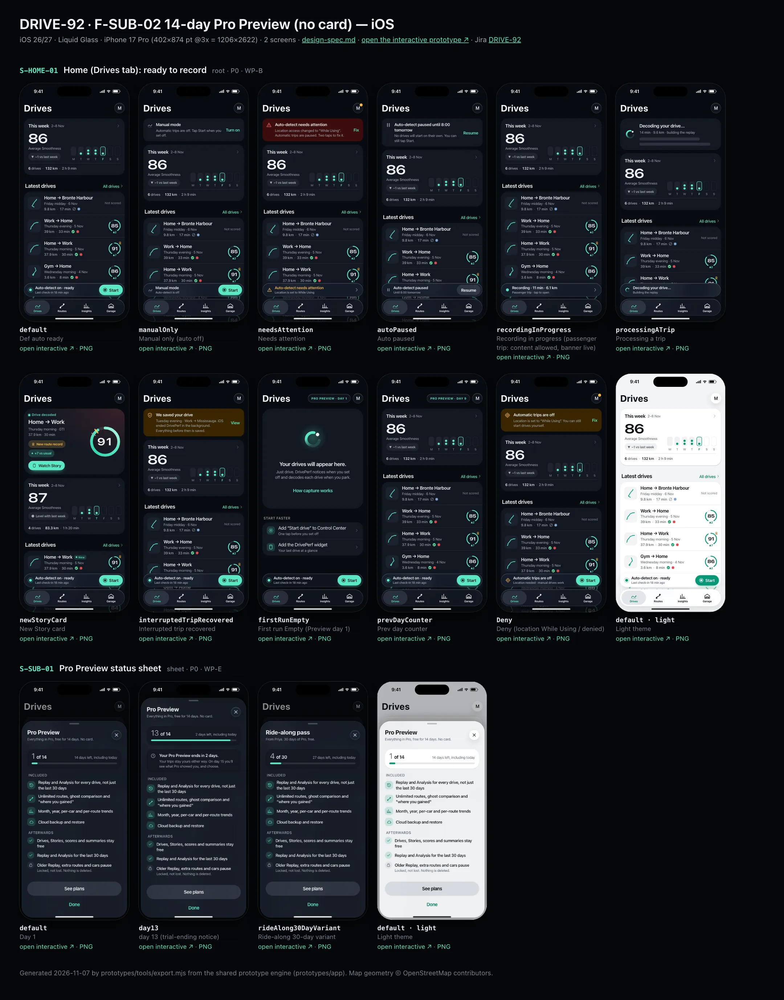
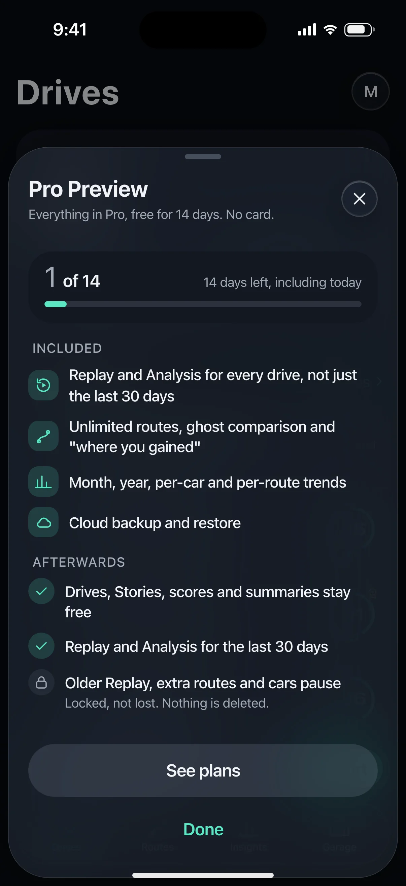
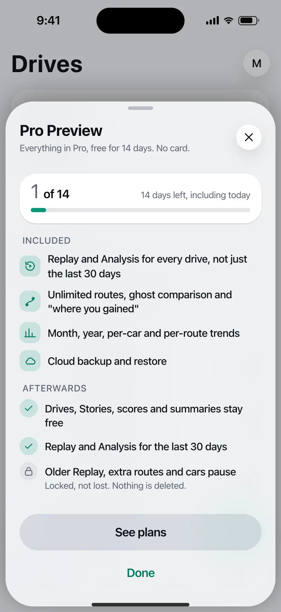

# DRIVE-92 · F-SUB-02 14-day Pro Preview (no card) — iOS design spec

> Generated by `prototypes/tools/export.mjs` on 2026-11-07 from the shared prototype engine. **Do not edit by hand:** change the screen's `spec` in `prototypes/app/screens/wp-*.js` (see `prototypes/app/AUTHORING.md`) and re-export.

- **Jira story:** [DRIVE-92](https://thekeval.atlassian.net/browse/DRIVE-92) · F-SUB-02 · P0
- **Platform:** iOS 26/27 · Liquid Glass · iPhone 17 Pro (402×874 pt @3x = 1206×2622)
- **Interactive prototype:** [../../../../prototypes/ios/index.html#S-HOME-01](../../../../prototypes/ios/index.html#S-HOME-01) (catalog panel: every screen and state; deep links `#S-ID/state?trip=…&ent=…&theme=light&text=xl&rm=1`)
- **Contact sheet:** [mockup.html](mockup.html) · 
- **Design system (source of truth for values):** [brand](../../system/brand.md) · [components](../../system/components.md) · [motion](../../system/motion.md) · [accessibility](../../system/accessibility.md) · [screen map](../../system/screen-map.md) · [fixtures](../../system/fixtures.md) · tokens `prototypes/shared/tokens.css`

## Screens in this story

| Screen | Name | Presentation | Priority | States | Status |
|---|---|---|---|---|---|
| `S-HOME-01` | Home (Drives tab): ready to record | Root (Drives tab) | P0 | 11 | Prototyped |
| `S-SUB-01` | Pro Preview status sheet | Sheet (medium) | P0 | 3 | Prototyped |

## Tokens used on this platform

Values resolved from `prototypes/shared/tokens.css` inside the iOS device (`[data-platform="ios"]`). Use the token names in code; the hex values are for reference.

| Token | Dark | Light |
|---|---|---|
| `--app-bg` | `#080B10` | `#F2F3F6` |
| `--card-bg` | `#131822` | `#FFFFFF` |
| `--dp-bg-grouped` | `#080B10` | `#F2F3F6` |
| `--dp-surface` | `#131822` | `#FFFFFF` |
| `--dp-surface-2` | `#1B222D` | `#F2F3F6` |
| `--dp-surface-3` | `#262E3B` | `#E4E7EC` |
| `--dp-fill` | `#7880961F` | `#7880961F` |
| `--dp-fill-strong` | `#7880963D` | `#78809633` |
| `--dp-text` | `#F2F4F7` | `#0B0E13` |
| `--dp-text-2` | `#A3AAB6` | `#5A6271` |
| `--dp-text-3` | `#6E7787` | `#8A919D` |
| `--dp-separator` | `#96A0B429` | `#3C435024` |
| `--dp-accent` | `#5BE7C4` | `#079777` |
| `--dp-accent-text` | `#5BE7C4` | `#06775E` |
| `--dp-on-accent` | `#04241D` | `#FFFFFF` |
| `--dp-accent-container` | `#0A4439` | `#C6F8EA` |
| `--dp-record` | `#FFC24B` | `#9A6300` |
| `--dp-positive` | `#5BE7C4` | `#06775E` |
| `--dp-change-down` | `#A3AAB6` | `#5A6271` |
| `--dp-warning` | `#F5B648` | `#9A5F00` |
| `--dp-critical` | `#FF6B6B` | `#C62828` |
| `--dp-glass-fill` | `#1C222C6B` | `#FFFFFF8C` |
| `--dp-glass-fill-strong` | `#1C222CB8` | `#FFFFFFD1` |
| `--dp-glass-stroke` | `#FFFFFF24` | `#FFFFFF99` |
| `--dp-data-route` | `#5BE7C4` | `#079777` |
| `--dp-data-event-brake` | `#FF7A66` | `#A21F16` |
| `--dp-data-event-accel` | `#E58BD0` | `#A33A8C` |
| `--dp-data-event-corner` | `#EAD54E` | `#9A8A00` |
| `--dp-data-quality-good` | `#5FDB9C` | `#1E9E62` |
| `--dp-data-speed` | `#D6DCE4` | `#404A58` |
| `--dp-data-long-g` | `#5AB8F5` | `#0A6AB8` |
| `--dp-data-lat-g` | `#F5A142` | `#B25A00` |

| Type / layout token | Value |
|---|---|
| `--dp-font-screen-title` | `700 34px / 41px -apple-system, BlinkMacSystemFont, "SF Pro Display", system-ui, sans-serif` |
| `--dp-font-sheet-title` | `700 22px / 28px -apple-system, BlinkMacSystemFont, "SF Pro Display", system-ui, sans-serif` |
| `--dp-font-section-title` | `600 20px / 25px -apple-system, BlinkMacSystemFont, "SF Pro Display", system-ui, sans-serif` |
| `--dp-font-card-title` | `600 17px / 22px -apple-system, BlinkMacSystemFont, "SF Pro Text", system-ui, sans-serif` |
| `--dp-font-body` | `400 17px / 22px -apple-system, BlinkMacSystemFont, "SF Pro Text", system-ui, sans-serif` |
| `--dp-font-body-secondary` | `400 15px / 20px -apple-system, BlinkMacSystemFont, "SF Pro Text", system-ui, sans-serif` |
| `--dp-font-meta` | `400 13px / 18px -apple-system, BlinkMacSystemFont, "SF Pro Text", system-ui, sans-serif` |
| `--dp-font-caption` | `400 12px / 16px -apple-system, BlinkMacSystemFont, "SF Pro Text", system-ui, sans-serif` |
| `--dp-font-button` | `600 17px / 22px -apple-system, BlinkMacSystemFont, "SF Pro Text", system-ui, sans-serif` |
| `--dp-num-hero` | `600 72px / 72px -apple-system, BlinkMacSystemFont, "SF Pro Display", system-ui, sans-serif` |
| `--dp-num-xl` | `600 48px / 52px -apple-system, BlinkMacSystemFont, "SF Pro Display", system-ui, sans-serif` |
| `--dp-num-l` | `600 34px / 38px -apple-system, BlinkMacSystemFont, "SF Pro Display", system-ui, sans-serif` |
| `--dp-num-m` | `600 24px / 28px -apple-system, BlinkMacSystemFont, "SF Pro Display", system-ui, sans-serif` |
| `--dp-num-s` | `600 17px / 22px -apple-system, BlinkMacSystemFont, "SF Pro Display", system-ui, sans-serif` |
| `--dp-num-xs` | `600 13px / 16px -apple-system, BlinkMacSystemFont, "SF Pro Display", system-ui, sans-serif` |
| `--dp-screen-margin` | `16px` |
| `--dp-radius-card` | `24px` |
| `--dp-radius-card-hero` | `32px` |
| `--dp-radius-sheet` | `38px` |
| `--dp-radius-chip` | `999px` |
| `--dp-radius-button` | `999px` |
| `--dp-layout-list-row-min` | `52px` |
| `--dp-layout-touch-min` | `44px` |
| `--safe-top` | `62px` |
| `--safe-bottom` | `34px` |

Text sizes scale with `--dp-text-scale` (XL = 2.0×) and numerals with `--dp-num-scale` (XL = 1.3×). DP Numerals: SF Pro Expanded Semibold, tabular.

---

## S-HOME-01 · Home (Drives tab): ready to record

- **Presentation:** root · tab: drives — screen map: “Root (Drives tab)”
- **Entry points:** Tab · S-ONB-15 · S-DRV-04 done (new Story card)
- **Leads to:** S-STY-01 (new Story) · S-TRP-01 · S-HIS-01 ("All drives") · S-HOME-02 · S-HOME-03 · S-DRV-01 (Start) · S-SET-05 (needs attention) · S-SUB-01 (Prev badge)
- **PRD features:** F-CAP-01, F-CAP-02, F-CAP-06, F-CAP-14, F-SET-02, F-SUB-02 · **Priority:** P0 · **WP:** B
- **Interactive:** [S-HOME-01](../../../../prototypes/ios/index.html#S-HOME-01)

**Purpose.** The Drives tab root: glanceable capture status, the newest decoded drive (Story card), this week at a glance and the latest drives. It never shows live speed, score or record pace while recording (SAF-02).

### States

| State | PRD label | Fixture params | Screenshot |
|---|---|---|---|
| `default` | Def auto ready | — | — · [open](../../../../prototypes/ios/index.html#S-HOME-01) |
| `manualOnly` | Manual only (auto off) | `capture=manual` | — · [open](../../../../prototypes/ios/index.html#S-HOME-01/manualOnly) |
| `needsAttention` | Needs attention | `health=alwaysLost` | — · [open](../../../../prototypes/ios/index.html#S-HOME-01/needsAttention) |
| `autoPaused` | Auto paused | `capture=paused` | — · [open](../../../../prototypes/ios/index.html#S-HOME-01/autoPaused) |
| `recordingInProgress` | Recording in progress (passenger trip: content allowed, banner live) | — | — · [open](../../../../prototypes/ios/index.html#S-HOME-01/recordingInProgress) |
| `processingATrip` | Processing a trip | — | — · [open](../../../../prototypes/ios/index.html#S-HOME-01/processingATrip) |
| `newStoryCard` | New Story card | `trip=t20261105-0742` | — · [open](../../../../prototypes/ios/index.html#S-HOME-01/newStoryCard) |
| `interruptedTripRecovered` | Interrupted trip recovered | `trip=t20261013-1742` | — · [open](../../../../prototypes/ios/index.html#S-HOME-01/interruptedTripRecovered) |
| `firstRunEmpty` | First run Empty (Preview day 1) | `ent=preview` | — · [open](../../../../prototypes/ios/index.html#S-HOME-01/firstRunEmpty) |
| `prevDayCounter` | Prev day counter | `ent=preview` | — · [open](../../../../prototypes/ios/index.html#S-HOME-01/prevDayCounter) |
| `Deny` | Deny (location While Using / denied) | `capture=denied` | — · [open](../../../../prototypes/ios/index.html#S-HOME-01/Deny) |

Every state also renders in light/dark (`theme=light`), XL text (`text=xl`) and reduced motion (`rm=1`).

### Layout

- Large title “Drives” (iOS 34/41 bold large title · Android LargeFlexibleTopAppBar 32/40 with the date as subtitle); trailing: Preview/Ride-along badge (when active) + profile avatar (dot = needs attention).
- State banner slot (needs attention · paused · manual · denied · interrupted recovered · processing), full width, 16 margins.
- New Story card (state newStoryCard): hero card (radius 32 iOS / 28 Android) tinted 18% with the car colour; kicker “● Drive decoded”, route label, part of day · car, distance · duration, record + delta chips, “Watch Story” filled small button; Smoothness ring 116 with baseline and record notches.
- “This week” card: average Smoothness (DP Numerals 48), delta vs last week (neutral when lower, never red), 7-day dot strip (Mon–Sun, ≤ 3 dots per day, future days dimmed), drives · km · time footer. Tap → Insights tab.
- “Latest drives” section (title + “All drives” → S-HIS-01): 5 trip cards in one card, newest first (components.md §12).
- Capture status: iOS tabViewBottomAccessory glass capsule (50 pt, 8 above the floating tab bar) · Android M3E floating toolbar (64 dp, primaryContainer, 16 above the navigation bar, Drives tab only). Start → S-DRV-01 with the trip-start expansion.

### Components & tokens

| Component | Tokens / spec |
|---|---|
| `largeTitle` | --dp-font-screen-title (iOS 34/41 bold · Android 32/40) · components.md §2 |
| `previewBadge` | see components.md |
| `avatar` | see components.md |
| `banner` | radius 12 (--dp-radius-sm+) · info --dp-fill · attention --dp-warning-container · critical --dp-critical-container · components.md §22 |
| `card` | --dp-surface / --md-sys-color-surface-container · --dp-radius-card (24 iOS · 16 Android) · hero: --dp-radius-card-hero (32 · 28) · light iOS: --dp-elev-1 |
| `ring` | track --dp-fill-strong · arc --dp-gradient-ring (glide-400 → accent → glide-100) · baseline notch --dp-text-2 · record notch --dp-record · Android container Cookie9Sided --md-sys-color-primary-container 42% · components.md §3 |
| `deltaChip` | better: --dp-accent-text on --dp-accent 18% · lower: --dp-text-2 on --dp-fill (never red) · record: --dp-record on --dp-record 18% · components.md §4 |
| `chip` | --dp-radius-chip (iOS capsule · Android 8) · height 28 · --dp-font-caption |
| `button` | --dp-accent / --dp-on-accent (filled) · --dp-fill-strong · --md-sys-color-secondary-container (tonal) · --dp-radius-button · height iOS 50/44/34 · Android 56/40/32 · --dp-font-button · components.md §0 |
| `tripRow` | glyph 40 on --dp-surface-2 · --dp-font-card-title · --dp-font-meta · components.md §12 |
| `scoreBadge` | iOS mini ring 46 · Android Cookie9Sided 46 · --dp-num-s |
| `qualityBadge` | --dp-data-quality-{good\|usable\|limited\|unscorable} · components.md §10 |
| `section` | --dp-font-section-title · --dp-layout-section-gap 28 |
| `empty` | illustration 120 in --dp-accent · --dp-font-section-title · components.md §21 |
| `loader` | see components.md |
| `skeleton` | --dp-fill-strong, breathe 1.2 s (dp-skeleton) |
| `list` | iOS inset grouped radius --dp-radius-card, rows 52 pt, separators --dp-separator inset 16 · Android ListItem 56/72 dp in --md-sys-color-surface-container |
| `row` | --dp-font-body · --dp-font-meta (supporting) · --dp-layout-list-row-min |
| `tabBar` | iOS floating glass: inset 16, bottom 21, height 62, lens --dp-fill-strong · Android NavigationBar 64 dp + indicator 56×32 --md-sys-color-secondary-container · components.md §1 |
| `accessory` | iOS tabViewBottomAccessory glass 48 pt, 8 above tab bar · Android floating toolbar 64 dp --md-sys-color-primary-container, 16 above nav bar · Start: --dp-accent |

### Interactions & navigation

- Trip card → S-TRP-01 (zoom transition on iOS, container transform on Android).
- New Story card / “Watch Story” → S-STY-01 (D1 gate: held on S-DRV-05 while moving).
- “This week” card → Insights tab (S-STA-01). “All drives” → S-HIS-01.
- Accessory/toolbar body → S-HOME-02 capture status sheet; Start → S-DRV-01 (manual trip; gate locks the app to the in-drive screen); recording banner → S-DRV-01; needs attention → S-SET-05; denied → S-ONB-16.
- Avatar → S-ACC-01 (iOS sheet, Android full-screen). Preview badge → S-SUB-01.
- Banners: Fix → S-SET-05 / S-ONB-16 · Turn on → S-SET-03 · Resume → resumes auto-detect (toast) · View → S-TRP-01/interrupted.
- Scroll: large title collapses to an inline title; iOS tab bar minimises to a compact capsule with the accessory inline; Android toolbar slides away and returns on scroll up.

### Motion

- Blocks rise 8 px and fade in, 40 ms stagger, spring.default (RM: 220 ms cross-fade).
- Story card ring: ring reveal (motion.md §3.4) 1400 ms count-up locked to the arc; record notch turns solid gold as the arc passes 89 (doubleSuccess haptic); RM: full ring, static number.
- Start: press scale 0.96 (spring.fast) + confirm haptic, then the accessory/toolbar expands into the in-drive surface (spring.slow container transform, motion.md §3.1).
- Recording banner dot: continuous livePulse breathe 2400 ms (passenger trip / finalising only); RM: static dot.
- Tab switch: iOS cross-fade + lens slides (spring.default); Android fade-through.

### Accessibility

- Trip card label: “Home to Work, Thursday morning, 5 November. 37.9 kilometres, 30 minutes. Smoothness 91. Good data.” (one element, button).
- This-week card is one element: “This week: 6 drives, 132.1 kilometres, 2 h 9 min. Average Smoothness 86, 1 down on last week.”
- Accessory: “Auto-detect on · ready. Last check-in 18 min ago” + separate “Start drive” button (≥ 44 pt / 48 dp).
- XL text: trip cards stack (glyph above), stats wrap; the accessory keeps one line with ellipsis and the full text in its label.
- Colour never carries meaning alone: ▲/▼/● glyphs on deltas, shapes on quality glyphs, the attention state has a triangle glyph and text.

### Platform notes

- **iOS (this spec):** Floating Liquid Glass tab bar (inset 16, bottom 21, 62 tall) with lens selection; tabViewBottomAccessory carries capture status on every tab; glass avatar toolbar item opens Profile as a sheet; score badges are mini rings; large title collapses to the inline title with a scroll-edge fade.
- *Android (for reference):* NavigationBar (64 dp + gesture area) with 56×32 secondaryContainer indicator; capture status is an M3E floating toolbar on the Drives tab only (other tabs show a status chip when it needs attention); avatar in a Cookie12Sided shape opens Profile full-screen; score badges use Cookie9Sided; LargeFlexibleTopAppBar with date subtitle.

### Analytics

- `home_viewed {state}`
- `story_card_tapped {trip_age}`
- `manual_start_tapped {source: accessory|toolbar}`
- `capture_status_opened`
- `history_opened {source: home}`

### Copy

| Key | Text |
|---|---|
| Accessory ready | Auto-detect on · ready / Last check-in {n} min ago |
| Accessory manual | Manual mode / Auto-detect is off |
| Accessory paused | Auto-detect paused / Until 8:00 tomorrow · Resume |
| Accessory attention | Auto-detect needs attention / Location is set to While Using |
| Accessory recording | Recording · {min} min · {km} km / Passenger trip · tap to open |
| Empty | Your drives will appear here. Just drive. DrivePerf notices when you set off and decodes each drive when you park. |
| Interrupted | We saved your drive. {part of day} · {label}. {iOS ended DrivePerf in the background \| Android stopped DrivePerf in the background}. Everything before then is saved. |
| Story card kicker | Drive decoded |

### Free / Pro

Free: identical layout (summaries are free forever); trips older than 30 days show a small lock after the score for “Replay & Analysis in Pro”. Preview/Ride-along: “PRO PREVIEW · DAY n” / “RIDE-ALONG · DAY n” badge → S-SUB-01. No paywall is ever shown here during or right after a trip (D12, F-SUB-08).

### Data & fixtures

This-week numbers are derived from DP_DATA.trips for the current week (they equal recaps[0]: 6 drives · 132.1 km · 2 h 9 min · 86, −1 vs 87). In newStoryCard the week is computed as of the Story trip’s end (Thu 5 Nov 08:13).

### Assets

[icon-drives.svg](assets/icon-drives.svg) · [icon-routes.svg](assets/icon-routes.svg) · [icon-insights.svg](assets/icon-insights.svg) · [icon-garage.svg](assets/icon-garage.svg) · [icon-record.svg](assets/icon-record.svg) · [icon-story.svg](assets/icon-story.svg) · [icon-chevronRight.svg](assets/icon-chevronRight.svg) · [icon-rosette.svg](assets/icon-rosette.svg) · [icon-lock.svg](assets/icon-lock.svg) · [icon-gps.svg](assets/icon-gps.svg) · [icon-shield.svg](assets/icon-shield.svg) · [icon-pause.svg](assets/icon-pause.svg) · [logo-a-loop.svg](assets/logo-a-loop.svg)

UI glyphs may be swapped for SF Symbols / Material Symbols Rounded equivalents; event-pin, quality and provenance glyphs must not be (components.md global rules).

### Checklist (accessibility.md §9)

- [ ] Light and dark both render, and contrast passes.
- [ ] The XL text state reflows with no truncation.
- [ ] The RM state is defined.
- [ ] Every control has a label; every chart and map has a summary sentence.
- [ ] Every target ≥ 44 pt / 48 dp (≥ 64 in-drive).
- [ ] No meaning by colour alone.
- [ ] Speed is neutral wherever it appears and absent from social or live surfaces.
- [ ] No streak, leaderboard, speed or “beat your time” language.
- [ ] Behaviour is defined while a trip is active (D1 gate).
- [ ] Haptics come from motion.md §6 only.

---

## S-SUB-01 · Pro Preview status sheet

 

- **Presentation:** sheet · tab: profile · detent: auto — screen map: “Sheet (medium)”
- **Entry points:** Preview badge (S-HOME-01, S-ACC-01)
- **Leads to:** S-SUB-04 (See plans) · back
- **PRD features:** F-SUB-02 · **Priority:** P0 · **WP:** E
- **Interactive:** [S-SUB-01](../../../../prototypes/ios/index.html#S-SUB-01)

**Purpose.** Show where the user is in the 14-day no-card Pro Preview (or the 30-day Ride-along pass) and what is included, from the badge on Home and Profile (F-SUB-02.2). On day 13 it carries the one allowed trial-ending notice. No prices here.

### States

| State | PRD label | Fixture params | Screenshot |
|---|---|---|---|
| `default` | Day 1 | `ent=preview` | [S-SUB-01.png](../../screens/ios/S-SUB-01.webp) · [open](../../../../prototypes/ios/index.html#S-SUB-01) |
| `day13` | day 13 (trial-ending notice) | `ent=previewEnding` | [S-SUB-01--day13.png](../../screens/ios/S-SUB-01--day13.webp) · [open](../../../../prototypes/ios/index.html#S-SUB-01/day13) |
| `rideAlong30DayVariant` | Ride-along 30-day variant | `ent=rideAlong` | [S-SUB-01--rideAlong30DayVariant.png](../../screens/ios/S-SUB-01--rideAlong30DayVariant.webp) · [open](../../../../prototypes/ios/index.html#S-SUB-01/rideAlong30DayVariant) |
| default · light | Light theme | `theme=light` | [S-SUB-01--light.png](../../screens/ios/S-SUB-01--light.webp) |

Every state also renders in light/dark (`theme=light`), XL text (`text=xl`) and reduced motion (`rm=1`).

### Layout

- Sheet fitted to content (iOS partial detent / Android ModalBottomSheet). Header “Pro Preview” + “Everything in Pro, free for 14 days. No card.” (Ride-along: “Ride-along pass” + “From Priya. 30 days of Pro, free.”).
- Day card: “1 of 14” (DP Numerals) + “14 days left, including today” + a 6/8 px progress bar. This is the Preview’s length, not a streak; it never counts consecutive driving days.
- day 13: info banner “Your Pro Preview ends in 2 days.” + “Your trips stay yours either way. On day 15 you’ll see what Pro showed you, and choose.”
- Included: 4 Pro features with glyphs (replay, routes, insights, cloud). Afterwards: ✓ drives, Stories, scores, summaries stay free · ✓ 30-day Replay and Analysis · lock “Older Replay, extra routes and cars pause — Locked, not lost.”
- Buttons: tonal “See plans” (no price on this sheet) + text “Done”.

### Components & tokens

| Component | Tokens / spec |
|---|---|
| `sheetHeader` | see components.md |
| `card` | --dp-surface / --md-sys-color-surface-container · --dp-radius-card (24 iOS · 16 Android) · hero: --dp-radius-card-hero (32 · 28) · light iOS: --dp-elev-1 |
| `banner` | radius 12 (--dp-radius-sm+) · info --dp-fill · attention --dp-warning-container · critical --dp-critical-container · components.md §22 |
| `section` | --dp-font-section-title · --dp-layout-section-gap 28 |
| `button` | --dp-accent / --dp-on-accent (filled) · --dp-fill-strong · --md-sys-color-secondary-container (tonal) · --dp-radius-button · height iOS 50/44/34 · Android 56/40/32 · --dp-font-button · components.md §0 |
| `sheet` | iOS glass --dp-glass-fill-strong + --dp-glass-prominent-blur, radius --dp-radius-sheet 38 · Android ModalBottomSheet --md-sys-color-surface-container-low, top radius 28, drag handle 32×4 · motion spring.sheet |

### Interactions & navigation

- See plans → S-SUB-04. Done / drag / scrim → back. Gate: never shown during a trip (badge unreachable on S-DRV-01).
- The day-13 notification (n_preview, “Your Pro Preview ends in 2 days.”) opens this sheet in the day 13 state.

### Motion

- Blocks rise 8 px, 35 ms stagger; the day bar grows from 0 (700 ms). RM: static.

### Accessibility

- Day card: “Day 1 of 14. 14 days left, including today.” (progressbar). XL: opens at the large detent.

### Platform notes

- **iOS (this spec):** Glass sheet, partial detent, X in the header.
- *Android (for reference):* ModalBottomSheet, M3 LinearProgressIndicator (8 dp, rounded).

### Analytics

- `preview_status_viewed {day}`
- `paywall_viewed {source: preview_sheet} (on See plans)`

### Copy

| Key | Text |
|---|---|
| Preview | Pro Preview · Everything in Pro, free for 14 days. No card. |
| Ride-along | Ride-along pass · From {Priya}. 30 days of Pro, free. |
| Day 13 notice | Your Pro Preview ends in 2 days. Your trips stay yours either way. On day 15 you’ll see what Pro showed you, and choose. |
| Afterwards | Drives, Stories, scores and summaries stay free · Replay and Analysis for the last 30 days · Older Replay, extra routes and cars pause. Locked, not lost. Nothing is deleted. |

### Free / Pro

Preview / Ride-along only. No price or upgrade copy (F-SUB-08.1/.4); the notice is the one allowed day-13 message.

### Data & fixtures

entitlement.states.preview (day forced to 1 for Day 1), previewEnding (day 13, notice), rideAlong (day 4 of 30, from Priya). Included = proFeatures[0, 1, 2, 4].

### Assets

[icon-replay.svg](assets/icon-replay.svg) · [icon-routes.svg](assets/icon-routes.svg) · [icon-insights.svg](assets/icon-insights.svg) · [icon-cloud.svg](assets/icon-cloud.svg) · [icon-clock.svg](assets/icon-clock.svg) · [icon-check.svg](assets/icon-check.svg) · [icon-lock.svg](assets/icon-lock.svg)

UI glyphs may be swapped for SF Symbols / Material Symbols Rounded equivalents; event-pin, quality and provenance glyphs must not be (components.md global rules).

### Checklist (accessibility.md §9)

- [ ] Light and dark both render, and contrast passes.
- [ ] The XL text state reflows with no truncation.
- [ ] The RM state is defined.
- [ ] Every control has a label; every chart and map has a summary sentence.
- [ ] Every target ≥ 44 pt / 48 dp (≥ 64 in-drive).
- [ ] No meaning by colour alone.
- [ ] Speed is neutral wherever it appears and absent from social or live surfaces.
- [ ] No streak, leaderboard, speed or “beat your time” language.
- [ ] Behaviour is defined while a trip is active (D1 gate).
- [ ] Haptics come from motion.md §6 only.

---

Map geometry in the prototype: © OpenStreetMap contributors (ODbL). Speed and G are simulated fixtures (fixtures.md).
