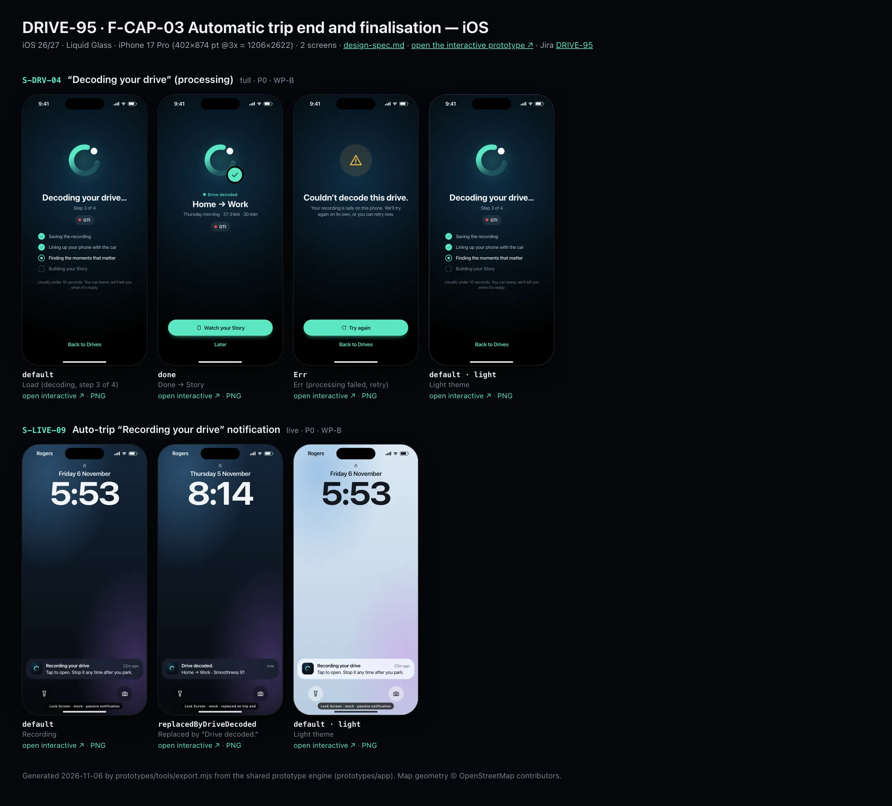
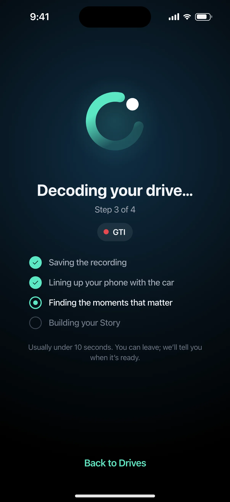
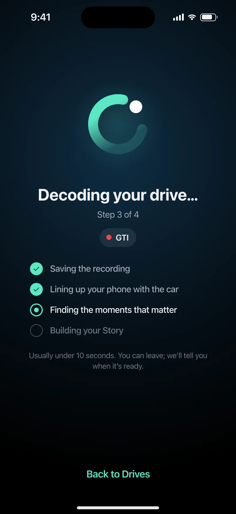
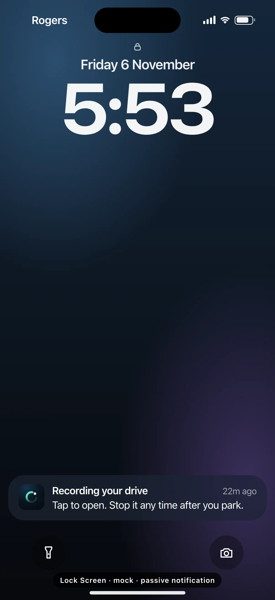
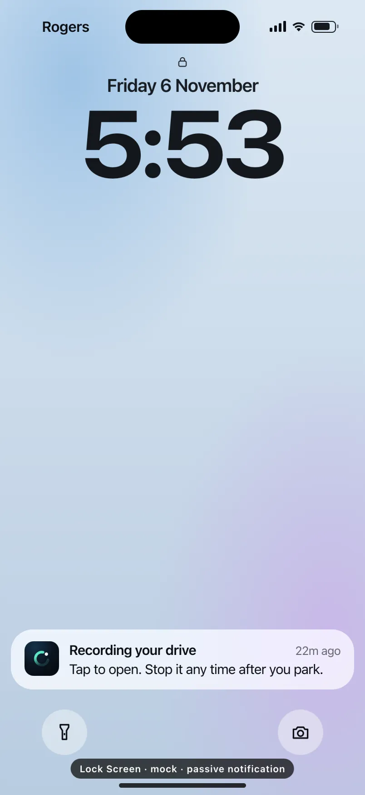

# DRIVE-95 · F-CAP-03 Automatic trip end and finalisation — iOS design spec

> Generated by `prototypes/tools/export.mjs` on 2026-11-06 from the shared prototype engine. **Do not edit by hand:** change the screen's `spec` in `prototypes/app/screens/wp-*.js` (see `prototypes/app/AUTHORING.md`) and re-export.

- **Jira story:** [DRIVE-95](https://thekeval.atlassian.net/browse/DRIVE-95) · F-CAP-03 · P0
- **Platform:** iOS 26/27 · Liquid Glass · iPhone 17 Pro (402×874 pt @3x = 1206×2622)
- **Interactive prototype:** [../../../../prototypes/ios/index.html#S-DRV-04](../../../../prototypes/ios/index.html#S-DRV-04) (catalog panel: every screen and state; deep links `#S-ID/state?trip=…&ent=…&theme=light&text=xl&rm=1`)
- **Contact sheet:** [mockup.html](mockup.html) · 
- **Design system (source of truth for values):** [brand](../../system/brand.md) · [components](../../system/components.md) · [motion](../../system/motion.md) · [accessibility](../../system/accessibility.md) · [screen map](../../system/screen-map.md) · [fixtures](../../system/fixtures.md) · tokens `prototypes/shared/tokens.css`

## Screens in this story

| Screen | Name | Presentation | Priority | States | Status |
|---|---|---|---|---|---|
| `S-DRV-04` | “Decoding your drive” (processing) | Full | P0 | 3 | Prototyped |
| `S-LIVE-09` | Auto-trip “Recording your drive” notification | Live (notification) | P0 | 2 | Prototyped |

## Tokens used on this platform

Values resolved from `prototypes/shared/tokens.css` inside the iOS device (`[data-platform="ios"]`). Use the token names in code; the hex values are for reference.

| Token | Dark | Light |
|---|---|---|
| `--app-bg` | `#080B10` | `#F2F3F6` |
| `--card-bg` | `#131822` | `#FFFFFF` |
| `--dp-bg-grouped` | `#080B10` | `#F2F3F6` |
| `--dp-surface` | `#131822` | `#FFFFFF` |
| `--dp-surface-2` | `#1B222D` | `#F2F3F6` |
| `--dp-surface-3` | `#262E3B` | `#E4E7EC` |
| `--dp-fill` | `#7880961F` | `#7880961F` |
| `--dp-fill-strong` | `#7880963D` | `#78809633` |
| `--dp-text` | `#F2F4F7` | `#0B0E13` |
| `--dp-text-2` | `#A3AAB6` | `#5A6271` |
| `--dp-text-3` | `#6E7787` | `#8A919D` |
| `--dp-separator` | `#96A0B429` | `#3C435024` |
| `--dp-accent` | `#5BE7C4` | `#079777` |
| `--dp-accent-text` | `#5BE7C4` | `#06775E` |
| `--dp-on-accent` | `#04241D` | `#FFFFFF` |
| `--dp-accent-container` | `#0A4439` | `#C6F8EA` |
| `--dp-record` | `#FFC24B` | `#9A6300` |
| `--dp-positive` | `#5BE7C4` | `#06775E` |
| `--dp-change-down` | `#A3AAB6` | `#5A6271` |
| `--dp-warning` | `#F5B648` | `#9A5F00` |
| `--dp-critical` | `#FF6B6B` | `#C62828` |
| `--dp-glass-fill` | `#1C222C6B` | `#FFFFFF8C` |
| `--dp-glass-fill-strong` | `#1C222CB8` | `#FFFFFFD1` |
| `--dp-glass-stroke` | `#FFFFFF24` | `#FFFFFF99` |
| `--dp-data-route` | `#5BE7C4` | `#079777` |
| `--dp-data-event-brake` | `#FF7A66` | `#A21F16` |
| `--dp-data-event-accel` | `#E58BD0` | `#A33A8C` |
| `--dp-data-event-corner` | `#EAD54E` | `#9A8A00` |
| `--dp-data-quality-good` | `#5FDB9C` | `#1E9E62` |
| `--dp-data-speed` | `#D6DCE4` | `#404A58` |
| `--dp-data-long-g` | `#5AB8F5` | `#0A6AB8` |
| `--dp-data-lat-g` | `#F5A142` | `#B25A00` |

| Type / layout token | Value |
|---|---|
| `--dp-font-screen-title` | `700 34px / 41px -apple-system, BlinkMacSystemFont, "SF Pro Display", system-ui, sans-serif` |
| `--dp-font-sheet-title` | `700 22px / 28px -apple-system, BlinkMacSystemFont, "SF Pro Display", system-ui, sans-serif` |
| `--dp-font-section-title` | `600 20px / 25px -apple-system, BlinkMacSystemFont, "SF Pro Display", system-ui, sans-serif` |
| `--dp-font-card-title` | `600 17px / 22px -apple-system, BlinkMacSystemFont, "SF Pro Text", system-ui, sans-serif` |
| `--dp-font-body` | `400 17px / 22px -apple-system, BlinkMacSystemFont, "SF Pro Text", system-ui, sans-serif` |
| `--dp-font-body-secondary` | `400 15px / 20px -apple-system, BlinkMacSystemFont, "SF Pro Text", system-ui, sans-serif` |
| `--dp-font-meta` | `400 13px / 18px -apple-system, BlinkMacSystemFont, "SF Pro Text", system-ui, sans-serif` |
| `--dp-font-caption` | `400 12px / 16px -apple-system, BlinkMacSystemFont, "SF Pro Text", system-ui, sans-serif` |
| `--dp-font-button` | `600 17px / 22px -apple-system, BlinkMacSystemFont, "SF Pro Text", system-ui, sans-serif` |
| `--dp-num-hero` | `600 72px / 72px -apple-system, BlinkMacSystemFont, "SF Pro Display", system-ui, sans-serif` |
| `--dp-num-xl` | `600 48px / 52px -apple-system, BlinkMacSystemFont, "SF Pro Display", system-ui, sans-serif` |
| `--dp-num-l` | `600 34px / 38px -apple-system, BlinkMacSystemFont, "SF Pro Display", system-ui, sans-serif` |
| `--dp-num-m` | `600 24px / 28px -apple-system, BlinkMacSystemFont, "SF Pro Display", system-ui, sans-serif` |
| `--dp-num-s` | `600 17px / 22px -apple-system, BlinkMacSystemFont, "SF Pro Display", system-ui, sans-serif` |
| `--dp-num-xs` | `600 13px / 16px -apple-system, BlinkMacSystemFont, "SF Pro Display", system-ui, sans-serif` |
| `--dp-screen-margin` | `16px` |
| `--dp-radius-card` | `24px` |
| `--dp-radius-card-hero` | `32px` |
| `--dp-radius-sheet` | `38px` |
| `--dp-radius-chip` | `999px` |
| `--dp-radius-button` | `999px` |
| `--dp-layout-list-row-min` | `52px` |
| `--dp-layout-touch-min` | `44px` |
| `--safe-top` | `62px` |
| `--safe-bottom` | `34px` |

Text sizes scale with `--dp-text-scale` (XL = 2.0×) and numerals with `--dp-num-scale` (XL = 1.3×). DP Numerals: SF Pro Expanded Semibold, tabular.

---

## S-DRV-04 · “Decoding your drive” (processing)

 

- **Presentation:** full — screen map: “Full”
- **Entry points:** S-DRV-02 · auto trip end with app foreground
- **Leads to:** S-STY-01 (or S-DRV-05 if still moving) · Err → retry
- **PRD features:** F-CAP-01, F-CAP-03, F-STY-01 · **Priority:** P0 · **WP:** B
- **Interactive:** [S-DRV-04](../../../../prototypes/ios/index.html#S-DRV-04)

**Purpose.** Bridges Stop (or an auto trip ending with the app open) and the Story: the drive is finalised, aligned, scored and turned into a Story in ≤ 10 s (F-CAP-01, F-CAP-03, F-STY-01, Q18). It never shows a score itself.

### States

| State | PRD label | Fixture params | Screenshot |
|---|---|---|---|
| `default` | Load (decoding, step 3 of 4) | `trip=t20261105-0742` | [S-DRV-04.png](../../screens/ios/S-DRV-04.webp) · [open](../../../../prototypes/ios/index.html#S-DRV-04) |
| `done` | Done → Story | `trip=t20261105-0742` | [S-DRV-04--done.png](../../screens/ios/S-DRV-04--done.webp) · [open](../../../../prototypes/ios/index.html#S-DRV-04/done) |
| `Err` | Err (processing failed, retry) | `trip=t20261105-0742` | [S-DRV-04--Err.png](../../screens/ios/S-DRV-04--Err.webp) · [open](../../../../prototypes/ios/index.html#S-DRV-04/Err) |
| default · light | Light theme | `theme=light` | [S-DRV-04--light.png](../../screens/ios/S-DRV-04--light.webp) |

Every state also renders in light/dark (`theme=light`), XL text (`text=xl`) and reduced motion (`rm=1`).

### Layout

- Full-screen cover, dark on both themes (#000 → Night gradient at 40% height), status bar light. Single centred column, 32 side margins.
- Loader 132: iOS = the Loop, its dot orbiting the trail at 1.6 s/rev (linear) · Android = M3E ContainedLoadingIndicator (7-shape morph) on a 132 primaryContainer disc.
- Title “Decoding your drive…” (story headline 28/34, #F2F4F7), sub “Step 3 of 4” (meta, #A3AAB6), car chip (car dot + nickname).
- Steps list (4 rows, 15/20): ✓ Saving the recording · ✓ Lining up your phone with the car · ● Finding the moments that matter · ○ Building your Story. Done rows #A3AAB6 with a Glide check; the running row is white with a Glide ring.
- Footnote “Usually under 10 seconds. You can leave; we’ll tell you when it’s ready.” + text button “Back to Drives”.
- done: the Loop with a Glide check badge, kicker “● Drive decoded”, route label (card title 24), part of day · km · min, car chip, “Watch your Story” (filled 52/56) + “Later”.
- Err: warning glyph in a 96 tonal disc, “Couldn’t decode this drive.”, reassurance, Try again (filled, refresh icon) + Back to Drives.

### Components & tokens

| Component | Tokens / spec |
|---|---|
| `page` | --dp-bg-grouped (iOS) / --md-sys-color-surface (Android) · --dp-screen-margin 16 |
| `loader` | see components.md |
| `button` | --dp-accent / --dp-on-accent (filled) · --dp-fill-strong · --md-sys-color-secondary-container (tonal) · --dp-radius-button · height iOS 50/44/34 · Android 56/40/32 · --dp-font-button · components.md §0 |
| `num` | see components.md |
| `carChip` | see components.md |

### Interactions & navigation

- Load → done automatically when finalisation completes (prototype: 3.4 s), then the Story opens by itself 1.5 s later; tapping Watch your Story opens it at once. Story goes through the D1 gate: if the phone is still moving (> 10 km/h or automotive) it lands on S-DRV-05 instead.
- Later → S-HOME-01 with the new Story card. Back to Drives (while decoding) → S-HOME-01 “processing a trip” state; the “Drive decoded.” notification (S-NTF-01) follows if the app is backgrounded.
- Err: Try again → Load; Back to Drives → S-HOME-01 (the trip shows as “Couldn’t decode · Try again” there).
- In the prototype Done opens S-HOME-01/newStoryCard underneath, then S-STY-01, so closing the Story lands on Home.

### Motion

- Entry from S-DRV-02: the in-drive dot’s trail retracts (450 ms), the decoding loader runs (iOS Loop orbit 1.6 s/rev · Android shape morph 1.4 s). Steps tick over with a check pop (spring.fast).
- Done: the loader ring becomes the Story progress bar (shared element, spring.default) — prototype: check badge pops, text rises 8 px (50 ms stagger).
- RM: static Loop, “Step 3 of 4” text only, cross-fade to done. Haptic tap on Watch your Story; none on auto-open.

### Accessibility

- Loader is a progressbar “Decoding your drive”; the step counter is announced when it changes (polite), not every frame.
- Done reads “Drive decoded. Home → Work, Thursday morning, 37.9 kilometres, 30 minutes. Watch your Story, button.”
- XL: steps wrap; buttons grow; loader stays 132.

### Platform notes

- **iOS (this spec):** .fullScreenCover; the Loop loader (brand.md §3.1) animated with a TimelineView rotation; glassProminent primary.
- *Android (for reference):* Full-screen destination; ContainedLoadingIndicator (M3E) and filled button with shape morph; predictive back = Back to Drives.

### Analytics

- `trip_finalise_ms {bucket}`
- `decoding_screen_viewed {source: stop|auto_end}`
- `story_opened {source: decoding, auto: bool}`
- `decode_failed {reason}`
- `decode_retry_tapped`

### Copy

| Key | Text |
|---|---|
| Load | Decoding your drive… · Step {3} of 4 · Saving the recording · Lining up your phone with the car · Finding the moments that matter · Building your Story |
| Note | Usually under 10 seconds. You can leave; we’ll tell you when it’s ready. |
| Done | Drive decoded · {Home → Work} · {Thursday morning} · {37.9 km} · {30 min} · Watch your Story · Later |
| Err | Couldn’t decode this drive. · Your recording is safe on this phone. We’ll try again on its own, or you can retry now. · Try again · Back to Drives |

### Free / Pro

Same for every plan (the Story is Free forever). No paywall or share prompt here or right after (D12).

### Data & fixtures

Decodes trip param (default t20261105-0742, Home → Work, Thursday morning, 37.9 km, 30 min, GTI). The score is deliberately not shown: it is revealed by the Story’s ring frame.

### Assets

[icon-check.svg](assets/icon-check.svg) · [icon-story.svg](assets/icon-story.svg) · [icon-warn.svg](assets/icon-warn.svg) · [icon-refresh.svg](assets/icon-refresh.svg) · [logo-a-loop.svg](assets/logo-a-loop.svg)

UI glyphs may be swapped for SF Symbols / Material Symbols Rounded equivalents; event-pin, quality and provenance glyphs must not be (components.md global rules).

### Checklist (accessibility.md §9)

- [ ] Light and dark both render, and contrast passes.
- [ ] The XL text state reflows with no truncation.
- [ ] The RM state is defined.
- [ ] Every control has a label; every chart and map has a summary sentence.
- [ ] Every target ≥ 44 pt / 48 dp (≥ 64 in-drive).
- [ ] No meaning by colour alone.
- [ ] Speed is neutral wherever it appears and absent from social or live surfaces.
- [ ] No streak, leaderboard, speed or “beat your time” language.
- [ ] Behaviour is defined while a trip is active (D1 gate).
- [ ] Haptics come from motion.md §6 only.

---

## S-LIVE-09 · Auto-trip “Recording your drive” notification

 

- **Presentation:** live — screen map: “Live (notification)”
- **Entry points:** Auto trip confirmed
- **Leads to:** Tap → S-DRV-01 · replaced by "Drive decoded" (S-NTF-01)
- **PRD features:** F-CAP-02, F-CAP-03, F-CAP-11 · **Priority:** P0 · **WP:** B
- **Interactive:** [S-LIVE-09](../../../../prototypes/ios/index.html#S-LIVE-09)

**Purpose.** Tells the user, silently, that an automatic drive is being recorded, and is replaced by the post-drive notification when it ends (F-CAP-02/03/11). It never opens content (D1).

### States

| State | PRD label | Fixture params | Screenshot |
|---|---|---|---|
| `default` | Recording | `live=auto` | [S-LIVE-09.png](../../screens/ios/S-LIVE-09.webp) · [open](../../../../prototypes/ios/index.html#S-LIVE-09) |
| `replacedByDriveDecoded` | Replaced by “Drive decoded.” | — | [S-LIVE-09--replacedByDriveDecoded.png](../../screens/ios/S-LIVE-09--replacedByDriveDecoded.webp) · [open](../../../../prototypes/ios/index.html#S-LIVE-09/replacedByDriveDecoded) |
| default · light | Light theme | `theme=light` | [S-LIVE-09--light.png](../../screens/ios/S-LIVE-09--light.webp) |

Every state also renders in light/dark (`theme=light`), XL text (`text=xl`) and reduced motion (`rm=1`).

### Layout

- iOS: Lock Screen mock with one passive notification (radius 24, system material): app icon (the Loop) · “Recording your drive” · “Tap to open. Stop it any time after you park.” · “21m ago”. No map, numbers or place names.
- Android: lock screen with the foreground-service notification: “DrivePerf · Recording · 21:50” · “Recording your drive” · “Started automatically · 21 min · 17.2 km · GTI” · Stop. On Android 16 it is promoted to the Live Update after confirmation (S-LIVE-05 autoRecording).
- Replaced: the same slot shows “Drive decoded.” · “Home → Work · Smoothness 91” (posted only once parked; Android adds Watch Story).

### Components & tokens

| Component | Tokens / spec |
|---|---|
| `notification` | components.md §20.6 |
| `lockScreen` | see components.md |

### Interactions & navigation

- Tap “Recording your drive” → DrivePerf on S-DRV-01 (auto trip state), never to content. Android Stop → ends the trip (prototype → replaced).
- Tap “Drive decoded.” → S-STY-01 for that trip through the gate (S-DRV-05 if still moving).

### Motion

- System presentation only; iOS interruption level .passive (no sound, no vibration, no wake); Android low-importance channel. RM: n/a.

### Accessibility

- Notification reads “DrivePerf. Recording your drive. Tap to open. Stop it any time after you park.”
- No haptic or sound (motion.md §6: never on notifications).

### Platform notes

- **iOS (this spec):** UNNotificationContent with interruptionLevel .passive, threadIdentifier = trip id; replaced by the Drive decoded notification using the same identifier (no Time Sensitive). With notifications denied nothing shows (blue location indicator only).
- *Android (for reference):* This is the FGS notification (channel “Recording”, IMPORTANCE_LOW, ongoing); on trip end the service posts the Drive decoded notification on its own channel and stops.

### Analytics

- `auto_trip_notification_posted`
- `auto_trip_notification_tapped`
- `notification_sent {type: drive_decoded}`

### Copy

| Key | Text |
|---|---|
| Recording | Recording your drive · Tap to open. Stop it any time after you park. |
| Android body | Started automatically · {21} min · {17.2} km · {GTI} |
| Replaced | Drive decoded. · Home → Work · Smoothness 91 |

### Free / Pro

Same for every plan.

### Data & fixtures

DP_DATA.notifications n_recording + liveTrip.states.auto (clock 5:53 = startedAt + elapsedS, “21m ago”); replaced uses n_decoded (t20261105-0742, scene Thu 5 Nov 8:14).

### Assets

[icon-stop.svg](assets/icon-stop.svg) · [icon-chevronDown.svg](assets/icon-chevronDown.svg) · [logo-a-loop.svg](assets/logo-a-loop.svg) · [icon-android-notification.svg](assets/icon-android-notification.svg)

UI glyphs may be swapped for SF Symbols / Material Symbols Rounded equivalents; event-pin, quality and provenance glyphs must not be (components.md global rules).

### Checklist (accessibility.md §9)

- [ ] Light and dark both render, and contrast passes.
- [ ] The XL text state reflows with no truncation.
- [ ] The RM state is defined.
- [ ] Every control has a label; every chart and map has a summary sentence.
- [ ] Every target ≥ 44 pt / 48 dp (≥ 64 in-drive).
- [ ] No meaning by colour alone.
- [ ] Speed is neutral wherever it appears and absent from social or live surfaces.
- [ ] No streak, leaderboard, speed or “beat your time” language.
- [ ] Behaviour is defined while a trip is active (D1 gate).
- [ ] Haptics come from motion.md §6 only.

---

Map geometry in the prototype: © OpenStreetMap contributors (ODbL). Speed and G are simulated fixtures (fixtures.md).
