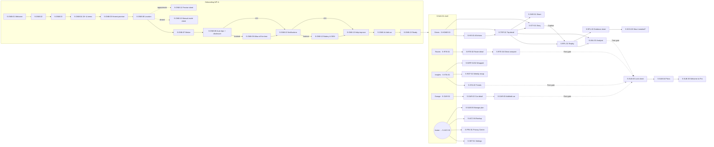
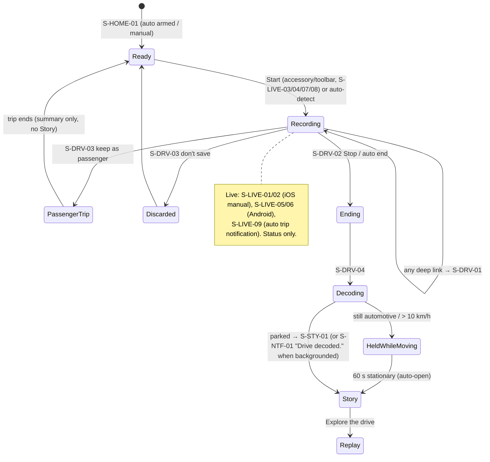
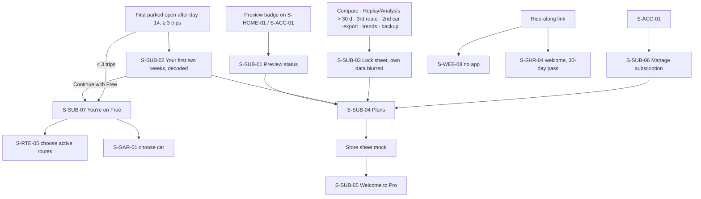

# DrivePerf screen map and navigation (v1)

**Jira:** DRIVE-99 · A6 · 6 Nov 2026. This covers **all 117 screen IDs** in [PRD §4](../../product/PRD-v1.md#4-screen-inventory-appendix-required): 106 app screens and 11 web pages. Coverage was checked by script against the PRD table. The presentation and routing rules here are shared by iOS and Android; only the cosmetics differ (components.md).

## 1. Tab structure: validated and improved

**Decision: four tabs (Drives · Routes · Insights · Garage), with Profile moved to an avatar button** in the top-trailing corner of every tab root. The PRD proposal ("Drives, Routes, Insights, Garage, Profile", S-NAV-01 "A6 to validate") is **kept in substance and improved in one place.**

| Tab | Root screen | What lives there | Icon (`DP_ICONS`) |
|---|---|---|---|
| **Drives** | S-HOME-01 | Capture status, the new-Story card, this week at a glance, the latest drives → All drives (S-HIS-01), trip detail, Story, Replay, Analysis | `drives` (a smooth trace with a dot) |
| **Routes** | S-RTE-01 | Routes and candidates, route detail with the dot strip and record, ghost comparison | `routes` |
| **Insights** | S-STA-01 | The weekly view and 4-week trend (Free), Month/Year/Car/Route trends (Pro), focus habit, recap and Wrapped cards | `insights` |
| **Garage** | S-GAR-01 | Cars, car detail and per-car stats, add or edit car | `garage` |
| *Profile* (avatar) | S-ACC-01 | Account / local mode, Pro and Preview status, Privacy Centre, Settings, Health Check, Ride-along pass | `profile` / the user's initial |

**Why Profile moves out of the tab bar:**
1. **Frequency.** Profile holds account, privacy and settings, which are low-frequency utilities. Tab slots are for daily destinations. The App Store, Apple Music, Google Photos and Gmail all put the account behind a top-trailing avatar, so this is native on both platforms.
2. **Bigger, calmer bars.** Four items give a wider hit area per tab on the iOS floating glass bar (≈ 90 pt each) and on the Android navigation bar, and keep the bar visually quiet.
3. **It frees the iOS bottom accessory slot for capture status.** `tabViewBottomAccessory` carries "Auto-detect on · ready · Start" (or the live recording state), which is the most important glanceable state in the app. On Android the same job is done by an M3E floating toolbar on the Drives tab.
4. **Garage stays a tab** on purpose. For the hero persona (E1) the car is identity: it tints Stories and cards, and per-car stats are the bridge persona's (I1) Pro trigger. It is the emotional tab, not a settings page.

**Rejected alternatives:** five tabs as proposed (Profile is a weak tab, and there is no room for the accessory) · "You" (Profile + Garage merged, which buries the car) · a centre "Record" tab (it invites starting manual drives and fights auto-detect; Start lives in the accessory/toolbar instead).

| | iOS 26/27 | Android M3 Expressive |
|---|---|---|
| Tab container | Floating Liquid Glass tab bar, `TabView` + `Tab`, `.tabBarMinimizeBehavior(.onScrollDown)` | `NavigationBar` (short, 64 dp), always visible |
| Capture status | `.tabViewBottomAccessory { CaptureStatusAccessory() }` on all tabs | Horizontal floating toolbar on the Drives tab, plus a status chip in the top bar on the other tabs when it needs attention |
| Profile | Glass avatar toolbar item → **sheet** (large detent, own `NavigationStack`) | Avatar in the top app bar → **full-screen destination** (shared axis X; predictive back) |
| Badges | A dot on the avatar (needs attention); Preview capsule | An M3 `Badge` on the avatar; Preview chip |

## 2. Navigation rules

### 2.1 Presentation vocabulary
**Root** = tab root · **Push** = navigation stack (iOS push / zoom transition; Android shared axis / container transform) · **Sheet** = iOS sheet with detents / Android modal bottom sheet · **Full** = full-screen cover (iOS `.fullScreenCover`, Android full-screen dialog or activity-level destination) · **Dialog** = iOS alert / M3 dialog · **Sys** = system permission dialog or OS settings page, **mocked as a non-interactive frame** (PRD §4 note) · **Live** = an OS surface outside the app (Live Activity, Dynamic Island, notification, widget, tile, control) · **Web** = driveperf.com.

### 2.2 The in-drive locked state (D1 gate)
Every navigation passes through one gate (accessibility.md §7, SAF-01, F-CAP-07, F-STY-05):

```
navigate(target):
  if trip.active and trip.type == driver:          → S-DRV-01 (target is remembered)
  elif trip.ended and (automotive or speed > 10 km/h) and target ∈ {Story, Replay, Analysis, Recap, Wrapped, Share, Paywall}:
                                                   → S-DRV-05, which opens target automatically after 60 s stationary / not automotive
  elif trip.active and trip.type == passenger:     → target (content allowed), recording banner shown in the shell
  else:                                            → target
```
- Notification taps, widget taps, Control Center / QS tile taps, Live Activity taps and app links all use the gate.
- **Allowed while a driver trip is active:** only S-DRV-01, S-DRV-02 (Stop sheet), S-DRV-03 (passenger sheet) and the system Settings deep link from a red Health Check notification. That last one opens after the trip, because the notification itself is held.
- Paywalls (S-SUB-02/03/04), share (S-SHR-*), rating prompts and tips are suppressed (D12). S-SUB-02 waits until the next parked foreground open.

### 2.3 Prototype deep-link convention (shared by A7 and A8)
`index.html#<SCREEN-ID>[/<state>][?trip=<tripId>&route=<routeId>&car=<vehicleId>&ent=<free|preview|previewEnding|pro|proMonthly|rideAlong>&health=<preset>&live=<liveTrip state>&theme=<dark|light>&text=<l|xl>&rm=1&rt=1]`
Examples: `#S-STY-01/newRecord?trip=t20261105-0742` · `#S-RPL-01/scrubbing?trip=t20261020-0740` · `#S-TRP-01/Lock?trip=t20261002-0745&ent=free` · `#S-SET-05/alwaysLost` · `#S-DRV-01/gpsSearching?live=gpsSearching`. State names are the PRD "States to prototype" values in camelCase (for example `Def` → `default`, `Lock`, `Part`, `Err`, `XL` → use `text=xl`). Unknown states fall back to `default`. Default fixtures: `DP_DATA.entitlement.current` (`pro`) and the newest trip.

## 3. Navigation graphs

### 3.1 App level


### 3.2 Drive lifecycle and the locked state


### 3.3 Monetisation entry points (never during a trip, never after a worse-than-usual Story)


## 4. Work split for the prototype teams

The 117 IDs are grouped into **seven work packages along PRD epic lines**, so each prototype team (A7 iOS, A8 Android) can run them in parallel, and A9 takes WP-G. Build order: **WP-B shell first** (everything mounts in it), then WP-C (the hero flows), then the rest in parallel.

| WP | Scope | PRD epics | Screens | Priority mix | Screen IDs |
|---|---|---|---|---|---|
| **WP-A** | Onboarding & permissions | ONB | 16 | P0 14 · P1 2 | S-ONB-01, S-ONB-02, S-ONB-03, S-ONB-04, S-ONB-05, S-ONB-06, S-ONB-07, S-ONB-08, S-ONB-09, S-ONB-10, S-ONB-11, S-ONB-12, S-ONB-13, S-ONB-14, S-ONB-15, S-ONB-16 |
| **WP-B** | Shell, capture & live surfaces | HIS (S-NAV-01), CAP | 19 | P0 16 · P1 3 | S-NAV-01, S-HOME-01, S-HOME-02, S-HOME-03, S-DRV-01, S-DRV-02, S-DRV-03, S-DRV-04, S-DRV-05, S-LIVE-01, S-LIVE-02, S-LIVE-03, S-LIVE-04, S-LIVE-05, S-LIVE-06, S-LIVE-07, S-LIVE-08, S-LIVE-09, S-LIVE-10 |
| **WP-C** | Story, Replay, Analysis, data quality & scores | STY, RPL, DQ, SCO | 19 | P0 13 · P1 5 · P2 1 | S-STY-01, S-TRP-01, S-RPL-01, S-RPL-02, S-RPL-03, S-RPL-04, S-ANL-01, S-ANL-02, S-ANL-03, S-ANL-04, S-DQ-01, S-DQ-02, S-SCO-01, S-SCO-02, S-SCO-03, S-SCO-04, S-SCO-05, S-SCO-06, S-NTF-02 |
| **WP-D** | History, Insights, Routes & Garage | HIS, RTE, GAR | 14 | P0 14 | S-TRP-02, S-TRP-03, S-HIS-01, S-HIS-02, S-STA-01, S-STA-02, S-RTE-01, S-RTE-02, S-RTE-03, S-RTE-04, S-RTE-05, S-GAR-01, S-GAR-02, S-GAR-03 |
| **WP-E** | Sharing, account, privacy & subscription | SHR, ACC, PRV, SUB | 25 | P0 20 · P1 5 | S-SHR-01, S-SHR-02, S-SHR-03, S-SHR-04, S-ACC-01, S-ACC-02, S-ACC-03, S-ACC-04, S-ACC-05, S-ACC-06, S-ACC-07, S-PRV-01, S-PRV-02, S-PRV-03, S-PRV-04, S-PRV-05, S-PRV-06, S-PRV-07, S-SUB-01, S-SUB-02, S-SUB-03, S-SUB-04, S-SUB-05, S-SUB-06, S-SUB-07 |
| **WP-F** | Notifications, recaps, Wrapped & settings | NTF, SET | 13 | P0 9 · P1 4 | S-NTF-01, S-RCP-01, S-WRP-01, S-WRP-02, S-SET-01, S-SET-02, S-SET-03, S-SET-04, S-SET-05, S-SET-06, S-SET-07, S-SET-08, S-SET-09 |
| **WP-G** | Website (A9) | WEB | 11 | P0 8 · P1 2 · P2 1 | S-WEB-01, S-WEB-02, S-WEB-03, S-WEB-04, S-WEB-05, S-WEB-06, S-WEB-07, S-WEB-08, S-WEB-09, S-WEB-10, S-WEB-11 |

Platform-specific rows: **iOS only**: S-LIVE-01 to 04. **Android only**: S-ONB-09, S-ONB-12, S-LIVE-05 to 08. Everything else is built for both (or for the web). The ANA epic (analytics and crash reporting) has no screens of its own; its consent UI is S-ONB-13 and S-PRV-07.

### 4.1 Screen IDs by PRD epic

| PRD epic | Screens | IDs |
|---|---|---|
| HIS | 7 | S-NAV-01, S-TRP-02, S-TRP-03, S-HIS-01, S-HIS-02, S-STA-01, S-STA-02 |
| ONB | 16 | S-ONB-01, S-ONB-02, S-ONB-03, S-ONB-04, S-ONB-05, S-ONB-06, S-ONB-07, S-ONB-08, S-ONB-09, S-ONB-10, S-ONB-11, S-ONB-12, S-ONB-13, S-ONB-14, S-ONB-15, S-ONB-16 |
| CAP | 18 | S-HOME-01, S-HOME-02, S-HOME-03, S-DRV-01, S-DRV-02, S-DRV-03, S-DRV-04, S-DRV-05, S-LIVE-01, S-LIVE-02, S-LIVE-03, S-LIVE-04, S-LIVE-05, S-LIVE-06, S-LIVE-07, S-LIVE-08, S-LIVE-09, S-LIVE-10 |
| STY | 1 | S-STY-01 |
| RPL | 9 | S-TRP-01, S-RPL-01, S-RPL-02, S-RPL-03, S-RPL-04, S-ANL-01, S-ANL-02, S-ANL-03, S-ANL-04 |
| DQ | 3 | S-DQ-01, S-DQ-02, S-NTF-02 |
| SCO | 6 | S-SCO-01, S-SCO-02, S-SCO-03, S-SCO-04, S-SCO-05, S-SCO-06 |
| RTE | 5 | S-RTE-01, S-RTE-02, S-RTE-03, S-RTE-04, S-RTE-05 |
| GAR | 3 | S-GAR-01, S-GAR-02, S-GAR-03 |
| SHR | 4 | S-SHR-01, S-SHR-02, S-SHR-03, S-SHR-04 |
| ACC | 7 | S-ACC-01, S-ACC-02, S-ACC-03, S-ACC-04, S-ACC-05, S-ACC-06, S-ACC-07 |
| PRV | 7 | S-PRV-01, S-PRV-02, S-PRV-03, S-PRV-04, S-PRV-05, S-PRV-06, S-PRV-07 |
| SUB | 7 | S-SUB-01, S-SUB-02, S-SUB-03, S-SUB-04, S-SUB-05, S-SUB-06, S-SUB-07 |
| NTF | 4 | S-NTF-01, S-RCP-01, S-WRP-01, S-WRP-02 |
| SET | 9 | S-SET-01, S-SET-02, S-SET-03, S-SET-04, S-SET-05, S-SET-06, S-SET-07, S-SET-08, S-SET-09 |
| WEB | 11 | S-WEB-01, S-WEB-02, S-WEB-03, S-WEB-04, S-WEB-05, S-WEB-06, S-WEB-07, S-WEB-08, S-WEB-09, S-WEB-10, S-WEB-11 |

## 5. Screen-by-screen navigation (all 117 IDs)

"Entry points" lists every way in; "Leads to" lists every way out. All taps from outside the app (notifications, widgets, controls, links) go through the D1 gate in §2.2.

### WP-A · Onboarding & permissions (16 screens)

| Screen | Name | Epic | Presentation | Entry points | Leads to | Platform | Pri |
|---|---|---|---|---|---|---|---|
| `S-ONB-01` | Welcome: "Smooth is a skill." | ONB | Full | First launch | S-ONB-02 | Both | P0 |
| `S-ONB-02` | Intro: "Every drive, decoded." (Story preview) | ONB | Full (paged) | S-ONB-01 | S-ONB-03 | Both | P0 |
| `S-ONB-03` | Intro: Private by design + Pro Preview included | ONB | Full (paged) | S-ONB-02 | S-ONB-04 | Both | P0 |
| `S-ONB-04` | Age (18+) and terms | ONB | Full | S-ONB-03 | S-ONB-05; under-18 → blocked state (end) | Both | P0 |
| `S-ONB-05` | How capture works (honest promise) | ONB | Full | S-ONB-04 | S-ONB-06; "How it works" sheet | Both | P0 |
| `S-ONB-06` | Location primer (While Using) | ONB | Full + Sys | S-ONB-05 | S-ONB-07 (granted) · S-ONB-16 (denied) · S-ONB-11 (approximate chosen) | Both | P0 |
| `S-ONB-07` | Motion & activity primer | ONB | Full + Sys | S-ONB-06 | S-ONB-08 · denied → S-ONB-16 (manual) | Both | P0 |
| `S-ONB-08` | Automatic trips opt-in + background-location disclosure | ONB | Full + Sys | S-ONB-07 | iOS: Always prompt → S-ONB-10 · Android: → S-ONB-09 · toggle left off → S-ONB-10 (manual mode) | Both | P0 |
| `S-ONB-09` | "Allow all the time" settings step | ONB | Full + Sys (Settings mock) | S-ONB-08 (Android) | S-ONB-10 (returned granted / not granted) | Android only | P0 |
| `S-ONB-10` | Notifications primer | ONB | Full + Sys | S-ONB-08 / S-ONB-09 | S-ONB-12 (Android) · S-ONB-13 (iOS) | Both | P0 |
| `S-ONB-11` | Precise location sheet | ONB | Sheet | S-ONB-06 (approximate), S-SET-05 precise row | Back to caller | Both | P0 |
| `S-ONB-12` | Battery and reliability step | ONB | Full | S-ONB-10 (Android); S-SET-06 | S-ONB-13 · "Remind me later" | Android only | P0 |
| `S-ONB-13` | Help improve DrivePerf (usage statistics, crash reports) | ONB | Full | S-ONB-10 / S-ONB-12 | S-ONB-14 | Both | P0 |
| `S-ONB-14` | Add your car | ONB | Full | S-ONB-13 | S-ONB-15 (filled or skipped) | Both | P1 |
| `S-ONB-15` | You're ready (quick-start surfaces) | ONB | Full | S-ONB-14 | S-NAV-01 → S-HOME-01 (first run, Prev day 1) | Both | P1 |
| `S-ONB-16` | Permission denied / manual-mode sheet | ONB | Sheet | Any denied primer; S-LIVE-04 Deny; S-HOME-01 Deny state | System Settings (deep link) · continue in manual mode | Both | P0 |

### WP-B · Shell, capture & live surfaces (19 screens)

| Screen | Name | Epic | Presentation | Entry points | Leads to | Platform | Pri |
|---|---|---|---|---|---|---|---|
| `S-NAV-01` | App shell and tab bar (validated: 4 tabs + avatar) | HIS | Shell | App launch (after onboarding) | Tab roots S-HOME-01 · S-RTE-01 · S-STA-01 · S-GAR-01; avatar → S-ACC-01; accessory/toolbar → S-DRV-01 (recording) or S-HOME-02 | Both | P0 |
| `S-HOME-01` | Home (Drives tab): ready to record | CAP | Root (Drives tab) | Tab · S-ONB-15 · S-DRV-04 done (new Story card) | S-STY-01 (new Story) · S-TRP-01 · S-HIS-01 ("All drives") · S-HOME-02 · S-HOME-03 · S-DRV-01 (Start) · S-SET-05 (needs attention) · S-SUB-01 (Prev badge) | Both | P0 |
| `S-HOME-02` | Capture status sheet | CAP | Sheet (medium) | S-HOME-01 status, iOS accessory, Android toolbar | S-SET-05 · S-HOME-03 | Both | P0 |
| `S-HOME-03` | Pause auto-detect sheet | CAP | Sheet (small) | S-HOME-02 · Android FAB menu · long-press accessory | Back (paused until…) | Both | P1 |
| `S-DRV-01` | In-drive locked screen | CAP | Full (locked) | Start (S-HOME-01, S-LIVE-03/04/07/08) · any deep link during a driver trip · S-LIVE-09 tap | S-DRV-02 (Stop) · S-DRV-03 (passenger) · auto end → S-DRV-04 | Both | P0 |
| `S-DRV-02` | End trip sheet (Stop confirmation) | CAP | Sheet (small) | S-DRV-01 Stop | S-DRV-04 · Cancel → S-DRV-01 | Both | P0 |
| `S-DRV-03` | "I'm a passenger" sheet | CAP | Sheet (small) | S-DRV-01 / S-DRV-05 "I'm a passenger" | Keep as passenger → S-NAV-01 (content unlocked) · Don't save → S-HOME-01 | Both | P0 |
| `S-DRV-04` | "Decoding your drive" (processing) | CAP | Full | S-DRV-02 · auto trip end with app foreground | S-STY-01 (or S-DRV-05 if still moving) · Err → retry | Both | P0 |
| `S-DRV-05` | "Your Story will be ready when you've parked" | CAP | Full (locked) | Any Story/Replay/Analysis/share/paywall request while moving or in a driver trip | Auto-opens requested content after 60 s stationary · S-DRV-03 | Both | P0 |
| `S-LIVE-01` | Live Activity, Lock Screen | CAP | Live (iOS Lock Screen) | Manual start; S-LIVE-03 "Show live drive" | Tap → S-DRV-01 · Stop → trip ends (S-DRV-04 on next open) | iOS only | P0 |
| `S-LIVE-02` | Live Activity, Dynamic Island | CAP | Live (iOS Dynamic Island) | Same Live Activity as S-LIVE-01 | Tap → S-DRV-01 · long-press → expanded · Stop | iOS only | P0 |
| `S-LIVE-03` | Control Center control | CAP | Live (iOS Control Center) | Control Center | Start → S-LIVE-01 (no app open) · Show live drive · Stop | iOS only | P0 |
| `S-LIVE-04` | Lock Screen and Home Screen widgets | CAP | Live (iOS widgets) | Lock/Home Screen | Start → S-LIVE-01 · tap last drive → S-STY-01 / S-TRP-01 (via D1 gate) · Deny → S-ONB-16 | iOS only | P0 |
| `S-LIVE-05` | Live Update notification (promoted) | CAP | Live (Android 16 promoted notification) | Manual start; confirmed auto trip | Tap → S-DRV-01 · Stop action | Android only | P0 |
| `S-LIVE-06` | Standard ongoing recording notification | CAP | Live (Android ongoing notification) | Recording on Android < 16 or demoted | Tap → S-DRV-01 · Stop action | Android only | P0 |
| `S-LIVE-07` | Quick Settings tile | CAP | Live (Android QS tile) | Quick Settings | Start / Stop · unavailable → S-ONB-16 | Android only | P1 |
| `S-LIVE-08` | Home-screen widget (Glance) | CAP | Live (Android Glance widget) | Home screen | Start · tap last drive → S-STY-01 (D1 gate) | Android only | P1 |
| `S-LIVE-09` | Auto-trip "Recording your drive" notification | CAP | Live (notification) | Auto trip confirmed | Tap → S-DRV-01 · replaced by "Drive decoded" (S-NTF-01) | Both | P0 |
| `S-LIVE-10` | "Auto-detect may be paused" watchdog notification | CAP | Live (notification) + in-app card | Watchdog (F-CAP-14) | Tap → S-SET-05 | Both | P0 |

### WP-C · Story, Replay, Analysis, data quality & scores (19 screens)

| Screen | Name | Epic | Presentation | Entry points | Leads to | Platform | Pri |
|---|---|---|---|---|---|---|---|
| `S-STY-01` | Drive Story player (frames 1–7) | STY | Full (player) | S-NTF-01 "Drive decoded" · S-HOME-01 card · S-DRV-04 · S-TRP-01 "Story" · S-LIVE-04/08 | f7: S-RPL-01 (Explore) · S-SHR-01 (Share) · Done → caller · chips: S-RTE-03, S-SCO-03, S-TRP-02 (passenger/car), S-DQ-01 | Both | P0 |
| `S-TRP-01` | Trip detail | RPL | Push | S-HOME-01 · S-HIS-01 · S-RTE-02 runs · S-GAR-02 · S-RCP-01 drive of week | S-RPL-01 · S-ANL-01 · S-STY-01 · S-SHR-01 · S-PRV-04 (Export, Pro) · S-TRP-02 · S-DQ-01 · S-SCO-01 · S-SCO-04 · S-SUB-03 (Lock) | Both | P0 |
| `S-RPL-01` | Trip Replay | RPL | Push (immersive) | S-STY-01 f7 · S-TRP-01 · S-SCO-03 evidence links | S-RPL-02 (pin) · S-RPL-03 (stop/max pin) · S-RPL-04 (layers) · S-ANL-01 · S-DQ-01 · S-SUB-03 (Lock) | Both | P0 |
| `S-RPL-02` | Event evidence sheet | RPL | Sheet (medium → large) | S-RPL-01 pin · S-ANL-01 tick · S-SCO-01 contributor · S-TRP-01 event list | S-SCO-03 · S-SCO-04 · "Not accurate?" list | Both | P0 |
| `S-RPL-03` | Stop and max-speed pin popover | RPL | Popover / small sheet | S-RPL-01 stop or max-speed pin | Dismiss | Both | P0 |
| `S-RPL-04` | Replay layers sheet | RPL | Sheet (medium) | S-RPL-01 layers button | Dismiss | Both | P2 |
| `S-ANL-01` | Analysis workspace (map + synced timeline + G-G) | RPL | Push (immersive) | S-TRP-01 · S-RPL-01 | S-ANL-02 · S-ANL-03 · S-ANL-04 · S-RPL-02 · S-SUB-03 (Lock) | Both | P0 |
| `S-ANL-02` | G-G circle, expanded | RPL | Full / zoom from G-G | S-ANL-01 G-G tap | Back | Both | P0 |
| `S-ANL-03` | Channel picker | RPL | Sheet (iOS menu) / bottom sheet | S-ANL-01 channels | S-SUB-03 for Pro channels on Free | Both | P0 |
| `S-ANL-04` | Range statistics sheet | RPL | Sheet (medium) | S-ANL-01 range select | S-SUB-03 (Lock) | Both | P1 |
| `S-DQ-01` | Data-quality detail sheet | DQ | Sheet (large) | Quality badge anywhere (S-STY-01, S-TRP-01, S-RPL-01, S-ANL-01) | S-DQ-02 · S-SCO-02 | Both | P0 |
| `S-DQ-02` | Phone placement guide | DQ | Push / sheet | S-DQ-01 (Limited trip) · S-SET-06 | Back | Both | P1 |
| `S-SCO-01` | Smoothness breakdown | SCO | Push | S-TRP-01 ring · S-STY-01 f4 tap | S-RPL-02 (contributor events) · S-SCO-02 | Both | P0 |
| `S-SCO-02` | How scores work | SCO | Push | ⓘ on any score · S-DQ-01 | Back | Both | P0 |
| `S-SCO-03` | "Was it needed?" sheet | SCO | Sheet (small) | S-RPL-02 · Story "Was it needed?" chip | Back (score recomputes ≤ 1 s) | Both | P0 |
| `S-SCO-04` | Coaching tip detail | SCO | Push / sheet | S-TRP-01 tip · S-STY-01 f6 · S-RPL-02 | S-RPL-02 (evidence) | Both | P0 |
| `S-SCO-05` | Weekly focus detail | SCO | Push | S-STA-01 focus card · S-RCP-01 W4 | Back | Both | P1 |
| `S-SCO-06` | Efficiency habits detail | SCO | Push | S-TRP-01 efficiency row · S-GAR-02 | Back | Both | P1 |
| `S-NTF-02` | Missed-trip check sheet | DQ | Sheet (medium) | Missed-trip notification · S-SET-05 | Back (thanks) | Both | P1 |

### WP-D · History, Insights, Routes & Garage (14 screens)

| Screen | Name | Epic | Presentation | Entry points | Leads to | Platform | Pri |
|---|---|---|---|---|---|---|---|
| `S-TRP-02` | Edit trip sheet | HIS | Sheet (large) | S-TRP-01 Edit · Story f1 chips | S-TRP-03 · Save → caller | Both | P0 |
| `S-TRP-03` | Delete trip confirmation | HIS | Dialog (iOS alert / M3 dialog) | S-TRP-02 · trip card swipe | S-HIS-01 | Both | P0 |
| `S-HIS-01` | Drives list | HIS | Push (from Drives tab) | S-HOME-01 "All drives" | S-TRP-01 · S-HIS-02 · S-SUB-03 (locked older trip actions) | Both | P0 |
| `S-HIS-02` | Filter sheet | HIS | Sheet (medium) | S-HIS-01 filter | Back (chips applied) | Both | P0 |
| `S-STA-01` | Insights (weekly stats) | HIS | Root (Insights tab) | Tab | S-STA-02 (Pro) or S-SUB-03 (Free) · S-SCO-05 · S-RCP-01 (latest recap card) · S-WRP-01 card | Both | P0 |
| `S-STA-02` | Trend detail | HIS | Push | S-STA-01 period/car/route | Back | Both | P0 |
| `S-RTE-01` | Routes list | RTE | Root (Routes tab) | Tab | S-RTE-02 · S-RTE-03 (candidate) · S-SUB-03 (3rd route) · S-RTE-05 | Both | P0 |
| `S-RTE-02` | Route detail | RTE | Push | S-RTE-01 · S-STY-01 record chip · S-NTF-01 record | S-RTE-04 (Compare) · S-TRP-01 (run) · S-RTE-05 · S-SUB-03 | Both | P0 |
| `S-RTE-03` | Name this route sheet | RTE | Sheet (small) | S-STY-01 route-discovered frame · S-RTE-01 candidate · S-NTF-01 | Back | Both | P0 |
| `S-RTE-04` | Ghost comparison | RTE | Push (immersive) | S-RTE-02 Compare | S-RPL-02 evidence · S-SUB-03 (Free) | Both | P0 |
| `S-RTE-05` | Route management sheet | RTE | Sheet (large) | S-RTE-01/02 manage · S-SUB-07 choose routes | Back | Both | P0 |
| `S-GAR-01` | Garage | GAR | Root (Garage tab) | Tab | S-GAR-02 · S-GAR-03 (add) · S-SUB-03 (2nd car on Free) | Both | P0 |
| `S-GAR-02` | Car detail | GAR | Push | S-GAR-01 | S-GAR-03 (edit) · S-TRP-01 · S-STA-02 (per-car, Pro) · S-SCO-06 | Both | P0 |
| `S-GAR-03` | Add / edit car | GAR | Sheet (large) | S-GAR-01/02 · S-ONB-14 reuse | Back · delete confirm dialog | Both | P0 |

### WP-E · Sharing, account, privacy & subscription (25 screens)

| Screen | Name | Epic | Presentation | Entry points | Leads to | Platform | Pri |
|---|---|---|---|---|---|---|---|
| `S-SHR-01` | Share card builder | SHR | Full (builder) → system share sheet | S-STY-01 f7 · S-TRP-01 · S-RCP-01 W5 · S-WRP-* last frame | S-SHR-02 (Map style) · system share sheet · S-SHR-03 (from card footer) | Both | P0 |
| `S-SHR-02` | Map card warning sheet | SHR | Sheet (small) | S-SHR-01 Map style toggle | Back | Both | P1 |
| `S-SHR-03` | Ride-along pass invite | SHR | Sheet (large) | S-SHR-01 · S-ACC-01 "Give a Ride-along pass" | System share sheet | Both | P1 |
| `S-SHR-04` | Ride-along welcome (redeemed) | SHR | Full | Ride-along link (app opened via link), first open | S-ONB-01 (new user) · S-HOME-01 | Both | P1 |
| `S-ACC-01` | Profile tab | ACC | Sheet (iOS, large) / Push (Android) from avatar | Avatar on any tab root | S-ACC-02 · S-ACC-04 · S-PRV-01 · S-SET-01 · S-SUB-06 · S-SUB-01 · S-SHR-03 · S-SET-05 | Both | P0 |
| `S-ACC-02` | Sign-in sheet | ACC | Sheet (medium) | S-ACC-01 · S-ACC-04 (backup needs sign-in) · S-PRV-06 re-auth | S-ACC-03 (email) · S-ACC-05 (first backup) · back | Both | P0 |
| `S-ACC-03` | Check your email (email link) | ACC | Push in sheet | S-ACC-02 email | Universal/App link → signed in | Both | P0 |
| `S-ACC-04` | Cloud backup settings | ACC | Push | S-ACC-01 | S-ACC-05 · S-ACC-06 · S-SUB-03 (Free) · S-ACC-07 | Both | P0 |
| `S-ACC-05` | Backup consent | ACC | Sheet (large) | S-ACC-04 first enable | Back (backup on) | Both | P0 |
| `S-ACC-06` | Restore from backup | ACC | Full | Sign-in on a new device with a backup · S-ACC-04 restore | S-HOME-01 | Both | P0 |
| `S-ACC-07` | Sign out sheet | ACC | Sheet (medium) | S-ACC-01 sign out | S-ACC-01 (local mode) | Both | P1 |
| `S-PRV-01` | Privacy Centre | PRV | Push | S-ACC-01 · S-SET-01 | S-PRV-02 · S-PRV-03 · S-PRV-04 · S-PRV-05 · S-PRV-06 · S-PRV-07 · S-ACC-04 | Both | P0 |
| `S-PRV-02` | Privacy zones | PRV | Push | S-PRV-01 · S-SHR-02 link | Add zone (map pin + radius) · back | Both | P1 |
| `S-PRV-03` | Download all my data | PRV | Push | S-PRV-01 | iOS Files / share sheet · Android SAF picker | Both | P0 |
| `S-PRV-04` | Trip export (GPX/CSV) | PRV | Sheet (large) | S-TRP-01 Export · S-PRV-01 | Share sheet / SAF · S-SUB-03 (Free) | Both | P0 |
| `S-PRV-05` | Delete data options | PRV | Push | S-PRV-01 · S-SET-07 | Typed confirm dialog → done | Both | P0 |
| `S-PRV-06` | Delete account flow | PRV | Push (flow) | S-PRV-01 · S-ACC-01 | Re-auth S-ACC-02 → summary → done (local mode) | Both | P0 |
| `S-PRV-07` | Analytics and diagnostics | PRV | Push | S-PRV-01 · S-SET-01 | Back | Both | P0 |
| `S-SUB-01` | Pro Preview status sheet | SUB | Sheet (medium) | Preview badge (S-HOME-01, S-ACC-01) | S-SUB-04 (See plans) · back | Both | P0 |
| `S-SUB-02` | Day-15 "Your first two weeks, decoded" | SUB | Full (cover) | First foreground open after day 14, ≥ 3 trips, not in a trip (F-SUB-03) | S-SUB-04 purchase · "Continue with Free" → S-SUB-07 / S-HOME-01 | Both | P0 |
| `S-SUB-03` | Contextual lock sheet | SUB | Sheet (medium) | Any Pro gate (compare, > 30-day Replay/Analysis, 3rd route, 2nd car, export, trends, backup) | S-SUB-04 · "Not now" → exactly where the user was | Both | P0 |
| `S-SUB-04` | Plans (paywall) | SUB | Sheet (large) / Full | S-SUB-01 · S-SUB-02 · S-SUB-03 · S-SUB-06 | Store sheet mock → S-SUB-05 · Err/Off states | Both | P0 |
| `S-SUB-05` | Welcome to Pro | SUB | Full (celebration) | Successful purchase | Back to the unlocked feature | Both | P0 |
| `S-SUB-06` | Manage subscription | SUB | Push | S-ACC-01 | System subscription management · restore result · S-SUB-04 | Both | P0 |
| `S-SUB-07` | Preview ended / "You're on Free" | SUB | Full | Preview ended with < 3 trips · after "Continue with Free" | S-RTE-05 (choose active routes) · S-GAR-01 (choose car) · S-HOME-01 | Both | P0 |

### WP-F · Notifications, recaps, Wrapped & settings (13 screens)

| Screen | Name | Epic | Presentation | Entry points | Leads to | Platform | Pri |
|---|---|---|---|---|---|---|---|
| `S-NTF-01` | Notification catalogue (all templates) | NTF | Live (notification catalogue) | OS notification centre | Drive decoded → S-STY-01 · route → S-RTE-03/S-RTE-02 · recap → S-RCP-01 · Wrapped → S-WRP-01 · capture → S-SET-05 · missed trip → S-NTF-02 · preview → S-SUB-01 (all via the D1 gate) | Both | P0 |
| `S-RCP-01` | Weekly recap player | NTF | Full (player) | Weekly recap notification · S-STA-01 card | S-SHR-01 (W5) · S-TRP-01 (drive of week) · S-SCO-05 | Both | P0 |
| `S-WRP-01` | Monthly Wrapped player | NTF | Full (player) | Monthly Wrapped notification (1st of month) · S-STA-01 card | S-SHR-01 · S-SUB-03 (Pro chapter on Free) | Both | P1 |
| `S-WRP-02` | Annual Drive Wrapped player | NTF | Full (player) | Annual Wrapped (1 Dec) notification · S-STA-01 card | S-SHR-01 · S-SUB-03 | Both | P1 |
| `S-SET-01` | Settings | SET | Push | S-ACC-01 | S-SET-02 · S-SET-03 · S-SET-04 · S-SET-05 · S-SET-06 · S-SET-07 · S-SET-08 · S-SET-09 · S-PRV-01 | Both | P0 |
| `S-SET-02` | Units and display | SET | Push | S-SET-01 | Back | Both | P0 |
| `S-SET-03` | Recording settings | SET | Push | S-SET-01 | S-HOME-03 · S-GAR-01 (default car) | Both | P0 |
| `S-SET-04` | Notifications and quiet hours | SET | Push | S-SET-01 | System notification settings | Both | P0 |
| `S-SET-05` | Health Check | SET | Push (or sheet from S-HOME-02) | S-SET-01 · S-HOME-01 "needs attention" · S-HOME-02 · S-LIVE-10 · S-NTF-01 capture problem | System Settings deep links · S-SET-06 · S-ONB-11 · S-NTF-02 · S-SET-07 | Both | P0 |
| `S-SET-06` | Reliability guide | SET | Push | S-SET-05 · S-SET-01 · S-ONB-12 | OEM settings deep links · "Test my setup" | Both | P0 |
| `S-SET-07` | Storage | SET | Push | S-SET-01 · S-SET-05 storage row | S-PRV-05 · remove raw data confirm | Both | P1 |
| `S-SET-08` | About, legal and support | SET | Push | S-SET-01 | Web pages S-WEB-03/04/05 (in-app browser) | Both | P0 |
| `S-SET-09` | Report a problem | SET | Push | S-SET-01 · S-SET-08 | Sent → back | Both | P1 |

### WP-G · Website (A9) (11 screens)

| Screen | Name | Epic | Presentation | Entry points | Leads to | Platform | Pri |
|---|---|---|---|---|---|---|---|
| `S-WEB-01` | Home (landing + waitlist form) | WEB | Web | driveperf.com | S-WEB-02 (submit) · S-WEB-03/04/05/06 | Web | P0 |
| `S-WEB-02` | Waitlist confirmation | WEB | Web | S-WEB-01 submit | S-WEB-01 | Web | P0 |
| `S-WEB-03` | Privacy policy | WEB | Web | Footer · S-SET-08 · store listing | — | Web | P0 |
| `S-WEB-04` | Terms of use | WEB | Web | Footer · S-SET-08 | — | Web | P0 |
| `S-WEB-05` | Support and FAQ | WEB | Web | Footer · S-SET-08 | S-WEB-06 | Web | P1 |
| `S-WEB-06` | How DrivePerf records (capture and battery explainer) | WEB | Web | S-WEB-01 · S-ONB-05 "How it works" link | — | Web | P0 |
| `S-WEB-07` | Account deletion request | WEB | Web | Footer · Play listing (account deletion URL) | Email sent → verified/done | Web | P0 |
| `S-WEB-08` | Ride-along landing | WEB | Web | Ride-along link without the app (mobile / desktop QR) | App Store / Play · S-SHR-04 via app link | Web | P1 |
| `S-WEB-09` | Email preferences / unsubscribe | WEB | Web | Email footer unsubscribe link | — | Web | P0 |
| `S-WEB-10` | Press kit | WEB | Web | Footer | — | Web | P2 |
| `S-WEB-11` | 404 | WEB | Web | Any unknown URL | S-WEB-01 | Web | P0 |

## 6. Cross-cutting states every screen must support

Light and dark · XL text (`text=xl`) · reduced motion (`rm=1`) · **trip active** (gate → S-DRV-01/05) · entitlement (`ent=` free / preview / pro) where the screen has Pro depth · offline where the screen loads maps, the store or the network. Screen-specific states are in the PRD §4 "States to prototype" column, and their fixture hooks are in [fixtures.md](fixtures.md) §6.
